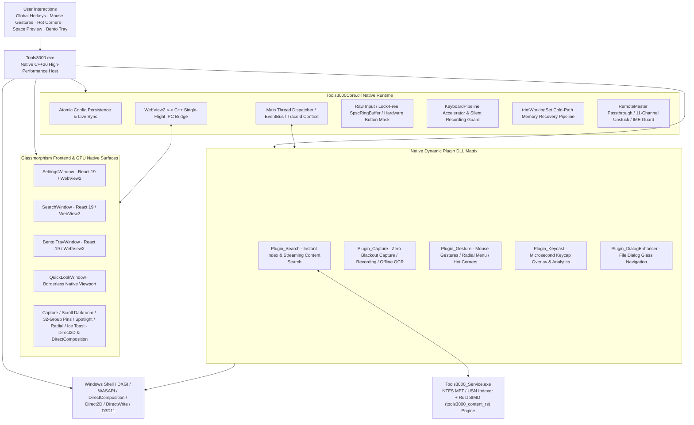

<div align="center">


# Tools3000

World-Class High-Performance Open-Source Productivity Suite for Windows 10/11 and Windows Server (v1.0.0 Official Release)

[简体中文](README.md) · [English](README.en.md)

[](https://github.com/yuan278501381/Tools3000/releases/latest)
[](LICENSE)
[](#system-requirements)
[](CMakeLists.txt)
[](src/service/rust_content/src/lib.rs)
[](ui/package.json)
[](ui/package.json)

</div>

Tools3000 is a **world-class, high-performance native desktop productivity toolkit** engineered specifically for Windows daily office work, creative design, software engineering, and power users. Say goodbye to bloated Electron runtimes, sluggish performance, and fragmented utilities. Powered by a **C++20 native microkernel + Rust SIMD full-text engine + Direct2D/DirectComposition hardware-accelerated rendering**, Tools3000 unifies **File & Content Search, Mouse Gestures, Hot Corners, Screen Capture & Recording, Keycast Keystroke Overlay & Analytics, Cursor Effects & Presentation, File Dialog Enhancer, and Remote Assistance Boost** into one rock-solid, ultra-lightweight suite.

---

## Core Feature Matrix (In Client Navigation Order)

Every feature module in Tools3000 is crafted around genuine high-frequency desktop friction points and natural human ergonomics:

```text
┌─────────────────────────────────────────────────────────────────────────────────┐
│ [01] File & Content Search -> Alt+Space instant lookup, 2.75M files & SIMD text │
│ [02] Global Mouse Gestures -> Right-click/wheel/edge swipes & radial menu       │
│ [03] Screen Hot Corners    -> Blind-flick to 4 corners: desktop, lock & task view│
│ [04] Capture & Recording   -> Zero-blackout, PixPin markup, scroll crop, 32 pins│
│ [05] Keycast & Analytics   -> Glassmorphic keycaps, typing mute & local heatmap │
│ [06] Cursor Effects & FX   -> Double-tap Ctrl spotlight, ripples & motion trail │
│ [07] File Dialog Enhancer  -> Top glass bar on Save/Open, 1-click Explorer jump │
│ [08] Remote Assist Boost   -> Hotkey tunneling, stuck key flush & touchpad guard│
└─────────────────────────────────────────────────────────────────────────────────┘
```

---

## User-Centric Scenarios & Feature Deep Dive

### 1. File & Content Search
> **"Looking for a 6-month-old document or a buried configuration line across 2.75M+ files? Press `Alt + Space` and type keywords or initials—results appear in a blink with zero flicker."**

<p align="center">
  
</p>

- **Sub-Millisecond NTFS Lookup Across Millions of Files**: Press `Alt + Space` anytime to summon the Search Center. Powered by direct NTFS MFT reading, real-time USN Journal incremental updates, and **separable 64-bit directory bitmasks + giant posting-list pre-filtering**, multi-keyword cross-directory queries across 2.75M real files complete in **20~27 ms**;
- **Best-Match Priority & Lock-Free Bloom Frecency Ranking**: Multi-keyword and multi-extension union queries (e.g., `*.log *.txt log`) isolate extension-only false hits, prioritize filename stem coverage, and integrate a lock-free 64-bit dual-hash Bloom `RunHistorySnapshot` to boost frequently opened files (`[Opened N times]`) to the top;
- **Authentic Windows Explorer Native Icons**: Extracts real per-instance embedded icons for `.exe`, `.lnk`, `.ico`, `.cur`, `.ani`, `.scr`, `.cpl`, and `.msc` files alongside high-DPI system file association icons—matching Windows Explorer 100% and minimizing visual cognitive load;
- **C++ SEH + Rust SIMD Deep Document Content Search (`content:`)**: Built-in zero-dependency Rust SIMD full-text engine (`tools3000_content_rs`) protected by MSVC `__try/__except` page-fault guards penetrates Word, Excel, PowerPoint, PDF (`ToUnicode` CMaps), AutoCAD DXF, and source code files. Streams hits in 220ms time-slices (~160ms first paint) with locked row heights for **zero list flicker**, real-time percentage progress, 1-click `[Stop]`, and 1-click line badge (`L66`) code copy;
- **Everything-Grade Query Syntax**: Supports wildcards (`*.pdf`), multi-extension unions (`*.log *.txt` or `ext:jpg;png`), closed-range and semantic size filters (`size:1mb..50mb`, `size:empty`, `size:tiny`, `size:small`, `size:medium`, `size:large`, `size:huge`), date modified filters (`dm:today`, `dm:thisweek`, `dm:2026-10`), logical exclusions (`!node_modules`), and regular expressions (`regex:`);
- **QuickLook Space Preview & `DEMAND_START` Lifecycle Contract**: Press `Space` on any result to preview documents, rendered Markdown, syntax-highlighted code, or high-resolution images in place; the search service strictly follows `DEMAND_START`—never auto-starting at boot, waking only when explicitly summoned by the user.

---

### 2. Global Mouse Gestures
> **"Browsing technical docs and juggling windows all day? Never fling your wrist across the entire monitor just to click a tiny Back or Close button."**

<p align="center">
  
</p>

- **Right/Middle-Button Strokes, Wheel & Screen-Edge Actions**: Hold the right (or middle) mouse button and flick to go back, go forward, close tab, restore tab, or pin a window on top; scroll along screen edges or taskbar to adjust system volume or switch virtual desktops;
- **8~16 Sector Radial Menu & Flight Compass**: Summon a hardware-accelerated Direct2D radial wheel menu and release to trigger, or display a real-time directional compass HUD while drawing;
- **Instant Execution (`instantExecute`) & Silent Mode (`silentToast`)**: Trigger high-frequency actions (such as image paging or volume stepping) the microsecond a gesture threshold is met without waiting for button release;
- **Per-Application Scopes & Fullscreen Auto-Bypass**: Customize gesture rules by process name or window class, automatically yielding during fullscreen 3D games, movies, or active capture/pin overlays.

---

### 3. Screen Hot Corners
> **"Flick your mouse blindly into any of the four physical screen corners to show the desktop, open Task View, or lock your workstation."**

- **Zero-Aim Blind Corner Activation**: Push the cursor into the Top-Left, Top-Right, Bottom-Left, or Bottom-Right corner to trigger custom system commands, hotkeys, or scripts;
- **Ergonomic Office Presets**: Top-Right toggles desktop visibility (`Win + D`), Top-Left opens Windows Task View (`Win + Tab`), Bottom-Left immediately locks the screen (`Win + L`);
- **Anti-Jitter Dwell Filter & Fullscreen Bypass**: Built-in dwell delay prevents accidental activation during fast cursor sweeps and pauses automatically during fullscreen games or video playback.

---

### 4. Screen Capture, Long Scroll Capture, Pinning & HD Recording
> **"Zero-blackout window snapping, PixPin/Figma-grade annotations, Smartisan-style lossless scroll-capture cropping, 32 gemstone pin groups, and glow-bordered HD recording."**

- **DirectX Zero-Blackout Capture & PixPin/Figma-Grade Annotation System**:
  - **Smart Window Snapping & Corner Aesthetics**: Press `F1` to freeze the screen with zero blackout, auto-snapping window bounds and penetrating child controls with the mouse wheel; features **Figma-style proximity-fade (`smoothstep`) corner radius handles** and high-DPI anti-aliased curvature cursors;
  - **Circular/Elliptical Magnifier & 4 Callout Lead Styles**: Create circular or freely stretched elliptical magnifiers (with distortion-free optical zoom inside) paired with **Double-Tangent (`Tangent`), Elbow (`Elbow`), Dashed (`Dashed`), or Single-Line (`Single`)** callout leads;
  - **6 Arrow Styles, Smooth Curves & Dual-Channel Fill/Stroke**: Includes standard, thin, swallowtail, bidirectional, **3D Campaign (`CampaignMarch`)**, and **Double-Track (`MarchDoubleTrack`)** arrows, 1-click polyline/Bezier curve toggling, **10 independent start/end cap styles**, and **dual-channel Fill + independent Stroke (`0~12px`)** control across rectangles, ellipses, arrows, and text;
  - **Glass Capsule Text Labels & Self-Healing Step Badges**: High-contrast glass text backing and numbered step badges (`1, 2, 3`) that automatically renumber when a middle step is deleted, plus a 5-theme Share Beautifier frame.
- **Smartisan-Style Long Scroll Capture & Lossless Head/Tail Crop Studio**:
  - Smoothly stitches web pages, documents, code, and chat logs; clicking "Done" enters a fullscreen darkroom studio powered by `4096px` tiled GPU textures;
  - Features **non-destructive top/bottom/left/right crop rulers** (cropped regions remain visible under a dim overlay and can be dragged back 100% losslessly at any time), edge auto-scroll, **interactive right-side Minimap crop sync**, and in-place annotations.
- **32 Gemstone Desktop Pin Groups & Offline OCR**:
  - Pin screenshots, clipboard images, or text on top of your desktop (`F3`) with up to **32 custom pin groups** (12-hue gemstone palette, porcelain-white top group bar, Bento tray drawer grouping, and `Ctrl+1..9` / `Alt+1..9` group filtering);
  - Built-in offline Windows OCR engine lets you drag-select text across lines in any pin or OCR window and copy with `Ctrl+A`/`Ctrl+C`—100% offline with zero cloud uploads.
- **Hollow Breathing-Border HD Recording & 2-Pass GIF**:
  - Displays a hollow breathing border and auto-avoiding floating control bar around the recording region; supports independent system audio/mic mute, frame snapshots, power-loss safe fragmented MP4 muxing, and high-fidelity 2-Pass adaptive palette GIF export.

---

### 5. Keycast & Local Keystroke Analytics
> **"Recording tutorials or presenting live? Crisp glassmorphic keycaps float in the corner while continuous typing stays silent, backed by a 100% local daily keystroke heatmap."**

<table>
  <tr>
    <td width="50%" align="center">
      <br />
      <sub>Visual global hotkey configuration & real-time conflict health check</sub>
    </td>
    <td width="50%" align="center">
      <br />
      <sub>Local keyboard heatmap & activity trend dashboard (100% local SQLite storage)</sub>
    </td>
  </tr>
</table>

- **DirectWrite Exact Glyph Measurement & High-Contrast Keycaps**: Renders translucent glass keycaps with high-contrast combo counters (`Ctrl + C x3`) and adaptive widths that never truncate long shortcuts;
- **Smart Shift-Symbol Folding & Typing Silence**: `Shift + 8` folds cleanly into `*`; in Smart Shortcut mode, continuous prose and IME typing stay silent while functional modifier shortcuts appear immediately;
- **100% Local Keyboard & Mouse Analytics**: Tracks daily keystrokes, mouse clicks, cursor travel distance, and full-keyboard heatmap distributions locally in SQLite with 1-click daily reset.

---

### 6. Cursor Effects & Presentation
> **"Sharing your screen in a conference room or online meeting? Double-tap `Ctrl` to center everyone's attention on your cursor."**

<p align="center">
  
</p>

- **Double-Tap Ctrl / Shake Mouse Spotlight**: Softly dims the background while a smooth spotlight follows your cursor, with configurable auto-fade timeout;
- **Color-Coded Click Ripples & Luminous Cursor Trail**: Uses a 100~300px dynamic bounding-box micro-viewport and 256-entry LUT rendering, cutting GPU overhead by 99%;
- **Focus Assist Geometric Avoidance (`FocusAssistAvoidance`)**: Shrinks the spotlight dim overlay by 1 physical pixel (`vw - 1, vh - 1`) so Windows Shell never mistakes it for a fullscreen game or triggers Do Not Disturb notifications.

---

### 7. File Dialog Enhancer
> **"When clicking Open or Save As in any app, jump in one click to the folder currently open in File Explorer."**

- **Top Glass Navigation Capsule Bar**: Automatically attaches a floating glass bar to standard Windows file dialogs (`#32770`) while avoiding titlebar caption buttons, letting you jump to open Explorer folders or favorites in one click;
- **Per-Application Path Memory**: Remembers recent directories independently for VS Code, browsers, Photoshop, and other host processes without crosstalk.

---

### 8. Remote Assistance Boost
> **"Working remotely via mstsc, Sunlogin, ToDesk, AnyDesk, or RustDesk? Tunnel system hotkeys, flush stuck modifier keys in 1 click, and keep 4-finger touchpad swipes rock-solid."**

- **System Hotkey Tunneling**: Passes `Alt + Tab`, `Win + E`, `Win + R`, and other system shortcuts directly to the remote session while intelligently letting local virtual-desktop shortcuts (`Win + Ctrl + Left/Right/D/F4`) switch local desktops;
- **RustDesk Precision Touchpad 4-Finger Swipe Guard**: Tracks physical mouse button masks (`m_hardwareButtonMask`) and pairs delayed gesture events so Windows Precision Touchpad 4-finger desktop swipes never freeze or lose responsiveness over RustDesk/ToDesk;
- **11-Channel Stuck Modifier Emergency Flush & Smart English IME**: Rapidly double-tap Right-`Ctrl` (or press `Ctrl + Alt + Backspace`) to flush stuck `Ctrl`/`Alt`/`Shift`/`Win` states without stealing focus; automatically switches to `ENG (0409)` inside remote windows and restores your local IME when leaving.

---

## Physical Memory Consumption Benchmark

Powered by a modern C++20 native microkernel and **cold-path physical working-set trimming (`trimWorkingSet`)**, Tools3000 delivers all eight core modules with minimal resource footprint:

```text
Physical Working Set RAM Comparison (Lower is Better):
┌─────────────────────────────────────────────────────────────────────────────┐
│ [High]   Typical Electron Productivity Apps (300 MB ~ 800 MB)               │
│          ██████████████████████████████████████████████████████████ 600 MB  │
├─────────────────────────────────────────────────────────────────────────────┤
│ [Medium] Traditional C# / .NET Desktop Tools (120 MB ~ 200 MB)              │
│          ████████████████ 160 MB                                            │
├─────────────────────────────────────────────────────────────────────────────┤
│ [Light]  Tools3000 Unified Microkernel (All 8 modules active: 20 ~ 40 MB)   │
│          ███ 28 MB                                                          │
├─────────────────────────────────────────────────────────────────────────────┤
│ [Silent] Tools3000 Daily Tray Standby (Only ~11 MB RAM, 0.0% idle CPU)      │
│          █ 11 MB                                                            │
└─────────────────────────────────────────────────────────────────────────────┘
```

| Category & Tech Stack | Daily Standby RAM | Heavy Peak RAM | Post-Task Recovery | Root Cause Analysis |
| :--- | :---: | :---: | :---: | :--- |
| **Electron Launchers / Toolboxes** | **300 MB ~ 500 MB** | 800 MB ~ 1.5 GB | Retained in V8 heap | Bundles a full Chromium renderer and Node.js runtime permanently in memory. |
| **Traditional C# / .NET Tools** | **120 MB ~ 180 MB** | 300 MB ~ 500 MB | Waits for GC cycles | Relies on managed CLR heap and garbage collection cycles. |
| **Tools3000 (C++20 + Rust Microkernel)** | **`~11 MB`** | **`20 ~ 40 MB`** | **`< 0.5 s` instant trim** | Zero runtime overhead; triggers cold-path `trimWorkingSet()` immediately after capture, recording, scroll-stitching, or OCR, with zero page faults on 1000Hz input hot paths. |

---

## Hardcore Tech Stack & Microkernel Architecture



### Core Engineering & Architecture Highlights:
1. **Modern C++20 Microkernel + Rust SIMD Hybrid Architecture**: Host and plugins are built in modern C++20 with unified cross-DLL singleton exports and `TraceId` propagation, paired with a zero-dependency Rust SIMD static library (`tools3000_content_rs`) for multi-core vectorized full-text search;
2. **1000Hz Lock-Free Input Pipeline & Accelerator Governance (`KeyboardPipeline`)**: Microsecond input dispatch via `WH_KEYBOARD_LL`, `WH_MOUSE_LL`, Raw Input, and cache-aligned `SpscRingBuffer`; atomic overlay visibility flags eliminate `FindWindowW` kernel locks inside hooks; `KeyboardPipeline` blocks `SC_KEYMENU`/`WM_HELP` and silences global hotkeys during shortcut recording;
3. **Direct2D / DirectComposition Hardware Composition & Self-Healing**: Automatic recovery from `D2DERR_RECREATE_TARGET` and `DXGI_ERROR_ACCESS_LOST`; Universal Rounded Corners Dual Insurance (`applyUniversalRoundedCorners`) guarantees crisp rounded corners across Windows 11, Windows 10, Windows Server 2019/2022/2025, and RDP sessions;
4. **Single-Weight Lossless Noto Sans SC Typography**: Embeds a single `1.10MB` `Noto Sans SC 500 Medium` font file with `local('Source Han Sans SC')` reuse—zero system font directory pollution, zero uninstall residue, and automated CI gates enforcing font size (`>= 12px`) and weight (`>= 500`);
5. **Rigorous Automated Quality Gates**: Guarded by **640** C++ GoogleTest unit tests, **157** frontend Vitest unit tests, a 7-stage bilingual i18n parity gate, a 6-stage `TraceId` logger gate, CSS variable checks, typography checks, and `trimWorkingSet` cold-path checks.

---

<a id="system-requirements"></a>
## System Requirements & Cross-Architecture Support

- **Operating System**: Windows 10 (1809+) / Windows 11 / Windows Server 2019 / 2022 / 2025;
- **Instruction Set Architecture**: Native support for **x64** (Intel / AMD) and **ARM64** (Surface Pro / Qualcomm Snapdragon Windows on ARM);
- **Runtime**: Microsoft Edge WebView2 Runtime (built into Windows 10/11; installer guides setup if missing);
- **Graphics**: DirectX 11 / Direct2D hardware acceleration (gracefully adapts to integrated GPUs and Remote Desktop).

---

## Downloads & Installation

Visit the [GitHub Releases Page](https://github.com/yuan278501381/Tools3000/releases/latest) to download the official release assets:

| File Name | Architecture & Platform | Description |
| :--- | :--- | :--- |
| **`Tools3000-Setup.exe`** | Windows 10/11/Server (x64) | Official recommended standard installer (auto-start, demand-start search service, in-place upgrade) |
| **`Tools3000-v1.0.0-Setup.exe`** | Windows 10/11/Server (x64) | Version-tagged official archive installer |
| **`Tools3000-Portable-x64.zip`** | Windows 10/11/Server (x64) | Green portable archive (extract and run; keeps all configs & databases in local folder) |
| **`Tools3000-v1.0.0-win-x64-portable.zip`** | Windows 10/11/Server (x64) | Version-tagged official green portable archive |
| **`SHA256SUMS.txt`** | All Assets | SHA-256 integrity verification manifest for all release binaries |

> **[TIP] Default Hotkey Quick Reference** (all customizable in Settings with real-time conflict detection):
> - **Summon / Hide Instant Search**: `Alt + Space` (press `Space` on any search result for instant QuickLook preview)
> - **Region Capture & Markup**: `F1` (Pin screenshot: `F3`; Long Scroll Capture & Recording accessible from capture toolbar or custom hotkeys)
> - **Summon Cursor Spotlight**: Rapidly double-tap `Ctrl`
> - **Remote Stuck Modifier Emergency Flush**: Rapidly double-tap Right-`Ctrl` or press `Ctrl + Alt + Backspace` inside a remote session

---

## Privacy & Security Commitment (Privacy First)

- **100% Local Execution**: File indexing, full-text search, offline OCR text recognition, screenshot annotation, screen recording, and keystroke analytics run entirely on your local machine;
- **Zero Telemetry & Zero Cloud Uploads**: No user accounts, no background network analytics, and zero collection or uploading of user files or keystrokes—100% functional in completely air-gapped networks;
- **Authenticated Local IPC**: Client and local index service communicate over named pipes protected by cryptographic session tokens and strict Windows security descriptors (SDDL).

---

## Build from Source

### Prerequisites
- Windows 10/11 or Windows Server (x64 / ARM64)
- Visual Studio 2022 / Build Tools (with "Desktop development with C++" workload)
- Rust Toolchain (`rustc` 1.75+, for building the `tools3000_content_rs` SIMD static library)
- CMake 3.25+, PowerShell 7+ (`pwsh`), Git 2.40+, Node.js 20+

### One-Click Build, Test & Package
```powershell
# 1. Clone the repository
git clone https://github.com/yuan278501381/Tools3000.git
cd Tools3000

# 2. Build frontend, Rust SIMD kernel, C++20 core & plugins, run all quality gates, and package installers
pwsh deploy.ps1
```

Once completed, portable artifacts are placed in `deploy_dist\` and `Output\Tools3000-Portable-x64.zip`, and the standard installer is generated at `Output\Tools3000-Setup.exe`.

---

## Developer & Advanced Documentation

- [Tools3000 v1.0.0 Official Release Notes](docs/RELEASE_NOTES_v1.0.0.md)
- [Memory Trimming & Performance Tuning](docs/performance-tuning.md)
- [Performance Baseline Protocol](docs/performance-baseline.md)
- [Native C++ Plugin Development Guide](docs/plugin-development.md)
- [Lua Automation Scripting API Reference](docs/api/lua-api.md)
- [Versioning & Release Pipeline Guide](docs/versioning.md)
- [Automated Authenticode Signing Guide](docs/release-signing.md)

---

## License & Attribution

Licensed under the **[MIT License](LICENSE)**.

* **Author**: **`Yy1 (yuan278501381)`** (GitHub: [@yuan278501381](https://github.com/yuan278501381))
* **Repository**: [https://github.com/yuan278501381/Tools3000](https://github.com/yuan278501381/Tools3000)
* **Copyright**: `Copyright (c) 2026 Yy1 (yuan278501381) & Tools3000 contributors`
