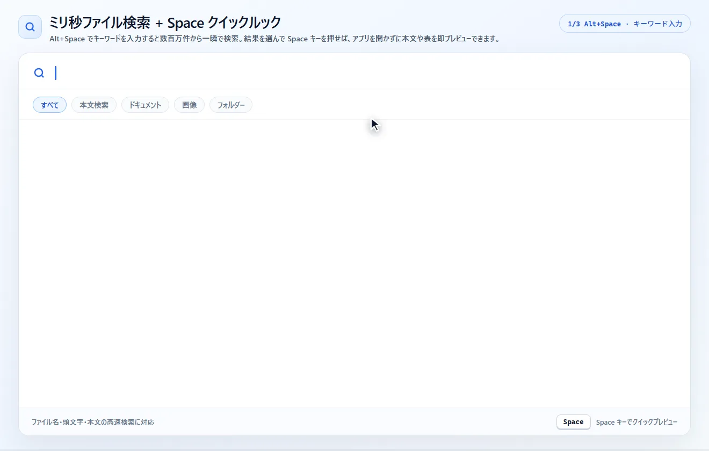
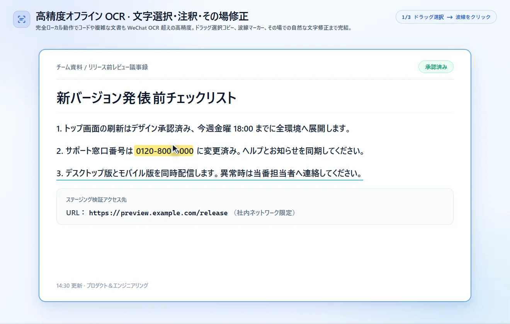
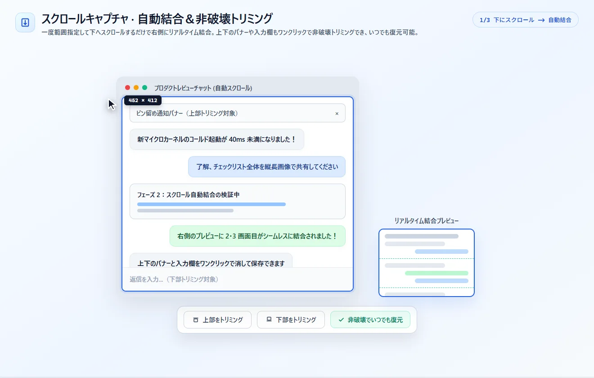
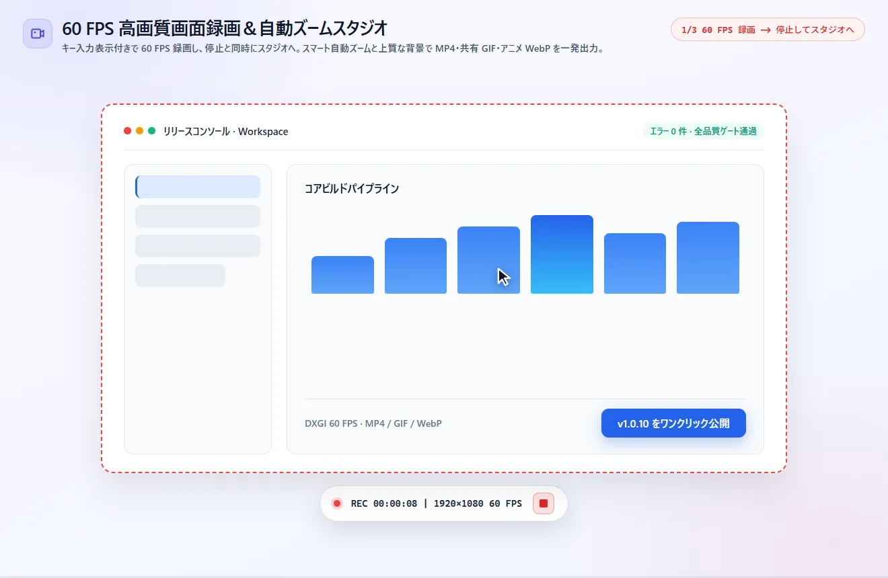
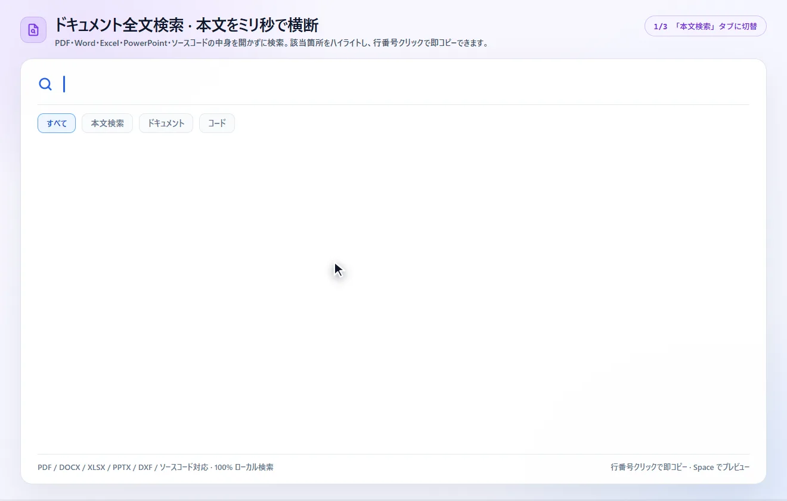
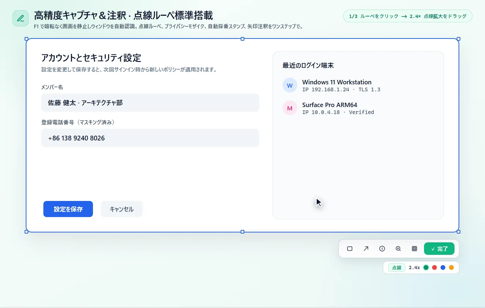
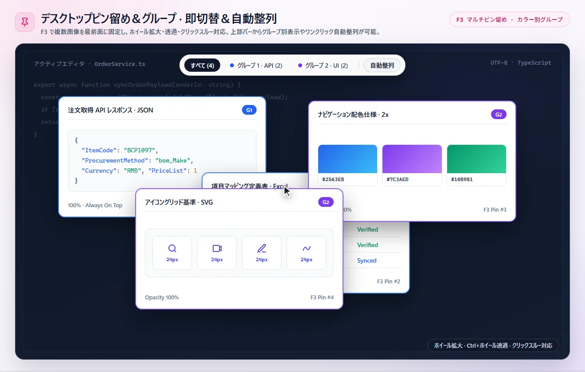
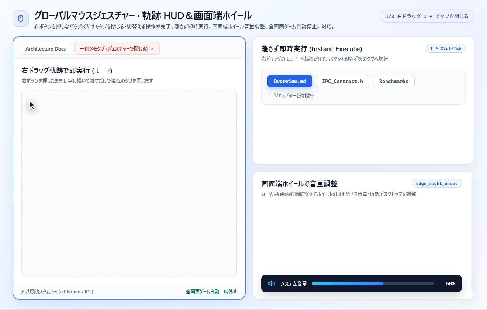

<div align="center">


# Tools3000

**軽量・ネイティブな Windows オールインワン生産性ツールスイート**

[简体中文](README.md) · [繁體中文](README.zh-TW.md) · [English](README.en.md) · **日本語** · [한국어](README.ko.md) · [Русский](README.ru.md) · [Português (Brasil)](README.pt-BR.md) · [Español](README.es.md)

[](https://github.com/yuan278501381/Tools3000/releases/latest)
[](https://github.com/yuan278501381/Tools3000/stargazers)
[](https://github.com/yuan278501381/Tools3000/releases)
[](#ダウンロードとインストール)
[](#ダウンロードとインストール)
[](LICENSE)

**[最新版をダウンロード](#ダウンロードとインストール)** · [機能一覧](#機能一覧) · [デモ](#アニメーションデモ) · [セキュリティと検証](#セキュリティ検証と信頼性) · [開発のきっかけ](#開発のきっかけ) · [置き換え対象一覧](#置き換え対象一覧) · [共創・フィードバック](#共創とフィードバック) · [開発者ガイド](docs/DEVELOPER.md)

</div>

<br />

Tools3000 は、日々の業務で頻繁に使う **高速ファイル検索、ドキュメント全文検索、スクロールキャプチャ、高精度スクリーンショット注釈、デスクトップピン留め＆グループ管理、高精度オフライン OCR、画面録画（自動ズームスタジオ・MP4 / WeChat 向け GIF / アニメーション WebP 書き出し対応）、グローバルマウスジェスチャー** を 1 つのネイティブ Windows アプリに統合しました。待機メモリは約十数 MB、100% オフラインで動作し、個人 PC（`x64` / `ARM64`）から Windows Server のマルチユーザー同時利用環境まで幅広く対応します。

---

## 機能一覧

<p align="center">
  
</p>

---

## アニメーションデモ

<table>
  <tr>
    <td width="50%" align="center" valign="top">
      <br />
      <sub><b>高速ファイル検索 ＆ クイックプレビュー</b> · 数百万ファイルを瞬時に検索し、Space キーでそのまま中身を確認</sub>
    </td>
    <td width="50%" align="center" valign="top">
      <br />
      <sub><b>高精度オフライン OCR ＆ 注釈</b> · 完全ローカル動作。ドラッグコピー・波線マークアップ・その場文字修正に対応</sub>
    </td>
  </tr>
  <tr>
    <td width="50%" align="center" valign="top">
      <br />
      <sub><b>スクロールキャプチャ</b> · 自動スクロールでシームレス結合、リアルタイムプレビューと上下の非破壊トリミング</sub>
    </td>
    <td width="50%" align="center" valign="top">
      <br />
      <sub><b>画面録画 ＆ 自動ズームスタジオ</b> · 画面録画・スマート自動ズーム・MP4 / GIF / アニメーション WebP 出力</sub>
    </td>
  </tr>
  <tr>
    <td width="50%" align="center" valign="top">
      <br />
      <sub><b>ドキュメント全文検索</b> · PDF / Word / Excel / ソースコード本文を横断検索し、行番号クリックで即コピー</sub>
    </td>
    <td width="50%" align="center" valign="top">
      <br />
      <sub><b>精密スクリーンショット注釈</b> · 要素自動吸着、破線光学ルーペ、モザイク、自動連番スタンプ</sub>
    </td>
  </tr>
  <tr>
    <td width="50%" align="center" valign="top">
      <br />
      <sub><b>ピン留め ＆ グループ管理</b> · F3 で最前面固定、カラーグループ絞り込みとワンクリック自動整列</sub>
    </td>
    <td width="50%" align="center" valign="top">
      <br />
      <sub><b>グローバルマウスジェスチャー</b> · 右ドラッグでタブ終了、ボタンを離さず即時切替、画面端ホイール音量操作</sub>
    </td>
  </tr>
</table>

| モジュール | 主な体験 |
| :--- | :--- |
| **高速ファイル検索** | `Alt + Space` で全ドライブの数百万ファイルをミリ秒単位で検索。結果を選んで `Space` を押すだけで、画像・Office・PDF・コード・CAD・PSD・3D モデルをアプリ起動なしで即プレビューできます。 |
| **ドキュメント全文検索** | `content:` プレフィックスで Word・Excel・PDF・PowerPoint・CAD・ソースコードの本文を直接検索。該当箇所をハイライト表示し、行番号クリックで該当行をワンクリックコピーできます。 |
| **スクロールキャプチャ** | 長い Web ページやチャット履歴を自動スクロールでシームレスに結合。右側でリアルタイムに確認でき、上下の不要部分を非破壊トリミング（いつでもドラッグで復元可能）や長画像への直接注釈に対応します。 |
| **精密スクリーンショット注釈** | `F1` でウィンドウや UI 要素へ自動吸着。ピクセル単位のカラーピッカー、破線光学ルーペ、6 種類の矢印、自動再採番スタンプ、モザイク、共有フレームを備えています。 |
| **ピン留め ＆ グループ管理** | `F3` でキャプチャやクリップボード画像を常に最前面へ固定（ホイール拡大縮小・透過度調整・クリックスルー対応）。カラー別グループで管理し、上部フローティングバーから表示切替やワンクリック自動整列が可能です。 |
| **高精度オフライン OCR** | 100% ローカル処理の高精度文字認識。コード・JSON・高密度レイアウトに強く、ピン留め画像上での直接ドラッグコピー、波線・マーカー注釈、その場での文字修正、表・QR コード抽出に対応します。 |
| **画面録画 ＆ 自動ズームスタジオ** | キー・クリック表示付きの画面録画後、そのままスタジオ画面へ移行。クリック箇所へのスマート自動ズーム、厳選背景、波形タイムライン編集に対応し、**MP4**・**軽量 GIF（WeChat 等向け）**・**高品質アニメーション WebP** をワンクリックで書き出せます。 |
| **グローバルマウスジェスチャー** | 右クリックドラッグだけでタブ切替・戻る・ウィンドウ閉じを完結。ホールド中の即時実行、画面端でのホイール音量調整、アプリ別カスタムルール、フルスクリーンゲーム自動回避に対応します。 |
| **プレゼン演出 ＆ リモート支援** | 画面共有向けキー入力表示と `Ctrl` 2 回押しスポットライト、標準「開く / 保存」ダイアログのクイック移動バー、mstsc・RustDesk・ToDesk・AnyDesk などのリモート環境向けショートカット透過と修飾キー固着解除を備えます。 |

---

## ダウンロードとインストール

### 方法 1：パッケージマネージャー（おすすめ）

- **Scoop（すぐ利用可能・`data/` 永続化による完全ポータブル構成でアップデート時も設定維持）**：

```powershell
scoop bucket add tools3000 https://github.com/yuan278501381/Tools3000
scoop install tools3000/tools3000
```

- **Winget（公式スキーマ準拠マニフェスト同梱）**：[`packaging/winget/`](packaging/winget/) に `winget validate` 検証済みの `Yy1.Tools3000` マニフェストを自動生成しています。`microsoft/winget-pkgs` 登録後は `winget install Yy1.Tools3000` で直接導入できます（ローカル検証は `winget install -m packaging/winget`）。

### 方法 2：GitHub Releases から直接ダウンロード

最新バージョンは **[GitHub Releases](https://github.com/yuan278501381/Tools3000/releases/latest)** からダウンロードできます：

- **標準インストーラー（`Tools3000-Setup.exe`）** — 日常利用におすすめ。コンポーネント選択、自動起動、シームレスな上書きアップデートに対応します。
- **ポータブル版（`Tools3000-Portable-x64.zip`）** — 解凍するだけで即利用可能。設定やデータはすべて展開先フォルダー内に保存されます。
- **チェックサム（`SHA256SUMS.txt`）** — 各リリースの SHA-256 整合性検証ハッシュを同梱しています。

> **動作環境**：Windows 10（1809 以降）/ Windows 11 / Windows Server 2019–2025。ソース・ビルド基盤は `x64`・`ARM64` ネイティブ対応（GitHub Releases では現在 `x64` ビルド済みインストーラー／ポータブル版を配布中。ARM64 環境は[開発者ガイド](docs/DEVELOPER.md)に沿ってネイティブビルド、または `x64` 版を直接実行可能）、標準の Microsoft Edge WebView2 Runtime が必要です。アプリ UI は日本語を含む 8 言語にネイティブ対応し、既定で OS 言語に自動追従します。

### セキュリティ検証と信頼性

透明性と安心感を最優先し、4 つの検証手段を用意しています（詳細は **[SECURITY.md](SECURITY.md)**）：

1. **SHA-256 整合性チェック**：PowerShell でローカルのハッシュを算出し `SHA256SUMS.txt` と照合できます：
   ```powershell
   Get-FileHash .\Tools3000-Setup.exe -Algorithm SHA256
   ```
2. **VirusTotal 公開スキャン確認**：**[VirusTotal](https://www.virustotal.com/)** に SHA-256 を入力する（または今後の Release ノート記載の直リンクを開く）ことで、70 以上のセキュリティエンジンの結果を公開確認できます。
3. **Windows Defender SmartScreen 警告について**：個人 OSS で商用 EV 署名／公的信頼署名（SignPath 等を準備中）が未適用、または新バージョン直後のレピュテーション蓄積前は「Windows によって PC が保護されました」と表示される場合があります。SHA-256 と VirusTotal を確認のうえ **「詳細情報 -> 実行」** で続行するか、**[開発者ガイド](docs/DEVELOPER.md)** からソースビルドしてください。
4. **SPDX SBOM 同梱**：インストーラーおよびポータブル版には依存関係一覧 `SBOM.spdx.json` と `THIRD_PARTY_NOTICES.txt` を同梱しています。

---

## 開発のきっかけ

私は **Everything** を 10 年以上愛用してきました。スクリーンショットは **QQ・WeChat の内蔵キャプチャ** から始まり、注釈が便利な **FastStone Capture** へ、さらに画面上にピン留めできる **Snipaste** へと移り、スクロール撮影・虫眼鏡注釈・OCR が必要になって **PixPin** へ。マウスジェスチャーは **WGestures** から **WGestures 2** を使い、画面録画ツールもいくつも乗り換え、途中で Microsoft **PowerToys** も試してみましたが、どうしても日常の必須機能がいくつか足りず、結局また複数の常駐アプリに戻ってしまいました。

ある日 Windows のタスクトレイに並ぶいくつもの常駐アイコンを眺めながら、**「これらが 1 つのアプリにまとまればいいのに」**と思いました。さらに、PixPin の OCR は精度・速度ともに WeChat に及ばないと感じており、WGestures もある日から画面に小さなテキストボックスが居座って再起動しないと消えない現象に悩まされていました。AI 時代の追い風もあり、それなら自分で作ろうと手掛けたオールインワンツールが **Tools3000** です。

利用を検討される方へ率直にお伝えすると、公開前に私自身が **4 か月間じっくり実用** しながら段階的に機能を追加し、気づいた不具合を少しずつ潰してきました。最初のうちは旧ツールも起動したまま併用し、うまく動かない時だけ戻して修正を重ねていましたが、**いまではタスクトレイがすっかり静かになり、常駐しているのは Tools3000 だけです。**

もちろん実際の利用環境は千差万別なので、今後も新たな課題は出てくるはずです。AI 時代だからこそ、**[GitHub Issues](https://github.com/yuan278501381/Tools3000/issues) での不具合報告** や **Pull Request による共創** を通じて、一緒に磨き上げていければ嬉しいです。

---

## 置き換え対象一覧

単機能ツールにはそれぞれの深い強みがあります。Tools3000 は日常の 90% 以上を占める高頻度ワークフローを **広告なし・GPL-3.0 ライセンスの 1 つのネイティブアプリ** に集約しつつ、専門ツールが優位な領域も率直に明記しています：

| 定番の単機能ツール | Tools3000 がカバーする日常ワークフロー | 専用ツールの併用をおすすめする場面 |
| :--- | :--- | :--- |
| **Everything** | `Alt + Space` によるミリ秒ファイル名・`content:` 全文検索（オンデマンド起動で常駐負荷ゼロ） | HTTP/ETP ネットワーク共有検索、EXIF 等全プロパティ列ソート、`es.exe` CLI 連携が必要な場合 |
| **QuickLook** | 検索結果上で `Space` を押すだけで画像・Office・PDF・コード・CAD・PSD・3D モデルを即プレビュー | デスクトップやエクスプローラー上の任意のフォルダから直接スペースプレビューしたい場合 |
| **Snipaste / PixPin / Rapture** | `F1` キャプチャ注釈、破線ルーペ、スクロール撮影、`F3` ピン留めグループ、高速オフライン OCR（選択コピー・その場文字修正） | 特殊レガシー GUI の極限スナップ検出や独自 CLI キャプチャ連携に依存する場合 |
| **WGestures / StrokesPlus** | 右ドラッグ操作、ホールド中即時実行、画面端ホイール音量、ホットコーナー、ゲーム自動回避、Lua 拡張 | 複雑なマルチボタン同時押しや高度なウィンドウ領域条件・既存マクロ資産を使う場合 |
| **画面録画ツール（ShareX 等）** | 画面録画、キー表示、自動ズームスタジオ（波形編集＆カーソル自動ズーム）、MP4 / GIF / WebP ワンクリック出力 | 80 以上のクラウド / S3 / FTP 自動アップロードや複雑な FFmpeg 後処理パイプラインを使う場合 |

---

## 基本ショートカット

すべてのショートカットは設定画面から自由に変更でき、競合も自動検知されます：

| ショートカット | 動作 |
| :--- | :--- |
| `Alt + Space` | 高速検索の表示 / 非表示（選択中に `Space` でクイックプレビュー） |
| `F1` | 範囲スクリーンショット ＆ 注釈 |
| `F3` | クリップボードの画像・テキストを最前面にピン留め |
| `Ctrl` を素早く 2 回押し | カーソルスポットライトのオン / オフ |
| `Ctrl + Alt + Backspace` | リモート操作時の修飾キー固着を即時解除（または右 `Ctrl` 2 回押し） |

---

## プライバシーと設計思想

- **完全オフライン**：ファイル索引、全文検索、OCR、注釈、キー・マウス統計まですべてローカル完結。インターネット未接続でも全機能が動作します。
- **ゼロテレメトリ・アカウント不要**：広告ポップアップやログインは一切なく、ファイルや入力データの外部送信も行いません。
- **オンデマンド設計の軽量動作**：各モジュールは個別にオン / オフ可能。検索サービスは呼び出し時のみ起動し、待機負荷を極限まで抑えます。

---

## 共創とフィードバック

- **不具合報告**：**[Bug Report テンプレート](https://github.com/yuan278501381/Tools3000/issues/new?template=bug_report.yml)** から環境と再現手順をお知らせください。
- **機能提案**：**[Feature Request](https://github.com/yuan278501381/Tools3000/issues/new?template=feature_request.yml)** や **[GitHub Discussions](https://github.com/yuan278501381/Tools3000/discussions)** で気軽にアイデアを共有いただけます。
- **Pull Request 共創**：コントリビューションを大歓迎しています。詳細は **[開発者ガイド](docs/DEVELOPER.md)**・**[パッケージ管理ガイド](packaging/README.md)** を参照してください。

---

## ドキュメントとライセンス

- **開発・セキュリティ**：ビルド手順と SDK は **[開発者ガイド](docs/DEVELOPER.md)**、セキュリティポリシーは **[SECURITY.md](SECURITY.md)**、変更履歴は **[GitHub Releases](https://github.com/yuan278501381/Tools3000/releases)** をご覧ください。
- **ライセンス**：**[GNU GPL v3.0](LICENSE)** の下で公開されています（[Windows / WebView2 リンク例外](LICENSE-EXCEPTION.md) 付き）。
- **著作権**：`Copyright (c) 2026 Yy1 (yuan278501381) & Tools3000 contributors` · [@yuan278501381](https://github.com/yuan278501381)
