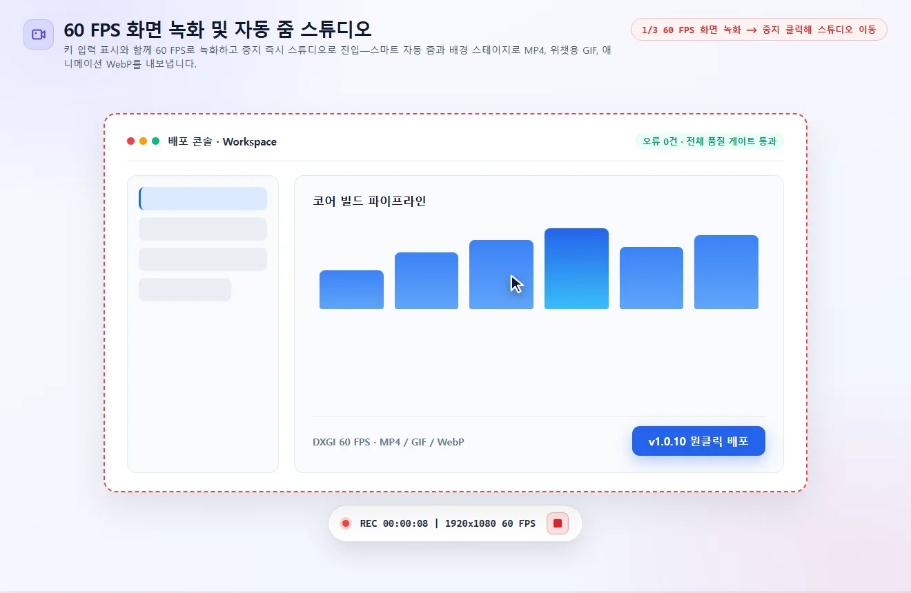
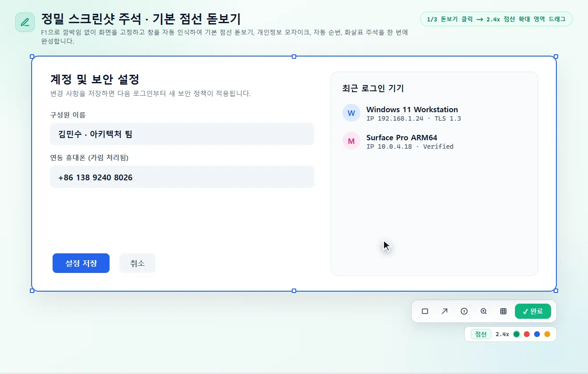
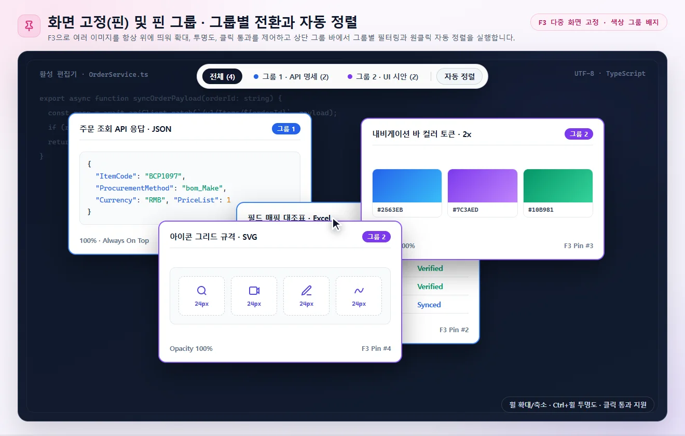
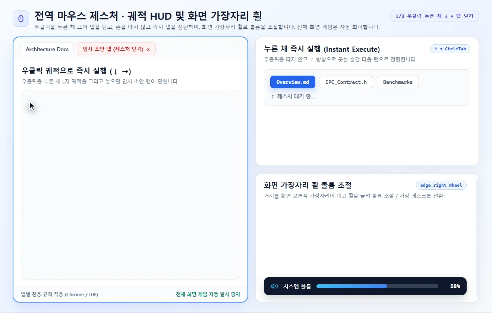

<div align="center">


# Tools3000

**가볍고 빠른 네이티브 Windows 올인원 생산성 도구 모음**

[简体中文](README.md) · [繁體中文](README.zh-TW.md) · [English](README.en.md) · [日本語](README.ja.md) · **한국어** · [Русский](README.ru.md) · [Português (Brasil)](README.pt-BR.md) · [Español](README.es.md)

[](https://github.com/yuan278501381/Tools3000/releases/latest)
[](https://github.com/yuan278501381/Tools3000/stargazers)
[](https://github.com/yuan278501381/Tools3000/releases)
[](#다운로드-및-설치)
[](#다운로드-및-설치)
[](LICENSE)

**[최신 버전 다운로드](#다운로드-및-설치)** · [핵심 기능](#핵심-기능-한눈에-보기) · [기능 데모](#기능-데모) · [보안 및 검증](#보안-검증-및-신뢰-안내) · [개발 계기](#개발-계기) · [대체 가능 목록](#대체-가능-도구-목록) · [참여 및 피드백](#피드백-및-공동-제작) · [개발자 가이드](docs/DEVELOPER.md)

</div>

<br />

Tools3000은 매일 자주 쓰는 **초고속 파일 검색, 문서 본문 검색, 자동 스크롤 긴 캡처, 정밀 스크린샷 주석, 화면 고정(핀) 및 그룹 관리, 오프라인 고정밀 OCR, 화면 녹화(자동 줌 스튜디오 · MP4 / 메신저용 GIF / 애니메이션 WebP 내보내기), 전역 마우스 제스처**를 하나의 네이티브 Windows 앱으로 통합했습니다. 대기 메모리는 약 십수 MB 수준이며 100% 오프라인으로 동작하고, 개인 PC(`x64` / `ARM64`)는 물론 Windows Server 다중 사용자 동시 작업 환경까지 완벽히 지원합니다.

---

## 핵심 기능 한눈에 보기

<p align="center">
  
</p>

---

## 기능 데모

<table>
  <tr>
    <td width="50%" align="center" valign="top">
      <br />
      <sub><b>초고속 파일 검색 및 빠른 미리보기</b> · 수백만 파일을 밀리초 만에 찾고 Space 키로 바로 확인</sub>
    </td>
    <td width="50%" align="center" valign="top">
      <br />
      <sub><b>오프라인 고정밀 OCR 및 주석</b> · 100% 로컬 처리, 드래그 복사 · 물결 밑줄 · 제자리 텍스트 수정 지원</sub>
    </td>
  </tr>
  <tr>
    <td width="50%" align="center" valign="top">
      <br />
      <sub><b>자동 스크롤 긴 캡처</b> · 실시간 자동 이어붙이기와 상하단 무손실 자르기</sub>
    </td>
    <td width="50%" align="center" valign="top">
      <br />
      <sub><b>화면 녹화 및 자동 줌 스튜디오</b> · 화면 녹화, 스마트 자동 줌, MP4 / GIF / 애니메이션 WebP 원클릭 내보내기</sub>
    </td>
  </tr>
  <tr>
    <td width="50%" align="center" valign="top">
      <br />
      <sub><b>문서 본문 검색</b> · PDF / Word / Excel / 소스 코드 내부 본문 검색 및 행 번호 클릭 복사</sub>
    </td>
    <td width="50%" align="center" valign="top">
      <br />
      <sub><b>정밀 스크린샷 주석</b> · 창·요소 자동 스냅, 점선 광학 돋보기, 모자이크, 자동 번호 배지</sub>
    </td>
  </tr>
  <tr>
    <td width="50%" align="center" valign="top">
      <br />
      <sub><b>화면 고정 핀 및 그룹 관리</b> · F3 최상위 고정, 색상 그룹별 표시 전환 및 원클릭 자동 타일 정렬</sub>
    </td>
    <td width="50%" align="center" valign="top">
      <br />
      <sub><b>전역 마우스 제스처</b> · 우클릭 드래그로 탭 닫기, 버튼 떼기 전 즉시 실행, 화면 가장자리 휠 볼륨 조절</sub>
    </td>
  </tr>
</table>

| 모듈 | 주요 기능 |
| :--- | :--- |
| **초고속 파일 검색** | `Alt + Space`로 전체 드라이브의 수백만 개 파일을 밀리초 단위로 검색합니다. 결과에서 `Space`를 누르면 무거운 앱을 열지 않고 이미지, Office, PDF, 코드, CAD, PSD, 3D 모델을 즉시 미리 봅니다. |
| **문서 본문 검색** | `content:` 접두사로 Word, Excel, PDF, PowerPoint, CAD 및 소스 코드 내부 텍스트를 검색하고, 강조된 문맥과 행 번호 클릭 원클릭 복사를 지원합니다. |
| **자동 스크롤 긴 캡처** | 긴 웹페이지, 문서, 메신저 대화를 자동 스크롤로 매끄럽게 이어 붙입니다. 우측 실시간 미리보기, 상하단 무손실 자르기(언제든 드래그로 복원), 긴 이미지 직접 주석을 지원합니다. |
| **정밀 스크린샷 주석** | `F1`으로 창과 UI 컨트롤에 자동 스냅해 캡처합니다. 픽셀 컬러 피커, 기본 점선 광학 돋보기, 6종 화살표, 자동 재정렬 번호, 프라이버시 모자이크, 공유 프레임을 제공합니다. |
| **화면 고정 핀 및 그룹** | `F3`으로 스크린샷이나 클립보드 이미지를 항상 위에 고정하고 휠 확대/축소, 투명도, 클릭 투과를 지원합니다. 색상 그룹으로 묶어 상단 바에서 표시 전환하거나 원클릭으로 깔끔하게 정렬할 수 있습니다. |
| **오프라인 고정밀 OCR** | 완전 오프라인으로 동작하며 코드, JSON, 고밀도 문서에서 높은 정확도를 제공합니다. 고정된 이미지 위에서 바로 드래그 복사, 물결선·형광펜 주석, 제자리 텍스트 수정, 표·QR 코드 추출이 가능합니다. |
| **화면 녹화 및 스튜디오** | 키/클릭 오버레이가 포함된 화면 녹화 후 자동으로 스튜디오로 이동합니다. 클릭 지점 스마트 자동 줌, 프리미엄 배경, 파형 타임라인 편집을 지원하며 **MP4**, **메신저용 GIF(WeChat 최적화 등급)**, **고화질 애니메이션 WebP**로 원클릭 내보내기가 가능합니다. |
| **전역 마우스 제스처** | 우클릭 드래그만으로 탭 전환, 뒤로 가기, 창 닫기를 수행합니다. 키를 떼기 전 즉시 실행, 화면 가장자리 휠 볼륨 조절, 앱별 규칙, 전체 화면 게임 자동 우회를 지원합니다. |
| **프레젠테이션 및 원격 도우미** | 깔끔한 키 입력 표시 및 `Ctrl` 두 번 누르기 스포트라이트, Windows 열기/저장 대화 상자 빠른 이동 바, mstsc·RustDesk·ToDesk·AnyDesk 원격 단축키 패스스루 및 키 걸림 해제 기능을 제공합니다. |
| **Picasa 이미지 뷰어 (Rust 재구현 · 선택)** | Rust + Direct2D로 재구현한 클래식 경량 Picasa 이미지 뷰어입니다(**뷰어 전용 · 원본 Google Picasa 전체 기능 제품군 아님**). **2 MB 미만의 단일 실행 파일이자 외부 런타임 의존성 제로로 Tools3000과 함께 쓰거나 단독 복사해 독립 실행할 수 있습니다.** 설치 시 기본 비활성화되며 활성화하면 41종 지원 이미지 형식을 자동 연결합니다(클래식 폴라로이드 아이콘 및 다크/라이트 대응 Direct2D 설정 UI 포함). 커서 기준 부드러운 줌, 필름스트립 파동, 크로스 디졸브 슬라이드쇼를 충실히 재현하면서도 **원본에 없던 최신 기능을 보완**했습니다: 4K High-DPI(100%–250%+) 선명도, 60–240Hz VSync, WebP / AVIF / HEIC / SVG / QOI / DDS / 카메라 RAW 디코딩, 애니메이션 프레임 제어, 무손실 좌우/상하 반전 및 8개 언어 UI 지원. |

---

## 다운로드 및 설치

### 방법 1: 패키지 관리자 원클릭 설치 (권장)

- **Scoop (지금 바로 사용 가능 · `data/` 영속화로 완전 포터블 모드 및 업그레이드 시 설정 유지)**:

```powershell
scoop bucket add tools3000 https://github.com/yuan278501381/Tools3000
scoop install tools3000/tools3000
```

- **Winget (공식 규격 매니페스트 내장)**: [`packaging/winget/`](packaging/winget/)에 `winget validate` 검증을 통과한 `Yy1.Tools3000` 매니페스트가 자동 유지됩니다. `microsoft/winget-pkgs` 반영 후 `winget install Yy1.Tools3000`으로 바로 설치할 수 있습니다 (로컬 검증: `winget install -m packaging/winget`).

### 방법 2: GitHub Releases 직접 다운로드

**[GitHub Releases](https://github.com/yuan278501381/Tools3000/releases/latest)**에서 최신 버전을 다운로드하세요:

- **표준 설치 프로그램 (`Tools3000-vX.Y.Z-Setup.exe`)** — 일상 사용에 권장되며 선택적 구성 요소, 시작 프로그램 등록, 매끄러운 덮어쓰기 업그레이드를 지원합니다.
- **포터블 압축 파일 (`Tools3000-vX.Y.Z-win-x64-portable.zip`)** — 압축 해제 후 바로 실행할 수 있으며 모든 설정과 데이터가 현재 폴더에 저장됩니다.
- **체크섬 (`SHA256SUMS.txt`)** — 모든 릴리스 아티팩트의 SHA-256 무결성 해시를 제공합니다.

> **시스템 요구 사항**: Windows 10 (1809 이상) / Windows 11 / Windows Server 2019–2025, 소스 및 빌드 파이프라인에서 `x64` 및 `ARM64` 네이티브 지원 (GitHub Releases는 현재 사전 빌드된 `x64` 설치 파일 및 포터블 패키지 제공, ARM64 기기는 [개발자 가이드](docs/DEVELOPER.md)에 따라 네이티브 빌드하거나 `x64` 버전을 바로 실행 가능), 시스템 내장 Microsoft Edge WebView2 Runtime 필요. 앱 UI는 한국어를 포함한 8개 언어를 기본 지원하며 시스템 언어를 자동으로 따릅니다.

### 보안 검증 및 신뢰 안내

완전한 투명성을 위해 4중 검증 절차를 제공합니다 (자세한 내용은 **[SECURITY.md](SECURITY.md)** 참조):

1. **SHA-256 무결성 확인**: 다운로드 후 PowerShell에서 해시를 계산해 `SHA256SUMS.txt`와 대조하세요:
   ```powershell
   Get-FileHash .\Tools3000-vX.Y.Z-Setup.exe -Algorithm SHA256
   ```
2. **VirusTotal 공개 검사**: **[VirusTotal](https://www.virustotal.com/)**에서 파일 SHA-256을 조회하거나(이후 Release 노트에는 바로가기 링크 포함) 70개 이상 보안 엔진 결과를 투명하게 확인할 수 있습니다.
3. **Windows Defender SmartScreen 안내**: 독립 오픈소스 프로젝트가 상용 EV/공인 코드 서명(SignPath / Trusted Signing 준비 중) 적용 전이거나 신규 릴리스 직후에는 "알 수 없는 게시자" 안내가 표시될 수 있습니다. SHA-256 및 VirusTotal 확인 후 **추가 정보 -> 실행**을 선택하거나 **[개발자 가이드](docs/DEVELOPER.md)**에 따라 소스에서 직접 빌드할 수 있습니다.
4. **SPDX SBOM 내장**: 설치 파일과 포터블 패키지 모두 `SBOM.spdx.json` 및 `THIRD_PARTY_NOTICES.txt`를 포함합니다.

---

## 개발 계기

저는 **Everything**을 10년 넘게 사용해 온 오랜 사용자입니다. 스크린샷 도구는 **QQ·위챗 내장 캡처**에서 시작해 주석 기능이 편리한 **FastStone Capture**로 옮겼고, 이어 화면에 고정(핀)할 수 있는 **Snipaste**를 거쳐 스크롤 캡처·돋보기 효과·OCR이 필요해 **PixPin**으로 갈아탔습니다. 마우스 제스처는 **WGestures**에서 **WGestures 2**까지 써 왔으며, 화면 녹화 도구도 수많은 앱을 거쳐 왔고, 중간에 Microsoft **PowerToys**도 써 봤지만 일상에서 꼭 필요한 핵심 기능이 몇 가지 빠져 결국 다시 여러 앱을 함께 띄워 둘 수밖에 없었습니다.

이미지 뷰어도 마찬가지였습니다. 흔한 국산/무료 뷰어는 광고와 번들이 가득했고, Google이 **Picasa**를 종료한 뒤 **FastStone Image Viewer**나 심지어 Everything 제작사의 공식 이미지 뷰어(**Void Image Viewer**)까지 찾아 써 봤지만 Picasa 특유의 경쾌하고 손에 감기는 조작감과 애니메이션에는 못 미쳐 결국 포기하고 Windows 기본 사진 앱으로 버티고 있었습니다. 그래서 Rust + Direct2D로 그리웠던 클래식 경량 Picasa 이미지 뷰어를 직접 재구현하고(2 MB 미만·외부 의존성 제로로 단독 실행 가능), 원본에 없던 4K 고해상도 DPI와 WebP/AVIF/HEIC/SVG/RAW 등 최신 포맷까지 모두 채워 넣었습니다.

어느 날 Windows 시스템 트레이에 줄지어 떠 있는 여러 아이콘을 보며 **“이걸 전부 하나로 합칠 수 있다면 얼마나 좋을까”**라는 생각이 들었습니다. 게다가 PixPin의 OCR은 인식률과 속도 모두 WeChat에 미치지 못했고, WGestures는 어느 날부터 화면에 작은 텍스트 상자가 계속 남아 앱을 재시작해야만 사라지는 문제가 반복됐습니다. AI 시대가 열린 김에 직접 팔을 걷어붙이고 만든 올인원 도구가 바로 **Tools3000**입니다.

새로운 사용자분들께 솔직히 말씀드리면, 공개 전 **4개월 동안 직접 실사용하며** 점진적으로 기능을 추가하고 부딪힌 버그들을 하나씩 고쳐 왔습니다. 초반에는 기존 도구들을 같이 켜 두고 문제가 생기면 잠시 돌아갔다가 수정하곤 했지만, **이제 제 시스템 트레이는 말끔히 비워지고 Tools3000 단 하나만 남아 있습니다.**

물론 실제 데스크톱 환경은 워낙 다양해 앞으로도 새로운 문제가 생길 수 있습니다. AI 시대에는 함께 다듬어 가기가 훨씬 쉬워졌습니다. **[GitHub Issues](https://github.com/yuan278501381/Tools3000/issues)로 문제를 제보**해 주시거나 **Pull Request로 함께 기여**해 주시면 감사하겠습니다.

---

## 하나로 대체하는 도구 목록

단일 전문 도구들은 각자의 깊은 강점이 있습니다. Tools3000은 일상의 90% 이상을 차지하는 고빈도 작업을 **광고 없는 GPL-3.0 오픈소스 네이티브 앱 하나로 통합**하되, 전문 도구가 유리한 영역도 솔직히 안내합니다:

| 기존 단독 도구 | Tools3000이 대체하는 일상 워크플로 | 기존 전문 도구 병행을 권장하는 경우 |
| :--- | :--- | :--- |
| **Everything** | `Alt + Space` 밀리초 파일명 및 `content:` 문서 본문 검색 (온디맨드 구동으로 시작 프로그램 부담 없음) | HTTP/ETP 네트워크 공유 검색, EXIF 전 속성 정렬 또는 `es.exe` CLI 자동화 생태계가 필요한 경우 |
| **Snipaste / PixPin** | `F1` 캡처 주석, 점선 돋보기, 스크롤 캡처, `F3` 그룹 핀 고정, 고속 오프라인 OCR 및 제자리 텍스트 수정 | 특수 구형 GUI 요소 탐지나 전용 CLI 캡처 자동화에 의존하는 경우 |
| **WGestures / StrokesPlus** | 우클릭 드래그 탭/뒤로/닫기, 즉시 트리거, 화면 가장자리 휠 볼륨, 핫 코너, 전체 화면 게임 우회, Lua 확장 | 복잡한 다중 버튼 조합 제스처나 장기간 축적된 매크로 스크립트를 사용하는 경우 |
| **화면 녹화 도구 (ShareX 등)** | 화면 녹화, 키 입력 오버레이, 자동 줌 스튜디오(파형 편집 및 마우스 자동 줌) 및 MP4 / GIF / WebP 원클릭 내보내기 | 80+ 클라우드/S3/FTP 자동 업로드 워크플로나 커스텀 FFmpeg 배치 파이프라인이 필요한 경우 |
| **Picasa 뷰어 / FastStone / Windows 사진** | 2 MB 미만·외부 의존성 제로의 Rust 재구현 경량 Picasa 뷰어(단독 실행 가능) — 클래식 애니메이션에 4K High-DPI, WebP/AVIF/HEIC/SVG/RAW, 무손실 반전 보강 | 원본 Google Picasa의 앨범 라이브러리 관리·얼굴 인식이나 전문 일괄 RAW 현상·편집이 필요한 경우 |

---

## 기본 단축키

모든 단축키는 설정 화면에서 자유롭게 변경할 수 있으며 충돌을 실시간으로 감지합니다:

| 단축키 | 동작 |
| :--- | :--- |
| `Alt + Space` | 초고속 검색 열기 / 닫기 (선택 항목에서 `Space`로 빠른 미리보기) |
| `F1` | 영역 스크린샷 및 주석 |
| `F3` | 클립보드 이미지 또는 텍스트 화면 고정(핀) |
| `Ctrl` 빠르게 두 번 누르기 | 마우스 스포트라이트 켜기 / 끄기 |
| `Ctrl + Alt + Backspace` | 원격 데스크톱 조합 키 걸림 즉시 해제 (또는 오른쪽 `Ctrl` 두 번 누르기) |

---

## 개인정보 보호 원칙

- **100% 오프라인**: 파일 인덱싱, 본문 검색, OCR, 주석, 입력 통계 모두 로컬 기기에서만 실행되며 네트워크가 없어도 모든 기능을 사용할 수 있습니다.
- **텔레메트리 및 계정 없음**: 광고 팝업이나 로그인이 없으며 파일 및 입력 데이터를 외부로 전송하지 않습니다.
- **온디맨드 경량 설계**: 모든 모듈을 개별적으로 켜고 끌 수 있으며 검색 서비스는 호출 시에만 실행되어 대기 리소스 점유를 최소화합니다.

---

## 피드백 및 기여

- **버그 제보**: **[Bug Report 템플릿](https://github.com/yuan278501381/Tools3000/issues/new?template=bug_report.yml)**으로 재현 단계를 남겨 주세요.
- **기능 제안**: **[Feature Request](https://github.com/yuan278501381/Tools3000/issues/new?template=feature_request.yml)** 또는 **[GitHub Discussions](https://github.com/yuan278501381/Tools3000/discussions)**에서 의견을 나눠 주세요.
- **오픈소스 공창**: Pull Request를 환영합니다. 자세한 내용은 **[개발자 가이드](docs/DEVELOPER.md)** 및 **[패키징 가이드](packaging/README.md)**를 참고하세요.

---

## Star History

<a href="https://www.star-history.com/#yuan278501381/Tools3000&Date">
 <picture>
   <source media="(prefers-color-scheme: dark)" srcset="https://api.star-history.com/svg?repos=yuan278501381/Tools3000&type=Date&theme=dark" />
   <source media="(prefers-color-scheme: light)" srcset="https://api.star-history.com/svg?repos=yuan278501381/Tools3000&type=Date" />
   
 </picture>
</a>

---

## 문서 및 라이선스

- **개발 및 보안**: 빌드 안내와 SDK는 **[개발자 가이드](docs/DEVELOPER.md)**, 보안 정책은 **[SECURITY.md](SECURITY.md)**, 릴리스 기록은 **[GitHub Releases](https://github.com/yuan278501381/Tools3000/releases)**에서 확인하세요.
- **라이선스**: **[GNU GPL v3.0](LICENSE)** 하에 배포됩니다 ([Windows / WebView2 링크 예외](LICENSE-EXCEPTION.md) 포함).
- **저작권**: `Copyright (c) 2026 Yy1 (yuan278501381) & Tools3000 contributors` · [@yuan278501381](https://github.com/yuan278501381)
