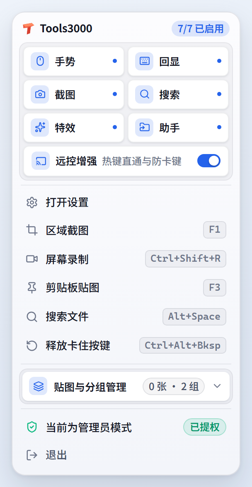
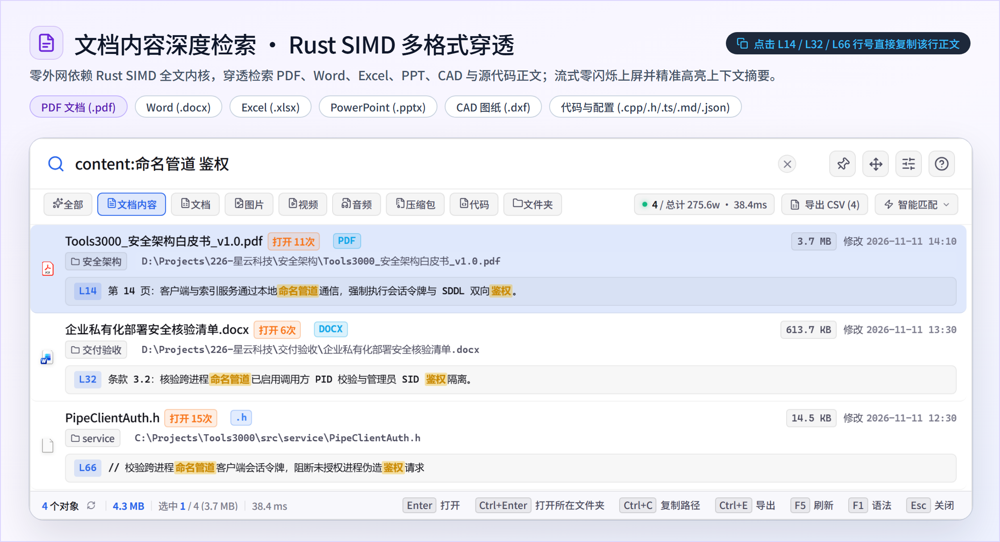
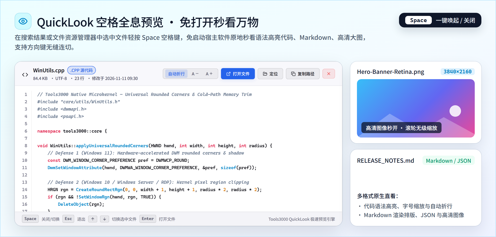
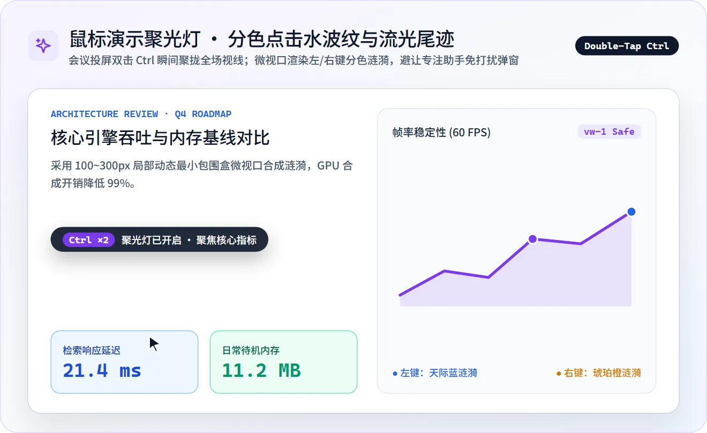
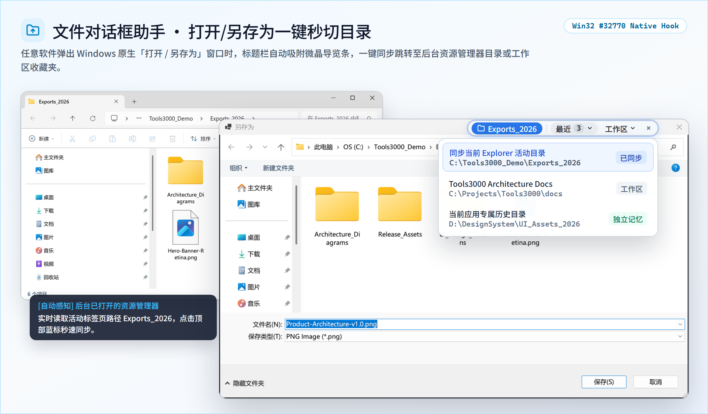
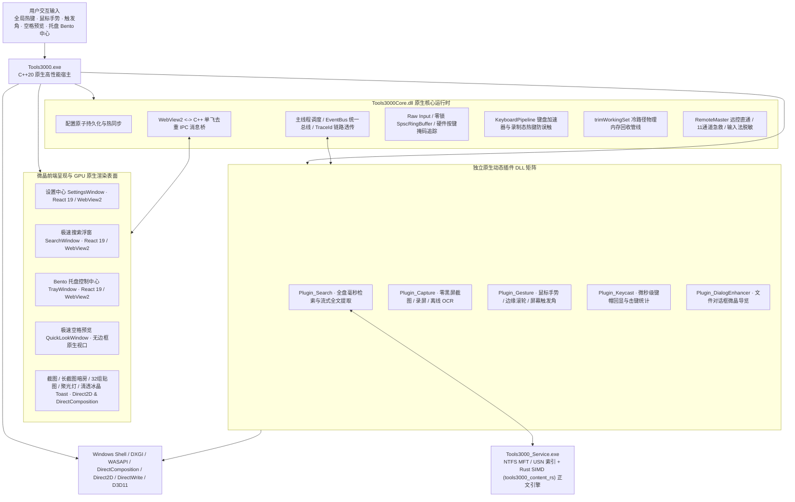

<div align="center">


# Tools3000

面向 Windows 10/11 与 Windows Server 的世界级高性能开源桌面效率工具集 (v1.0.0 官方正式版)

[简体中文](README.md) · [English](README.en.md)

[](https://github.com/yuan278501381/Tools3000/releases/latest)
[](LICENSE)
[](#system-requirements)
[](CMakeLists.txt)
[](src/service/rust_content/src/lib.rs)
[](ui/package.json)
[](ui/package.json)

</div>

Tools3000 是一款专为 Windows 平台日常办公、设计创作、开发运维与效率极客打造的**全场景高性能原生桌面效率套件**。它彻底告别了传统效率工具笨重卡顿、互相割裂、常驻吃内存的痛点，依托 **C++20 原生微内核 + Rust SIMD 全文检索引擎 + Direct2D/DirectComposition 硬件加速合成**，将**文件与全文搜索、鼠标手势、触发角、全能截图与录屏、按键回显与统计、鼠标演示特效、文件对话框助手、远程协助增强**深度熔铸为一体。随叫随到，用完即走，像呼吸一样轻快自然。

---

## 核心功能矩阵（按客户端导航顺序）

Tools3000 每一个功能模块均源自对真实高频桌面痛点的深度打磨，完全以人类直觉与操作心流为基准：

```text
┌─────────────────────────────────────────────────────────────────────────────────┐
│ [01] 文件与内容搜索  -> Alt+Space 毫秒级呼出，275万文件秒查、拼音混搜与全文穿透 │
│ [02] 全局鼠标手势    -> 右键/滚轮/屏幕边缘一划即达，流光轨迹与即时触发行云流水  │
│ [03] 屏幕四角触发角  -> 光标盲甩屏幕四角，秒切桌面、锁屏息屏、多任务视图调度    │
│ [04] 全能截图与录屏  -> 零黑屏定格、PixPin级标注、长截图无损裁切、32组贴图与OCR │
│ [05] 按键回显与统计  -> 微晶键帽实时投影，长句打字智能静默，全天本地按键热力图  │
│ [06] 鼠标演示与特效  -> 双击 Ctrl 聚光灯焦点，左右中键分色点击涟漪与流光尾迹    │
│ [07] 文件对话框助手  -> 打开/保存弹窗顶部微晶导览，一键秒切当前资源管理器目录   │
│ [08] 远程协助增强    -> 系统热键直通远端、修饰键粘滞急救、RustDesk 四指横滑守护 │
└─────────────────────────────────────────────────────────────────────────────────┘
```

<table>
  <tr>
    <td width="75%" align="center" valign="middle">
      <br />
      <sub>微内核动态模块管理中心：原生插件按需启停、ABI 能力标签与系统权限透明审计</sub>
    </td>
    <td width="25%" align="center" valign="middle">
      <br />
      <sub>Bento 微晶系统托盘面板：高频能力秒级触发与贴图分组管理</sub>
    </td>
  </tr>
</table>

---

## 用户真实体感与核心场景深度解析 (Feature Deep Dive)

### 1. 文件与全文搜索 (File & Content Search)
> **“在百万级文件与海量项目仓库中找一份半年前的文档或某行配置，按下快捷键敲入关键词或拼音缩写，结果眨眼即出，零闪烁、零卡顿。”**

<p align="center">
  <br />
  <sub>毫秒级检索 + 空格秒看动态演示：敲入关键词或拼音缩写（<code>xykj 架构</code>）21ms 秒出真实图标结果，轻按 <code>Space</code> 原地弹出 QuickLook 预览</sub>
</p>

<table>
  <tr>
    <td width="50%" align="center" valign="top">
      <br />
      <sub>全盘百万文件秒搜：跨目录拼音首字母混搜、Windows 原生真实图标与高频打开（Frecency）自动置顶</sub>
    </td>
    <td width="50%" align="center" valign="top">
      <br />
      <sub>Rust SIMD 正文穿透检索（<code>content:</code>）：Word / Excel / PPT / PDF / CAD / 代码零闪烁流式上屏与行号一键复制</sub>
    </td>
  </tr>
</table>

<p align="center">
  <br />
  <sub>QuickLook 空格全息预览：选中任意结果轻按 <code>Space</code> 空格键，免启动笨重软件瞬时预览语法高亮代码、Markdown、4K 大图与 PDF</sub>
</p>

- **百万级文件毫秒响应与跨目录秒搜**：随时按下 `Alt + Space` 立即唤起搜索中心。基于底层 NTFS MFT 元数据直读、USN 实时增量日志与**可分离目录 64 位位掩码 + 极大反链预筛算法**，在 275 万真实文件规模下，即便输入多词跨目录查询（如 `星云 部署手册` 或拼音混搜 `xykj 部署手册`），耗时亦稳定在 **20~27 毫秒**以内；
- **最匹配优先置顶与无锁 Bloom Frecency 加权**：多关键词与多扩展名并集（如 `*.log *.txt log`）自动隔离扩展名假命中，按文件名主干（Stem）命中度分层置顶，并结合 64 位双哈希 Bloom 运行历史快照将高频打开的文件智能排在最前；
- **Windows 资源管理器原生真实图标还原**：针对 `.exe`、`.lnk`、`.ico`、`.cur`、`.ani`、`.scr`、`.cpl`、`.msc` 等自带实例图标的文件直接提取其真实内嵌高清图标，普通文档提取系统关联图标，视觉认知与 Windows 资源管理器 100% 零落差；
- **C++ SEH + Rust SIMD 深度正文穿透检索**：内置零外网依赖的 Rust SIMD 文本检索引擎（`tools3000_content_rs`），结合 MSVC `__try/__except` 页错误保护，直接穿透检索 Word、Excel、PowerPoint、PDF、AutoCAD DXF 及各类代码源文件。采用 220ms 时间片流式上屏，首屏命中 ~160ms 即刻呈现，跨分片锁定行高**彻底杜绝列表闪烁**，支持实时百分比进度显示、一键停止后台扫描以及点击代码行号胶囊（如 `L66`）**单行代码一键复制**；
- **Everything 级完备语法**：原生支持通配符（`*.pdf`）、多扩展名并集（`*.log *.txt` 或 `ext:jpg;png`）、闭区间与语义化大小过滤（`size:1mb..50mb`、`size:empty`、`size:tiny`、`size:small`、`size:medium`、`size:large`、`size:huge`）、修改日期过滤（`dm:today`、`dm:thisweek`、`dm:2026-10`）、逻辑排除（`!node_modules`）与正则表达式（`regex:`）；
- **QuickLook 空格全息预览与按需常驻契约 (`DEMAND_START`)**：选中任意结果轻按 `Space`（空格键）即可原地预览文档排版、语法高亮代码或高清大图；搜索服务严格遵循 `DEMAND_START`，开机绝不自启动，仅在用户首次显式呼出搜索时按需唤醒。

---

### 2. 全局鼠标手势 (Mouse Gestures)
> **“每天查阅海量技术文档与多窗口办公，手腕再也不用频繁跨越整块屏幕去瞄准细小的‘后退’或‘关闭’按钮。”**

<p align="center">
  <br />
  <sub>全局鼠标手势动态演示：右键一划（<code>↓ →</code>）秒关标签页，支持不松手即刻触发（<code>instantExecute</code>）与右边缘滚轮秒调系统音量</sub>
</p>

- **右键/中键轨迹、滚轮联动与屏幕边缘滑动**：按住鼠标右键（或中键）轻轻一划即可执行后退、前进、关闭标签页、恢复标签页、窗口置顶等操作；支持在桌面或任务栏边缘滑动滚轮调节系统音量或切换虚拟桌面；
- **实时方向动作提示与抗抖动轨迹引擎**：轨迹绘制期间实时浮现当前识别方向序列与即将触发的动作名称，松手即刻精准执行，移回原位或按左键/Esc 可随时无损取消；
- **极客级立即执行 (`instantExecute`) 与静默模式 (`silentToast`)**：针对看图翻页、连续调音等高频动作，支持轨迹达标的微秒级刹那立即触发而无需等待松开按键；支持静默执行不弹提示浮层；
- **应用作用域规则与全屏自动免打扰**：可按进程名或窗口类名定制专属手势配置集，在全屏 3D 游戏、观影或截图/贴图交互浮层打开期间自动退避放行。

---

### 3. 屏幕四角触发角 (Hot Corners)
> **“把鼠标随手盲甩到屏幕四个物理角落，瞬间显示桌面、展开多任务视图或一键息屏锁屏。”**

- **零瞄准四角盲操作**：将光标推入左上、右上、左下、右下四个屏幕角落即可触发自定义系统命令、快捷键或脚本；
- **典型高效映射**：右上角一键显示/恢复桌面，左上角展开 Windows 多任务视图，左下角离开工位前随手一甩立即锁屏防窥；
- **防抖驻留滤波与全屏避让**：内置驻留延迟滤波，日常快速划过角落绝不误触；全屏游戏与视频播放时自动暂停。

---

### 4. 全能截图、长截图、贴图与高清录屏 (Screen Capture, Scroll Capture, Pin & Recording)
> **“零黑屏窗口磁吸与像素级取色、一步到位的专业标注体系（默认虚线引出光学放大镜）、实时拼接预览与首尾无损裁切长截图，以及 32 组置顶贴图、100% 离线 OCR 与自带键鼠回显的高清录屏。”**

<table>
  <tr>
    <td width="50%" align="center" valign="top">
      <br />
      <sub>截图更精准：自动识别窗口与子控件层级，十字准星放大镜逐像素对齐并一键复制 HEX / RGB 色值</sub>
    </td>
    <td width="50%" align="center" valign="top">
      <br />
      <sub>标注一步到位：默认虚线引出正圆光学放大镜、自愈步骤序号、隐私马赛克与雪瓷白双层工具栏</sub>
    </td>
  </tr>
</table>

<p align="center">
  <br />
  <sub>贴图随手钉与文字一键识别：图像/文本/色卡置顶对照（支持 32 组宝石配色归档），贴图内直接拖选文字或打开独立离线 OCR 窗口一键复制</sub>
</p>

<table>
  <tr>
    <td width="50%" align="center" valign="top">
      <br />
      <sub>长截图动态演示：框选后滚动自动无缝拼接，右侧实时预览整张长图，首尾冗余横幅一键无损裁除（随时往回拖恢复）</sub>
    </td>
    <td width="50%" align="center" valign="top">
      <br />
      <sub>高清录屏动态演示：60 FPS MP4 / 2-Pass GIF 开箱即用，选区外悬浮控制条内置双路实时音量峰值、键鼠回显与停录一键复制/打开目录</sub>
    </td>
  </tr>
</table>

- **DirectX 零黑屏定格与精细标注系统**：
  - **智能窗口探测与圆角美学**：按下 `F1` 瞬间零黑屏定格屏幕，自动磁吸窗口边界并支持滚轮穿透子窗口；内置 **Figma 式平时隐形、近场平滑渐显 (`smoothstep`) 圆角手柄**与 Direct2D 高分屏抗锯齿曲率光标；
  - **正圆/椭圆局部放大镜与 4 种引出线**：支持创建默认正圆或自由拉伸为横纵椭圆的局部放大镜（内部画面严格光学等比放大零畸变），默认采用清爽透气的**精密虚线 (`Dashed`)** 方案，并支持一键切换**双切线 (`Tangent`)、折线 (`Elbow`)、单线 (`Single`)** 四种专业引出线样式；
  - **6 种箭头样式、平滑曲线与双通道边框填充**：提供标准箭头、细线箭头、燕尾箭头、双向箭头、**立体箭头 (`CampaignMarch`)**、**路线箭头 (`MarchDoubleTrack`)**，支持折线与平滑贝塞尔曲线一键切换及首尾独立 **10 种端点样式**；矩形、椭圆、箭头与文字全面支持**「填充色 + 独立边框色 + `0~12px` 边框粗细」双通道融合控制**（支持悬停滚轮微调边框粗细或按住 `Alt` 点击色板秒改边框色）；
  - **微晶胶囊字签与自愈序号**：文字工具提供纯白微晶圆角底衬与自动反差描边；步骤序号标注支持删除中间步骤后自动向前递补重排自愈；内置美化分享外壳（5 大主题背景 + 可调留白与圆角）。
- **Smartisan 式滚动长截图首尾无损裁切与 Minimap 精修工作台**：
  - 支持网页、文档、代码与聊天记录自动平滑滚动拼接；点击「完成」后无缝进入全屏暗房精修工作台（基于 `4096px` 分片纹理瓦片流，突破单张 GPU 纹理高度上限）；
  - 提供**非破坏性首尾/左右推拉裁切标尺**（已裁除区域半透暗罩保留，随时往回拖动可 100% 无损恢复）、近边缘自动滚屏、**右侧全景缩略图 (Minimap) 联动拖拽裁切**以及长图原位标注。
- **32 组宝石配色桌面贴图与离线 OCR**：
  - 支持将截图、剪贴板图像或文本一键钉在桌面顶层（`F3`），支持多达 **32 个自定义贴图分组**（12 色宝石色相环、顶部雪瓷白分组导览栏、托盘 Bento 抽屉一键归组与 `Ctrl+1..9` / `Alt+1..9` 快捷键筛选）；
  - 内置离线 Windows OCR 引擎，支持在贴图或独立 OCR 窗口中跨行拖选文字、`Ctrl+A`/`Ctrl+C` 复制，全程 100% 离线零云端上传。
- **镂空呼吸边框高清录屏与 2-Pass GIF**：
  - 录制区域外围呈现镂空呼吸微光边框与选区外 40px 自动避让悬浮控制条（`RecordingIndicator`），彻底告别盲录焦虑；支持系统声音/麦克风独立静音切换与实时音量峰值条、录制中抓拍快照、防断电损坏分片封装、高保真 2-Pass 调色板 GIF 导出，以及停录原地弹出「已保存」胶囊（一键打开目录或复制视频文件）。

---

### 5. 按键回显与本地统计 (Keycast & Keystroke Analytics)
> **“录制教学视频或投屏演示时，屏幕角落浮现清透微晶键帽；日常连续打字时自动静默隐身，并提供 100% 本地的全天击键热力大盘。”**

<p align="center">
  <br />
  <sub>智能按键回显与纯本地统计大盘：投屏/录课时浮现高对比磨砂键帽（<code>Ctrl + C ×3</code>）且普通打字自动静默；右侧全尺寸键盘热力图 100% 留存本地磁盘</sub>
</p>

- **DirectWrite 真实字宽测量与高对比微晶键帽**：实时渲染半透明微晶键帽与独立高对比度连击角标（如 `Ctrl + C ×3`），长组合键自适应宽度绝不截断；
- **智能上档符号折叠与打字静默**：`Shift + 8` 自动折叠为 `*`；在智能快捷键模式下，连续打字与拼音输入自动静默，仅在按下真实功能组合键时精准呈现；
- **纯本地键鼠统计大盘**：记录今日按键数、鼠标点击数、鼠标移动里程与 104/87/60 键键盘热力分布，支持一键重置今日统计，所有数据 100% 原子化留存本地磁盘，零网络上传。

---

### 6. 鼠标演示与特效 (Cursor Effects & Presentation)
> **“在会议室大屏投屏或线上会议共享桌面时，双击两下 Ctrl 瞬间聚拢全场视线。”**

<p align="center">
  <br />
  <sub>会议投屏演示实况：双击 <code>Ctrl</code> 唤起平滑跟随聚光灯，配合左右中键分色点击水波纹与指针流光尾迹</sub>
</p>

- **双击 Ctrl / 晃动鼠标唤起聚光灯**：背景柔和压暗，聚光灯紧密跟随光标，支持自定义超时自动淡出；
- **左右中键分色点击水波纹与指针流光尾迹**：采用 100~300px 局部动态最小包围盒微视口与 256 阶 LUT 查表渲染，GPU 开销降低 99%；
- **专注助手全屏几何避让 (`FocusAssistAvoidance`)**：聚光灯暗角窗口物理尺寸主动缩减 1 像素（`vw - 1, vh - 1`），从底层阻断 Windows 误判全屏独占而弹出“专注助手/免打扰”通知。

---

### 7. 文件对话框助手 (File Dialog Enhancer)
> **“在软件中点击‘打开’或‘另存为’时，一键秒切到旁边资源管理器正在浏览的文件夹，彻底告别层层翻找。”**

<p align="center">
  <br />
  <sub>Windows 原生打开/另存为对话框（<code>#32770</code>）实战：右上角自动贴合微晶导览条，一键同步后台 Explorer 活动目录与收藏工作区</sub>
</p>

- **顶部微晶导览胶囊条**：当标准文件对话框（`#32770`）弹出时，顶部自动贴合悬浮微晶导览胶囊（自动锚定安全区间避让标题栏最小化/关闭按钮），点击即可瞬间跳转到当前打开的 Explorer 目录或常用工作区收藏；
- **应用级独立路径记忆**：为 VS Code、浏览器、Photoshop 等不同宿主进程分别记忆最近访问目录，互不串台。

---

### 8. 远程协助增强 (Remote Assistance Boost)
> **“使用 mstsc、向日葵、ToDesk、AnyDesk、RustDesk 远程办公时，系统热键直通远端、修饰键卡死一键急救，并彻底解决触控板四指横滑失效难题。”**

- **系统热键沉浸直通**：在远控窗口内按下 `Alt + Tab`、`Win + E`、`Win + R` 等系统热键直接透传至远端执行；同时智能放行 `Win + Ctrl + Left/Right/D/F4` 本地虚拟桌面切换热键；
- **RustDesk 精密触控板四指横滑防粘滞守护**：针对 Windows 精密触控板在远控窗口下的注入事件流，内置 `MouseHook` 物理按键状态追踪（`m_hardwareButtonMask`）与手势延迟按下配对自愈机制，彻底根除触控板四指横滑切桌面间歇性失效顽疾；
- **11 通道修饰键粘滞急救与输入法智能脱敏**：快速双击右侧 `Ctrl`（或按 `Ctrl + Alt + Backspace`）即可无抢焦冲刷释放所有卡住的 `Ctrl`/`Alt`/`Shift`/`Win` 状态；焦点进入远控窗口自动切换纯英文键盘（`ENG 0409`），切出时自动恢复原输入法状态。

---

## 物理内存占用横向对比 (Memory Consumption Benchmark)

Tools3000 依托现代 C++20 原生微内核与**冷路径退场物理工作集修剪机制 (`trimWorkingSet`)**，在提供八大核心模块的同时保持超低资源开销：

```text
物理内存常驻占用横向对比 (越低越好)：
┌─────────────────────────────────────────────────────────────────────────────┐
│ [高开销] 常见 Electron 架构效率工具 (300 MB ~ 800 MB)                       │
│          ██████████████████████████████████████████████████████████ 600 MB  │
├─────────────────────────────────────────────────────────────────────────────┤
│ [中开销] 传统 C# / .NET 架构桌面工具 (120 MB ~ 200 MB)                      │
│          ████████████████ 160 MB                                            │
├─────────────────────────────────────────────────────────────────────────────┤
│ [轻量级] Tools3000 一体化微内核 (八大模块并发活跃常驻仅 20 MB ~ 40 MB)      │
│          ███ 28 MB                                                          │
├─────────────────────────────────────────────────────────────────────────────┤
│ [静默态] Tools3000 后台日常托盘待机 (日常仅 ~11 MB，待机 CPU 占用 0.0%)     │
│          █ 11 MB                                                            │
└─────────────────────────────────────────────────────────────────────────────┘
```

| 软件类别与技术方案 | 日常待机物理内存 | 重度使用峰值 | 任务退场恢复速度 | 资源开销根因分析 |
| :--- | :---: | :---: | :---: | :--- |
| **Electron 架构启动器/工具箱** | **300 MB ~ 500 MB** | 800 MB ~ 1.5 GB | 无法有效归还 (V8 堆常驻) | 常驻完整 Chromium 渲染器与 Node.js 运行时，内存居高不下。 |
| **传统 C# / .NET 桌面工具** | **120 MB ~ 180 MB** | 300 MB ~ 500 MB | 缓慢等待 GC 周期回收 | 依赖 CLR 托管堆与垃圾回收器，易产生周期性内存波动。 |
| **Tools3000 (C++20 + Rust 微内核)** | **`~11 MB`** | **`20 ~ 40 MB`** | **`< 0.5 秒` 极速收缩** | 原生零运行时开销；截图、录屏、长截图拼接、OCR 完成后立即触发冷路径 `trimWorkingSet()` 归还物理内存，1000Hz 键鼠热路径零缺页抖动。 |

---

## 硬核技术栈与微内核架构 (Tech Stack & Architecture)



### 核心工程与架构亮点：
1. **现代 C++20 微内核 + Rust SIMD 混合架构**：宿主与插件全量采用现代 C++20 构建，跨 DLL 统一导出核心单例与 `TraceId` 链路上下文；全文检索核心计算层采用零外部依赖的 Rust SIMD 静态库（`tools3000_content_rs`），兼具 Win32/SEH 底层硬件控制力与 Rust 内存安全及向量化吞吐；
2. **1000Hz 零锁输入管线与键盘加速器治理 (`KeyboardPipeline`)**：基于 `WH_KEYBOARD_LL`、`WH_MOUSE_LL`、Raw Input 与原始字节对齐 `SpscRingBuffer` 实现微秒级分发；通过原子浮层可见标志彻底消灭钩子内 `FindWindowW` 内核锁查询；全宿主窗口挂载 `KeyboardPipeline` 拦截 `SC_KEYMENU`/`WM_HELP` 并静默录制态全局热键；
3. **Direct2D / DirectComposition 硬件合成与设备丢失自愈**：全量原生浮层与贴图窗口内置 `D2DERR_RECREATE_TARGET` 与 `DXGI_ERROR_ACCESS_LOST` 自动重建机制；跨系统圆角双保险管线（`applyUniversalRoundedCorners`）在 Windows 11、Windows 10、Windows Server 2019/2022/2025 及 RDP 远程桌面下均呈现平滑无黑框圆角；
4. **单字重极简无损思源黑体排版体系**：内嵌仅 `1.10MB` 单文件 `Noto Sans SC 500 Medium` 并优先复用本地 `Source Han Sans SC`，0 系统字体目录写入、0 卸载残留，配合字号（`>= 12px`）与字重（`>= 500`）自动化 CI 门禁，保障高分屏与普通屏 ClearType 次像素字字锐利；
5. **严密的自动化质量门禁与极简体积**：标准安装程序精简至 **`19.6 MB`**（插件零重复第三方依赖库），内置 **640+ 项** C++ GoogleTest 单元测试断言、**166 项**前端 Vitest 测试以及 7 重 i18n 双语同构门禁、6 重日志 TraceID 门禁、CSS 变量门禁、排版门禁与 `trimWorkingSet` 冷路径门禁。

---

<a id="system-requirements"></a>
## 系统要求与跨架构兼容

- **操作系统**：Windows 10 (1809 及以上) / Windows 11 / Windows Server 2019 / 2022 / 2025 全系列；
- **指令集架构**：原生支持 **x64** (Intel / AMD) 与 **ARM64** (Surface Pro / 高通骁龙 Windows 终端)；
- **运行环境**：Microsoft Edge WebView2 Runtime（Windows 10/11 默认内置，缺失时安装器自动引导）；
- **图形硬件**：支持 DirectX 11 / Direct2D 硬件加速（无独显或远程桌面环境下自动无缝适配）。

---

## 下载与安装 (Downloads)

请前往 [GitHub Releases 最新发行版页面](https://github.com/yuan278501381/Tools3000/releases/latest) 下载对应资产：

| 文件名称 | 适用架构与平台 | 说明 |
| :--- | :--- | :--- |
| **`Tools3000-Setup.exe`** | Windows 10/11/Server (x64) | 官方推荐标准安装程序（支持开机自启、按需搜索服务集成与平滑升级） |
| **`Tools3000-v1.0.0-Setup.exe`** | Windows 10/11/Server (x64) | 带明确版本号标识的官方归档安装程序 |
| **`Tools3000-Portable-x64.zip`** | Windows 10/11/Server (x64) | 绿色免安装便携压缩包（解压即用，配置与数据库 100% 本地目录留存） |
| **`Tools3000-v1.0.0-win-x64-portable.zip`** | Windows 10/11/Server (x64) | 带明确版本号标识的官方绿色便携压缩包 |
| **`SHA256SUMS.txt`** | 全平台产物 | 官方发布二进制资产的 SHA-256 完整性校验清单 |

> **[TIP] 常用默认快捷键速览**（均可在设置中心自由修改并支持实时冲突检测）：
> - **呼出/隐藏极速搜索**：`Alt + Space`（搜索结果按 `Space` 空格键秒级预览）
> - **区域截图标注**：`F1`（贴图快捷键：`F3`，长截图与录屏可在截图栏或自定义热键一键触发）
> - **双击唤起聚光灯**：快速双击 `Ctrl`
> - **远控修饰键粘滞急救**：在远控窗口内快速双击右侧 `Ctrl` 或按 `Ctrl + Alt + Backspace`

---

## 隐私与安全承诺 (Privacy First)

- **100% 纯本地运行**：文件索引、全文检索、离线 OCR 识别、截图标注、屏幕录制与击键统计全部在本地完成；
- **零遥测零云端上传**：无账号体系、无后台联网统计、不收集或上传任何用户文件与击键内容，完全断网环境下 100% 功能可用；
- **强鉴权进程间通信**：客户端与本地索引服务通过命名管道令牌与安全描述符严格鉴权。

---

## 从源码构建 (Build from Source)

### 环境依赖
- Windows 10/11 或 Windows Server (x64 / ARM64)
- Visual Studio 2022 / Build Tools (安装“使用 C++ 的桌面开发”工作负载)
- Rust 工具链 (`rustc` 1.75+，用于编译 `tools3000_content_rs` SIMD 静态库)
- CMake 3.25+、PowerShell 7+ (`pwsh`)、Git 2.40+、Node.js 20+

### 一键编译、测试与打包
```powershell
# 1. 克隆代码仓库
git clone https://github.com/yuan278501381/Tools3000.git
cd Tools3000

# 2. 一键编译前端、Rust SIMD 内核、C++20 核心与插件，执行全套门禁并生成安装包
pwsh deploy.ps1
```

构建完成后，便携版产物位于 `deploy_dist\` 与 `Output\Tools3000-Portable-x64.zip`，标准安装程序位于 `Output\Tools3000-Setup.exe`。

---

## 开发者与进阶文档

- [Tools3000 v1.0.0 官方正式版发布说明 (Release Notes)](docs/RELEASE_NOTES_v1.0.0.md)
- [内存收缩与性能调优实录 (Performance Tuning)](docs/performance-tuning.md)
- [性能基线采集与验证协议 (Performance Baseline)](docs/performance-baseline.md)
- [C++ 原生动态插件开发指南 (Plugin Development)](docs/plugin-development.md)
- [Lua 扩展脚本 API 参考手册 (Lua API Reference)](docs/api/lua-api.md)
- [版本号管理与发布流水线规范 (Versioning Guide)](docs/versioning.md)
- [Authenticode 自动化数字签名规范 (Release Signing)](docs/release-signing.md)

---

## 开源许可证与作者署名

本项目遵循 **[MIT License](LICENSE)** 开源协议。

* **项目作者**：**`Yy1 (yuan278501381)`**（GitHub：[@yuan278501381](https://github.com/yuan278501381)）
* **项目仓库**：[https://github.com/yuan278501381/Tools3000](https://github.com/yuan278501381/Tools3000)
* **法定版权**：`Copyright (c) 2026 Yy1 (yuan278501381) & Tools3000 contributors`
