<div align="center">


# Tools3000

**Lightweight, native all-in-one desktop productivity suite for Windows**

**English** · [简体中文](docs/i18n/README.zh-CN.md) · [繁體中文](docs/i18n/README.zh-TW.md) · [日本語](docs/i18n/README.ja.md) · [한국어](docs/i18n/README.ko.md) · [Русский](docs/i18n/README.ru.md) · [Português (Brasil)](docs/i18n/README.pt-BR.md) · [Español](docs/i18n/README.es.md)

[](https://github.com/yuan278501381/Tools3000/releases/latest)
[](https://github.com/yuan278501381/Tools3000/actions/workflows/ci.yml)
[](https://github.com/yuan278501381/Tools3000/stargazers)
[](https://github.com/yuan278501381/Tools3000/releases)
[](https://glama.ai/mcp/servers/yuan278501381/Tools3000)
[](#download--install)
[](#download--install)
[](LICENSE)

**[Official Website](https://yuan278501381.github.io/Tools3000/)** · **[Download Latest](#download--install)** · [At a Glance](#at-a-glance) · [Live Demos](#live-feature-demos) · [Security & Trust](#security-verification--trust) · [Why Tools3000](#why-i-built-tools3000) · [What It Replaces](#what-it-replaces) · [Contribute](#feedback--co-creation) · [Developer Guide](docs/DEVELOPER.md)

</div>

<br />

Tools3000 unifies everyday **file, app, system-command & real-Favicon browser bookmark search (with Live Watch, 3 RAM tiers & CLI / MCP), document content search, persistent clipboard history, native Text Expander, inline File Dialog search, File Locksmith, scrolling capture, precision markup, grouped desktop pins, 8-language offline OCR & clean in-place translation, screen recording with auto-zoom Studio (exporting MP4, Discord/Slack/GitHub-ready compact GIF, and animated WebP), global mouse gestures, encrypted config backup, and a Rust Picasa photo viewer** into one native Windows app. Core features run 100% locally with full support for non-English install folders and Windows usernames, keep the resident main host around **2–6 MB** of private working set (with optional 0 MB idle search sleep), and support personal PCs (`x64` & `ARM64`) as well as concurrent multi-user Windows Server desktops.

> **Quick Install** — Grab **[Installer `.exe` / Portable `.zip` (Latest Release)](https://github.com/yuan278501381/Tools3000/releases/latest)**, or install via **Scoop** (`winget install Yy1.Tools3000` PR `#487469` pending merge):
> ```powershell
> scoop bucket add tools3000 https://github.com/yuan278501381/Tools3000 && scoop install tools3000/tools3000
> ```

---

## At a Glance

<p align="center">
  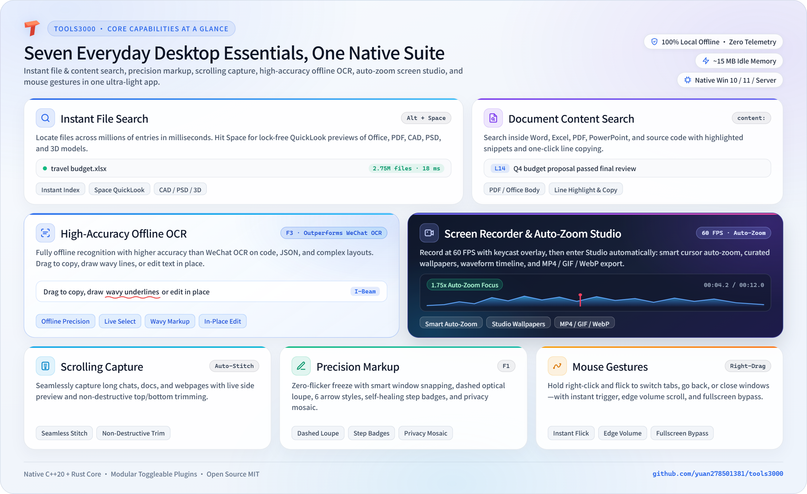
</p>

---

## Live Feature Demos

<table>
  <tr>
    <td width="50%" align="center" valign="top">
      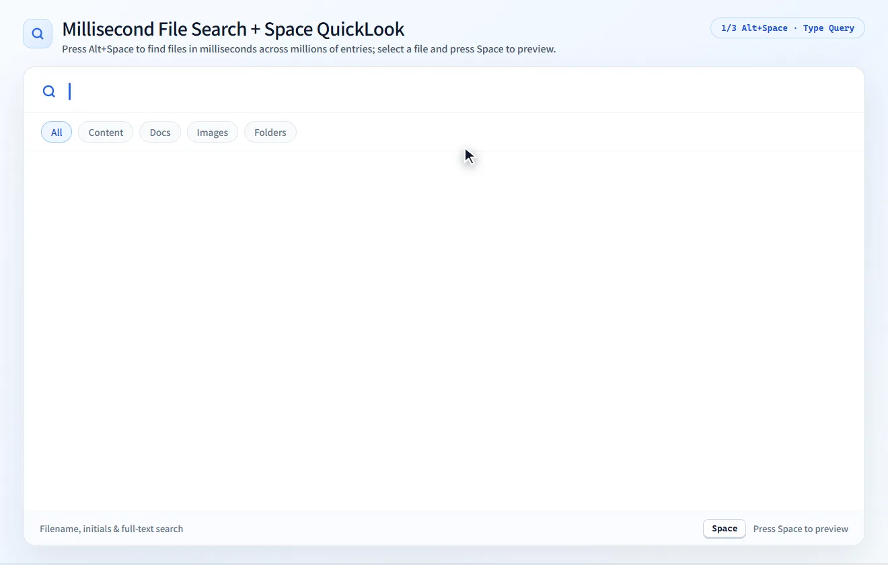<br />
      <sub><b>Instant Search &amp; Spacebar Preview</b> · Native app icons, real offline bookmark Favicons, Live Watch &amp; archive/font preview</sub>
    </td>
    <td width="50%" align="center" valign="top">
      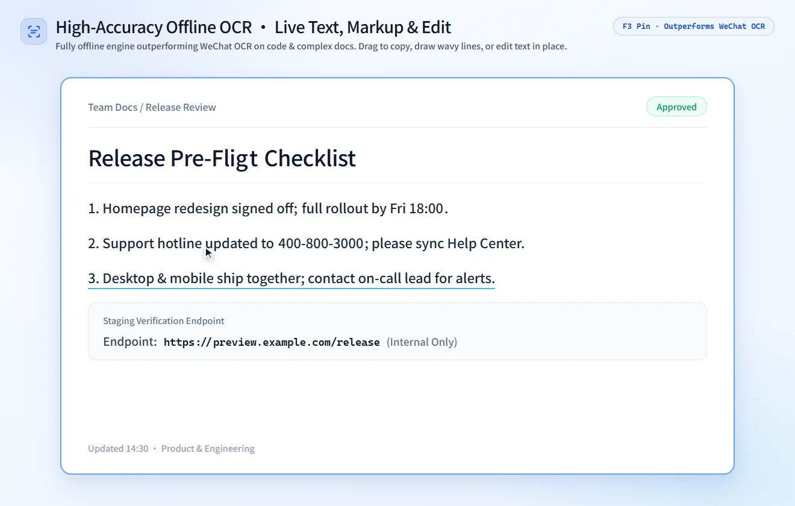<br />
      <sub><b>8-Language Offline OCR &amp; Live Text</b> · Auto-detects EN/CJK/JA/KO/RU/ES/PT locally; select, annotate, or edit in place</sub>
    </td>
  </tr>
  <tr>
    <td width="50%" align="center" valign="top">
      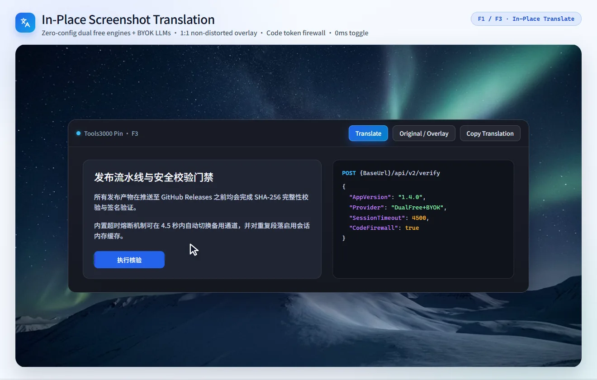<br />
      <sub><b>In-Place 1:1 Screenshot Translation</b> · Zero-config dual free channels + BYOK LLMs, clean 1:1 overlay, code protection &amp; 0ms toggle</sub>
    </td>
    <td width="50%" align="center" valign="top">
      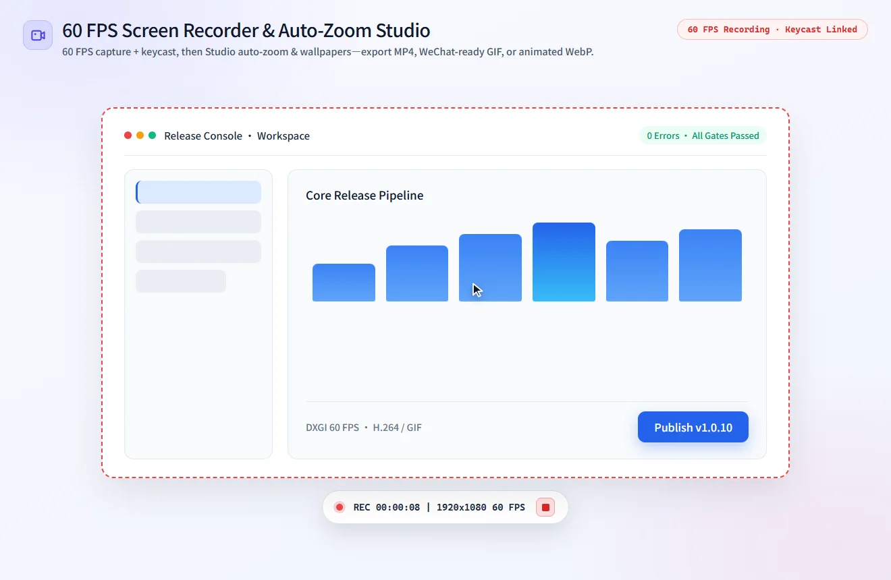<br />
      <sub><b>Screen Recorder &amp; Auto-Zoom Studio</b> · Smart cursor-follow zoom, export MP4, Discord/Slack/GitHub compact GIF &amp; animated WebP</sub>
    </td>
  </tr>
  <tr>
    <td width="50%" align="center" valign="top">
      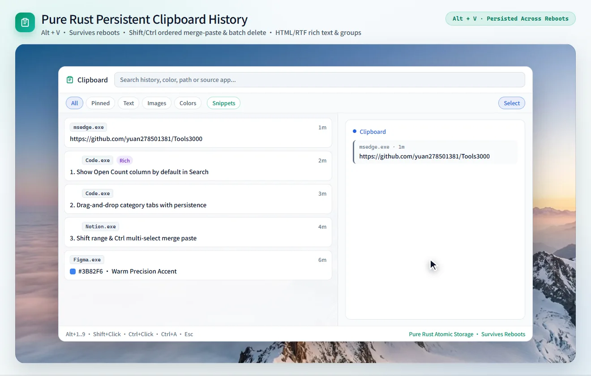<br />
      <sub><b>Persistent Clipboard History (Alt + V)</b> · Survives reboots, color app icons, universal browser/CLI drag-paste &amp; ordered merge paste</sub>
    </td>
    <td width="50%" align="center" valign="top">
      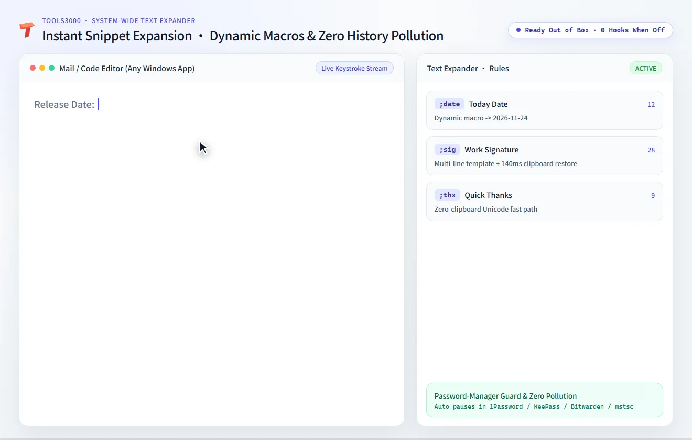<br />
      <sub><b>Native Text Expander</b> · Type <code>;date</code> or <code>;sig</code> anywhere for instant expansion with 15 dynamic macros &amp; password-manager guard</sub>
    </td>
  </tr>
</table>

<details>
<summary><b>View 7 more live demos</b> — File Dialog Inline Search, File Locksmith, Scrolling Capture, Precision Markup, 120Hz Pin Groups, Document Full-Text Search &amp; Global Mouse Gestures</summary>
<br />
<table>
  <tr>
    <td width="50%" align="center" valign="top">
      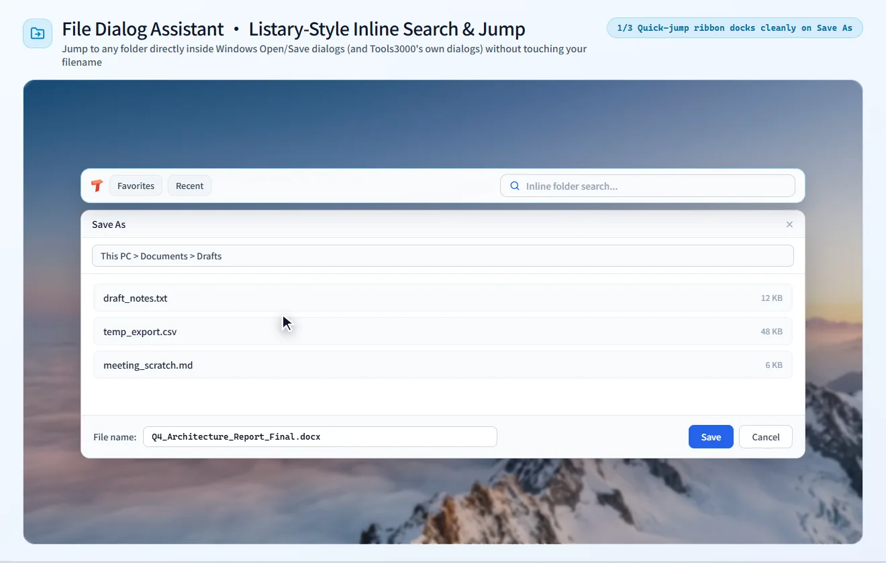<br />
      <sub><b>File Dialog Assistant</b> · Listary-style inline folder search in Windows &amp; Tools3000 dialogs without overwriting Save-As names</sub>
    </td>
    <td width="50%" align="center" valign="top">
      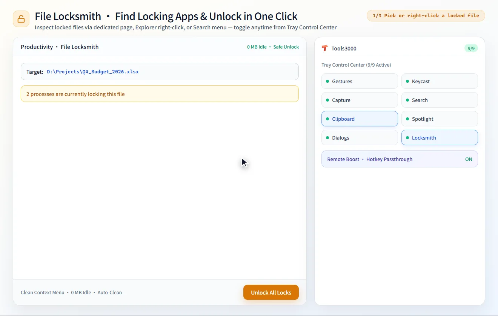<br />
      <sub><b>File Locksmith</b> · Zero-RAM right-click, dedicated page picker &amp; one-click lock release</sub>
    </td>
  </tr>
  <tr>
    <td width="50%" align="center" valign="top">
      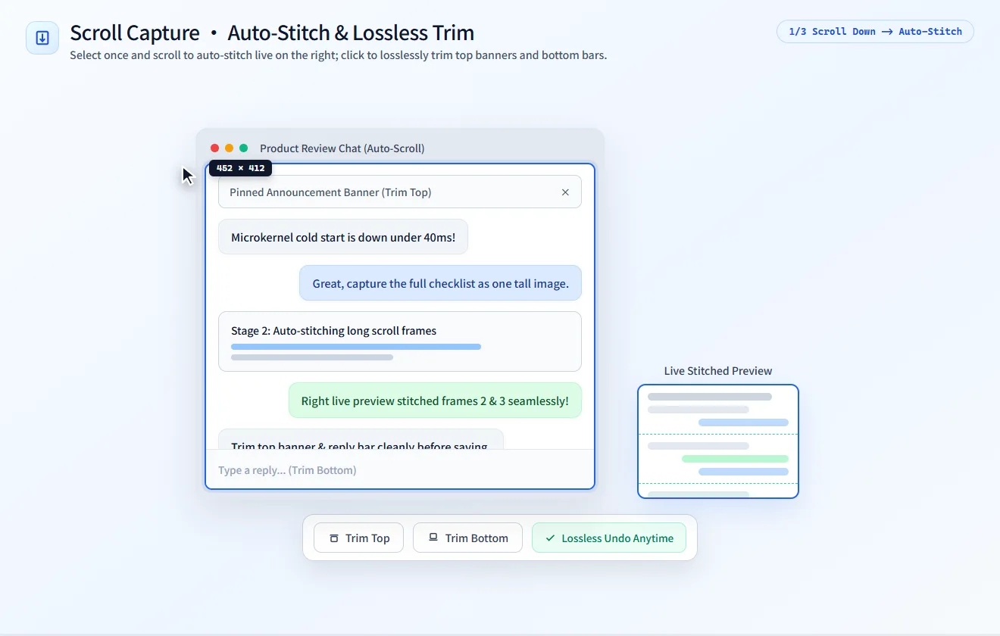<br />
      <sub><b>Scrolling Capture</b> · Auto-scroll seamless stitching with live sidebar preview and lossless head/tail trim</sub>
    </td>
    <td width="50%" align="center" valign="top">
      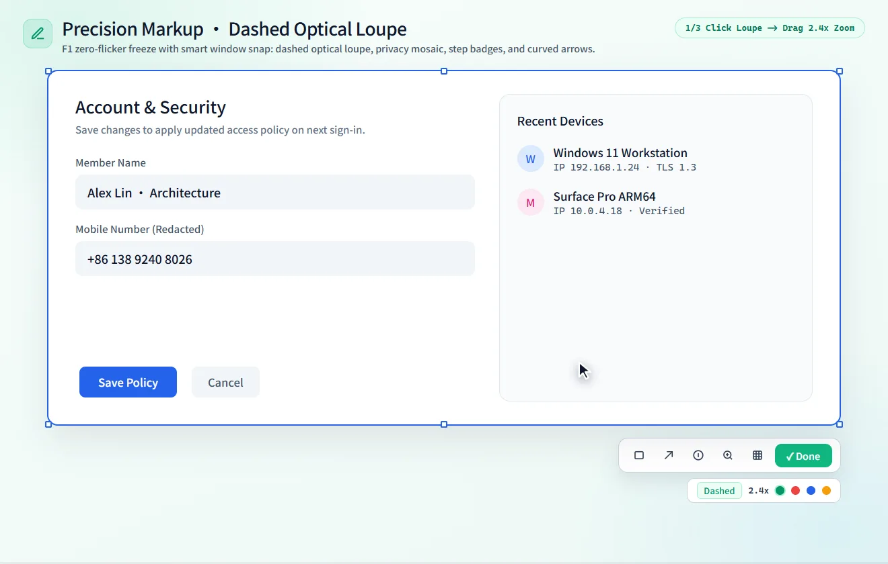<br />
      <sub><b>Precision Screenshot Markup</b> · Smart element snapping, dashed optical magnifier, privacy mosaic &amp; saved region presets</sub>
    </td>
  </tr>
  <tr>
    <td width="50%" align="center" valign="top">
      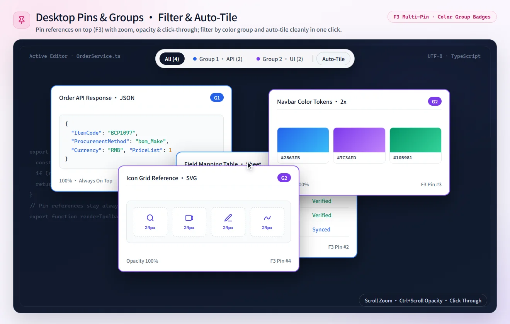<br />
      <sub><b>Desktop Pins &amp; Pin Groups</b> · F3 always-on-top pins with color groups, 4K lossless RAM compression &amp; one-click tiling</sub>
    </td>
    <td width="50%" align="center" valign="top">
      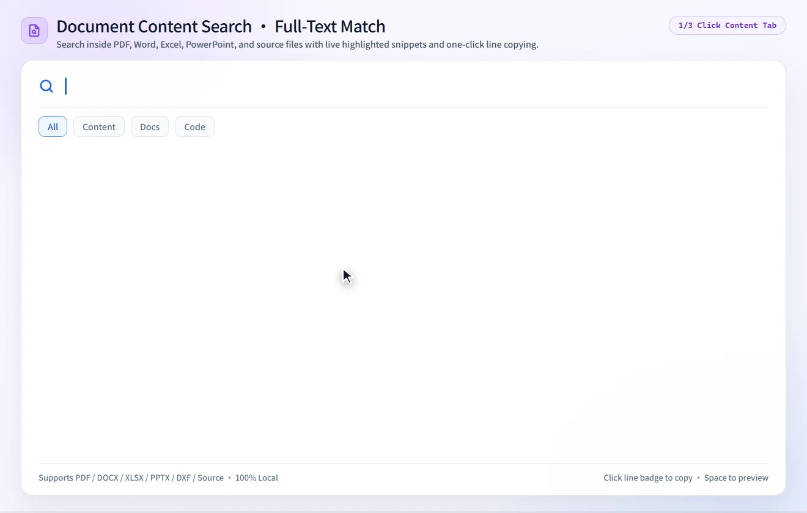<br />
      <sub><b>Document Content Search</b> · Search inside PDF, Word, Excel, and source code with highlighted context</sub>
    </td>
  </tr>
  <tr>
    <td colspan="2" align="center" valign="top">
      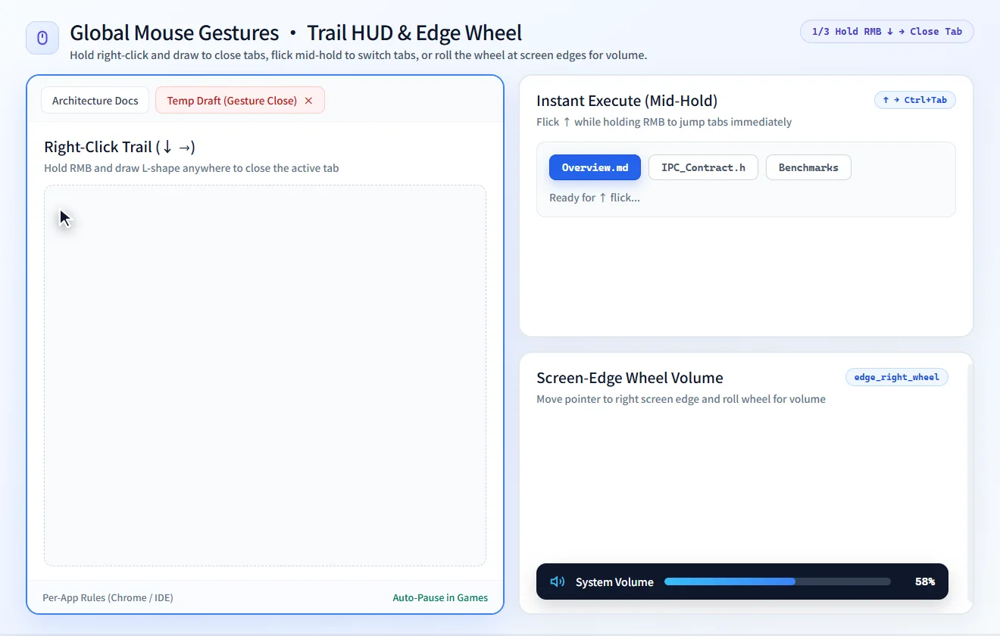<br />
      <sub><b>Global Mouse Gestures</b> · Pause-to-cancel on by default, profile-aware window switching, instant trigger &amp; edge wheel</sub>
    </td>
  </tr>
</table>
</details>

| Module | Core Experience |
| :--- | :--- |
| **Instant File Search** | `Alt + Space` searches millions of files in ms alongside desktop/UWP apps (`app:`), 37 system tools (`cmd:env`, etc.), and Chrome/Edge/Brave/Vivaldi bookmarks (`bm:`/`b:`, showing real site icons completely offline); features **Live Watch** updates, **3 RAM tiers** (down to 0 MB idle sleep), Open Count tracking, draggable category tabs, `Space` QuickLook (Office, PDF, code, CAD, PSD, 3D, ZIP/7Z/RAR archives, TTF/OTF fonts & media preview), and a lightweight 350 KB CLI & MCP tool `tools3000-cli.exe`. |
| **Document Content Search** | Prefix `content:` to search directly inside Word, Excel, PDF, PowerPoint, CAD, and source code with highlighted snippets and one-click line copy. |
| **Persistent Clipboard History** | Press `Alt + V` (with tray menu access and quick tray toggle) for clipboard history that survives reboots; shows real color source app icons & friendly names, supports universal drag-to-paste across modern web browsers, CLI terminals, borderless apps & AI IDEs, `Shift / Ctrl` ordered merge-paste & batch delete, HTML/RTF rich text, collection groups, inline editing, `Alt + 1..9` instant paste, color swatches, 1-click hide-pinned in other categories, and sensitive-app exclusion. |
| **Text Expander** | Type short triggers (e.g. `;date`, `;now`, `;sig`) in any Windows app to expand full phrases and 15 dynamic macros (date offsets `{{date+Nd}}`, localized `{{weekday}}`, `{{uuid}}`, `{{timestamp}}`, `{{user}}`, clipboard & `{{cursor}}` placement); includes automatic CJK fullwidth/halfwidth trigger compatibility, optional delimiter retention, live preview, password-manager auto-pause, Windows privacy markers (zero history / `Win + V` pollution), and zero hooks/RAM when off. |
| **File Dialog Assistant** | Docks a quick-jump bar with Listary-style inline folder search directly onto Windows Open / Save As / Folder dialogs (including Tools3000's own dialogs), strictly protecting Save-As filenames from overwrite. |
| **File Locksmith** | Find out what is locking a stubborn file and unlock it safely — via Explorer right-click (optional `Shift + Right-click`), Search right-click, or the built-in File Locksmith page. Uses zero background RAM, leaves system files untouched, and cleans up its menu automatically when disabled. |
| **Scrolling Capture** | Auto-scroll seamless stitching for web pages, documents, and chats with live side preview, lossless head/tail trim, and in-place annotation. |
| **Precision Screenshot Markup** | `F1` snaps directly to windows and UI elements with pixel color picker, default dashed optical magnifier, 6 arrow styles, self-healing step badges, mosaic, sharing frames, decoupled auto-copy / auto-save finish actions, plus `Shift + F1` / `R` to reuse saved & recent capture regions. |
| **Desktop Pins & Pin Groups** | `F3` pins screenshots or clipboard content always-on-top with 120Hz GPU smooth zoom, opacity, click-through, color groups, and one-click snap-tiling; includes lossless cold compression & GPU texture unloading so even dozens of 4K or scrolling pins stay lightweight, with configurable auto Live Text recognition. |
| **8-Language Offline OCR & In-Place Translation** | Pure local auto-detect OCR across 8 languages (Chinese, English, Japanese, Korean, Russian, Spanish, and Portuguese — on-demand lightweight language packs plus right-click per-image language switch); select/copy, highlight/underline, edit in place, extract tables/QR codes; plus **clean 1:1 in-place screenshot translation** (free dual channels + BYOK LLMs) with code protection and 0ms toggle. |
| **Screen Recorder & Auto-Zoom Studio** | Screen recording with keystroke overlay flows directly into Studio — automatic click-focus zoom, curated wallpapers, audio waveform timeline, and one-click export to **MP4**, **Discord / Slack / GitHub-ready compact GIF**, and **animated WebP**. |
| **Global Mouse Gestures** | Right-drag to switch tabs, navigate back, or close windows; pause-to-cancel enabled by default, smart app window switching without duplicate launches (even across Chrome profiles), instant trigger without releasing, screen-edge wheel volume/brightness, 8-second easter egg, fullscreen game bypass, and Lua scripting. |
| **Presenter, Remote Boost & Feedback** | Crisp keystroke OSD and double-`Ctrl` spotlight; remote desktop (`mstsc`, RustDesk, ToDesk) hotkey passthrough and one-key stuck-modifier recovery; built-in sidebar **Feedback** button with automatic local privacy redaction before exporting diagnostics. |
| **Picasa Photo Viewer (Rust Recreation · Optional)** | Lightweight Picasa-style image viewer recreated in Rust + Direct2D (**viewer only, not the full Google Picasa suite**). **Under 2 MB as a zero-dependency standalone executable** that works both inside Tools3000 and completely standalone on any Windows PC. Unchecked by default in the installer; enabling automatically associates all 41 supported image formats with classic Polaroid icons and a native dark/light Direct2D format manager. Alongside faithful cursor-anchored damped zoom, filmstrip wave, smooth close, and cross-dissolve slideshow animations, it **adds modern capabilities the original lacked**: native 4K High-DPI (100%–250%+) crispness, 60–240Hz VSync rendering, WebP / AVIF / HEIC / SVG / QOI / DDS / camera RAW decoding, animated GIF/WebP/APNG frame scrubbing, lossless horizontal/vertical flip, and 8-language UI. |

---

## Download & Install

### Option 1: Package Managers (Recommended)

- **Scoop (Available now — runs in true portable mode with settings persisted in `data/` across upgrades)**:

```powershell
scoop bucket add tools3000 https://github.com/yuan278501381/Tools3000
scoop install tools3000/tools3000
```

- **Winget (Official schema manifests included)**: Manifests for `Yy1.Tools3000` in [`packaging/winget/`](packaging/winget/) are automatically generated and verified with `winget validate` on every release. Once merged into `microsoft/winget-pkgs`, install directly via `winget install Yy1.Tools3000` (or validate locally with `winget install -m packaging/winget`).

### Option 2: Direct Download from GitHub Releases

Grab the latest release from **[GitHub Releases](https://github.com/yuan278501381/Tools3000/releases/latest)**:

- **Standard Installer (`Tools3000-vX.Y.Z-Setup.exe`)** — Recommended for daily use, with optional components, auto-start, and smooth in-place upgrades.
- **Portable Archive (`Tools3000-vX.Y.Z-win-x64-portable.zip`)** — Extract and run with all config and data kept in the local folder, supporting one-click in-place hot updates inside `Settings -> About`.
- **Checksums (`SHA256SUMS.txt`)** — SHA-256 verification hashes for every release artifact.

> **System Requirements**: Windows 10 (1809+) / Windows 11 / Windows Server 2019–2025, with native `x64` and `ARM64` source & build support (GitHub Releases currently ships prebuilt `x64` installer and portable packages; ARM64 devices can build natively via the [Developer Guide](docs/DEVELOPER.md) or run the `x64` build directly), requiring built-in Microsoft Edge WebView2 Runtime. The app UI natively supports 8 languages (`zh-CN`, `zh-TW`, `en-US`, `ja-JP`, `ko-KR`, `ru-RU`, `pt-BR`, `es-ES`), automatically following your Windows display language by default.

### Security Verification & Trust

Tools3000 is built for complete zero-black-box transparency (full details in **[SECURITY.md](.github/SECURITY.md)**):

1. **SHA-256 Integrity Verification**: Verify your download against `SHA256SUMS.txt` in PowerShell:
   ```powershell
   Get-FileHash .\Tools3000-vX.Y.Z-Setup.exe -Algorithm SHA256
   ```
2. **VirusTotal Public Inspection**: Paste any artifact's SHA-256 into **[VirusTotal](https://www.virustotal.com/)** (and click the direct VirusTotal hash links embedded in upcoming Release notes) to inspect multi-engine scan results publicly.
3. **Windows Defender SmartScreen Notice**: Until an independent open-source release is backed by commercial EV / public trusted code signing (SignPath / Trusted Signing in progress) or builds sufficient reputation on fresh releases, Windows may show an "Unknown publisher" SmartScreen prompt. After verifying the SHA-256 and VirusTotal report, click **More info -> Run anyway**, or build cleanly from source via the **[Developer Guide](docs/DEVELOPER.md)**.
4. **Embedded SPDX SBOM**: Both the installer and portable archive ship with `SBOM.spdx.json` and `THIRD_PARTY_NOTICES.txt` documenting every dependency and license.

---

## Why I Built Tools3000

I have been a heavy **Everything** user for over ten years. For screenshots and desktop pins, I bounced across **Greenshot**, **FastStone Capture**, **ShareX**, and **Snipaste** as I needed element snapping, scrolling capture, magnifier callouts, and fast offline OCR. For clipboard history and snippets I ran **Ditto** and **AutoHotkey**, for mouse gestures I went from **WGestures** to **StrokesPlus**, and I cycled through plenty of screen recorders along the way — even giving Microsoft **PowerToys** a serious try in between, yet it still missed several daily essentials, leaving me back with a crowded row of separate background apps.

Image viewers were another long-standing frustration: third-party freeware viewers were increasingly packed with pop-up ads or heavy frameworks, and after Google discontinued **Picasa**, I tried **FastStone Image Viewer** and even **Void Image Viewer** (from the Everything author) — yet none felt quite as fluid and effortless as classic Picasa on modern 4K displays. While building Tools3000, I decided to recreate the lightweight Picasa Photo Viewer in Rust + Direct3D 11 (under 2 MB, zero external dependencies, usable completely standalone) and fill in the modern formats (AVIF, HEIC, WebP, SVG, RAW) and High-DPI capabilities the classic original never had.

One day I looked at the row of icons sitting in my Windows system tray and thought: **what if all of these lived in a single native app without Electron bloat?** On top of tray clutter and conflicting global hooks, small daily annoyances kept nagging at me — built-in Windows OCR struggled on mixed-language technical screenshots, and my gesture tool occasionally left stuck overlay artifacts on screen until restarted. With modern tooling making ambitious solo systems projects practical, I rolled up my sleeves and built **Tools3000** as one cohesive C++20 + Rust suite.

To be completely transparent with new users: I have been **dogfooding Tools3000 daily for 4 months**, progressively adding features and fixing issues as they came up. Early on I kept the old apps running as fallbacks whenever something broke; **today, my system tray is finally clean — Tools3000 is the only one left running.**

Of course, real-world Windows setups are endlessly varied and new edge cases will inevitably appear. In the AI era, improving open-source tools together is easier than ever — whether you **[open an issue](https://github.com/yuan278501381/Tools3000/issues)** to report a bug or **co-create via Pull Requests**, your feedback and contributions are warmly welcome.

---

## What It Replaces

Dedicated single-purpose tools each excel at deep niche workflows. Tools3000 is built to cover 90%+ of everyday desktop tasks inside **one consistent, ad-free, GPL-3.0 open-source native app**, while staying honest about where specialized tools still shine:

| Classic Utility | Everyday Workflows Covered by Tools3000 | When to Keep the Dedicated Tool |
| :--- | :--- | :--- |
| **Everything** | `Alt + Space` millisecond NTFS filename, phonetic, `bm:` browser bookmarks, and `content:` full-text document search, plus a 350 KB pure Rust CLI / MCP server — starting strictly on demand | When you need HTTP/ETP network file servers, full EXIF/media property column indexing, or legacy scripts tied to `es.exe` syntax |
| **Ditto / Windows `Win + V` Clipboard** | `Alt + V` pure Rust atomic persistent clipboard history (survives reboots) with `Shift / Ctrl` ordered merge-paste & batch delete, HTML/RTF rich text, custom groups, inline edit, and `Alt + 1..9` instant paste | When you need real-time LAN clipboard sync across multiple PCs or cloud-synced clipboard roaming |
| **Snipaste / Greenshot / PowerToys Text Extractor** | `F1` region capture & markup, dashed magnifier, scrolling capture, `F3` 120Hz grouped desktop pins (lossless 4K RAM cap), 1:1 in-place screenshot translation, and fast 8-language local offline OCR with in-place text replacement | When you rely on Snipaste's ultra-specialized legacy GUI element snapping or custom CLI screenshot chains |
| **WGestures / StrokesPlus** | Right-drag gestures for tabs/back/close, instant trigger without release, screen-edge wheel volume, hot corners, fullscreen game bypass, and Lua scripting | When you need multi-button chord gestures (e.g., left-hold + right-gesture), intricate window-region conditions, or years of recorded macros |
| **ShareX / Screen Studio** | Screen recording, keystroke overlay, instant auto-zoom Studio (waveform trimming & cursor auto-zoom), exporting MP4, Discord/Slack/GitHub compact GIF, and animated WebP | When you need 80+ cloud/S3/FTP/Webhook auto-upload workflows or heavily customized FFmpeg post-capture pipelines |
| **Picasa Photo Viewer / FastStone / Windows Photos** | Optional under-2 MB zero-dependency Rust recreation of the classic lightweight Picasa viewer (also works completely standalone), bringing faithful animations plus 4K High-DPI, WebP/AVIF/HEIC/SVG/RAW, and lossless flip | When you need full Google Picasa album catalog management, face recognition, or dedicated batch RAW editing |
| **Listary Dialog Jump / PowerToys File Locksmith** | Listary-style inline folder search in Windows Open/Save and internal dialogs (protecting Save-As filenames); zero-RAM File Locksmith via Explorer right-click or built-in page | Full Listary custom launcher action workflows or deep kernel handle forensics |
| **Espanso / Beeftext / AutoHotkey Snippets** | Built-in native Text Expander (ready out of the box, zero hooks when off) with immediate/boundary triggers, date/clipboard/cursor macros, password-manager auto-skip, live sandbox, and JSON import/export | Complex YAML form dialogs, shell-command dynamic output, or cross-platform Linux/macOS config sync |

---

## Default Shortcuts & Key Paths

All shortcuts can be customized in Settings with real-time conflict detection:

| Shortcut | Action |
| :--- | :--- |
| `Alt + Space` | Toggle instant search (supports `app:`, `cmd:`, `bm:`, `content:`; `Space` on a result opens instant preview) |
| `Alt + V` | Toggle persistent clipboard history (`Shift / Ctrl` ordered merge paste & `Alt + 1..9` instant paste; also in the tray menu) |
| `F1` / `Shift + F1` | Region screenshot, annotation & 1-click translation (`Shift + F1` repeats last region; `R` cycles saved/recent regions) |
| `F3` | Pin clipboard image or text always-on-top |
| Double-tap `Ctrl` | Toggle cursor spotlight |
| `Ctrl + Alt + Backspace` | Release stuck remote-desktop modifier keys (or double-tap right `Ctrl`) |

### Where to Find Features & Local Data

Full compatibility with install folders and Windows usernames containing Chinese, Japanese, Korean, Cyrillic, or accented characters:

| Feature / Resource | UI Entry / Standard Installer Path | Portable Archive Path |
| :--- | :--- | :--- |
| **Cloud & Sync-Folder Backup** | `System -> General -> Cloud & Sync Folder Backup` (OneDrive/Google Drive/Dropbox/iCloud/Nutstore auto-detect, WebDAV & S3 with optional AES-256-GCM E2E encryption) | Same (local credentials protected via Windows DPAPI; pre-restore safety snapshot saved automatically) |
| **Performance & Memory Schedule** | `Insights & About -> Performance & Memory` (live working-set/latency telemetry, 1-click trim & 10-rule reclaim schedule) | Same |
| **Pin Auto-OCR & Region Manager** | `Productivity -> Capture & Record -> Pin & Fixed Regions` (`Auto-Recognize Text When Pinning` toggle & pinned capture regions) | Same |
| **File Locksmith** | `System -> Modules` / `Productivity -> File Locksmith` / `Tray Control Center`; also via Explorer & Search right-click | Same (user-level menu only, zero background RAM, auto-cleaned when disabled) |
| **Search Icons / Live Watch / RAM Tiers** | `Productivity -> File Search` (Icon Style / Live Watch / Service Memory); Live toggle also in Search status bar | Same (bookmark icons read locally offline, zero network) |
| **8-Language Offline OCR Packs** | `Productivity -> OCR & Translation` / Pin right-click `OCR Language`; `%LOCALAPPDATA%\Tools3000\models\ocr\` | `<app-dir>\data\models\ocr\` |
| **Persistent Clipboard Data** | Toggled in Tray Control Center; `%LOCALAPPDATA%\Tools3000\clipboard\` | `<app-dir>\data\clipboard\` |
| **Config & Diagnostic Logs** | `%LOCALAPPDATA%\Tools3000\config\config.json` & `%LOCALAPPDATA%\Tools3000\logs\tools3000.log` (sidebar **Feedback** auto-redacts usernames, IPs, emails & tokens locally) | `<app-dir>\data\config\` & `<app-dir>\data\logs\` |
| **Standalone CLI & Photo Viewer** | `C:\Program Files\Tools3000\tools3000-cli.exe` (CLI/MCP) & `Tools3000_Picasa_Viewer.exe` (standalone viewer) | `<app-dir>\tools3000-cli.exe` & `Tools3000_Picasa_Viewer.exe` |

---

## Privacy & Principles

- **Local-First & Offline-Capable**: File indexing, full-text search, persistent clipboard history, offline OCR, annotations, and input stats run strictly on your machine — even offline. Only when you explicitly trigger screenshot translation is the selected text sent to your chosen translation provider.
- **Zero Telemetry, No Accounts**: No ads, no sign-in walls, and zero uploading of your files or keystrokes.
- **Lightweight by Default**: Every module toggles independently, and the search service launches strictly on demand to keep idle footprint minimal.

---

## Feedback & Co-Creation

- **Report a Bug**: The fastest way is inside the app — click **`Give Feedback`** in the bottom-left of the Settings sidebar (or **`Settings -> About -> Give Feedback`**). You can paste screenshots with `Ctrl + V`, and Tools3000 locally redacts usernames, emails, IPs, and tokens before exporting a diagnostic bundle (with the latest 1000 log lines) or pre-filling a GitHub Issue. You can also submit directly via the **[Bug Report template](https://github.com/yuan278501381/Tools3000/issues/new?template=bug_report.yml)**.
- **Share Ideas**: Propose features via **[Feature Request](https://github.com/yuan278501381/Tools3000/issues/new?template=feature_request.yml)** or join **[GitHub Discussions](https://github.com/yuan278501381/Tools3000/discussions)**.
- **Co-Create**: Pull Requests (human or AI-assisted) are warmly welcome — see the **[Developer Guide](docs/DEVELOPER.md)** and **[Packaging Guide](packaging/README.md)**.

---

## Star History

<a href="https://www.star-history.com/#yuan278501381/tools3000&Date">
 <picture>
   <source media="(prefers-color-scheme: dark)" srcset="https://api.star-history.com/svg?repos=yuan278501381/tools3000&type=Date&theme=dark" />
   <source media="(prefers-color-scheme: light)" srcset="https://api.star-history.com/svg?repos=yuan278501381/tools3000&type=Date" />
   
 </picture>
</a>

---

## Documentation & License

- **Development, Privacy & Security**: Contribution guide in **[CONTRIBUTING.md](.github/CONTRIBUTING.md)**; build & architecture in **[Developer Guide](docs/DEVELOPER.md)**; zero-telemetry privacy policy in **[PRIVACY.md](docs/PRIVACY.md)**; security policy in **[SECURITY.md](.github/SECURITY.md)**; release history on **[GitHub Releases](https://github.com/yuan278501381/Tools3000/releases)**.
- **License**: Released under the **[GNU GPL v3.0](LICENSE)** (with [Windows / WebView2 Linking Exception](LICENSE-EXCEPTION.md)).
- **Copyright**: `Copyright (c) 2026 Yy1 (yuan278501381) & Tools3000 contributors` · [@yuan278501381](https://github.com/yuan278501381)
