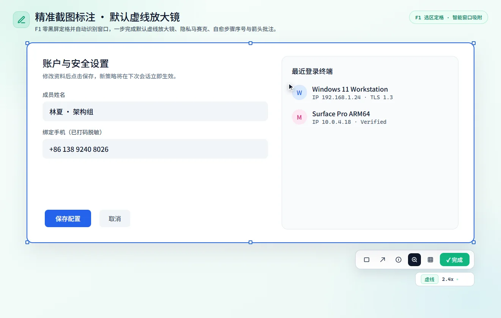

<div align="center">


# Tools3000

**轻量、原生的 Windows 多合一桌面效率工具集**

**简体中文** · [繁體中文](README.zh-TW.md) · [English](README.en.md) · [日本語](README.ja.md) · [한국어](README.ko.md) · [Русский](README.ru.md) · [Português (Brasil)](README.pt-BR.md) · [Español](README.es.md)

[](https://github.com/yuan278501381/Tools3000/releases/latest)
[](https://github.com/yuan278501381/Tools3000/stargazers)
[](https://github.com/yuan278501381/Tools3000/releases)
[](#安装与下载)
[](#安装与下载)
[](LICENSE)

**[立即下载最新版本](#安装与下载)** · [开发初衷](#开发初衷) · [一软替代清单](#一软替代清单) · [核心功能一览](#核心功能一览) · [安全与校验](#安全校验与信任说明) · [全功能演示](#全功能动态演示) · [参与共创](#参与共创与反馈) · [开发者指南](docs/DEVELOPER.md)

</div>

<br />

<table>
  <tr>
    <td width="50%" align="center" valign="top">
      <br />
      <sub><b>极速文件搜索与空格预览</b> · 关键词或拼音首字母秒查，按空格免打开直看</sub>
    </td>
    <td width="50%" align="center" valign="top">
      <br />
      <sub><b>高精度离线文本识别与批注</b> · 纯本地离线、准确率高于微信截图 OCR，拖选复制/波浪线/改字</sub>
    </td>
  </tr>
  <tr>
    <td width="50%" align="center" valign="top">
      <br />
      <sub><b>滚动长截图</b> · 自动滚动无缝拼接、右侧实时预览，首尾一键无损裁切</sub>
    </td>
    <td width="50%" align="center" valign="top">
      <br />
      <sub><b>高清录屏与自动运镜演播室</b> · 60 FPS 录屏、智能自动运镜，一键转微信 GIF、动态 WebP 与 MP4</sub>
    </td>
  </tr>
</table>

Tools3000 将日常高频的**文件搜索、文档内容搜索、滚动长截图、精准截图标注、桌面贴图与贴图组、高精度离线文本识别、高清录屏（自动运镜演播室、支持导出微信 GIF 与动态 WebP）与全局鼠标手势**整合为单一原生软件。待机仅占约十余 MB 内存、100% 本地离线运行，同时适配个人电脑（`x64` / `ARM64`）与 Windows Server 多用户并发办公。

---

## 开发初衷

我是 **Everything** 十多年的老用户；截图软件最早用 **QQ、微信截图**，后来换到标注方便的 **FastStone Capture**，再之后换到可以贴图的 **Snipaste**，后来因为需要滚动长截图、截图放大镜效果和文本识别，又换到了 **PixPin**；鼠标手势从 **WGestures** 一路用到 **WGestures 2**；录屏软件也前前后后换过很多款，中途还试过微软的 **PowerToys** 工具套件，但总还是缺那么几块核心拼图，最后依然得同时常驻好几个工具。

某一天看着 Windows 系统托盘里排成一串的图标，心想：**要是能把它们合并成一个软件就好了。** 再加上日常使用时一直被几个痛点困扰——PixPin 的文本识别在识别率和速度上始终不如微信；WGestures 从某一天起总会在屏幕上残留一个很小的文本框挡住视线，只有重启软件才能消掉。趁着 AI 时代到来，我干脆自己动手，借助 AI 一步步做出了这款多合一效率工具 **Tools3000**。

给各位潜在用户做一个真诚的交代：在公开发布之前，我已经**重度自用了 4 个月**，一边渐进式开发新功能，一边陆续修掉日常遇到的各种问题。最开始还是老软件开着兜底，Tools3000 哪里用着不顺手就先切回去，修完再切回来；**而现在，我的系统托盘终于清净了，只剩下 Tools3000 这一个软件。**

当然，考虑到真实桌面环境和使用场景的复杂性，大家在实际使用中难免还会遇到新的问题。在 AI 时代，软件演进的门槛已经大大降低——无论是通过 **[GitHub Issues](https://github.com/yuan278501381/Tools3000/issues) 把问题发给我**，还是**直接参与共创（Pull Request）**，都非常欢迎我们一起把它打磨得越来越顺手。

---

## 一软替代清单

老牌专精软件各有深厚积累，Tools3000 的目标不是否定它们，而是用**一个统一界面、统一快捷键、零广告零付费墙的原生进程**，覆盖日常 90%+ 的高频组合场景，让系统托盘回归清净：

| 常见独立工具 | Tools3000 覆盖的日常高频场景 | 仍建议保留或搭配原工具的专精场景 |
| :--- | :--- | :--- |
| **Everything** | `Alt + Space` 毫秒级全盘文件名、拼音/首字母与 `content:` 文档正文穿透检索，按需启动不拖慢开机 | 需要 HTTP/ETP 局域网共享搜索、EXIF/音视频全属性列索引，或深度依赖 `es.exe` CLI 第三方生态 |
| **QuickLook** | 搜索结果列表选中按 `Space` 免打开秒看图片、Office、PDF、代码、CAD、PSD 与 3D 模型 | 需要直接在 Windows 桌面或资源管理器任意文件夹中按空格全局预览，或依赖丰富社区 `.qlplugin` 插件 |
| **Snipaste / PixPin** | `F1` 零黑屏定格截图标注、默认虚线放大镜、滚动长截图、`F3` 多贴图分组管理，以及纯离线高精度 OCR（拖选复制、波浪线批注与原位改字） | 需要 Snipaste 对老旧特殊 GUI 控件的极致单点元素探测，或特定命令行截图工作流 |
| **WGestures / StrokesPlus** | 按住右键一划切标签/后退/关窗、不松键瞬发、屏幕边缘滚轮调音量、四角触发、全屏游戏自动避让与内置 Lua 扩展 | 需要极复杂的多键组合触发（如左键按住加右键手势）、复杂窗体区域条件或多年沉淀的宏录制脚本 |
| **各类录屏工具（如 ShareX）** | 60 FPS 高清录屏、键鼠回显、停止即进自动运镜演播室（声波剪辑与微晶点击特效），一键导出 MP4、微信直发 GIF 与动态 WebP | 需要 80+ 图床/S3/FTP/Webhook 截完自动上传工作流，或高度定制的自定义 FFmpeg 批处理流水线 |

---

## 核心功能一览

<p align="center">
  
</p>

---

## 安装与下载

### 方式一：包管理器一键安装（推荐）

- **Scoop（即刻可用 · 自动绿色便携模式，配置持久化于 `data/`，升级零丢失）**：

```powershell
scoop bucket add tools3000 https://github.com/yuan278501381/Tools3000
scoop install tools3000/tools3000
```

- **Winget（官方规范清单已就绪）**：仓库 [`packaging/winget/`](packaging/winget/) 已随版本自动生成并通过微软官方 `winget validate` 校验（包 ID：`Yy1.Tools3000`），收录至微软官方 `microsoft/winget-pkgs` 源后可直接运行 `winget install Yy1.Tools3000`（源码环境亦可通过 `winget install -m packaging/winget` 本地安装）。

### 方式二：GitHub Releases 直接下载

前往 **[GitHub Releases](https://github.com/yuan278501381/Tools3000/releases/latest)** 下载最新版本：

- **标准安装程序（`Tools3000-Setup.exe`）** — 推荐日常使用，支持开机自启、按需组件勾选与无感覆盖升级。
- **绿色便携版（`Tools3000-Portable-x64.zip`）** — 解压即用，配置与数据均保存在当前目录。
- **校验清单（`SHA256SUMS.txt`）** — 提供每次发布的 SHA-256 完整性校验值。

> **系统要求**：Windows 10（1809 及以上）/ Windows 11 / Windows Server 2019–2025，源码与构建管线原生支持 `x64` 与 `ARM64` 架构（GitHub Releases 当前预编译提供 `x64` 安装包与便携包，ARM64 设备可按[开发者指南](docs/DEVELOPER.md)原生编译或直接运行 `x64` 版本），依赖系统内置 Microsoft Edge WebView2 Runtime。界面原生支持简体中文、繁體中文、English、日本語、한국어、Русский、Português (Brasil)、Español 共 8 种语言，默认自动跟随系统语言。

### 安全校验与信任说明

为彻底消除对 Windows 桌面工具的安全顾虑，Tools3000 提供四重零黑盒验证机制（完整披露见 **[SECURITY.md](SECURITY.md)**）：

1. **SHA-256 完整性校验**：下载后可在 PowerShell 中核对本地文件哈希，并与对应版本的 `SHA256SUMS.txt` 比对：
   ```powershell
   Get-FileHash .\Tools3000-Setup.exe -Algorithm SHA256
   ```
2. **VirusTotal 公开查毒**：在 **[VirusTotal](https://www.virustotal.com/)** 搜索框输入发布包 SHA-256（后续每个 GitHub Release 说明页也将直接附带可点击的 VirusTotal 哈希直链），即可公开核验 70+ 主流杀毒引擎检测结果。
3. **关于 Windows Defender SmartScreen 提示**：独立开源项目在尚未配置商业 EV / 公网可信代码签名（SignPath / Trusted Signing 推进中）或新版本刚发布尚未累积云端信誉前，Windows 可能会弹出「Windows 已保护你的电脑（未知发布者）」提示。核对 SHA-256 与 VirusTotal 无误后点击 **「更多信息 -> 仍要运行」** 即可继续；如您更偏好完全自主可控，也可随时依据 **[开发者指南](docs/DEVELOPER.md)** 从源码从零编译。
4. **内嵌 SPDX 软件物料清单（SBOM）**：每个安装包与便携包根目录均随附 `SBOM.spdx.json` 与 `THIRD_PARTY_NOTICES.txt`，所有依赖与开源许可透明可查。

---

## 全功能动态演示

<table>
  <tr>
    <td width="50%" align="center" valign="top">
      <br />
      <sub><b>文档内容搜索</b> · 穿透检索 PDF / Word / Excel / 代码正文，高亮上下文并一键复制行</sub>
    </td>
    <td width="50%" align="center" valign="top">
      <br />
      <sub><b>精准截图标注</b> · 零黑屏定格、默认虚线光学放大镜、隐私马赛克与自愈序号</sub>
    </td>
  </tr>
  <tr>
    <td width="50%" align="center" valign="top">
      <br />
      <sub><b>桌面贴图与贴图组</b> · F3 多图置顶与彩色分组，顶部导览条按组秒切显隐、一键磁吸平铺</sub>
    </td>
    <td width="50%" align="center" valign="top">
      <br />
      <sub><b>全局鼠标手势</b> · 按住右键一划关标签、不松键瞬发切页、边缘滚轮调音量</sub>
    </td>
  </tr>
</table>

| 模块 | 核心体验 |
| :--- | :--- |
| **极速文件搜索** | `Alt + Space` 全盘百万文件毫秒秒搜，支持中文全拼与首字母；选中按 `Space` 免打开快速预览（图片、Office、PDF、代码、CAD、PSD 与 3D 模型）。 |
| **文档内容搜索** | `content:` 直接穿透检索 Word、Excel、PDF、PPT、CAD 与源代码正文，实时高亮上下文片段并支持点击行号一键复制。 |
| **滚动长截图** | 网页、文档与聊天记录自动滚动无缝拼接，右侧实时预览，支持首尾无损裁切（随时往回拖恢复）与长图原位标注。 |
| **精准截图标注** | `F1` 零黑屏定格并自动吸附窗口控件，支持像素级取色、默认虚线光学放大镜、6 种箭头、自愈步骤序号、隐私马赛克与美化分享壳。 |
| **桌面贴图与贴图组** | `F3` 一键将截图或剪贴板图像置顶悬浮，支持滚轮缩放、透明调节与鼠标穿透；内置多贴图分组管理，可通过顶部导览条按组秒切显隐或一键磁吸整齐平铺。 |
| **高精度离线文本识别** | 纯本地离线识别，实测代码、JSON 与复杂排版识别准确率高于微信截图 OCR；在原图或贴图上直接拖选复制、画波浪线/荧光笔批注、原位无痕改字及表格/二维码提取。 |
| **高清录屏与自动运镜演播室** | 60 FPS 高清录屏联动键鼠回显，停止即进演播室——光标点击处智能自动运镜聚焦，搭配多款质感壁纸与声波时间轴剪辑；支持一键导出 **MP4**、**微信直发 GIF**（免点直播表情 / 可双击放大高清大图分档）与**高清动态 WebP**。 |
| **全局鼠标手势** | 按住右键一划即可切标签、后退、关窗口，支持不松键瞬发、屏幕边缘滚轮调音量、分应用专属手势与全屏游戏自动避让。 |
| **演示特效与远控助手** | 投屏清透键帽与双击 `Ctrl` 聚光灯；系统“打开 / 另存为”弹窗快捷导览条；mstsc、RustDesk、ToDesk、向日葵等远控系统热键直通与卡键一键释放。 |

---

## 常用快捷键

所有快捷键均可在设置中心自由修改并自动检测冲突：

| 快捷键 | 功能 |
| :--- | :--- |
| `Alt + Space` | 呼出 / 隐藏极速搜索（选中结果按 `Space` 快速预览） |
| `F1` | 区域截图与标注 |
| `F3` | 将剪贴板图像或文本置顶贴图 |
| 快速双击 `Ctrl` | 唤起 / 关闭鼠标聚光灯 |
| `Ctrl + Alt + Backspace` | 远控修饰键卡死一键释放（或快速双击右侧 `Ctrl`） |

---

## 隐私与原则

- **完全离线**：文件索引、文档搜索、文字识别与键鼠统计均在本地完成，断网环境下全部可用。
- **零遥测、无账号**：无广告弹窗、无需登录，不收集或上传任何文件与输入数据。
- **按需轻量**：所有模块均可自由开关，搜索服务仅在主动呼出时按需启动，日常待机几乎零感知。

---

## 参与共创与反馈

- **报告问题**：遇到任何边界兼容性或识别/录制问题，欢迎通过 **[Bug Report 模板](https://github.com/yuan278501381/Tools3000/issues/new?template=bug_report.yml)** 提交。
- **需求建议**：有好用的顺手小功能想法，欢迎提交 **[Feature Request](https://github.com/yuan278501381/Tools3000/issues/new?template=feature_request.yml)** 或前往 **[GitHub Discussions](https://github.com/yuan278501381/Tools3000/discussions)** 交流。
- **代码共创**：非常欢迎提交 Pull Request（也欢迎借助 AI 共同打磨），构建与开发细节请参阅 **[开发者指南](docs/DEVELOPER.md)** 与 **[包管理器维护说明](packaging/README.md)**。

---

## 文档与许可

- **开发与安全**：源码编译、插件 SDK、Lua 扩展见 **[开发者指南](docs/DEVELOPER.md)**，安全验证与漏洞披露见 **[SECURITY.md](SECURITY.md)**，版本变更见 **[GitHub Releases](https://github.com/yuan278501381/Tools3000/releases)**。
- **开源协议**：本项目基于 **[GNU GPL v3.0](LICENSE)** 开源（附 [Windows / WebView2 链接豁免](LICENSE-EXCEPTION.md)）。
- **版权声明**：`Copyright (c) 2026 Yy1 (yuan278501381) & Tools3000 contributors` · [@yuan278501381](https://github.com/yuan278501381)
