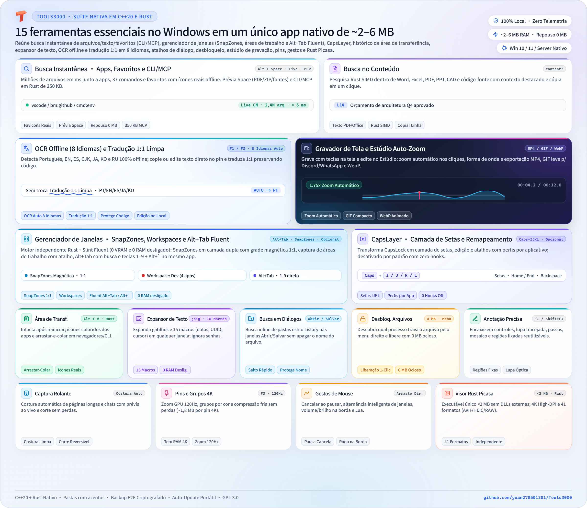
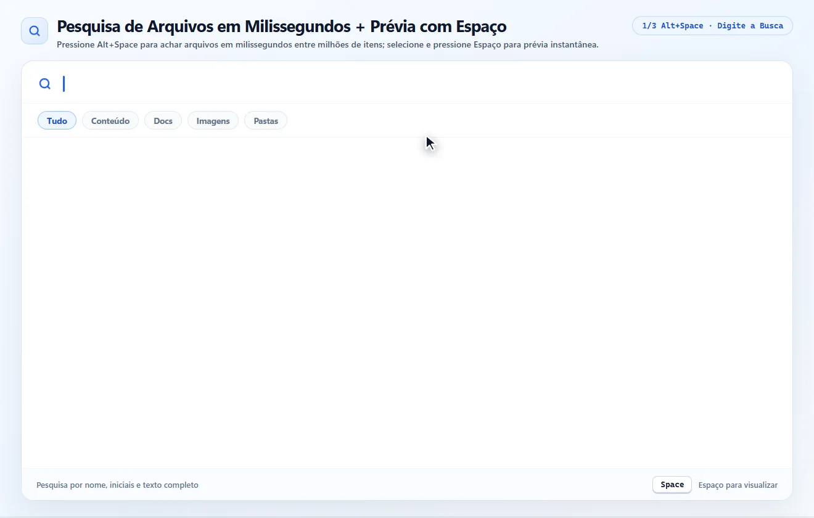
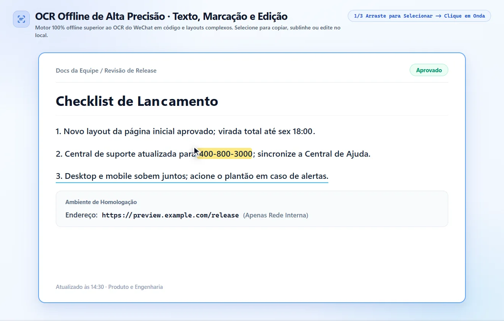
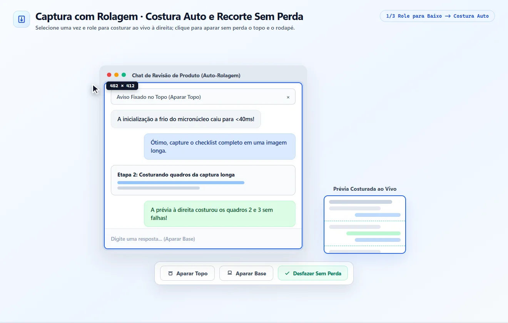
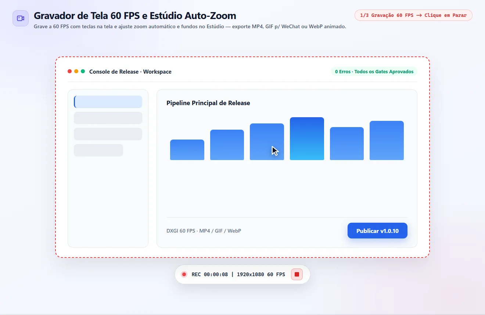
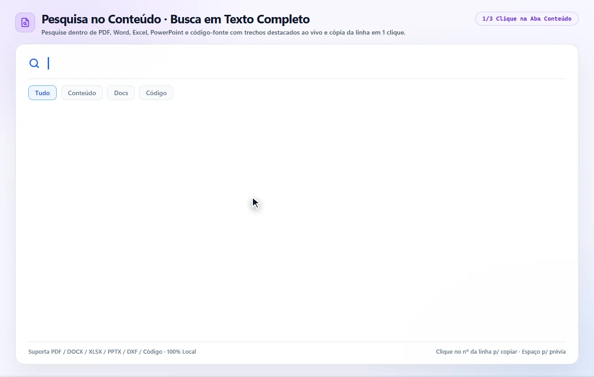
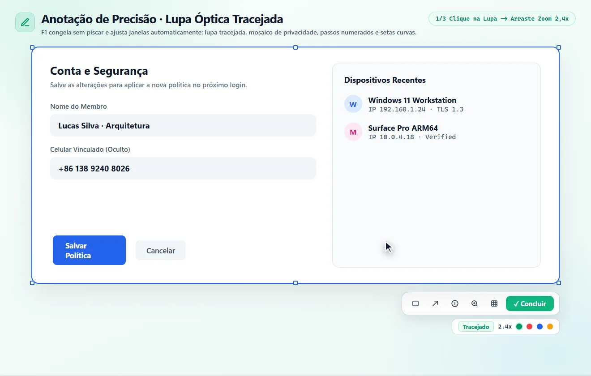
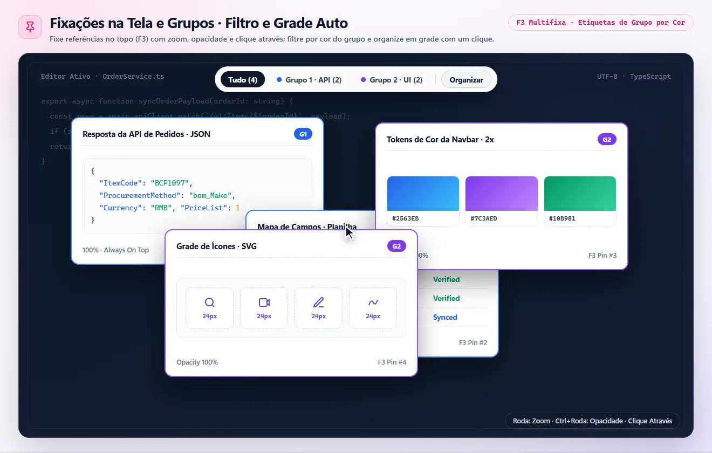
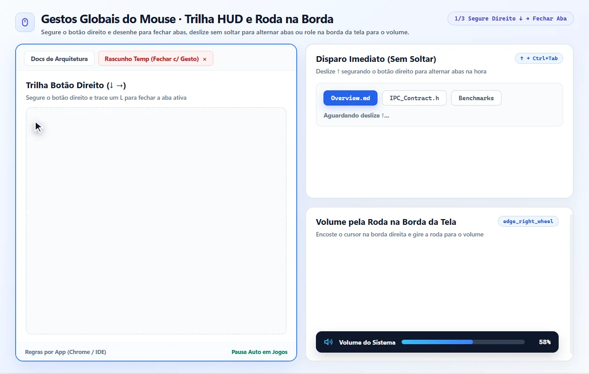

<div align="center">


# Tools3000

**Suíte nativa, completa e ultraleve de produtividade para Windows**

[简体中文](README.md) · [繁體中文](README.zh-TW.md) · [English](README.en.md) · [日本語](README.ja.md) · [한국어](README.ko.md) · [Русский](README.ru.md) · **Português (Brasil)** · [Español](README.es.md)

[](https://github.com/yuan278501381/Tools3000/releases/latest)
[](https://github.com/yuan278501381/Tools3000/stargazers)
[](https://github.com/yuan278501381/Tools3000/releases)
[](#download-e-instalação)
[](#download-e-instalação)
[](LICENSE)

**[Baixar versão mais recente](#download-e-instalação)** · [Visão geral](#visão-geral) · [Demonstrações](#demonstrações) · [Segurança e verificação](#verificação-de-segurança-e-confiança) · [Por que criei](#por-que-criei-o-tools3000) · [O que substitui](#o-que-o-tools3000-substitui) · [Contribuir](#feedback-e-cocriação) · [Guia do desenvolvedor](docs/DEVELOPER.md)

</div>

<br />

O Tools3000 reúne em um único aplicativo nativo para Windows as ferramentas essenciais do dia a dia: **busca instantânea de arquivos, busca no conteúdo de documentos, captura com rolagem, anotação precisa de capturas, fixação na tela com grupos de pins, OCR offline de alta precisão, gravação de tela com Estúdio de zoom automático (exportando MP4, GIF otimizado para mensageiros/WeChat e WebP animado) e gestos globais do mouse**. Consome cerca de uma dúzia de MB de RAM em repouso, funciona 100% offline e atende tanto PCs pessoais (`x64` e `ARM64`) quanto ambientes Windows Server com múltiplos usuários simultâneos.

---

## Visão geral

<p align="center">
  
</p>

---

## Demonstrações

<table>
  <tr>
    <td width="50%" align="center" valign="top">
      <br />
      <sub><b>Busca Instantânea e Pré-visualização</b> · Encontre arquivos em milissegundos e visualize com a barra de Espaço</sub>
    </td>
    <td width="50%" align="center" valign="top">
      <br />
      <sub><b>OCR Offline de Alta Precisão</b> · 100% local; arraste para copiar, sublinhe com linha ondulada ou edite no local</sub>
    </td>
  </tr>
  <tr>
    <td width="50%" align="center" valign="top">
      <br />
      <sub><b>Captura com Rolagem</b> · Junção automática com prévia ao vivo e recorte não destrutivo de topo e rodapé</sub>
    </td>
    <td width="50%" align="center" valign="top">
      <br />
      <sub><b>Gravador de Tela e Estúdio Auto-Zoom</b> · Zoom inteligente nos cliques e exportação em MP4, GIF e WebP animado</sub>
    </td>
  </tr>
  <tr>
    <td width="50%" align="center" valign="top">
      <br />
      <sub><b>Busca no Conteúdo</b> · Pesquise dentro de PDF, Word, Excel e código-fonte com cópia da linha em um clique</sub>
    </td>
    <td width="50%" align="center" valign="top">
      <br />
      <sub><b>Anotação Precisa</b> · Encaixe automático em controles, lupa óptica tracejada, mosaico de privacidade e marcadores numerados</sub>
    </td>
  </tr>
  <tr>
    <td width="50%" align="center" valign="top">
      <br />
      <sub><b>Pins na Tela e Grupos</b> · Fixe referências no topo (F3), filtre por cor de grupo e organize em grade com um clique</sub>
    </td>
    <td width="50%" align="center" valign="top">
      <br />
      <sub><b>Gestos Globais do Mouse</b> · Arraste com o botão direito para fechar abas, disparo instantâneo e volume na borda</sub>
    </td>
  </tr>
</table>

| Módulo | O que faz |
| :--- | :--- |
| **Busca Instantânea de Arquivos** | Pressione `Alt + Space` para localizar arquivos entre milhões de itens em milissegundos; aperte `Space` para visualizar imagens, Office, PDFs, código, CAD, PSD e modelos 3D sem abrir programas pesados. |
| **Busca no Conteúdo** | Use `content:` para pesquisar dentro de Word, Excel, PDF, PowerPoint, CAD e código-fonte com trechos destacados e cópia da linha em um clique. |
| **Captura com Rolagem** | Costure automaticamente páginas longas, chats e documentos com prévia lateral ao vivo, recorte não destrutivo de topo/rodapé e anotação direta na imagem longa. |
| **Anotação Precisa** | `F1` encaixa automaticamente em janelas e controles de interface; inclui seletor de cor por pixel, lupa óptica tracejada, 6 estilos de seta, numeração autoajustável, mosaico e molduras. |
| **Pins na Tela e Grupos** | Fixe capturas ou trechos da área de transferência sempre no topo (`F3`) com zoom na roda, opacidade e clique transparente; organize em grupos por cor, alterne visibilidade na barra superior ou alinhe em grade em um clique. |
| **OCR Offline de Alta Precisão** | Reconhecimento 100% local com alta precisão em código, JSON e layouts densos — selecione e copie texto direto em imagens fixadas, faça marcações onduladas, destaque, edite texto no local e extraia tabelas ou QR Codes. |
| **Gravador de Tela e Estúdio** | Grave a tela com sobreposição de teclas/cliques e entre direto no Estúdio: zoom automático nos cliques, papéis de parede selecionados, edição por forma de onda e exportação em **MP4**, **GIF pronto para mensageiros/WeChat** e **WebP animado**. |
| **Gestos Globais do Mouse** | Segure o botão direito e deslize para alternar abas, voltar ou fechar janelas; suporta disparo instantâneo, volume pela roda na borda da tela, regras por aplicativo e pausa automática em jogos em tela cheia. |
| **Apresentação e Acesso Remoto** | Exibição limpa de teclas e holofote de cursor com duplo toque em `Ctrl`; barra de acesso rápido nas janelas Abrir/Salvar do Windows; passagem de atalhos para mstsc, RustDesk, ToDesk e AnyDesk com desbloqueio de teclas presas. |
| **Visualizador de Fotos Picasa (Rust · Opcional)** | Visualizador leve no estilo Picasa recriado em Rust + Direct2D (**apenas visualizador, não o pacote completo Google Picasa**). **Executável único com menos de 2 MB e zero dependências externas — funciona junto ao Tools3000 ou totalmente independente em qualquer Windows.** Desmarcado por padrão no instalador; ao ativar, associa automaticamente todos os 41 formatos suportados (com ícones Polaroid e painel Direct2D nativo com tema claro/escuro). Além do zoom amortecido no cursor, tira de miniaturas e apresentação com fundido cruzado, **adiciona recursos ausentes no original**: nitidez 4K High-DPI (100%–250%+), VSync 60–240 Hz, WebP / AVIF / HEIC / SVG / QOI / DDS / RAW de câmeras, controle de quadros animados, espelhamento sem perdas e 8 idiomas. |

---

## Download e instalação

### Opção 1: Gerenciadores de Pacotes (Recomendado)

- **Scoop (Disponível agora — modo portátil verdadeiro com configurações persistidas em `data/`)**:

```powershell
scoop bucket add tools3000 https://github.com/yuan278501381/Tools3000
scoop install tools3000/tools3000
```

- **Winget (Manifestos oficiais incluídos)**: os manifestos de `Yy1.Tools3000` em [`packaging/winget/`](packaging/winget/) são atualizados e validados com `winget validate` a cada release. Após publicação em `microsoft/winget-pkgs`, instale com `winget install Yy1.Tools3000` (validação local: `winget install -m packaging/winget`).

### Opção 2: Download Direto no GitHub Releases

Baixe a versão mais recente em **[GitHub Releases](https://github.com/yuan278501381/Tools3000/releases/latest)**:

- **Instalador Padrão (`Tools3000-vX.Y.Z-Setup.exe`)** — Recomendado para uso diário, com seleção de componentes, inicialização automática e atualização fluida sem reiniciar.
- **Versão Portátil (`Tools3000-vX.Y.Z-win-x64-portable.zip`)** — Extraia e execute imediatamente, mantendo todas as configurações na própria pasta.
- **Checksums (`SHA256SUMS.txt`)** — Hashes SHA-256 para validação de integridade de cada arquivo publicado.

> **Requisitos do sistema**: Windows 10 (1809+) / Windows 11 / Windows Server 2019–2025, com suporte nativo no código e pipeline de build para `x64` e `ARM64` (o GitHub Releases fornece atualmente pacotes pré-compilados `x64`; dispositivos ARM64 podem compilar nativamente pelo [Guia do desenvolvedor](docs/DEVELOPER.md) ou executar a versão `x64`), requer Microsoft Edge WebView2 Runtime integrado. A interface do aplicativo oferece suporte nativo a 8 idiomas (incluindo Português do Brasil), seguindo o idioma do sistema por padrão.

### Verificação de segurança e confiança

Transparência total em quatro camadas (detalhes em **[SECURITY.md](SECURITY.md)**):

1. **Verificação SHA-256**: valide o arquivo baixado contra `SHA256SUMS.txt` no PowerShell:
   ```powershell
   Get-FileHash .\Tools3000-vX.Y.Z-Setup.exe -Algorithm SHA256
   ```
2. **Consulta pública no VirusTotal**: pesquise o SHA-256 no **[VirusTotal](https://www.virustotal.com/)** (ou clique nos links diretos incluídos nas notas dos próximos releases) para inspecionar os resultados de 70+ mecanismos de segurança.
3. **Aviso do Windows Defender SmartScreen**: enquanto um projeto open-source independente não possui certificado comercial EV/confiável público (SignPath / Trusted Signing em andamento) ou em versões recém-lançadas, o Windows pode exibir "Editor desconhecido". Após conferir SHA-256 e VirusTotal, clique em **Mais informações -> Executar assim mesmo** ou compile você mesmo pelo **[Guia do desenvolvedor](docs/DEVELOPER.md)**.
4. **SPDX SBOM embutido**: o instalador e o arquivo portátil incluem `SBOM.spdx.json` e `THIRD_PARTY_NOTICES.txt`.

---

## Por que criei o Tools3000

Sou usuário assíduo do **Everything** há mais de dez anos. Para capturas de tela, comecei com as capturas integradas do **QQ e WeChat**, passei para o **FastStone Capture** pela praticidade das anotações, depois mudei para o **Snipaste** para poder fixar capturas na tela e, mais tarde, migrei para o **PixPin** por causa da captura com rolagem, lupa e OCR; nos gestos de mouse, usei **WGestures** e **WGestures 2**, além de testar inúmeros gravadores de tela — no meio do caminho cheguei até a experimentar o Microsoft **PowerToys**, mas ainda faltavam peças essenciais do dia a dia e acabei voltando a manter vários aplicativos abertos ao mesmo tempo.

Com visualizadores de imagem foi a mesma frustração: os gratuitos populares vinham cheios de anúncios e instaladores embutidos, e depois que o Google descontinuou o **Picasa**, testei várias alternativas — como **FastStone Image Viewer** e até o visualizador oficial do autor do Everything (**Void Image Viewer**) —, mas nenhum tinha a fluidez e a naturalidade do Picasa. Acabei desistindo e me contentando com o app Fotos nativo do Windows. Aproveitando o projeto, recriei em Rust + Direct2D o clássico visualizador leve do Picasa (menos de 2 MB, zero dependências, utilizável de forma independente) completando tudo o que faltava no original, como High-DPI e formatos modernos (WebP/AVIF/HEIC/SVG/RAW).

Um dia, olhando para a fileira de ícones acumulados na bandeja do sistema do Windows, pensei: **seria ótimo juntar tudo isso em um único aplicativo.** Além disso, alguns incômodos diários persistiam — o OCR do PixPin continuava atrás do WeChat em precisão e velocidade, e o WGestures passou a deixar uma pequena caixa de texto presa na tela que só sumia ao reiniciar o programa. Aproveitando a era da IA, decidi construir do zero essa suíte tudo-em-um: o **Tools3000**.

Para ser totalmente transparente com quem está conhecendo o projeto: venho **usando o Tools3000 no meu dia a dia há 4 meses**, adicionando recursos de forma gradual e corrigindo problemas conforme aparecem. No começo eu ainda mantinha os programas antigos abertos como plano B quando algo falhava; **hoje minha bandeja do sistema está finalmente limpa — só o Tools3000 continua rodando.**

Claro que os ambientes Windows reais são muito diversos e novos detalhes ainda podem surgir. Na era da IA, evoluir um software juntos ficou muito mais acessível — seja **[abrindo uma issue no GitHub](https://github.com/yuan278501381/Tools3000/issues)** para relatar problemas, seja **cocriando via Pull Requests**, você é muito bem-vindo.

---

## O que o Tools3000 substitui

Cada utilitário clássico tem seus pontos fortes avançados. O Tools3000 reúne 90%+ da rotina diária em **um único aplicativo nativo gratuito sob licença GPL-3.0**, deixando claro quando ainda vale manter a ferramenta dedicada:

| Utilitário Clássico | Fluxos cobertos pelo Tools3000 | Quando manter a ferramenta dedicada |
| :--- | :--- | :--- |
| **Everything** | `Alt + Space` para busca NTFS instantânea por nome e `content:` no conteúdo de documentos, iniciando sob demanda | Quando precisa de servidor HTTP/ETP, indexação completa de metadados EXIF/mídia ou ecossistema CLI `es.exe` |
| **Snipaste / PixPin** | `F1` captura e anotação, lupa tracejada, captura com rolagem, `F3` grupos de pins e OCR offline rápido com edição no local | Quando depende da detecção extrema de controles GUI legados ou automações CLI específicas |
| **WGestures / StrokesPlus** | Gestos com botão direito, disparo imediato, volume na borda, cantos ativos, pausa automática em jogos e scripts Lua | Quando utiliza gestos com múltiplos botões simultâneos, condições complexas de janela ou macros legados |
| **Gravadores (ex.: ShareX)** | Gravação de tela, exibição de teclas, Estúdio (edição por forma de onda e zoom do cursor), exportação em MP4, GIF e WebP | Quando depende de upload automático para 80+ serviços de nuvem/S3/FTP/Webhook ou pipelines FFmpeg personalizados |
| **Picasa Photo Viewer / FastStone / Fotos do Windows** | Visualizador leve Picasa opcional em Rust (< 2 MB, zero dependências, executável independente): animações clássicas com 4K High-DPI, WebP/AVIF/HEIC/SVG/RAW e espelhamento sem perdas | Quando precisa da biblioteca de álbuns e reconhecimento facial do Google Picasa completo ou edição RAW avançada em lote |

---

## Atalhos padrão

Todos os atalhos podem ser personalizados nas Configurações com detecção de conflitos em tempo real:

| Atalho | Ação |
| :--- | :--- |
| `Alt + Space` | Abrir / ocultar busca instantânea (`Space` sobre o resultado abre a pré-visualização) |
| `F1` | Captura de área e anotação |
| `F3` | Fixar imagem ou texto da área de transferência no topo |
| Duplo toque em `Ctrl` | Ativar / desativar holofote do cursor |
| `Ctrl + Alt + Backspace` | Liberar teclas modificadoras presas em acesso remoto (ou duplo toque no `Ctrl` direito) |

---

## Privacidade e princípios

- **100% Offline**: Indexação de arquivos, busca textual, OCR, anotações e estatísticas funcionam estritamente no seu dispositivo — mesmo sem conexão com a internet.
- **Zero Telemetria, Sem Contas**: Sem anúncios, sem login e sem envio de arquivos ou digitação para servidores externos.
- **Leve por Padrão**: Cada módulo pode ser ativado ou desativado individualmente, e o serviço de busca só inicia sob demanda para manter o consumo em repouso mínimo.

---

## Feedback e cocriação

- **Relatar um bug**: use o **[modelo de Bug Report](https://github.com/yuan278501381/Tools3000/issues/new?template=bug_report.yml)**.
- **Sugerir recursos**: envie um **[Feature Request](https://github.com/yuan278501381/Tools3000/issues/new?template=feature_request.yml)** ou participe das **[GitHub Discussions](https://github.com/yuan278501381/Tools3000/discussions)**.
- **Contribuir com código**: Pull Requests são muito bem-vindos — consulte o **[Guia do desenvolvedor](docs/DEVELOPER.md)** e o **[Guia de empacotamento](packaging/README.md)**.

---

## Star History

<a href="https://www.star-history.com/#yuan278501381/Tools3000&Date">
 <picture>
   <source media="(prefers-color-scheme: dark)" srcset="https://api.star-history.com/svg?repos=yuan278501381/Tools3000&type=Date&theme=dark" />
   <source media="(prefers-color-scheme: light)" srcset="https://api.star-history.com/svg?repos=yuan278501381/Tools3000&type=Date" />
   
 </picture>
</a>

---

## Documentação e licença

- **Desenvolvimento e Segurança**: instruções de compilação no **[Guia do desenvolvedor](docs/DEVELOPER.md)**, política de segurança em **[SECURITY.md](SECURITY.md)** e histórico em **[GitHub Releases](https://github.com/yuan278501381/Tools3000/releases)**.
- **Licença**: Distribuído sob a **[GNU GPL v3.0](LICENSE)** (com [exceção de vinculação Windows / WebView2](LICENSE-EXCEPTION.md)).
- **Direitos autorais**: `Copyright (c) 2026 Yy1 (yuan278501381) & Tools3000 contributors` · [@yuan278501381](https://github.com/yuan278501381)
