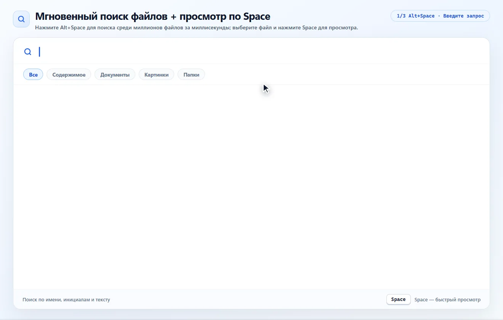
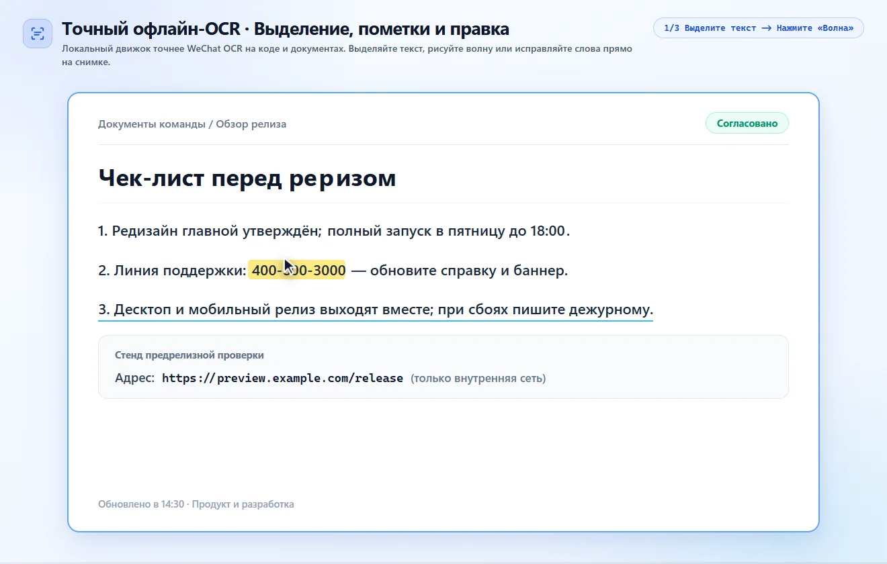
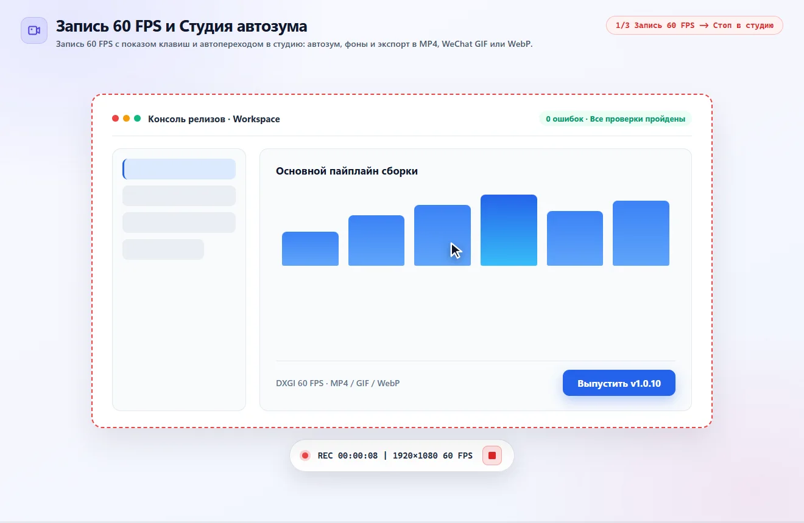
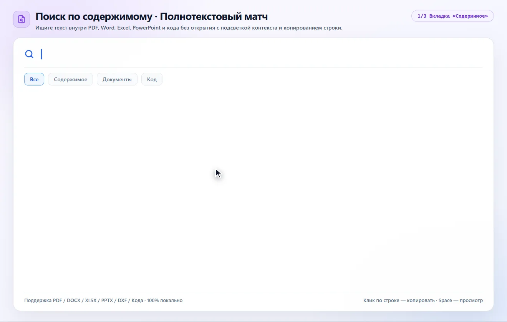
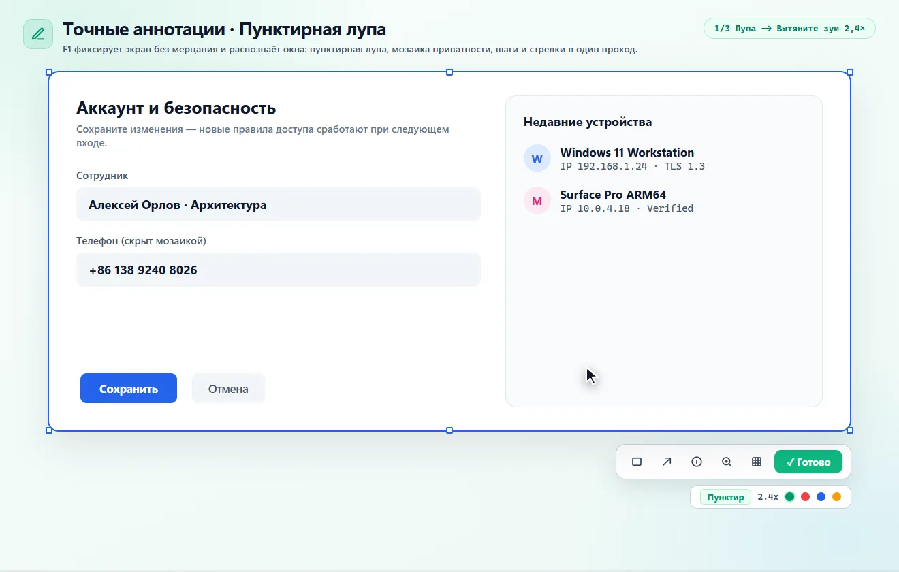
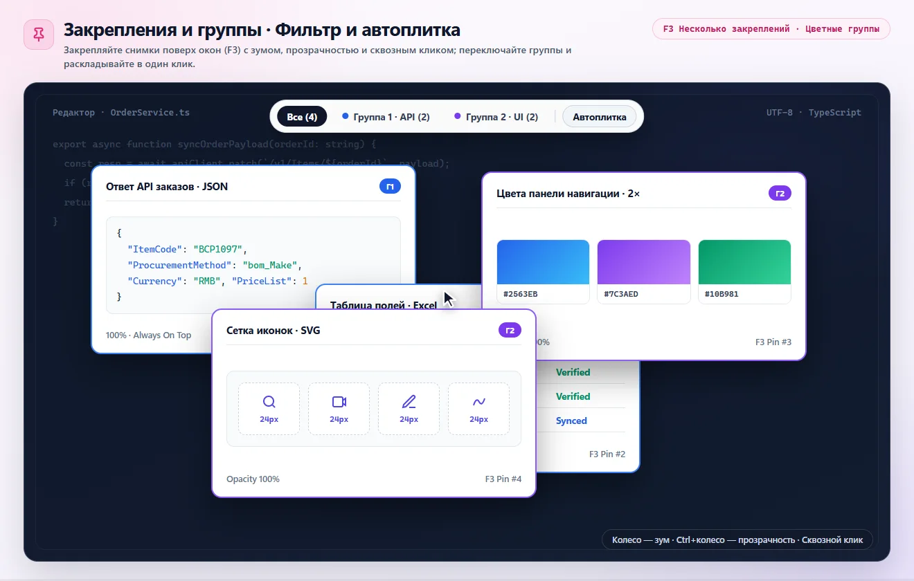
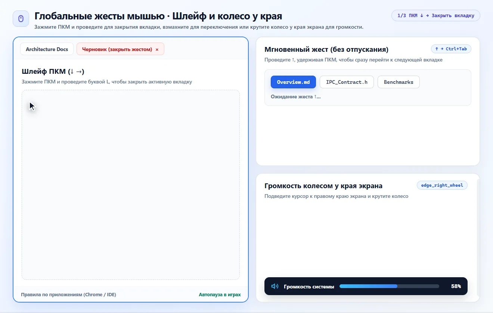

<div align="center">


# Tools3000

**Лёгкий нативный универсальный набор продуктивности для Windows**

[简体中文](README.md) · [繁體中文](README.zh-TW.md) · [English](README.en.md) · [日本語](README.ja.md) · [한국어](README.ko.md) · **Русский** · [Português (Brasil)](README.pt-BR.md) · [Español](README.es.md)

[](https://github.com/yuan278501381/Tools3000/releases/latest)
[](https://github.com/yuan278501381/Tools3000/stargazers)
[](https://github.com/yuan278501381/Tools3000/releases)
[](#загрузка-и-установка)
[](#загрузка-и-установка)
[](LICENSE)

**[Скачать последнюю версию](#загрузка-и-установка)** · [Обзор](#обзор-возможностей) · [Демонстрация](#демонстрация-функций) · [Безопасность и проверка](#проверка-безопасности-и-доверие) · [Зачем я создал Tools3000](#почему-я-создал-tools3000) · [Что заменяет](#что-заменяет-tools3000) · [Участие](#обратная-связь-и-совместная-разработка) · [Руководство разработчика](docs/DEVELOPER.md)

</div>

<br />

Tools3000 объединяет повседневные инструменты — **мгновенный поиск файлов, полнотекстовый поиск по содержимому документов, длинный скриншот с автопрокруткой, точную разметку скриншотов, закрепление снимков поверх окон с группами, высокоточный офлайн-OCR, запись экрана со Студией автозума (экспорт в MP4, GIF и анимированный WebP) и глобальные жесты мышью** — в одном нативном приложении Windows. В режиме ожидания оно занимает около десятка мегабайт ОЗУ, работает полностью офлайн и поддерживает как личные ПК (`x64` и `ARM64`), так и многопользовательскую одновременную работу на Windows Server.

---

## Обзор возможностей

<p align="center">
  
</p>

---

## Демонстрация функций

<table>
  <tr>
    <td width="50%" align="center" valign="top">
      <br />
      <sub><b>Мгновенный поиск и предпросмотр</b> · Поиск среди миллионов файлов за миллисекунды и просмотр по Space</sub>
    </td>
    <td width="50%" align="center" valign="top">
      <br />
      <sub><b>Офлайн-OCR и разметка</b> · 100% локальное распознавание: выделение, копирование, подчёркивание и правка текста на месте</sub>
    </td>
  </tr>
  <tr>
    <td width="50%" align="center" valign="top">
      <br />
      <sub><b>Скриншот с прокруткой</b> · Автосклейка с предпросмотром в реальном времени и неразрушающая обрезка краёв</sub>
    </td>
    <td width="50%" align="center" valign="top">
      <br />
      <sub><b>Запись экрана и Студия с автозумом</b> · умный автозум и экспорт в MP4, GIF и анимированный WebP</sub>
    </td>
  </tr>
  <tr>
    <td width="50%" align="center" valign="top">
      <br />
      <sub><b>Поиск по содержимому</b> · Поиск внутри PDF, Word, Excel и исходного кода с копированием строки по клику</sub>
    </td>
    <td width="50%" align="center" valign="top">
      <br />
      <sub><b>Точная разметка</b> · Автопривязка к элементам, пунктирная лупа, мозаика и нумерация шагов</sub>
    </td>
  </tr>
  <tr>
    <td width="50%" align="center" valign="top">
      <br />
      <sub><b>Закрепление и группы</b> · Фиксация поверх окон (F3), фильтрация по группам и автоукладка сеткой в один клик</sub>
    </td>
    <td width="50%" align="center" valign="top">
      <br />
      <sub><b>Жесты мышью</b> · Закрытие вкладок жестом ПКМ, мгновенное срабатывание и громкость у края экрана</sub>
    </td>
  </tr>
</table>

| Модуль | Возможности |
| :--- | :--- |
| **Мгновенный поиск файлов** | Нажмите `Alt + Space` для поиска среди миллионов файлов за миллисекунды; нажмите `Space` для быстрого предпросмотра изображений, Office, PDF, кода, CAD, PSD и 3D-моделей без запуска тяжёлых программ. |
| **Поиск по содержимому** | Префикс `content:` ищет непосредственно внутри Word, Excel, PDF, PowerPoint, CAD и исходного кода с подсветкой фрагментов и копированием строки кликом по её номеру. |
| **Скриншот с прокруткой** | Автоматическая склейка длинных веб-страниц, чатов и документов с боковым предпросмотром, неразрушающей обрезкой верха/низа и прямой разметкой длинного снимка. |
| **Точная разметка** | `F1` автоматически привязывается к окнам и элементам UI; доступны пипетка, пунктирная оптическая лупа, 6 видов стрелок, самовосстанавливающаяся нумерация, мозаика и рамки. |
| **Закрепление и группы** | Закрепляйте скриншоты и фрагменты буфера обмена поверх окон (`F3`) с масштабом колесом, прозрачностью и кликом насквозь; объединяйте в цветовые группы, переключайте видимость и выравнивайте сеткой в один клик. |
| **Офлайн-OCR высокой точности** | Полностью локальное распознавание с высокой точностью на коде, JSON и плотной вёрстке: выделение и копирование прямо на закреплённом снимке, волнистое подчёркивание, маркер, правка текста на месте, извлечение таблиц и QR-кодов. |
| **Запись экрана и Студия** | Запись экрана с отображением клавиш и кликов и мгновенным переходом в Студию: умный автозум на кликах, фоновые обои, монтаж по аудиоволне и экспорт в **MP4**, **компактный GIF (включая пресеты для WeChat)** и **анимированный WebP**. |
| **Глобальные жесты мышью** | Зажмите правую кнопку мыши для переключения вкладок, навигации и закрытия окон; поддерживаются мгновенное срабатывание, громкость у края экрана, правила для отдельных приложений и автообход в полноэкранных играх. |
| **Презентация и удалённый доступ** | Оверлей нажатых клавиш и прожектор курсора по двойному `Ctrl`; панель быстрого перехода в диалогах «Открыть / Сохранить»; проброс горячих клавиш для mstsc, RustDesk, ToDesk, AnyDesk и сброс залипших модификаторов. |

---

## Загрузка и установка

### Способ 1: Пакетные менеджеры (рекомендуется)

- **Scoop (доступно прямо сейчас — настоящий портативный режим с сохранением данных в `data/` при обновлениях)**:

```powershell
scoop bucket add tools3000 https://github.com/yuan278501381/Tools3000
scoop install tools3000/tools3000
```

- **Winget (готовые официальные манифесты)**: в каталоге [`packaging/winget/`](packaging/winget/) автоматически обновляются и проходят `winget validate` манифесты `Yy1.Tools3000`. После публикации в `microsoft/winget-pkgs` установка будет доступна через `winget install Yy1.Tools3000` (локально: `winget install -m packaging/winget`).

### Способ 2: Прямая загрузка с GitHub Releases

Скачайте актуальный релиз на странице **[GitHub Releases](https://github.com/yuan278501381/Tools3000/releases/latest)**:

- **Стандартный установщик (`Tools3000-Setup.exe`)** — рекомендуется для повседневной работы: выбор компонентов, автозапуск и плавное обновление поверх установленной версии.
- **Портативный архив (`Tools3000-Portable-x64.zip`)** — распакуйте и запускайте сразу, все настройки и данные хранятся в папке программы.
- **Контрольные суммы (`SHA256SUMS.txt`)** — хеши SHA-256 для проверки целостности каждого файла релиза.

> **Системные требования**: Windows 10 (1809+) / Windows 11 / Windows Server 2019–2025; исходный код и система сборки нативно поддерживают `x64` и `ARM64` (в GitHub Releases сейчас публикуются готовые сборки `x64`, на устройствах ARM64 можно собрать нативно по [Руководству разработчика](docs/DEVELOPER.md) или запускать `x64`-версию), требуется встроенный Microsoft Edge WebView2 Runtime. Интерфейс приложения поддерживает 8 языков, включая русский, и по умолчанию следует за языком системы.

### Проверка безопасности и доверие

Полная прозрачность без чёрных ящиков (подробнее в **[SECURITY.md](SECURITY.md)**):

1. **Проверка целостности SHA-256**: сверьте файл с `SHA256SUMS.txt` в PowerShell:
   ```powershell
   Get-FileHash .\Tools3000-Setup.exe -Algorithm SHA256
   ```
2. **Публичная проверка на VirusTotal**: вставьте SHA-256 файла на **[VirusTotal](https://www.virustotal.com/)** (в новых релизах ссылки на VirusTotal добавляются прямо в описание релиза), чтобы проверить вердикты 70+ антивирусных движков.
3. **Предупреждение Windows Defender SmartScreen**: пока у независимого open-source проекта нет коммерческого EV/публично доверенного сертификата (оформление SignPath / Trusted Signing в процессе) или свежий релиз ещё не набрал репутацию, Windows может показать «Неизвестный издатель». После проверки SHA-256 и VirusTotal нажмите **«Подробнее -> Выполнить в любом случае»** или соберите программу самостоятельно из исходников по **[Руководству разработчика](docs/DEVELOPER.md)**.
4. **Встроенный SPDX SBOM**: в установщик и портативный архив входят `SBOM.spdx.json` и `THIRD_PARTY_NOTICES.txt` со всеми зависимостями.

---

## Почему я создал Tools3000

Я пользуюсь **Everything** уже более десяти лет. Для скриншотов я начинал со встроенных инструментов **QQ и WeChat**, затем перешёл на **FastStone Capture** ради удобных аннотаций, после — на **Snipaste** ради закрепления скриншотов поверх окон, а позже перешёл на **PixPin** ради длинных скриншотов с прокруткой, лупы и OCR; для жестов мышью пользовался **WGestures** и **WGestures 2**, программ для записи экрана перепробовал десятки, а по пути даже попробовал Microsoft **PowerToys**, но в нём всё равно не хватало нескольких ключевых повседневных инструментов — и снова приходилось держать запущенной целую стопку утилит.

Однажды, глядя на целую вереницу иконок в системном трее Windows, я подумал: **было бы здорово объединить всё это в одном приложении.** К тому же в ежедневной работе накапливались раздражающие мелочи — OCR в PixPin уступал WeChat и по точности, и по скорости, а в WGestures в какой-то момент на экране стало зависать маленькое текстовое окошко, убрать которое удавалось только перезапуском программы. С наступлением эпохи ИИ я решил собрать единый комбайн сам — так появился **Tools3000**.

Честно расскажу потенциальным пользователям: перед публикацией я **4 месяца ежедневно пользовался Tools3000 сам**, постепенно добавляя функции и исправляя всё, на что натыкался. Поначалу старые утилиты оставались запущенными на подстраховке — если что-то сбоило, я временно возвращался к ним и чинил проблему; **а теперь мой трей наконец-то чист, в нём остался только Tools3000.**

Разумеется, реальные конфигурации Windows очень разнообразны, и новые нюансы наверняка ещё встретятся. В эпоху ИИ дорабатывать проекты вместе стало проще простого — буду рад как **[баг-репортам в GitHub Issues](https://github.com/yuan278501381/Tools3000/issues)**, так и **совместной разработке через Pull Requests**.

---

## Что заменяет Tools3000

У специализированных программ есть свои глубокие ниши. Tools3000 закрывает 90%+ ежедневных задач **одним бесплатным нативным приложением под лицензией GPL-3.0**, честно обозначая границы, где узкие утилиты всё ещё незаменимы:

| Отдельная утилита | Ежедневные задачи в Tools3000 | Когда стоит оставить исходную утилиту |
| :--- | :--- | :--- |
| **Everything** | `Alt + Space` — мгновенный поиск по именам и `content:` по тексту документов с запуском службы строго по запросу | Нужны HTTP/ETP-серверы поиска, индексация EXIF/медиа-атрибутов или экосистема CLI `es.exe` |
| **Snipaste / PixPin** | `F1` захват и разметка, пунктирная лупа, длинный скриншот, `F3` группы закреплений и быстрый офлайн-OCR с правкой текста на месте | Нужна уникальная детекция элементов в старых редких GUI или кастомные CLI-цепочки захвата |
| **WGestures / StrokesPlus** | Жесты правой кнопкой, мгновенный триггер, громкость у края экрана, активные углы, автопауза в играх и Lua-скрипты | Нужны сложные многокнопочные аккорды, хитрые условия областей окна или многолетняя коллекция макросов |
| **Запись экрана (ShareX и др.)** | Запись экрана, показ клавиш, Студия (монтаж по аудиоволне и автозум за курсором), экспорт в MP4, GIF и WebP | Нужна автозагрузка на 80+ облачных хостингов/S3/FTP/Webhook или сложные пакетные конвейеры FFmpeg |

---

## Горячие клавиши

Любое сочетание клавиш можно свободно изменить в настройках с автоматической проверкой конфликтов:

| Сочетание | Действие |
| :--- | :--- |
| `Alt + Space` | Открыть / скрыть быстрый поиск (`Space` на результате — быстрый предпросмотр) |
| `F1` | Скриншот области и разметка |
| `F3` | Закрепить изображение или текст из буфера обмена поверх окон |
| Двойное нажатие `Ctrl` | Включить / выключить прожектор курсора |
| `Ctrl + Alt + Backspace` | Сбросить залипшие модификаторы в удалённом рабочем столе (или двойной правый `Ctrl`) |

---

## Приватность и принципы

- **100% офлайн**: индексация файлов, полнотекстовый поиск, OCR, аннотации и статистика ввода работают строго локально — даже без интернета.
- **Без телеметрии и аккаунтов**: никакой рекламы, регистрации и отправки ваших файлов или нажатий клавиш на внешние серверы.
- **Лёгкость по умолчанию**: каждый модуль отключается отдельно, а служба поиска запускается только по запросу, сохраняя минимальное потребление ресурсов в фоне.

---

## Обратная связь и совместная разработка

- **Сообщить об ошибке**: воспользуйтесь **[шаблоном Bug Report](https://github.com/yuan278501381/Tools3000/issues/new?template=bug_report.yml)**.
- **Предложить идею**: создайте **[Feature Request](https://github.com/yuan278501381/Tools3000/issues/new?template=feature_request.yml)** или обсудите в **[GitHub Discussions](https://github.com/yuan278501381/Tools3000/discussions)**.
- **Участвовать в разработке**: Pull Request всегда приветствуются — см. **[Руководство разработчика](docs/DEVELOPER.md)** и **[руководство по пакетам](packaging/README.md)**.

---

## Документация и лицензия

- **Разработка и безопасность**: инструкции по сборке в **[Руководстве разработчика](docs/DEVELOPER.md)**, политика безопасности в **[SECURITY.md](SECURITY.md)**, история версий в **[GitHub Releases](https://github.com/yuan278501381/Tools3000/releases)**.
- **Лицензия**: распространяется под **[GNU GPL v3.0](LICENSE)** (с [исключением связывания Windows / WebView2](LICENSE-EXCEPTION.md)).
- **Авторские права**: `Copyright (c) 2026 Yy1 (yuan278501381) & Tools3000 contributors` · [@yuan278501381](https://github.com/yuan278501381)
