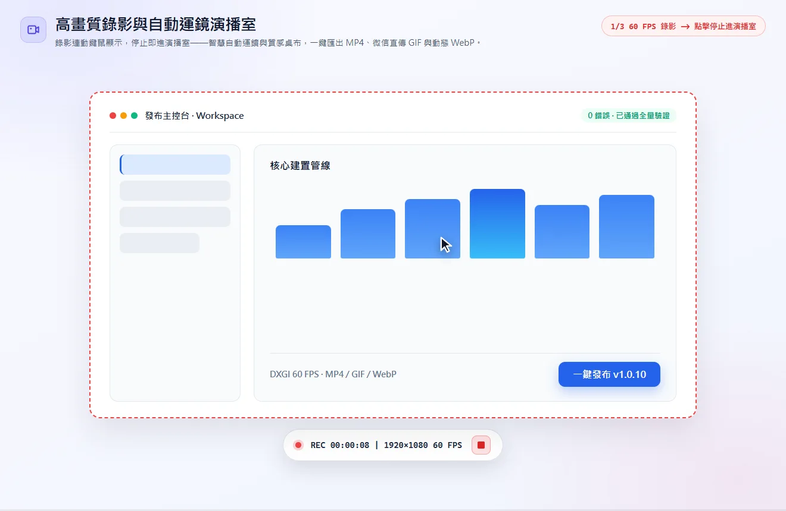
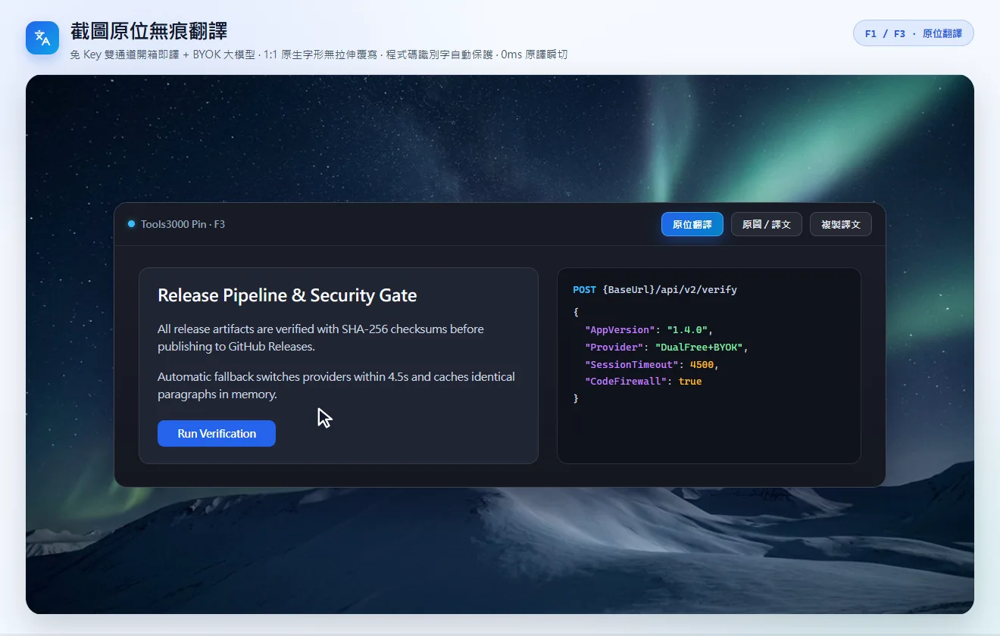
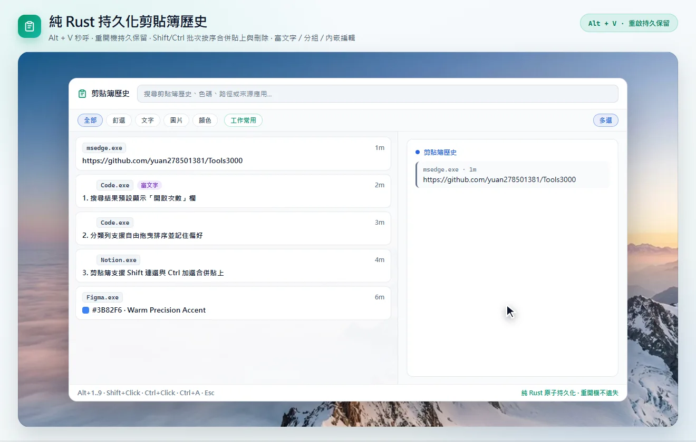
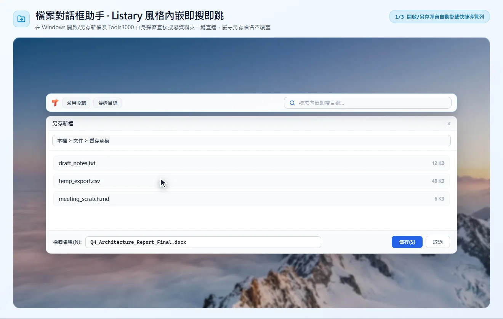

<div align="center">


# Tools3000

**輕量、原生的 Windows 多合一桌面效率工具集**

[简体中文](README.md) · **繁體中文** · [English](README.en.md) · [日本語](README.ja.md) · [한국어](README.ko.md) · [Русский](README.ru.md) · [Português (Brasil)](README.pt-BR.md) · [Español](README.es.md)

[](https://github.com/yuan278501381/Tools3000/releases/latest)
[](https://github.com/yuan278501381/Tools3000/stargazers)
[](https://github.com/yuan278501381/Tools3000/releases)
[](#安裝與下載)
[](#安裝與下載)
[](LICENSE)

**[立即下載最新版本](#安裝與下載)** · [核心功能一覽](#核心功能一覽) · [全功能展示](#全功能動態展示) · [安全與校驗](#安全校驗與信任說明) · [開發初衷](#開發初衷) · [一軟替代清單](#一軟替代清單) · [參與共創](#參與共創與回饋) · [開發者指南](docs/DEVELOPER.md)

</div>

<br />

Tools3000 將日常高頻使用的**檔案/應用/系統工具與原站圖示書籤搜尋（含即時刷新、3 檔記憶體模式與命令列/MCP）、文件內容搜尋、重啟不遺失的剪貼簿歷史、檔案對話框內嵌即搜、檔案佔用解鎖、捲動長擷圖、精準擷圖標註、桌面釘選貼圖與群組管理、8 國語言自動離線識字與無痕原位翻譯、螢幕錄影（自動運鏡演播室，支援匯出 WeChat GIF、動態 WebP 與 MP4）、全域滑鼠手勢與 Rust 輕量看圖器**整合為單一原生軟體。核心功能 100% 本機離線執行、完整支援中文及多語系安裝資料夾與使用者名稱，待機僅佔約十餘 MB 記憶體（搜尋背景支援閒置 0 MB 休眠），同時適配個人電腦（`x64` / `ARM64`）與 Windows Server 多使用者併發辦公環境。

---

## 核心功能一覽

<p align="center">
  
</p>

---

## 全功能動態展示

<table>
  <tr>
    <td width="50%" align="center" valign="top">
      <br />
      <sub><b>極速融合搜尋與空白鍵預覽</b> · 原圖示直達應用/書籤/系統工具，即時刷新並按空白鍵直看文件/壓縮檔/字型</sub>
    </td>
    <td width="50%" align="center" valign="top">
      <br />
      <sub><b>8 國語言離線識字與批註</b> · 跨語種免切換離線識字，拖選複製 / 波浪線 / 原位改字</sub>
    </td>
  </tr>
  <tr>
    <td width="50%" align="center" valign="top">
      <br />
      <sub><b>捲動長擷圖</b> · 自動捲動無縫拼接、右側即時預覽，首尾一鍵無損裁切</sub>
    </td>
    <td width="50%" align="center" valign="top">
      <br />
      <sub><b>錄影與自動運鏡演播室</b> · 螢幕錄影、智慧自動運鏡，一鍵匯出 WeChat GIF、動態 WebP 與 MP4</sub>
    </td>
  </tr>
  <tr>
    <td width="50%" align="center" valign="top">
      <br />
      <sub><b>文件內容搜尋</b> · 穿透檢索 PDF / Word / Excel / 程式碼內文，高亮上下文並一鍵複製整行</sub>
    </td>
    <td width="50%" align="center" valign="top">
      <br />
      <sub><b>精準擷圖標註</b> · 預設虛線光學放大鏡、自動吸附控制項、隱私馬賽克與自動重排步驟序號</sub>
    </td>
  </tr>
  <tr>
    <td width="50%" align="center" valign="top">
      <br />
      <sub><b>桌面貼圖與貼圖群組</b> · F3 多圖置頂與色彩分組，頂部導覽列按組秒切顯隱、一鍵磁吸平鋪</sub>
    </td>
    <td width="50%" align="center" valign="top">
      <br />
      <sub><b>全域滑鼠手勢</b> · 預設停頓自動取消防誤觸、智慧切回已有視窗、不放鍵瞬發與螢幕邊緣滾輪調音量</sub>
    </td>
  </tr>
  <tr>
    <td width="50%" align="center" valign="top">
      <br />
      <sub><b>截圖原位翻譯</b> · 免 Key 雙通道 + 自訂大模型，智慧擦除無痕覆寫、程式碼原樣保留與 0ms 原譯瞬切</sub>
    </td>
    <td width="50%" align="center" valign="top">
      <br />
      <sub><b>剪貼簿歷史 (Alt + V)</b> · 關機重啟不遺失，Shift/Ctrl 批次按序合併貼上、富文字、分組與系統匣開關</sub>
    </td>
  </tr>
  <tr>
    <td width="50%" align="center" valign="top">
      <br />
      <sub><b>檔案對話框助手</b> · 開啟/另存新檔及自身彈窗直接搜目錄一鍵跳，另存檔名絕不覆蓋</sub>
    </td>
    <td width="50%" align="center" valign="top">
      <br />
      <sub><b>檔案佔用解鎖</b> · 右鍵檔案、搜尋結果或頁內直選，秒查佔用行程並一鍵安全解鎖</sub>
    </td>
  </tr>
</table>

| 模組 | 核心體驗 |
| :--- | :--- |
| **極速檔案搜尋** | `Alt + Space` 全磁碟百萬檔案毫秒即出，融合已安裝應用（`app:`）、37 個常用 Windows 系統工具（`cmd:env` 等）與 Edge/Chrome/Brave/Vivaldi 瀏覽器書籤（`bm:`/`b:`，純離線直接顯示網站原圖示）；支援 **即時刷新**、**3 檔記憶體模式**（含閒置 0 MB 休眠）、開啟次數統計與可拖曳分類列；選取按 `Space` 免開啟預覽圖片、Office、PDF、程式碼、CAD、PSD、3D、壓縮檔（ZIP/7Z/RAR）、字型（TTF/OTF）與影音畫面；附帶 350 KB 輕量命令列與 MCP 工具 `tools3000-cli.exe`。 |
| **文件內容搜尋** | 使用 `content:` 直接穿透檢索 Word、Excel、PDF、PowerPoint、CAD 與原始碼內文，即時高亮上下文片段並點擊行號一鍵複製。 |
| **剪貼簿歷史** | `Alt + V` 秒呼（支援系統匣右鍵開啟與系統匣面板一鍵開關），關機重啟不遺失歷史紀錄；支援 `Shift / Ctrl` 按序批次合併貼上與刪除、HTML/RTF 富文字、收藏分組、內嵌編輯、`Alt + 1..9` 瞬貼、色票與敏感應用排除。 |
| **檔案對話框助手** | 在 Windows「開啟 / 另存新檔 / 選擇資料夾」及 Tools3000 自身彈窗上方自動顯示快捷導覽列，像 Listary 一樣直接輸入搜目錄一鍵跳轉，並嚴格保護另存檔名不被覆蓋。 |
| **檔案佔用解鎖** | 刪不掉檔案時一鍵找出佔用程式：在檔案總管右鍵檔案或資料夾（可選僅按住 `Shift + 右鍵` 顯示）、搜尋結果右鍵，或在設定頁內直接選取檔案/資料夾，即可秒查佔用行程並一鍵安全解鎖；平時零記憶體常駐，不改動系統底層，關閉自動清理右鍵項。 |
| **捲動長擷圖** | 網頁、文件與聊天紀錄自動捲動無縫拼接，右側即時預覽，支援首尾無損裁切（隨時可拖回還原）與長圖原位標註。 |
| **精準擷圖標註** | `F1` 自動吸附視窗與介面控制項，支援像素級取色、預設虛線光學放大鏡、6 種箭頭、自癒步驟序號、隱私馬賽克與美化分享外框。 |
| **桌面貼圖與貼圖群組** | `F3` 一鍵將擷圖或剪貼簿圖像置頂懸浮，支援 120Hz 阻尼無段縮放、透明度調整與滑鼠穿透；內建多貼圖色彩群組，透過頂部浮動列按組切換顯隱或一鍵磁吸整齊平鋪。 |
| **8 國語言離線識字與原位翻譯** | 純本機跨語種免切換離線識字（自動辨識中/英/日/韓/俄/西/葡截圖，4 套輕量語種包按需下載，貼圖右鍵可單圖指定語言），支援拖選複製、波浪線／螢光筆批註、原位無痕改字與表格／QR Code 擷取；內建**截圖無痕原位 1:1 翻譯**（免 Key 雙通道 + 自訂 OpenAI 相容大模型）、程式碼原樣保留與 0ms 原譯瞬切。 |
| **錄影與自動運鏡演播室** | 螢幕錄影聯動鍵鼠回顯，停止即進入演播室——滑鼠點擊處智慧自動運鏡聚焦，搭配多款質感背景與聲波時間軸剪輯；支援一鍵匯出 **MP4**、**WeChat 直傳 GIF**（自動播放小圖 / 可雙擊放大高畫質大圖分檔）與**高畫質動態 WebP**。 |
| **全域滑鼠手勢** | 按住右鍵一劃即可切換分頁、上一頁或關閉視窗；預設開啟「劃動中途停頓自動取消」防誤觸，支援「執行程式」精準切回已有視窗（含 Chrome 多開不同設定檔）、不放鍵瞬發、螢幕邊緣滾輪調音量/亮度、8 秒彩蛋、全螢幕遊戲自動避讓與 Lua 擴充。 |
| **簡報特效與遠端控制助手** | 投屏清透鍵帽與雙擊 `Ctrl` 聚光燈；mstsc、RustDesk、ToDesk、AnyDesk 等遠端桌面熱鍵直通與卡鍵一鍵釋放；側邊欄左下角內建自動替敏感資訊打碼的「問題回饋」與診斷匯出通道。 |
| **Picasa 圖片檢視器（Rust 復刻 · 選用）** | 基於 Rust + Direct2D 復刻的經典 Picasa 輕量圖片檢視器（**非原版 Google Picasa 全功能套件**）。**單檔不到 2 MB、零外部執行庫相依，既可隨 Tools3000 使用也可直接單獨複製出去完全獨立執行**；安裝預設不勾選，勾選或於設定頁啟用即自動關聯全部 41 種支援的圖片格式（附經典拍立得圖示與原生深淺自適應 Direct2D 關聯面板）。在還原原版游標阻尼縮放、膠片縮圖漣漪、關閉收攏與全螢幕交叉疊化幻燈片的同時，**補足了原版缺少的現代功能**：4K High-DPI 100%–250%+ 實體像素銳度與 60–240Hz VSync 硬體算圖、WebP / AVIF / HEIC / SVG / QOI / DDS / 主流相機 RAW 解碼、動圖逐幀與倍速控制、水平／垂直無損鏡像翻轉及全 8 語種介面。 |

---

## 安裝與下載

### 方式一：套件管理器一鍵安裝（推薦）

- **Scoop（即刻可用 · 自動免安裝可攜模式，設定持久化於 `data/`，升級零遺失）**：

```powershell
scoop bucket add tools3000 https://github.com/yuan278501381/Tools3000
scoop install tools3000/tools3000
```

- **Winget（官方規範清單已就緒）**：儲存庫 [`packaging/winget/`](packaging/winget/) 已隨版本自動產生並通過微軟官方 `winget validate` 校驗（套件 ID：`Yy1.Tools3000`），收錄至 `microsoft/winget-pkgs` 官方源後即可直接執行 `winget install Yy1.Tools3000`（原始碼環境亦可透過 `winget install -m packaging/winget` 本機安裝）。

### 方式二：GitHub Releases 直接下載

前往 **[GitHub Releases](https://github.com/yuan278501381/Tools3000/releases/latest)** 下載最新版本：

- **標準安裝程式（`Tools3000-vX.Y.Z-Setup.exe`）** — 推薦日常使用，支援開機自啟、按需勾選元件與無感覆蓋升級。
- **免安裝可攜版（`Tools3000-vX.Y.Z-win-x64-portable.zip`）** — 解壓即用，設定與資料完整保存在目前資料夾。
- **校驗清單（`SHA256SUMS.txt`）** — 提供每次發佈的 SHA-256 完整性校驗值。

> **系統需求**：Windows 10（1809 及以上）/ Windows 11 / Windows Server 2019–2025，原始碼與建置管線原生支援 `x64` 與 `ARM64` 架構（GitHub Releases 目前預先編譯提供 `x64` 安裝程式與可攜版，ARM64 裝置可依[開發者指南](docs/DEVELOPER.md)原生編譯或直接執行 `x64` 版本），依賴系統內建 Microsoft Edge WebView2 Runtime。軟體介面原生支援 8 種語言，預設自動跟隨系統語言。

### 安全校驗與信任說明

Tools3000 提供四重零黑盒驗證機制（完整揭露見 **[SECURITY.md](SECURITY.md)**）：

1. **SHA-256 完整性校驗**：下載後可在 PowerShell 核對雜湊並與 `SHA256SUMS.txt` 比對：
   ```powershell
   Get-FileHash .\Tools3000-vX.Y.Z-Setup.exe -Algorithm SHA256
   ```
2. **VirusTotal 公開查驗**：前往 **[VirusTotal](https://www.virustotal.com/)** 輸入發佈檔 SHA-256（後續每次 GitHub Release 頁面亦直接附帶可點擊直連），公開檢視 70+ 主流防毒引擎掃描結果。
3. **關於 Windows Defender SmartScreen 提示**：獨立開源專案在尚未配置商業 EV / 公網受信任程式碼簽章（SignPath / Trusted Signing 推進中）或新版剛發佈累積信譽初期，Windows 可能彈出「未知發行者」提示；核對 SHA-256 與 VirusTotal 無誤後點選 **「其他資訊 -> 仍要執行」** 即可，或依 **[開發者指南](docs/DEVELOPER.md)** 從原始碼自行編譯。
4. **內嵌 SPDX 軟體物料清單（SBOM）**：安裝程式與可攜版根目錄均隨附 `SBOM.spdx.json` 與 `THIRD_PARTY_NOTICES.txt`，所有相依套件與開源授權透明可查。

---

## 開發初衷

我是 **Everything** 十多年的老用戶；擷圖軟體最早用 **QQ、微信擷圖**，後來換到標註方便的 **FastStone Capture**，再之後換到可以貼圖的 **Snipaste**，後來因為需要捲動長擷圖、擷圖放大鏡效果與文字辨識，又換到了 **PixPin**；滑鼠手勢從 **WGestures** 用到 **WGestures 2**；錄影軟體也前前後後換過許多款，中途還試過微軟的 **PowerToys** 工具套件，但總還是少那麼幾塊核心拼圖，最後依然得同時常駐好幾個工具。

至於看圖軟體，國產看圖工具大多充滿彈窗廣告與捆綁推廣；Google 停更 **Picasa** 後，我也在網上試過不少替代品——像是 **FastStone Image Viewer**，甚至 **Everything** 官方推出的看圖工具（Void Image Viewer）——但用下來總覺得少了 Picasa 那種行雲流水的跟手操作與靈魂動效，最後索性放棄，改回湊合使用 Windows 內建相片應用。趁著打造 Tools3000，便用 Rust + Direct2D 把最懷念的經典 Picasa 輕量檢視器親手復刻回來（不到 2 MB 單檔零相依、亦可獨立使用），並補足原版欠缺的高分屏銳度與現代格式支援。

某天看著 Windows 系統匣裡排成一串的圖示，心想：**要是能把它們合併成一個軟體就好了。** 再加上日常使用一直被幾個痛點困擾——PixPin 的文字辨識在辨識率與速度上始終不如微信；WGestures 從某一天起總會在螢幕上殘留一個很小的文字框擋住畫面，只有重啟軟體才能消除。趁著 AI 時代到來，我決定自己動手，借助 AI 一步步打造出這款多合一效率工具 **Tools3000**。

給各位潛在使用者一個真誠的交代：在公開前我已經**重度自用了 4 個月**，一邊漸進式開發新功能，一邊陸續修掉日常踩到的各種問題。一開始仍開著舊軟體備援，Tools3000 哪裡不好用就先切回去，修好再切回來；**而現在，我的系統匣終於清靜了，只留下 Tools3000 這一個軟體。**

當然，考量到實際桌面環境與使用情境的複雜性，難免還是會遇到新問題。在 AI 時代，無論是透過 **[GitHub Issues](https://github.com/yuan278501381/Tools3000/issues) 把問題回報給我**，還是**直接參與共創（Pull Request）**，都非常歡迎一起把它越磨越順手。

---

## 一軟替代清單

老牌專精軟體各有深厚累積，Tools3000 的目標並非否定它們，而是用**一個介面統一、零廣告零付費牆的原生程序**，涵蓋日常 90%+ 高頻組合情境，讓系統匣重回清靜：

| 常見獨立工具 | Tools3000 涵蓋的日常高頻情境 | 仍建議保留或搭配原工具的專精情境 |
| :--- | :--- | :--- |
| **Everything** | `Alt + Space` 毫秒級全磁碟檔名、拼音、`bm:` 瀏覽器書籤與 `content:` 文件內文穿透搜尋，內建 350 KB 純 Rust CLI / MCP Server，按需啟動不拖慢開機 | 需要 HTTP/ETP 區網共享搜尋、EXIF/影音全屬性欄索引，或強綁定既有 `es.exe` 第三方腳本語法 |
| **Ditto / Windows `Win + V` 剪貼簿** | `Alt + V` 純 Rust 原子持久化剪貼簿歷史（重開機不遺失），支援 `Shift / Ctrl` 批次按序合併貼上與刪除、HTML/RTF 富文字、自訂分組、內嵌編輯與 `Alt + 1..9` 秒貼 | 需要多台電腦間的區網剪貼簿即時同步，或海量歷史項目的雲端帳號漫遊 |
| **Snipaste / PixPin** | `F1` 擷圖標註、預設虛線放大鏡、捲動長擷圖、`F3` 120Hz 阻尼貼圖分組、截圖原位 1:1 翻譯，以及純離線高精度 OCR（框選複製、批註與原位改字） | 需要 Snipaste 對老舊特殊 GUI 控制項的極致單點元素偵測，或特定命令列擷圖工作流 |
| **WGestures / StrokesPlus** | 按住右鍵一劃切分頁/上一頁/關窗、不放鍵瞬發、螢幕邊緣滾輪調音量、四角觸發、全螢幕遊戲自動避讓與內建 Lua 擴充 | 需要複雜多鍵組合觸發、細部視窗區域條件，或長年累積的巨集錄製腳本 |
| **各類錄影工具（如 ShareX）** | 錄影、鍵鼠回顯、停止即進自動運鏡演播室（聲波剪輯與滑鼠運鏡），一鍵匯出 MP4、WeChat GIF 與動態 WebP | 需要 80+ 圖床/S3/FTP/Webhook 擷完自動上傳工作流，或高度客製化 FFmpeg 批次管線 |
| **Picasa 檢視器 / FastStone / Windows 相片** | 選用內建不到 2 MB 零相依的 Rust 復刻 Picasa 輕量檢視器（亦可完全獨立執行），還原經典動效並補足 4K High-DPI、WebP/AVIF/HEIC/SVG/RAW 與無損翻轉 | 需要原版 Google Picasa 相簿庫掃描管理、人臉辨識，或專業批次轉檔／RAW 後製修圖軟體 |
| **Listary 對話框跳轉 / PowerToys File Locksmith** | 在 Windows「開啟 / 另存新檔」與自身彈窗內直接輸入搜目錄一鍵跳轉（嚴守另存檔名不覆蓋）；「檔案佔用解鎖」平時零常駐，右鍵檔案或頁內直選即可秒查佔用並一鍵解鎖 | 需要 Listary 全套自訂動作流／外部啟動器外掛，或深度核心控制碼層級分析 |

---

## 常用快速鍵與入口/檔案位置速查

所有快速鍵皆可在設定中心自由自訂並即時偵測衝突：

| 快速鍵 | 功能 |
| :--- | :--- |
| `Alt + Space` | 呼出 / 隱藏極速搜尋（支援 `app:` / `cmd:` / `bm:` / `content:`，選取結果按 `Space` 快速預覽） |
| `Alt + V` | 呼出 / 隱藏剪貼簿歷史（支援 `Shift / Ctrl` 批次合併貼上與 `Alt + 1..9` 瞬貼，亦可於系統匣右鍵選單開啟） |
| `F1` | 區域擷圖、標註與一鍵原位翻譯 |
| `F3` | 將剪貼簿圖像或文字置頂貼圖 |
| 快速雙擊 `Ctrl` | 開啟 / 關閉滑鼠聚光燈 |
| `Ctrl + Alt + Backspace` | 遠端桌面修飾鍵卡死一鍵釋放（或快速雙擊右側 `Ctrl`） |

### 介面入口與本機資料路徑

完整相容含中文、日文、韓文、俄文、西葡等非英文字元的安裝資料夾與 Windows 使用者名稱：

| 項目 | 介面入口 / 標準安裝路徑 | 免安裝可攜版路徑 |
| :--- | :--- | :--- |
| **檔案佔用解鎖** | 設定：`系統總控 -> 功能模組`、`效率工具 -> 檔案佔用解鎖`；快捷：`系統匣右鍵面板`、`檔案右鍵`、`搜尋結果右鍵` | 同左（僅寫入目前使用者右鍵選單，平時零常駐、關閉自動清理） |
| **搜尋原圖示 / 即時刷新 / 記憶體模式** | `效率工具 -> 檔案搜尋`（圖示風格 / 即時監控 / 服務記憶體管理）；搜尋窗底部狀態列可一鍵開關即時監控 | 同左（瀏覽器書籤原站圖示純離線讀取本機快取，零連網） |
| **多語種離線識字包** | `效率工具 -> 文字辨識與翻譯` / 貼圖右鍵 `識字語種`；模型存於 `%LOCALAPPDATA%\Tools3000\models\ocr\` | `<程式資料夾>\data\models\ocr\` |
| **剪貼簿歷史資料** | 系統匣右鍵面板一鍵開關；資料存於 `%LOCALAPPDATA%\Tools3000\clipboard\` | `<程式資料夾>\data\clipboard\` |
| **全域設定與診斷日誌** | 設定 `%LOCALAPPDATA%\Tools3000\config\config.json`；日誌 `%LOCALAPPDATA%\Tools3000\logs\tools3000.log`（左下角「問題回饋」匯出前自動遮蔽使用者名稱、IP、信箱等隱私） | `<程式資料夾>\data\config\` 與 `<程式資料夾>\data\logs\` |
| **獨立命令列與看圖工具** | `C:\Program Files\Tools3000\tools3000-cli.exe`（命令列 / MCP）與 `Tools3000_Picasa_Viewer.exe`（獨立看圖器） | `<程式資料夾>\tools3000-cli.exe` 與 `Tools3000_Picasa_Viewer.exe` |

---

## 隱私與原則

- **本機優先、離線可用**：檔案索引、全文搜尋、持久化剪貼簿、離線 OCR 與鍵鼠統計皆 100% 在本機完成，斷網可用；僅在您主動點擊截圖原位翻譯時，依所選通道傳送目前擷選文字。
- **零遙測、免帳號**：無廣告彈窗、無需登入，不收集或上傳任何檔案與輸入資料。
- **按需輕量**：所有模組均可獨立開關，搜尋服務僅在主動呼出時按需啟動，日常待機幾乎零感知。

---

## 參與共創與回饋

- **問題回報**：建議直接在軟體內點擊 **設定視窗左下角「問題回饋」**（或 **`設定 -> 關於 -> 問題回饋`**），支援 `Ctrl + V` 直接貼上截圖，並在本機自動遮蔽使用者名稱路徑、信箱、IP 與金鑰後一鍵匯出診斷套件（含最近 1000 行日誌）或預填 GitHub Issue；亦可直接透過 **[Bug Report 範本](https://github.com/yuan278501381/Tools3000/issues/new?template=bug_report.yml)** 手動提交。
- **功能建議**：歡迎提交 **[Feature Request](https://github.com/yuan278501381/Tools3000/issues/new?template=feature_request.yml)** 或前往 **[GitHub Discussions](https://github.com/yuan278501381/Tools3000/discussions)** 交流。
- **開源共創**：歡迎提交 Pull Request，建置細節參閱 **[開發者指南](docs/DEVELOPER.md)** 與 **[套件管理器說明](packaging/README.md)**。

---

## Star History

<a href="https://www.star-history.com/#yuan278501381/tools3000&Date">
 <picture>
   <source media="(prefers-color-scheme: dark)" srcset="https://api.star-history.com/svg?repos=yuan278501381/tools3000&type=Date&theme=dark" />
   <source media="(prefers-color-scheme: light)" srcset="https://api.star-history.com/svg?repos=yuan278501381/tools3000&type=Date" />
   
 </picture>
</a>

---

## 文件與授權

- **開發與安全**：原始碼編譯與外掛 SDK 見 **[開發者指南](docs/DEVELOPER.md)**，安全驗證與漏洞揭露見 **[SECURITY.md](SECURITY.md)**，版本更新紀錄見 **[GitHub Releases](https://github.com/yuan278501381/Tools3000/releases)**。
- **開源授權**：本專案採用 **[GNU GPL v3.0](LICENSE)** 開源釋出（附 [Windows / WebView2 連結豁免](LICENSE-EXCEPTION.md)）。
- **版權聲明**：`Copyright (c) 2026 Yy1 (yuan278501381) & Tools3000 contributors` · [@yuan278501381](https://github.com/yuan278501381)
