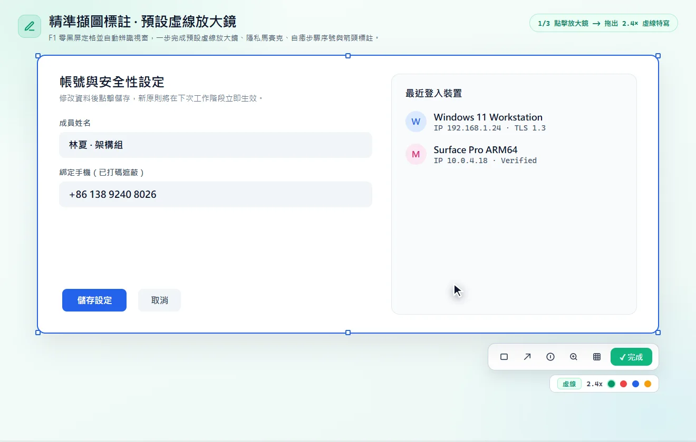

<div align="center">


# Tools3000

**輕量、原生的 Windows 多合一桌面效率工具集**

[简体中文](README.md) · **繁體中文** · [English](README.en.md) · [日本語](README.ja.md) · [한국어](README.ko.md) · [Русский](README.ru.md) · [Português (Brasil)](README.pt-BR.md) · [Español](README.es.md)

[](https://github.com/yuan278501381/Tools3000/releases/latest)
[](https://github.com/yuan278501381/Tools3000/stargazers)
[](https://github.com/yuan278501381/Tools3000/releases)
[](#安裝與下載)
[](#安裝與下載)
[](LICENSE)

**[立即下載最新版本](#安裝與下載)** · [開發初衷](#開發初衷) · [一軟替代清單](#一軟替代清單) · [核心功能一覽](#核心功能一覽) · [安全與校驗](#安全校驗與信任說明) · [全功能展示](#全功能動態展示) · [參與共創](#參與共創與回饋) · [開發者指南](docs/DEVELOPER.md)

</div>

<br />

<table>
  <tr>
    <td width="50%" align="center" valign="top">
      <br />
      <sub><b>極速檔案搜尋與空白鍵預覽</b> · 關鍵字毫秒秒查，按空白鍵免開啟直接檢視</sub>
    </td>
    <td width="50%" align="center" valign="top">
      <br />
      <sub><b>高精度離線文字辨識與批註</b> · 純本機離線、準確率高於 WeChat OCR，拖選複製 / 波浪線 / 原位改字</sub>
    </td>
  </tr>
  <tr>
    <td width="50%" align="center" valign="top">
      <br />
      <sub><b>捲動長擷圖</b> · 自動捲動無縫拼接、右側即時預覽，首尾一鍵無損裁切</sub>
    </td>
    <td width="50%" align="center" valign="top">
      <br />
      <sub><b>高畫質錄影與自動運鏡演播室</b> · 60 FPS 錄影、智慧自動運鏡，一鍵匯出 WeChat GIF、動態 WebP 與 MP4</sub>
    </td>
  </tr>
</table>

Tools3000 將日常高頻使用的**檔案搜尋、文件內容搜尋、捲動長擷圖、精準擷圖標註、桌面釘選貼圖與群組管理、高精度離線文字辨識、高畫質螢幕錄影（自動運鏡演播室，支援匯出 WeChat GIF、動態 WebP 與 MP4）以及全域滑鼠手勢**整合為單一原生軟體。待機僅佔約十餘 MB 記憶體、100% 本機離線執行，同時適配個人電腦（`x64` / `ARM64`）與 Windows Server 多使用者併發辦公環境。

---

## 開發初衷

我是 **Everything** 十多年的老用戶；擷圖軟體一路從 **FastStone Capture** 換到 **Snipaste**，後來因為需要捲動長擷圖、擷圖放大鏡效果與文字辨識，又換到了 **PixPin**；滑鼠手勢從 **WGestures** 用到 **WGestures 2**；錄影軟體也前前後後換過許多款，中途還試過微軟的 **PowerToys** 工具套件，但總還是少那麼幾塊核心拼圖，最後依然得同時常駐好幾個工具。

某天看著 Windows 系統匣裡排成一串的圖示，心想：**要是能把它們合併成一個軟體就好了。** 再加上日常使用一直被幾個痛點困擾——PixPin 的文字辨識在辨識率與速度上始終不如微信；WGestures 從某一天起總會在螢幕上殘留一個很小的文字框擋住畫面，只有重啟軟體才能消除。趁著 AI 時代到來，我決定自己動手，借助 AI 一步步打造出這款多合一效率工具 **Tools3000**。

給各位潛在使用者一個真誠的交代：在公開前我已經**重度自用了 4 個月**，一邊漸進式開發新功能，一邊陸續修掉日常踩到的各種問題。一開始仍開著舊軟體備援，Tools3000 哪裡不好用就先切回去，修好再切回來；**而現在，我的系統匣終於清靜了，只留下 Tools3000 這一個軟體。**

當然，考量到實際桌面環境與使用情境的複雜性，難免還是會遇到新問題。在 AI 時代，無論是透過 **[GitHub Issues](https://github.com/yuan278501381/Tools3000/issues) 把問題回報給我**，還是**直接參與共創（Pull Request）**，都非常歡迎一起把它越磨越順手。

---

## 一軟替代清單

老牌專精軟體各有深厚累積，Tools3000 的目標並非否定它們，而是用**一個介面統一、零廣告零付費牆的原生程序**，涵蓋日常 90%+ 高頻組合情境，讓系統匣重回清靜：

| 常見獨立工具 | Tools3000 涵蓋的日常高頻情境 | 仍建議保留或搭配原工具的專精情境 |
| :--- | :--- | :--- |
| **Everything** | `Alt + Space` 毫秒級全磁碟檔名、拼音與 `content:` 文件內文穿透搜尋，按需啟動不拖慢開機 | 需要 HTTP/ETP 區網共享搜尋、EXIF/影音全屬性欄索引，或深度依賴 `es.exe` CLI 生態 |
| **QuickLook** | 搜尋結果列表選取按 `Space` 免開啟秒看圖片、Office、PDF、程式碼、CAD、PSD 與 3D 模型 | 需要直接在 Windows 桌面或檔案總管任意資料夾按空白鍵全域預覽，或依賴豐富社群 `.qlplugin` |
| **Snipaste / PixPin** | `F1` 零黑屏定格擷圖標註、預設虛線放大鏡、捲動長擷圖、`F3` 多貼圖分組，以及純離線高精度 OCR（框選複製、批註與原位改字） | 需要 Snipaste 對老舊特殊 GUI 控制項的極致單點元素偵測，或特定命令列擷圖工作流 |
| **WGestures / StrokesPlus** | 按住右鍵一劃切分頁/上一頁/關窗、不放鍵瞬發、螢幕邊緣滾輪調音量、四角觸發、全螢幕遊戲自動避讓與內建 Lua 擴充 | 需要複雜多鍵組合觸發、細部視窗區域條件，或長年累積的巨集錄製腳本 |
| **各類錄影工具（如 ShareX）** | 60 FPS 高畫質錄影、鍵鼠回顯、停止即進自動運鏡演播室（聲波剪輯與點擊特效），一鍵匯出 MP4、WeChat GIF 與動態 WebP | 需要 80+ 圖床/S3/FTP/Webhook 擷完自動上傳工作流，或高度客製化 FFmpeg 批次管線 |

---

## 核心功能一覽

<p align="center">
  
</p>

---

## 安裝與下載

### 方式一：套件管理器一鍵安裝（推薦）

- **Scoop（即刻可用 · 自動免安裝可攜模式，設定持久化於 `data/`，升級零遺失）**：

```powershell
scoop bucket add tools3000 https://github.com/yuan278501381/Tools3000
scoop install tools3000/tools3000
```

- **Winget（官方規範清單已就緒）**：儲存庫 [`packaging/winget/`](packaging/winget/) 已隨版本自動產生並通過微軟官方 `winget validate` 校驗（套件 ID：`Yy1.Tools3000`），收錄至 `microsoft/winget-pkgs` 官方源後即可直接執行 `winget install Yy1.Tools3000`（原始碼環境亦可透過 `winget install -m packaging/winget` 本機安裝）。

### 方式二：GitHub Releases 直接下載

前往 **[GitHub Releases](https://github.com/yuan278501381/Tools3000/releases/latest)** 下載最新版本：

- **標準安裝程式（`Tools3000-Setup.exe`）** — 推薦日常使用，支援開機自啟、按需勾選元件與無感覆蓋升級。
- **免安裝可攜版（`Tools3000-Portable-x64.zip`）** — 解壓即用，設定與資料完整保存在目前資料夾。
- **校驗清單（`SHA256SUMS.txt`）** — 提供每次發佈的 SHA-256 完整性校驗值。

> **系統需求**：Windows 10（1809 及以上）/ Windows 11 / Windows Server 2019–2025，原始碼與建置管線原生支援 `x64` 與 `ARM64` 架構（GitHub Releases 目前預先編譯提供 `x64` 安裝程式與可攜版，ARM64 裝置可依[開發者指南](docs/DEVELOPER.md)原生編譯或直接執行 `x64` 版本），依賴系統內建 Microsoft Edge WebView2 Runtime。軟體介面原生支援 8 種語言，預設自動跟隨系統語言。

### 安全校驗與信任說明

Tools3000 提供四重零黑盒驗證機制（完整揭露見 **[SECURITY.md](SECURITY.md)**）：

1. **SHA-256 完整性校驗**：下載後可在 PowerShell 核對雜湊並與 `SHA256SUMS.txt` 比對：
   ```powershell
   Get-FileHash .\Tools3000-Setup.exe -Algorithm SHA256
   ```
2. **VirusTotal 公開查驗**：前往 **[VirusTotal](https://www.virustotal.com/)** 輸入發佈檔 SHA-256（後續每次 GitHub Release 頁面亦直接附帶可點擊直連），公開檢視 70+ 主流防毒引擎掃描結果。
3. **關於 Windows Defender SmartScreen 提示**：獨立開源專案在尚未配置商業 EV / 公網受信任程式碼簽章（SignPath / Trusted Signing 推進中）或新版剛發佈累積信譽初期，Windows 可能彈出「未知發行者」提示；核對 SHA-256 與 VirusTotal 無誤後點選 **「其他資訊 -> 仍要執行」** 即可，或依 **[開發者指南](docs/DEVELOPER.md)** 從原始碼自行編譯。
4. **內嵌 SPDX 軟體物料清單（SBOM）**：安裝程式與可攜版根目錄均隨附 `SBOM.spdx.json` 與 `THIRD_PARTY_NOTICES.txt`，所有相依套件與開源授權透明可查。

---

## 全功能動態展示

<table>
  <tr>
    <td width="50%" align="center" valign="top">
      <br />
      <sub><b>文件內容搜尋</b> · 穿透檢索 PDF / Word / Excel / 程式碼內文，高亮上下文並一鍵複製整行</sub>
    </td>
    <td width="50%" align="center" valign="top">
      <br />
      <sub><b>精準擷圖標註</b> · 零黑屏定格、預設虛線光學放大鏡、隱私馬賽克與自動重排步驟序號</sub>
    </td>
  </tr>
  <tr>
    <td width="50%" align="center" valign="top">
      <br />
      <sub><b>桌面貼圖與貼圖群組</b> · F3 多圖置頂與色彩分組，頂部導覽列按組秒切顯隱、一鍵磁吸平鋪</sub>
    </td>
    <td width="50%" align="center" valign="top">
      <br />
      <sub><b>全域滑鼠手勢</b> · 按住右鍵一劃關閉分頁、不放鍵瞬發切換、螢幕邊緣滾輪調音量</sub>
    </td>
  </tr>
</table>

| 模組 | 核心體驗 |
| :--- | :--- |
| **極速檔案搜尋** | `Alt + Space` 全磁碟百萬檔案毫秒即出，支援關鍵字與拼音首字母；選取後按 `Space` 免開啟直接預覽圖片、Office、PDF、程式碼、CAD、PSD 與 3D 模型。 |
| **文件內容搜尋** | 使用 `content:` 直接穿透檢索 Word、Excel、PDF、PowerPoint、CAD 與原始碼內文，即時高亮上下文片段並點擊行號一鍵複製。 |
| **捲動長擷圖** | 網頁、文件與聊天紀錄自動捲動無縫拼接，右側即時預覽，支援首尾無損裁切（隨時可拖回還原）與長圖原位標註。 |
| **精準擷圖標註** | `F1` 零黑屏定格並自動吸附視窗控制項，支援像素級取色、預設虛線光學放大鏡、6 種箭頭、自癒步驟序號、隱私馬賽克與美化分享外框。 |
| **桌面貼圖與貼圖群組** | `F3` 一鍵將擷圖或剪貼簿圖像置頂懸浮，支援滾輪縮放、透明度調整與滑鼠穿透；內建多貼圖色彩群組，透過頂部浮動列按組切換顯隱或一鍵磁吸整齊平鋪。 |
| **高精度離線文字辨識** | 純本機離線辨識，實測程式碼、JSON 與複雜排版準確率高於 WeChat 擷圖 OCR；可直接在原圖或貼圖上拖選複製、畫波浪線 / 螢光筆批註、原位無痕改字及表格 / QR Code 擷取。 |
| **高畫質錄影與自動運鏡演播室** | 60 FPS 高畫質螢幕錄影聯動鍵鼠回顯，停止即進入演播室——滑鼠點擊處智慧自動運鏡聚焦，搭配多款質感背景與聲波時間軸剪輯；支援一鍵匯出 **MP4**、**WeChat 直傳 GIF**（自動播放小圖 / 可雙擊放大高畫質大圖分檔）與**高畫質動態 WebP**。 |
| **全域滑鼠手勢** | 按住右鍵一劃即可切換分頁、上一頁或關閉視窗，支援不放鍵瞬發、螢幕邊緣滾輪調音量、分應用程式專屬規則與全螢幕遊戲自動避讓。 |
| **簡報特效與遠端控制助手** | 投屏清透鍵帽與雙擊 `Ctrl` 聚光燈；系統「開啟 / 另存新檔」對話框快速導覽列；mstsc、RustDesk、ToDesk、AnyDesk 等遠端桌面熱鍵直通與卡鍵一鍵釋放。 |

---

## 常用快速鍵

所有快速鍵皆可在設定中心自由自訂並即時偵測衝突：

| 快速鍵 | 功能 |
| :--- | :--- |
| `Alt + Space` | 呼出 / 隱藏極速搜尋（選取結果按 `Space` 快速預覽） |
| `F1` | 區域擷圖與標註 |
| `F3` | 將剪貼簿圖像或文字置頂貼圖 |
| 快速雙擊 `Ctrl` | 開啟 / 關閉滑鼠聚光燈 |
| `Ctrl + Alt + Backspace` | 遠端桌面修飾鍵卡死一鍵釋放（或快速雙擊右側 `Ctrl`） |

---

## 隱私與原則

- **完全離線**：檔案索引、全文搜尋、文字辨識與鍵鼠統計皆在本機完成，斷網環境下全功能可用。
- **零遙測、免帳號**：無廣告彈窗、無需登入，不收集或上傳任何檔案與輸入資料。
- **按需輕量**：所有模組均可獨立開關，搜尋服務僅在主動呼出時按需啟動，日常待機幾乎零感知。

---

## 參與共創與回饋

- **問題回報**：歡迎透過 **[Bug Report 範本](https://github.com/yuan278501381/Tools3000/issues/new?template=bug_report.yml)** 提供重現步驟與環境資訊。
- **功能建議**：歡迎提交 **[Feature Request](https://github.com/yuan278501381/Tools3000/issues/new?template=feature_request.yml)** 或前往 **[GitHub Discussions](https://github.com/yuan278501381/Tools3000/discussions)** 交流。
- **開源共創**：歡迎提交 Pull Request，建置細節參閱 **[開發者指南](docs/DEVELOPER.md)** 與 **[套件管理器說明](packaging/README.md)**。

---

## 文件與授權

- **開發與安全**：原始碼編譯與外掛 SDK 見 **[開發者指南](docs/DEVELOPER.md)**，安全驗證與漏洞揭露見 **[SECURITY.md](SECURITY.md)**，版本更新紀錄見 **[GitHub Releases](https://github.com/yuan278501381/Tools3000/releases)**。
- **開源授權**：本專案採用 **[GNU GPL v3.0](LICENSE)** 開源釋出（附 [Windows / WebView2 連結豁免](LICENSE-EXCEPTION.md)）。
- **版權聲明**：`Copyright (c) 2026 Yy1 (yuan278501381) & Tools3000 contributors` · [@yuan278501381](https://github.com/yuan278501381)
