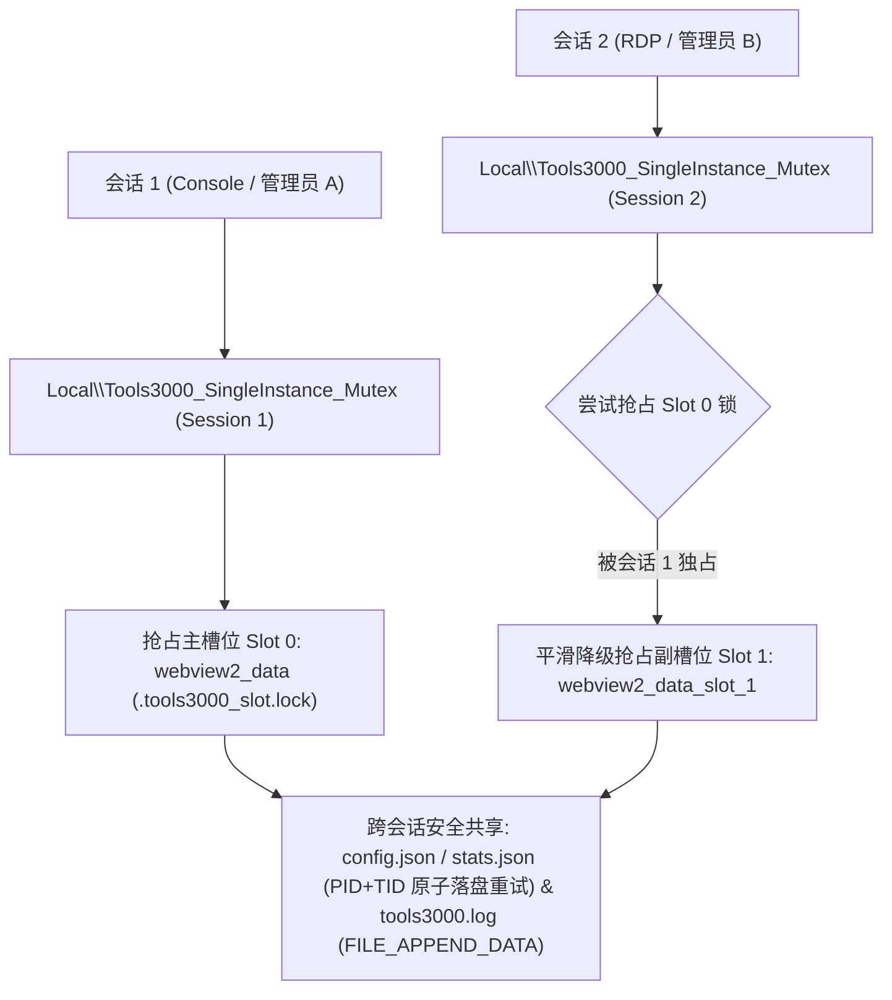

# Tools3000 Windows Server 多会话并发架构与公网可信代码签名指南

> Copyright (c) 2026 Yy1 (yuan278501381) & Tools3000 contributors. | GPL-3.0 License

---

## 一、Windows Server 多管理员并发会话隔离架构

在 Windows Server 上，常存在本地物理控制台（Session 1）与多个远程桌面（RDP Session 2/3）甚至同一 `Administrator` 账号同时登录的场景。Tools3000 采用 **四层资源隔离与无冲突并发架构**，保证每个登录会话各自拥有独立的托盘图标、热键、截图录屏与 WebView2 界面，零冲突、零僵尸锁、零磁盘膨胀。



### 核心设计要点 (`SessionIsolation.{h,cpp}`)
1. **会话级单实例锁 (`Local\Tools3000_SingleInstance_Mutex`)**：
   - 同一个登录会话内依然 100% 严格单实例，并完整支持 UAC 提权/降权 `--restart-pid` 互斥体交接（杜绝双托盘图标）；
   - 不同登录会话之间在内核 `\Sessions\<SessionId>\BaseNamedObjects` 中天然隔离，互不阻塞。
2. **WebView2 主/副槽位内核租约 (`acquireWebViewProfileSlot`)**：
   - **主槽位优先 (Slot 0)**：`%LOCALAPPDATA%\Tools3000\webview2_data`，单机用户与首位登录管理员 100% 沿用历史缓存路径，零迁移成本；
   - **OS 内核托管独占锁**：每个槽位以 `dwShareMode = 0` + `FILE_FLAG_DELETE_ON_CLOSE` 打开隐藏锁文件 `.tools3000_slot.lock`。无论正常退出还是任务管理器强杀/断电，Windows 内核瞬间释放句柄并清除锁文件，绝不遗留僵尸锁；
   - **低熵复用与 7 天冷回收**：第二并发会话自动抢占 `webview2_data_slot_1`（最多 15 副槽位，退出后自动复用）；主槽位启动时自动清理超过 7 天无人使用的过期副槽位，防止磁盘膨胀。
3. **跨进程共享配置与统计防踩踏 (`AtomicFile.h`, `ConfigManager.cpp`, `StatsManager.cpp`)**：
   - 统一收归 `WinUtils::atomicWriteFileWithFlush`（PID + TID 唯一临时文件名 + 硬件 `FlushFileBuffers` + `MoveFileExW` 针对 `ERROR_SHARING_VIOLATION` 的 3 次短退避重试）；
   - 日志文件 `tools3000.log` 使用 `FILE_APPEND_DATA` + 全共享模式，多会话并发安全追加，启动日志显式输出 `sessionId` 方便排障。

---

## 二、公网零 SmartScreen 拦截代码签名接入指南

[scripts/sign-artifacts.ps1](../scripts/sign-artifacts.ps1) 与 [.github/workflows/release.yml](../.github/workflows/release.yml) 现已构建统一的多 Provider 策略分发签名引擎，按公网信任度优先支持以下两种主流零 SmartScreen 警告方案：

### 方案对比

| 方案 | 适用主体 | 费用 | SmartScreen 表现 | 接入方式 |
| :--- | :--- | :--- | :--- | :--- |
| **Azure Trusted Signing (微软官方 Artifact Signing)** | 企业组织 / 个人开发者（支持独立开发者实名认证） | 基础档约 \$9.99/月 | **极佳**：微软官方根 CA 短效证书，首次分发即可快速建立信任，零实体 USB Key | 本地 CLI 或 GitHub Actions OIDC 无密钥联邦登录 |
| **SignPath Foundation (开源计划)** | 公开开源项目（MIT 等 OSI 协议） | **免费**（需申请审批） | **极佳**：由开源基金会权威代码签名证书双轮签发 | GitHub Actions 自动提交内外两轮签名请求 |
| **商业 OV / EV 证书 (PFX / USB Token)** | 企业独立采购 | \$200 ~ \$500+/年 | EV 立即零拦截，OV 需积累下载声誉 | 设置 `TOOLS3000_SIGNING_PFX` 或 `TOOLS3000_SIGNING_CERT_SHA1` |

---

### 快速接入 1：微软 Azure Trusted Signing（推荐）

#### A. GitHub Actions 无静态密钥 OIDC 自动双层签名
1. 在 Azure 门户创建 **Artifact Signing (Trusted Signing)** 账号并完成身份认证，创建 **Public Trust** 证书配置文件（Certificate Profile）；
2. 为 GitHub 仓库配置 Azure AD Federated Credential（OIDC），并向该应用主体授予 `Artifact Signing Certificate Profile Signer` 角色；
3. 在 GitHub 仓库 `Settings -> Secrets and variables -> Actions` 中配置：
   - **Secrets**：
     - `AZURE_CLIENT_ID`
     - `AZURE_TENANT_ID`
     - `AZURE_SUBSCRIPTION_ID`
   - **Variables**：
     - `AZURE_SIGNING_ENDPOINT`（例如 `https://eus.codesigning.azure.net`）
     - `AZURE_SIGNING_ACCOUNT`（您的 Trusted Signing 账号名）
     - `AZURE_SIGNING_PROFILE`（您的 Public Trust 证书配置名）
4. 手动触发 `Tools3000 CI & Manual Release Pipeline` 时，流水线将自动完成内层全部 `.exe/.dll` + 外层 `Tools3000-Setup.exe` 双轮微软公网签名，并通过 `-VerifyOnly -Required -RequirePublicTrust` 强断言。

#### B. 本机一键签名发版（`deploy.ps1` / `scripts/sign-artifacts.ps1`）
在已通过 `az login` 登录的本机设置 3 个环境变量后，直接运行 `deploy.ps1`：
```powershell
$env:TOOLS3000_AZURE_SIGNING_ENDPOINT = "https://eus.codesigning.azure.net"
$env:TOOLS3000_AZURE_SIGNING_ACCOUNT  = "<your-account-name>"
$env:TOOLS3000_AZURE_SIGNING_PROFILE  = "<your-public-trust-profile>"
pwsh -File .\deploy.ps1 -RequireSigning -RequirePublicTrust
```

---

### 快速接入 2：SignPath 开源免费代码签名

在 GitHub 仓库 Secrets 中配置：
- `SIGNPATH_API_TOKEN`
- `SIGNPATH_ORGANIZATION_ID`

触发 `release.yml` 后，若未配置 Azure Trusted Signing，流水线将自动切换至 SignPath 完成内外两轮签名及 `-RequirePublicTrust` 公网根链强断言。

---

### 一键只读信任审计（随时检验产物是否达标）

```powershell
# 仅审计签名有效性与时间戳（允许本地开发证书）
pwsh -File .\scripts\sign-artifacts.ps1 -VerifyOnly -Required -Paths Output\Tools3000-Setup.exe

# 严格审计公网受信任 CA 链（若为自签名证书直接阻断报错，防止误发公网）
pwsh -File .\scripts\sign-artifacts.ps1 -VerifyOnly -Required -RequirePublicTrust -Paths Output\Tools3000-Setup.exe
```
