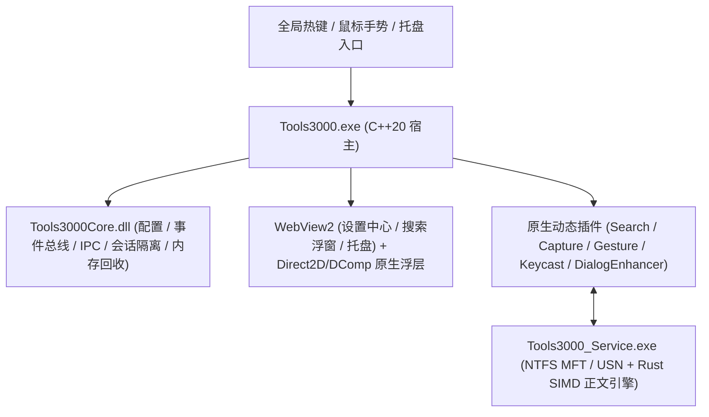

# Tools3000 开发者指南

本文档面向参与源码编译、架构研究、插件扩展与发布维护的开发者。面向普通用户的产品介绍与下载方式请返回 [README.md](../README.md)。

---

## 技术栈与系统架构

Tools3000 采用 **C++20 原生微内核 + Rust SIMD 正文检索库 + React 19 / TypeScript (WebView2)** 混合架构：

- **原生宿主与插件 (`Tools3000.exe` / `Tools3000Core.dll` / `Plugin_*.dll`)**：负责底层输入钩子、Direct2D/DirectComposition 硬件加速浮层、截图录屏管线、Windows Server 会话隔离与进程间通信。
- **按需索引服务 (`Tools3000_Service.exe` + `tools3000_content_rs`)**：遵循按需启动契约，负责 NTFS MFT/USN 元数据索引与多格式正文检索。
- **现代化配置与面板界面 (`ui/`)**：基于 React 19 与 TypeScript，通过系统内置 WebView2 渲染设置中心、搜索浮窗与托盘快捷面板。



---

## 从源码构建

### 环境要求

- Windows 10/11 或 Windows Server（x64 / ARM64）
- Visual Studio 2022 或 Build Tools（需勾选“使用 C++ 的桌面开发”工作负载）
- Rust 工具链（`rustc` 1.75+，用于编译 `tools3000_content_rs`）
- CMake 3.25+、PowerShell 7+ (`pwsh`)、Git 2.40+、Node.js 20+

### 一键编译、测试与打包

```powershell
# 1. 克隆仓库
git clone https://github.com/yuan278501381/tools3000.git
cd tools3000

# 2. 编译前端、Rust 静态库、C++ 核心与插件，执行自动化门禁并生成产物
pwsh -NoProfile -File .\deploy.ps1
```

构建完成后：
- 绿色便携产物位于 `deploy_dist\` 与 `Output\Tools3000-Portable-x64.zip`
- 标准安装程序位于 `Output\Tools3000-Setup.exe`

---

## 专题与进阶文档

- [多会话隔离与公网可信代码签名指南](CODE_SIGNING_AND_MULTI_SESSION.md)
- [C++ 原生动态插件开发指南](plugin-development.md)
- [Lua 扩展脚本 API 参考](api/lua-api.md)
- [内存收缩与性能调优实录](performance-tuning.md)
- [性能基线采集与验证协议](performance-baseline.md)
- [版本号管理与发布流水线规范](versioning.md)
- [Authenticode 自动化数字签名说明](release-signing.md)
- [SignPath 开源代码签名配置指南](signpath-setup-guide.md)
- [WinGet 包分发提交指南](winget-submission-guide.md)
