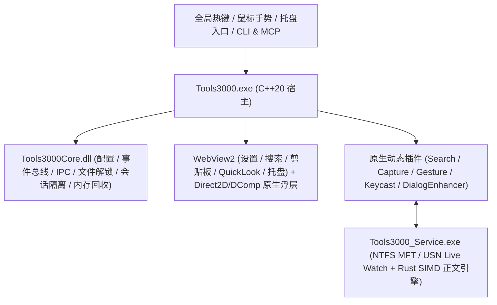

# Tools3000 开发者指南

本文档面向参与源码编译、架构研究、插件扩展与发布维护的开发者。面向普通用户的产品介绍与下载方式请返回 [简体中文 README](i18n/README.zh-CN.md) 或 [English README](../README.md)。

---

## 技术栈与系统架构

Tools3000 采用 **C++20 原生微内核 + Rust 原生高性能内核库（正文 SIMD / 剪贴板持久化 / 独立 CLI & MCP / Picasa 看图器）+ React 19 / TypeScript (WebView2)** 混合架构：

- **原生宿主与插件 (`Tools3000.exe` / `Tools3000Core.dll` / `plugins/Plugin_*.dll`)**：负责底层输入钩子、Direct2D/DirectComposition 硬件加速浮层、截图录屏与原位翻译管线、文件占用解锁、Windows Server 多会话隔离与进程间通信，全链路原生兼容 8 语种非 ASCII Unicode 安装路径与用户名。
- **按需索引服务 (`Tools3000_Service.exe` + `src/service/rust_content/`)**：严格遵循 `DEMAND_START` 按需启动契约，负责 NTFS MFT/USN 元数据索引、Live Watch 增量刷新、3 档可配置内存策略与 Rust SIMD 多格式正文检索。
- **独立零依赖 Rust 副产物**：
  - `tools3000-cli.exe`：单文件约 350 KB，提供命令行文件/正文搜索与标准 MCP (`stdio`) Server；
  - `Tools3000_Picasa_Viewer.exe`：单文件不足 2 MB、零外部运行库依赖的 Rust + Direct2D 轻量化 Picasa 风格看图器（支持 41 种图片格式，亦可独立运行）；
  - `src/clipboard/rust_clipboard/`：纯 Rust 原子二进制持久化引擎（`history.t3k` + 校验和与自动备份回退）。
- **现代化配置与面板界面 (`ui/`)**：基于 React 19 与 TypeScript，通过系统内置 WebView2 渲染设置中心、极速搜索、剪贴板历史、QuickLook 快速预览与托盘控制中心。



---

## 运行期关键目录与数据路径

| 类别 | 标准安装模式路径 | 绿色便携模式路径 | 说明 |
| :--- | :--- | :--- | :--- |
| **主程序与独立工具** | `C:\Program Files\Tools3000\` | `<解压目录>\` | 包含 `Tools3000.exe`、`Tools3000_Service.exe`、`tools3000-cli.exe`、`Tools3000_Picasa_Viewer.exe` 与 `plugins\Plugin_*.dll` |
| **配置文件** | `%LOCALAPPDATA%\Tools3000\config\config.json` | `<解压目录>\data\config\config.json` | 全局设置、快捷键、手势与模块开关单一事实源 |
| **剪贴板持久化存储** | `%LOCALAPPDATA%\Tools3000\clipboard\` | `<解压目录>\data\clipboard\` | 含 Rust 原子索引 `history.t3k` 及富文本/图片媒体目录 `blobs\` |
| **离线 OCR 模型目录** | `%LOCALAPPDATA%\Tools3000\models\ocr\` | `<解压目录>\data\models\ocr\` | 基础中/英包及按需下载的日/韩/俄/西葡 4 套轻量扩展模型 |
| **运行诊断日志** | `%LOCALAPPDATA%\Tools3000\logs\tools3000.log` | `<解压目录>\data\logs\tools3000.log` | 分级滚动日志（问题反馈导出诊断包会自动执行 10 维隐私脱敏） |
| **文件占用解锁右键注册** | `HKCU\Software\Classes\*\shell\Tools3000FileLocksmith` | 同左（用户级注册表） | 纯当前用户注册，零 Explorer DLL 注入，关闭模块或卸载自动清理 |

---

## 从源码构建

### 环境要求

- Windows 10（1809+）/ Windows 11 / Windows Server 2019–2025（原生支持 `x64` / `ARM64`）
- Visual Studio 2022 或 Build Tools（需勾选“使用 C++ 的桌面开发”工作负载）
- Rust 工具链（`rustc` 1.75+，用于编译正文检索库、剪贴板引擎、CLI/MCP 与 Picasa 看图器）
- CMake 3.25+、PowerShell 7+ (`pwsh`)、Git 2.40+、Node.js 20+

### 一键编译、测试与打包

```powershell
# 1. 克隆仓库
git clone https://github.com/yuan278501381/tools3000.git
cd tools3000

# 2. 编译前端、Rust 产物、C++ 核心与插件，执行全量单元测试与 E2E 门禁并打包
pwsh -NoProfile -File .\deploy.ps1
```

构建完成后（版本号自动读取根目录 `VERSION`）：
- 纯净可执行目录位于 `deploy_dist\`
- 标准安装程序位于 `Output\Tools3000-v<VERSION>-Setup.exe`
- 绿色便携包位于 `Output\Tools3000-v<VERSION>-win-x64-portable.zip`

---

## 专题与进阶文档

- [多会话隔离与公网可信代码签名指南](CODE_SIGNING_AND_MULTI_SESSION.md)
- [C++ 原生动态插件开发指南](plugin-development.md)
- [Lua 扩展脚本 API 参考](api/lua-api.md)
- [内存收缩与性能调优实录](performance-tuning.md)
- [性能基线采集与验证协议](performance-baseline.md)
- [版本号管理与发布流水线规范](versioning.md)
- [Authenticode 自动化数字签名说明](release-signing.md)
- [SignPath 开源代码签名配置指南](signpath-setup-guide.md)
- [WinGet 包分发提交指南](winget-submission-guide.md)
