<div align="center">


# Tools3000

**Suite de productividad nativa todo-en-uno y ultraligera para Windows**

[English](../../README.md) · [简体中文](README.zh-CN.md) · [繁體中文](README.zh-TW.md) · [日本語](README.ja.md) · [한국어](README.ko.md) · [Русский](README.ru.md) · [Português (Brasil)](README.pt-BR.md) · **Español**

[](https://github.com/yuan278501381/Tools3000/releases/latest)
[](https://github.com/yuan278501381/Tools3000/stargazers)
[](https://github.com/yuan278501381/Tools3000/releases)
[](#descarga-e-instalación)
[](#descarga-e-instalación)
[](../../LICENSE)

**[Descargar última versión](#descarga-e-instalación)** · [Vista general](#vista-general) · [Demostraciones](#demostraciones) · [Seguridad y verificación](#verificación-de-seguridad-y-confianza) · [Por qué lo creé](#por-qué-creé-tools3000) · [Qué reemplaza](#qué-reemplaza-tools3000) · [Contribuir](#comentarios-y-cocreación) · [Guía para desarrolladores](../DEVELOPER.md)

</div>

<br />

Tools3000 integra en una sola aplicación nativa para Windows las herramientas esenciales de uso diario: **búsqueda instantánea de archivos, apps, comandos del sistema y marcadores con iconos reales de cada sitio (con Live Watch, 3 modos de RAM y CLI / MCP), búsqueda de contenido en documentos, portapapeles que sobrevive a reinicios, búsqueda inline en diálogos Abrir/Guardar, desbloqueo de archivos ocupados, captura con desplazamiento, anotación precisa de capturas, fijación en pantalla con grupos de pines, OCR sin conexión en 8 idiomas y traducción limpia in situ, grabación de pantalla con Estudio de zoom automático (MP4, GIF para mensajería y WebP animado), gestos globales de ratón y visor ligero Picasa en Rust**. Funciona localmente sin telemetría, admite rutas y nombres de usuario con tildes, ñ u otros alfabetos, consume apenas una docena de MB de RAM en reposo (con modo reposo de 0 MB para el servicio de búsqueda) y funciona tanto en PCs personales (`x64` y `ARM64`) como en entornos Windows Server multiusuario.

---

## Vista general

<p align="center">
  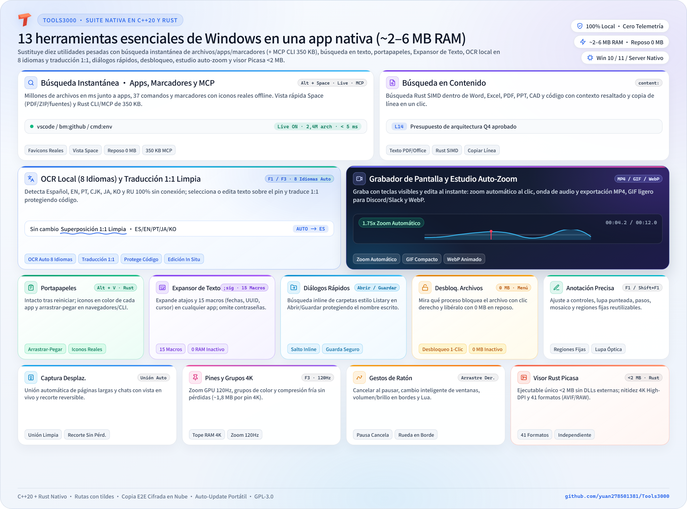
</p>

---

## Demostraciones

<table>
  <tr>
    <td width="50%" align="center" valign="top">
      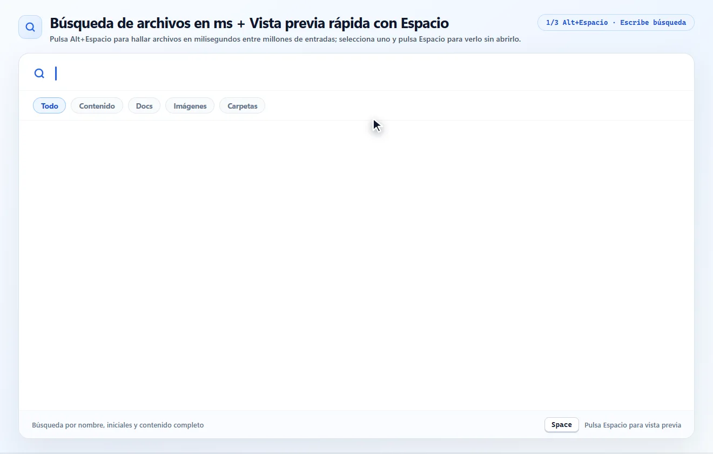<br />
      <sub><b>Búsqueda Instantánea y Vista Previa</b> · Apps, marcadores con Favicons reales, Live Watch y vista previa de ZIP y fuentes con Espacio</sub>
    </td>
    <td width="50%" align="center" valign="top">
      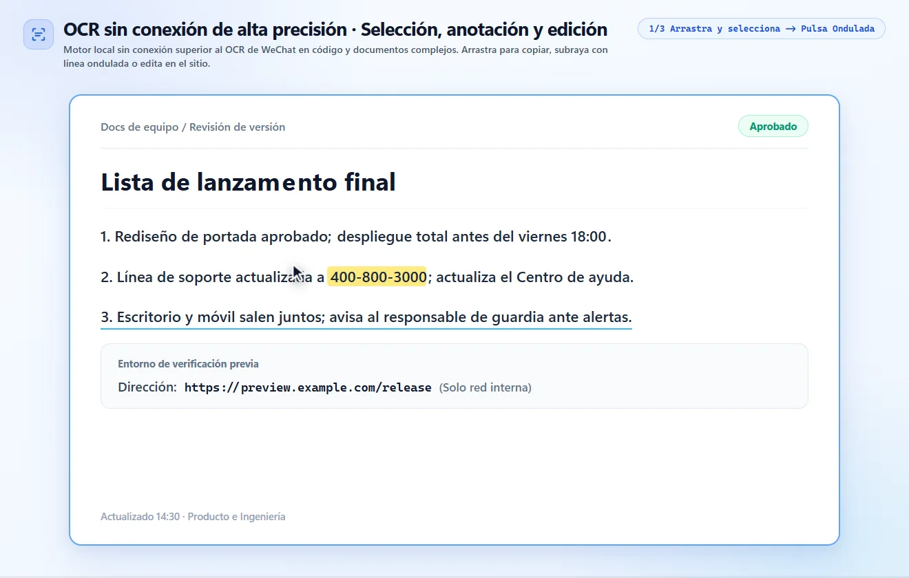<br />
      <sub><b>OCR Sin Conexión en 8 Idiomas</b> · Detecta idiomas automáticamente offline; copia, subraya con línea ondulada o edita en el sitio</sub>
    </td>
  </tr>
  <tr>
    <td width="50%" align="center" valign="top">
      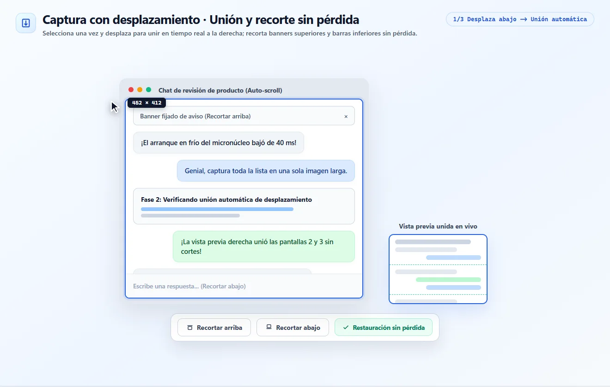<br />
      <sub><b>Captura con Desplazamiento</b> · Unión automática con vista previa en vivo y recorte no destructivo</sub>
    </td>
    <td width="50%" align="center" valign="top">
      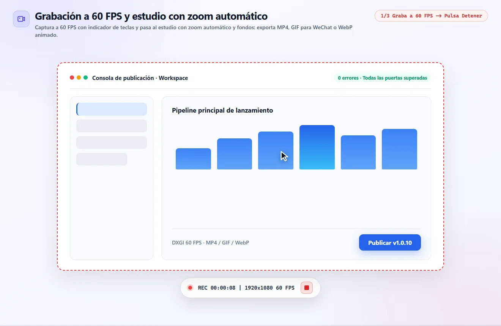<br />
      <sub><b>Grabación y Estudio Auto-Zoom</b> · Zoom inteligente en clics y exportación a MP4, GIF y WebP animado</sub>
    </td>
  </tr>
  <tr>
    <td width="50%" align="center" valign="top">
      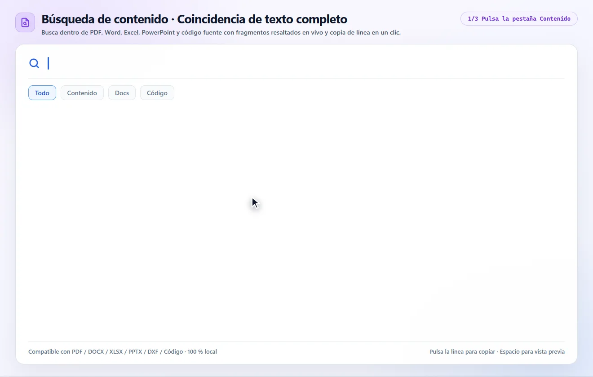<br />
      <sub><b>Búsqueda de Contenido</b> · Busca dentro de PDF, Word, Excel y código fuente con copia de línea en un clic</sub>
    </td>
    <td width="50%" align="center" valign="top">
      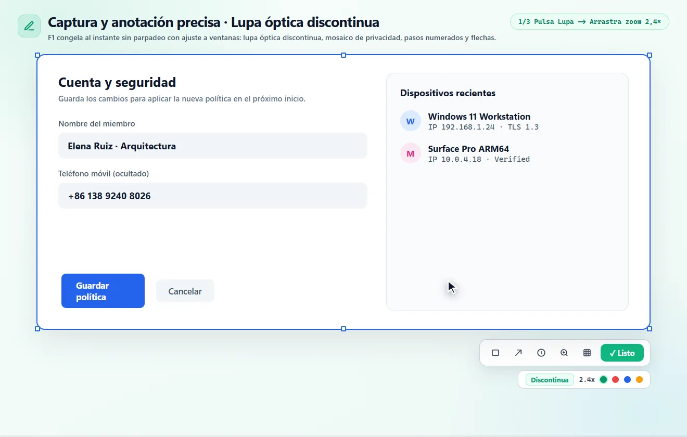<br />
      <sub><b>Anotación Precisa</b> · Ajuste automático a controles, lupa óptica discontinua, mosaico de privacidad y pasos numerados</sub>
    </td>
  </tr>
  <tr>
    <td width="50%" align="center" valign="top">
      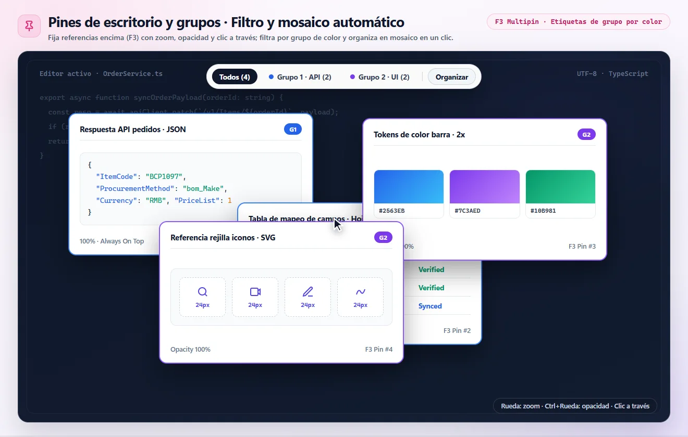<br />
      <sub><b>Pines en Pantalla y Grupos</b> · Fija referencias arriba (F3), filtra por color de grupo y ordena en cuadrícula en un clic</sub>
    </td>
    <td width="50%" align="center" valign="top">
      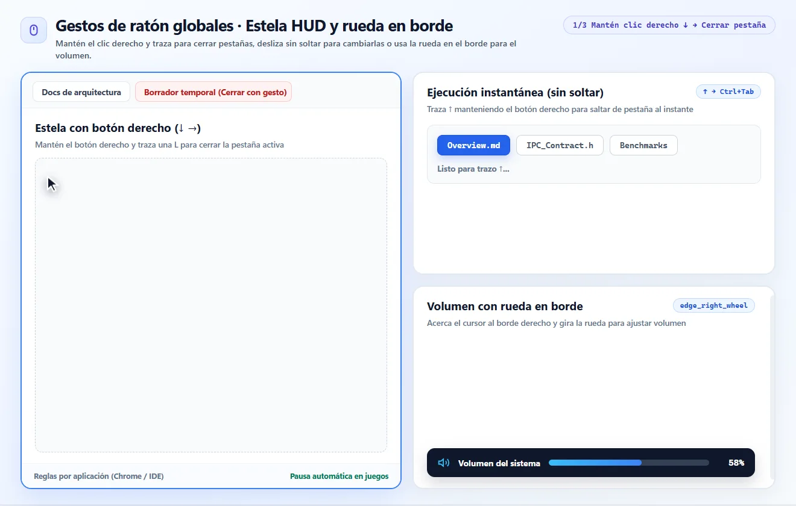<br />
      <sub><b>Gestos Globales de Ratón</b> · Cancelar al pausar activo por defecto, cambio inteligente a ventanas abiertas y volumen en el borde</sub>
    </td>
  </tr>
  <tr>
    <td width="50%" align="center" valign="top">
      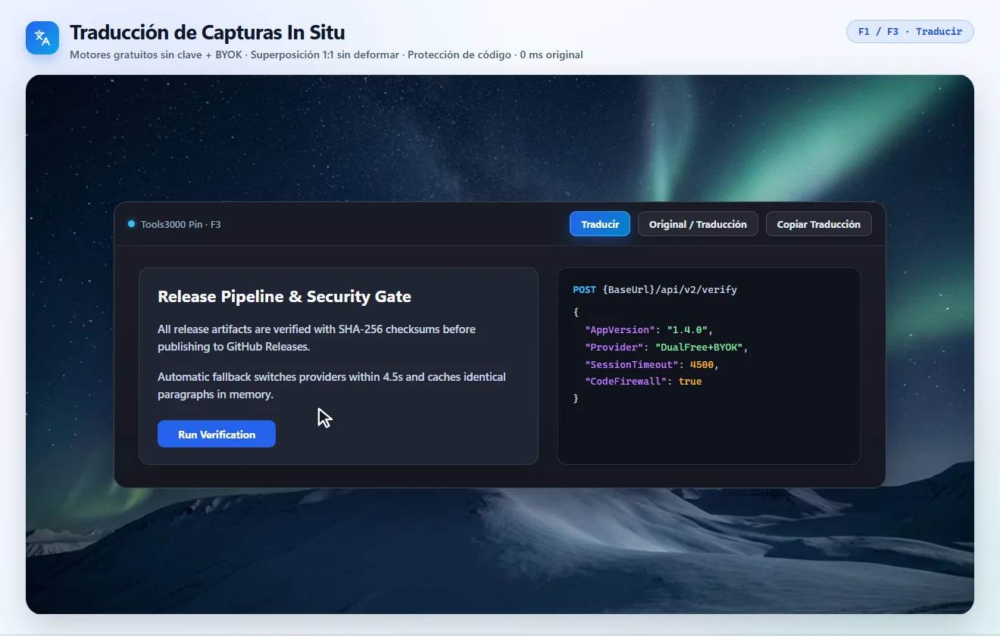<br />
      <sub><b>Traducción de Capturas In Situ</b> · Motores gratuitos sin clave + BYOK, superposición limpia 1:1, protección de código y cambio en 0 ms</sub>
    </td>
    <td width="50%" align="center" valign="top">
      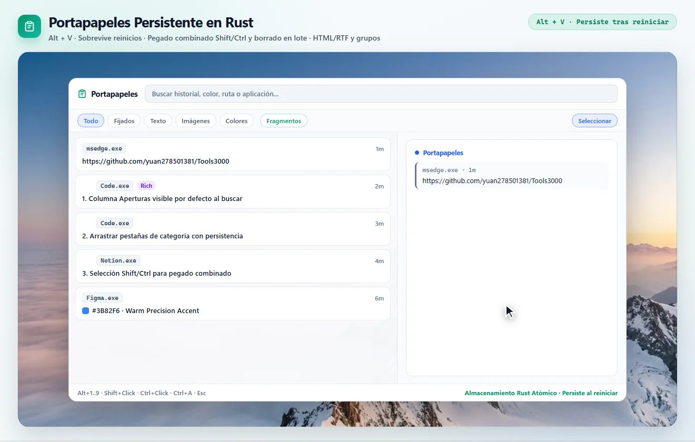<br />
      <sub><b>Portapapeles Persistente (Alt + V)</b> · Persiste tras reinicios, pegado combinado Shift/Ctrl, Rich Text y control en bandeja</sub>
    </td>
  </tr>
  <tr>
    <td width="50%" align="center" valign="top">
      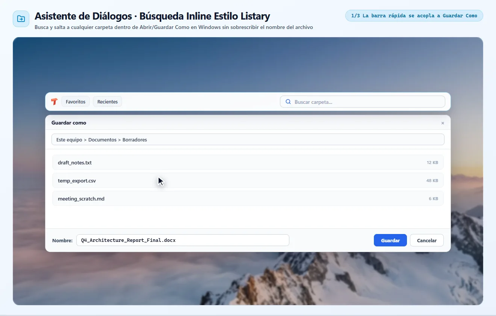<br />
      <sub><b>Asistente de Diálogos</b> · Búsqueda y salto de carpetas estilo Listary en Abrir/Guardar sin sobrescribir el nombre del archivo</sub>
    </td>
    <td width="50%" align="center" valign="top">
      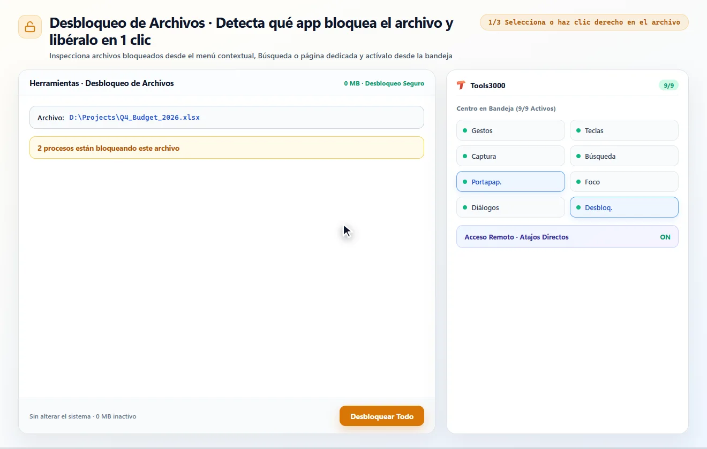<br />
      <sub><b>Desbloqueo de Archivos</b> · Detecta qué app bloquea un archivo desde el menú contextual, búsqueda o página dedicada y libéralo en 1 clic</sub>
    </td>
  </tr>
  <tr>
    <td colspan="2" align="center" valign="top">
      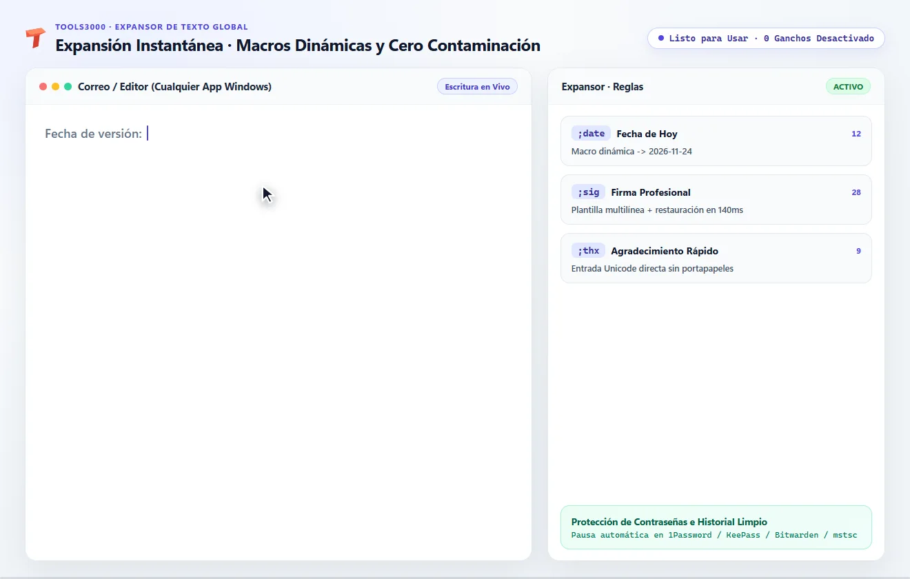<br />
      <sub><b>Expansor de Texto</b> · Escribe <code>;date</code> o <code>;sig</code> en cualquier app con macros dinámicas, protección de contraseñas y cero contaminación del portapapeles</sub>
    </td>
  </tr>
</table>

| Módulo | Qué ofrece |
| :--- | :--- |
| **Búsqueda Instantánea de Archivos** | Pulsa `Alt + Space` para buscar entre millones de archivos en ms junto a apps instaladas (`app:`), 37 herramientas de Windows (`cmd:env`, etc.) y marcadores de Edge/Chrome/Brave/Vivaldi (`bm:`/`b:`, mostrando los iconos reales de cada web completamente offline). Incluye **Live Watch**, **3 modos de RAM** (hasta 0 MB en reposo), contador de aperturas, pestañas arrastrables, vista previa con `Space` (Office, PDF, código, CAD, PSD, 3D, archivos ZIP/7Z/RAR, fuentes TTF/OTF y media) y la herramienta CLI/MCP `tools3000-cli.exe` (350 KB). |
| **Búsqueda de Contenido** | Usa `content:` para buscar directamente dentro de Word, Excel, PDF, PowerPoint, CAD y código fuente con fragmentos resaltados y copia de línea en un clic. |
| **Portapapeles Persistente** | Abre con `Alt + V` (o desde el menú y panel rápido de la bandeja) manteniendo todo el historial tras reiniciar; admite selección `Shift / Ctrl` para pegado combinado en orden y borrado en lote, HTML/RTF, grupos personalizados, edición directa, pegado rápido `Alt + 1..9` y exclusión de apps sensibles, arrastre nativo OLE para pegar y ocultación rápida de fijados en otras categorías. |
| **Expansor de Texto** | Escribe atajos cortos (`;date`, `;now`, `;sig`) en cualquier app de Windows para expandir frases, fechas dinámicas, plantillas con portapapeles y posición de cursor. Incluye pausa automática en gestores de contraseñas, entrada Unicode directa para ASCII, marcas privadas de Windows (sin ensuciar el historial ni `Win + V`) y restauración en 140ms — cero ganchos y cero RAM desactivado. |
| **Asistente de Diálogos** | Añade automáticamente una barra de acceso rápido con búsqueda inline de carpetas estilo Listary en los cuadros Abrir / Guardar Como / Elegir Carpeta de Windows y en los propios diálogos de Tools3000, protegiendo siempre el nombre escrito al guardar. |
| **Desbloqueo de Archivos** | Cuando un archivo no te deja borrarlo, descubre qué programa lo bloquea y libéralo con seguridad: desde el menú contextual del Explorador (opcionalmente solo con `Shift + Clic Derecho`), en resultados de búsqueda o desde la página dedicada en Configuración. Consume 0 MB inactivo, no altera el sistema y limpia el menú automáticamente al desactivarlo. |
| **Captura con Desplazamiento** | Une automáticamente páginas web largas, chats y documentos con vista previa lateral en tiempo real, recorte superior/inferior no destructivo y anotación directa sobre la imagen larga. |
| **Anotación Precisa** | `F1` se ajusta automáticamente a ventanas y controles de interfaz; incluye selector de color por píxel, lupa óptica discontinua, 6 tipos de flecha, numeración autoajustable, mosaico y marcos, además de `R / Shift + R` para reutilizar las últimas 10 regiones de captura. |
| **Pines en Pantalla y Grupos** | Fija capturas o contenido del portapapeles siempre encima (`F3`) con zoom fluido 120Hz, opacidad y paso de clics; organízalos en grupos de color, alterna visibilidad desde la barra superior o alinéalos en cuadrícula en un clic (zoom fluido GPU DirectComposition sin redimensionar). |
| **OCR Local (8 Idiomas) y Traducción In Situ** | Reconocimiento 100% local con detección automática de 8 idiomas sin cambio manual (paquetes ligeros adicionales bajo demanda y cambio de idioma por clic derecho en cada pin); selecciona/copia, subraya, edita en el sitio y extrae tablas/QR, más **traducción limpia 1:1 directamente sobre la captura** (canales gratuitos + BYOK LLM), protección de código y cambio en 0 ms al original. |
| **Grabación de pantalla y Estudio** | Graba la pantalla con superposición de teclas y clics y pasa al instante al Estudio: zoom automático inteligente en clics, fondos seleccionados, edición por forma de onda y exportación a **MP4**, **GIF listo para mensajería/WeChat** y **WebP animado**. |
| **Gestos Globales de Ratón** | Mantén el botón derecho y desliza para cambiar pestañas, retroceder o cerrar ventanas; cancelar al pausar activo por defecto, cambio inteligente a ventanas ya abiertas (incluso distintos perfiles de Chrome), disparo inmediato, volumen/brillo en bordes, easter egg de 8s, pausa en juegos y scripts Lua. |
| **Presentación, Escritorio Remoto y Comentarios** | Visualización limpia de teclas y foco con doble toque en `Ctrl`; paso directo de atajos en mstsc, RustDesk, ToDesk y AnyDesk con liberación de teclas bloqueadas; botón **Comentarios** en la esquina inferior izquierda con ocultación automática local de usuario, IP, correo y tokens antes de exportar diagnósticos. |
| **Visor de Fotos Picasa (Rust · Opcional)** | Visor ligero estilo Picasa recreado en Rust + Direct2D (**solo visor, no la suite completa de Google Picasa**). **Ejecutable único de menos de 2 MB y cero dependencias externas: funciona con Tools3000 o completamente independiente en cualquier PC con Windows.** Desmarcado por defecto en el instalador; al activarlo asocia automáticamente los 41 formatos compatibles (con iconos Polaroid y panel nativo Direct2D en modo claro/oscuro). Además del zoom amortiguado en el cursor, tira de miniaturas y presentación con fundido cruzado, **añade funciones que el original nunca tuvo**: nitidez 4K High-DPI (100%–250%+), VSync 60–240 Hz, WebP / AVIF / HEIC / SVG / QOI / DDS / RAW de cámara, control de animaciones, volteo sin pérdidas e interfaz en 8 idiomas. |

---

## Descarga e instalación

### Opción 1: Gestores de paquetes (Recomendado)

- **Scoop (Disponible ahora — modo portátil real con configuración persistente en `data/`)**:

```powershell
scoop bucket add tools3000 https://github.com/yuan278501381/Tools3000
scoop install tools3000/tools3000
```

- **Winget (Manifiestos oficiales incluidos)**: los manifiestos de `Yy1.Tools3000` en [`packaging/winget/`](../../packaging/winget/) se actualizan y validan con `winget validate` en cada lanzamiento. Una vez integrado en `microsoft/winget-pkgs`, instala con `winget install Yy1.Tools3000` (validación local: `winget install -m packaging/winget`).

### Opción 2: Descarga directa desde GitHub Releases

Obtén la última versión en **[GitHub Releases](https://github.com/yuan278501381/Tools3000/releases/latest)**:

- **Instalador estándar (`Tools3000-vX.Y.Z-Setup.exe`)** — Recomendado para el día a día, con componentes opcionales, inicio automático y actualizaciones fluidas sobre la instalación existente.
- **Archivo portátil (`Tools3000-vX.Y.Z-win-x64-portable.zip`)** — Extrae y ejecuta directamente guardando toda la configuración en la misma carpeta.
- **Sumas de verificación (`SHA256SUMS.txt`)** — Hashes SHA-256 para comprobar la integridad de cada artefacto publicado.

> **Requisitos del sistema**: Windows 10 (1809+) / Windows 11 / Windows Server 2019–2025, con soporte nativo en código y compilación para `x64` y `ARM64` (GitHub Releases ofrece actualmente instalador y versión portátil precompilados para `x64`; en equipos ARM64 se puede compilar nativamente siguiendo la [Guía para desarrolladores](../DEVELOPER.md) o ejecutar la versión `x64`), requiere Microsoft Edge WebView2 Runtime integrado. La interfaz de la aplicación admite de forma nativa 8 idiomas (incluido español) y sigue el idioma del sistema de forma predeterminada.

### Verificación de seguridad y confianza

Transparencia total sin cajas negras (detalles completos en **[SECURITY.md](../../.github/SECURITY.md)**):

1. **Verificación SHA-256**: comprueba el archivo descargado frente a `SHA256SUMS.txt` en PowerShell:
   ```powershell
   Get-FileHash .\Tools3000-vX.Y.Z-Setup.exe -Algorithm SHA256
   ```
2. **Inspección pública en VirusTotal**: introduce el SHA-256 en **[VirusTotal](https://www.virustotal.com/)** (o usa los enlaces directos incluidos en las notas de los próximos lanzamientos) para consultar 70+ motores de seguridad.
3. **Aviso de Windows Defender SmartScreen**: mientras un proyecto independiente de código abierto no cuente con firma comercial EV/pública de confianza (SignPath / Trusted Signing en trámite) o en versiones recién publicadas, Windows puede mostrar «Editor desconocido». Tras verificar SHA-256 y VirusTotal, haz clic en **Más información -> Ejecutar de todas formas**, o compila desde el código fuente con la **[Guía para desarrolladores](../DEVELOPER.md)**.
4. **SPDX SBOM integrado**: tanto el instalador como el archivo portátil incluyen `SBOM.spdx.json` y `THIRD_PARTY_NOTICES.txt`.

---

## Por qué creé Tools3000

Llevo más de diez años usando **Everything** a diario. En capturas de pantalla empecé con las herramientas integradas de **QQ y WeChat**, pasé a **FastStone Capture** por lo cómodas que eran sus anotaciones, luego cambié a **Snipaste** para poder fijar capturas en pantalla, y más tarde migré a **PixPin** por la captura con desplazamiento, el efecto lupa y el OCR; en gestos de ratón utilicé **WGestures** y **WGestures 2**, además de probar muchos grabadores de pantalla — a mitad de camino incluso probé Microsoft **PowerToys**, pero seguían faltando varias piezas clave de mi día a día y acabé de nuevo con varias utilidades residentes.

Con los visores de imágenes me ocurrió lo mismo: las alternativas gratuitas más extendidas estaban llenas de anuncios y software añadido, y desde que Google dejó de actualizar **Picasa** probé varias opciones — como **FastStone Image Viewer** e incluso el visor oficial del autor de Everything (**Void Image Viewer**) — pero ninguno se sentía tan fluido y natural como Picasa. Al final me rendí y me conformé con la app Fotos integrada de Windows. Así que aproveché para recrear con Rust + Direct2D el clásico visor ligero de Picasa (menos de 2 MB, cero dependencias y totalmente independiente), completando además lo que faltaba en el original: nitidez High-DPI y formatos modernos como WebP/AVIF/HEIC/SVG/RAW.

Un día, mirando la fila de iconos acumulados en la bandeja del sistema de Windows, pensé: **qué bien sería unir todo esto en una sola aplicación.** A eso se sumaban dos molestias cotidianas — el OCR de PixPin seguía por detrás de WeChat en precisión y velocidad, y WGestures empezó a dejar un pequeño cuadro de texto atascado en pantalla que solo desaparecía al reiniciar el programa. Aprovechando la llegada de la IA, decidí crear esta suite todo-en-uno por mi cuenta: **Tools3000**.

Para ser totalmente sincero con quienes lo prueben: llevo **4 meses usándolo a diario**, añadiendo funciones de forma gradual y corrigiendo fallos sobre la marcha. Al principio mantenía las apps anteriores abiertas por si algo fallaba y volvía a ellas mientras lo arreglaba; **hoy mi bandeja del sistema por fin está limpia, con Tools3000 como única herramienta residente.**

Por supuesto, los entornos reales de Windows son muy complejos y seguro aparecerán nuevos casos límite. En la era de la IA podemos mejorar el proyecto juntos con mucha más agilidad — tanto si quieres **[reportar un problema en GitHub Issues](https://github.com/yuan278501381/Tools3000/issues)** como **cocrear mediante Pull Requests**, toda ayuda es bienvenida.

---

## Qué reemplaza Tools3000

Cada utilidad especializada destaca en flujos muy concretos. Tools3000 cubre más del 90% de las tareas diarias en **una sola app nativa, gratuita y GPL-3.0**, reconociendo con honestidad dónde las herramientas dedicadas siguen brillando:

| Utilidad Clásica | Flujos cotidianos cubiertos por Tools3000 | Cuándo conviene mantener la herramienta dedicada |
| :--- | :--- | :--- |
| **Everything** | `Alt + Space` para búsqueda NTFS instantánea por nombre, marcadores `bm:` y `content:` dentro de documentos, más CLI / MCP en Rust (350 KB), arrancando bajo demanda | Si necesitas servidores HTTP/ETP, indexación de propiedades EXIF/multimedia o scripts antiguos ligados a la sintaxis de `es.exe` |
| **Ditto / Windows `Win + V`** | `Alt + V` historial persistente en Rust (sobrevive reinicios) con pegado combinado `Shift / Ctrl` y borrado en lote, HTML/RTF, grupos, edición directa y `Alt + 1..9` | Si necesitas sincronización en tiempo real por red local entre varios PCs o itinerancia en la nube |
| **Snipaste / PixPin** | `F1` captura y anotación, lupa discontinua, captura con desplazamiento, `F3` grupos de pines 120Hz, traducción 1:1 in situ y OCR local con edición directa | Si dependes del ajuste extremo a controles GUI heredados o flujos CLI personalizados |
| **WGestures / StrokesPlus** | Gestos con botón derecho, disparo inmediato, volumen en bordes, esquinas activas, pausa en juegos y scripts Lua | Si empleas gestos con múltiples botones simultáneos, condiciones complejas de ventana o macros históricos |
| **Grabadores (ej. ShareX)** | Grabación de pantalla, teclas en pantalla, Estudio (edición por forma de onda y zoom de cursor), exportación a MP4, GIF y WebP | Si necesitas subida automática a 80+ nubes/S3/FTP/Webhook o pipelines FFmpeg muy personalizados |
| **Picasa Photo Viewer / FastStone / Fotos de Windows** | Visor ligero Picasa opcional en Rust (< 2 MB, cero dependencias, ejecutable independiente): animaciones clásicas con 4K High-DPI, WebP/AVIF/HEIC/SVG/RAW y volteo sin pérdidas | Si necesitas la biblioteca de álbumes y reconocimiento facial de Google Picasa completo o revelado RAW profesional por lotes |
| **Listary Dialog Jump / PowerToys File Locksmith** | Búsqueda inline estilo Listary en diálogos Abrir/Guardar de Windows protegiendo el nombre al guardar; Desbloqueo de Archivos con 0 MB inactivo desde el menú contextual o página dedicada | Flujos de acciones personalizadas de Listary o inspección profunda de identificadores del kernel |
| **Espanso / Beeftext / Snippets AutoHotkey** | Expansor nativo integrado (listo para usar, cero ganchos al desactivar) con disparo inmediato o por delimitador, macros de fecha/portapapeles/cursor, exclusión automática de gestores de contraseñas, caja de pruebas y JSON | Formularios YAML complejos, salida dinámica de comandos shell o sincronización con Linux/macOS |

---

## Atajos predeterminados y ubicación de datos

Todos los atajos se pueden personalizar desde Configuración con detección de conflictos en tiempo real:

| Atajo | Acción |
| :--- | :--- |
| `Alt + Space` | Mostrar / ocultar búsqueda instantánea (admite `app:`, `cmd:`, `bm:`, `content:`; `Space` abre la vista previa) |
| `Alt + V` | Mostrar / ocultar portapapeles persistente (`Shift / Ctrl` pegado combinado y `Alt + 1..9`; también desde la bandeja) |
| `F1` | Captura de región, anotación y traducción in situ en 1 clic |
| `F3` | Fijar imagen o texto del portapapeles siempre encima |
| Doble toque en `Ctrl` | Activar / desactivar foco del cursor |
| `Ctrl + Alt + Backspace` | Liberar teclas modificadoras bloqueadas en escritorio remoto (o doble toque en `Ctrl` derecho) |

### Dónde encontrar funciones y archivos locales

Compatibilidad total con carpetas de instalación y nombres de usuario de Windows con tildes, ñ o caracteres no latinos:

| Función / Archivo | Dónde acceder / Instalación estándar | Versión portátil |
| :--- | :--- | :--- |
| **Desbloqueo de Archivos** | Configuración: `Sistema -> Módulos`, `Productividad -> Desbloqueo de Archivos`; centro de bandeja, clic derecho en Explorador y en Búsqueda | Igual (menú solo de usuario, 0 MB inactivo, limpieza automática al desactivar) |
| **Iconos de Búsqueda / Live / RAM** | `Productividad -> Búsqueda de Archivos` (estilo de iconos / Live Watch / memoria); interruptor Live también en la barra inferior | Igual (los iconos de marcadores se leen localmente sin conexión) |
| **Paquetes OCR Sin Conexión (8 idiomas)** | `Productividad -> OCR y Traducción` / clic derecho en pin `Idioma OCR`; `%LOCALAPPDATA%\Tools3000\models\ocr\` | `<carpeta de la app>\data\models\ocr\` |
| **Datos del Portapapeles** | Interruptor en el centro de bandeja; `%LOCALAPPDATA%\Tools3000\clipboard\` | `<carpeta de la app>\data\clipboard\` |
| **Configuración y Registros** | `%LOCALAPPDATA%\Tools3000\config\config.json` y `%LOCALAPPDATA%\Tools3000\logs\tools3000.log` (el botón **Comentarios** anonimiza datos personales localmente) | `<carpeta de la app>\data\config\` y `<carpeta de la app>\data\logs\` |
| **CLI y Visor Independientes** | `C:\Program Files\Tools3000\tools3000-cli.exe` (CLI/MCP) y `Tools3000_Picasa_Viewer.exe` | `<carpeta de la app>\tools3000-cli.exe` y `Tools3000_Picasa_Viewer.exe` |

---

## Privacidad y principios

- **Local Primero y Listo Sin Conexión**: La indexación de archivos, la búsqueda de texto completo, el portapapeles persistente, el OCR, las anotaciones y las estadísticas funcionan exclusivamente en tu equipo. Solo cuando activas explícitamente la traducción de capturas se envía el texto seleccionado al proveedor elegido.
- **Cero Telemetría, Sin Cuentas**: Sin anuncios, sin inicio de sesión y sin subir archivos ni pulsaciones a servidores externos.
- **Ligero por Defecto**: Cada módulo se puede activar o desactivar de forma independiente, y el servicio de búsqueda solo se inicia bajo demanda para mantener un consumo mínimo en reposo.

---

## Comentarios y cocreación

- **Reportar un error**: la vía más rápida es desde la propia aplicación — haz clic en **`Enviar comentarios`** en la esquina inferior izquierda de Configuración (o en **`Configuración -> Acerca de -> Enviar comentarios`**). Admite pegar capturas con `Ctrl + V` y oculta localmente rutas de usuario, correos, IPs y tokens antes de exportar el paquete de diagnóstico (con las últimas 1000 líneas de registro) o prellenar un Issue de GitHub. También puedes reportarlo manualmente mediante la **[plantilla de Bug Report](https://github.com/yuan278501381/Tools3000/issues/new?template=bug_report.yml)**.
- **Proponer mejoras**: abre un **[Feature Request](https://github.com/yuan278501381/Tools3000/issues/new?template=feature_request.yml)** o conversa en **[GitHub Discussions](https://github.com/yuan278501381/Tools3000/discussions)**.
- **Cocrear código**: los Pull Requests son bienvenidos — consulta la **[Guía para desarrolladores](../DEVELOPER.md)** y la **[Guía de empaquetado](../../packaging/README.md)**.

---

## Star History

<a href="https://www.star-history.com/#yuan278501381/tools3000&Date">
 <picture>
   <source media="(prefers-color-scheme: dark)" srcset="https://api.star-history.com/svg?repos=yuan278501381/tools3000&type=Date&theme=dark" />
   <source media="(prefers-color-scheme: light)" srcset="https://api.star-history.com/svg?repos=yuan278501381/tools3000&type=Date" />
   
 </picture>
</a>

---

## Documentación y licencia

- **Desarrollo y Seguridad**: instrucciones de compilación en la **[Guía para desarrolladores](../DEVELOPER.md)**, política de seguridad en **[SECURITY.md](../../.github/SECURITY.md)** e historial en **[GitHub Releases](https://github.com/yuan278501381/Tools3000/releases)**.
- **Licencia**: Publicado bajo la **[GNU GPL v3.0](../../LICENSE)** (con [excepción de enlace Windows / WebView2](../../LICENSE-EXCEPTION.md)).
- **Derechos de autor**: `Copyright (c) 2026 Yy1 (yuan278501381) & Tools3000 contributors` · [@yuan278501381](https://github.com/yuan278501381)
