<div align="center">


# Tools3000

**軽量・ネイティブな Windows オールインワン生産性ツールスイート**

[English](../../README.md) · [简体中文](README.zh-CN.md) · [繁體中文](README.zh-TW.md) · **日本語** · [한국어](README.ko.md) · [Русский](README.ru.md) · [Português (Brasil)](README.pt-BR.md) · [Español](README.es.md)

[](https://github.com/yuan278501381/Tools3000/releases/latest)
[](https://github.com/yuan278501381/Tools3000/stargazers)
[](https://github.com/yuan278501381/Tools3000/releases)
[](#ダウンロードとインストール)
[](#ダウンロードとインストール)
[](../../LICENSE)

**[最新版をダウンロード](#ダウンロードとインストール)** · [機能一覧](#機能一覧) · [デモ](#アニメーションデモ) · [セキュリティと検証](#セキュリティ検証と信頼性) · [開発のきっかけ](#開発のきっかけ) · [置き換え対象一覧](#置き換え対象一覧) · [共創・フィードバック](#共創とフィードバック) · [開発者ガイド](../DEVELOPER.md)

</div>

<br />

Tools3000 は、日々の業務で頻繁に使う **高速ファイル・アプリ・システムコマンド＆実 Favicon ブックマーク検索（Live 自動更新・3段階メモリ・CLI / MCP 対応）、ドキュメント全文検索、再起動後も消えないクリップボード履歴、ダイアログ内フォルダー即検索、ファイルロック解除、スクロールキャプチャ、高精度スクリーンショット注釈、デスクトップピン留め＆グループ管理、8言語自動オフライン OCR＆その場翻訳、画面録画（自動ズームスタジオ・MP4 / WeChat 向け GIF / アニメーション WebP 書き出し）、グローバルマウスジェスチャー、Rust 軽量画像ビューアー** を 1 つのネイティブ Windows アプリに統合しました。コア機能は 100% ローカルオフラインで動作し、日本語などの多言語フォルダー名・ユーザー名にも完全対応。待機メモリは約十数 MB（検索サービスは待機時 0 MB 休止可）で、個人 PC（`x64` / `ARM64`）から Windows Server のマルチユーザー同時利用まで幅広く対応します。

---

## 機能一覧

<p align="center">
  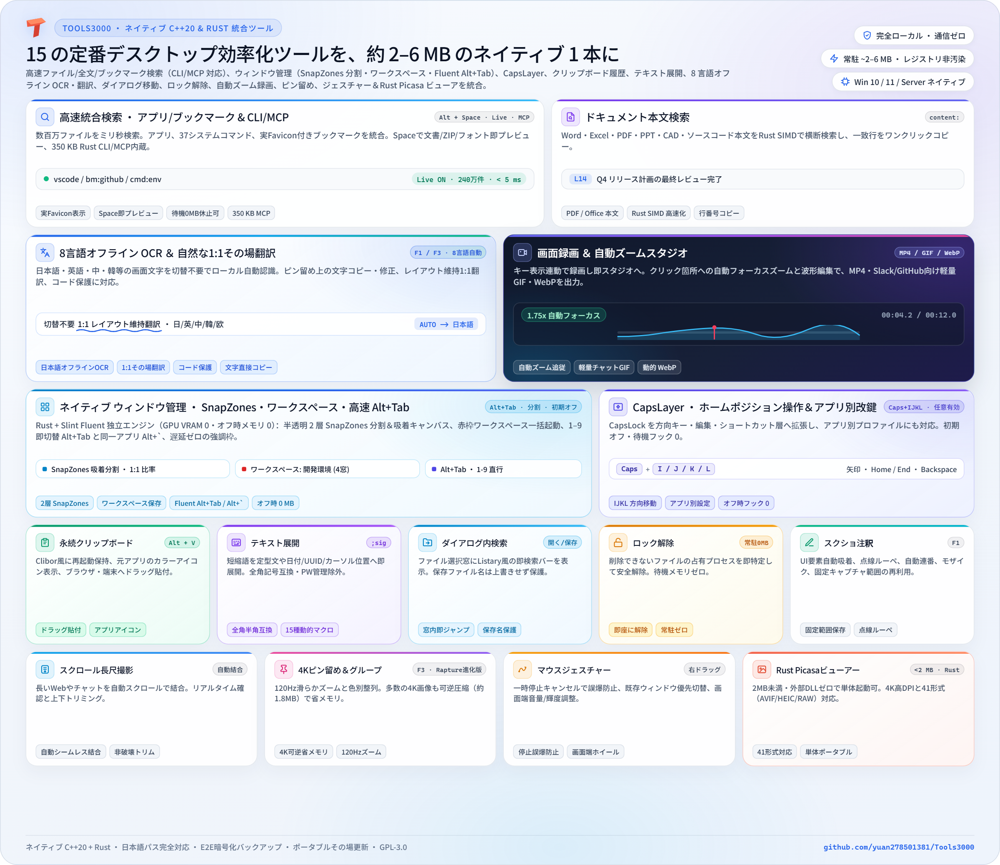
</p>

---

## アニメーションデモ

<table>
  <tr>
    <td width="50%" align="center" valign="top">
      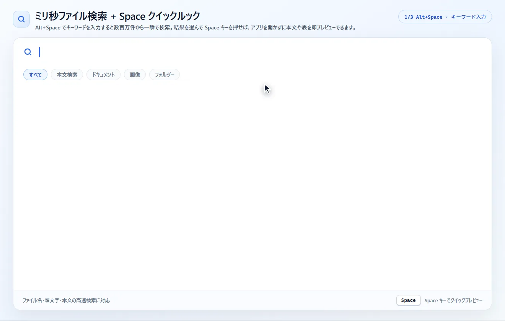<br />
      <sub><b>高速統合検索 ＆ クイックプレビュー</b> · 実アイコン付きアプリ/ブックマーク/コマンド検索、Live 自動更新＆圧縮/フォント即プレビュー</sub>
    </td>
    <td width="50%" align="center" valign="top">
      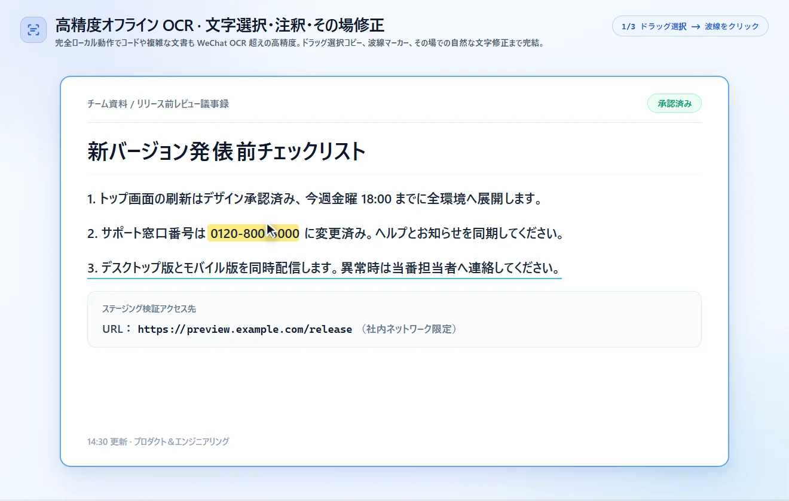<br />
      <sub><b>8言語オフライン OCR ＆ 注釈</b> · 切替不要で 8 言語をローカル自動認識、ドラッグコピー・波線・その場文字修正</sub>
    </td>
  </tr>
  <tr>
    <td width="50%" align="center" valign="top">
      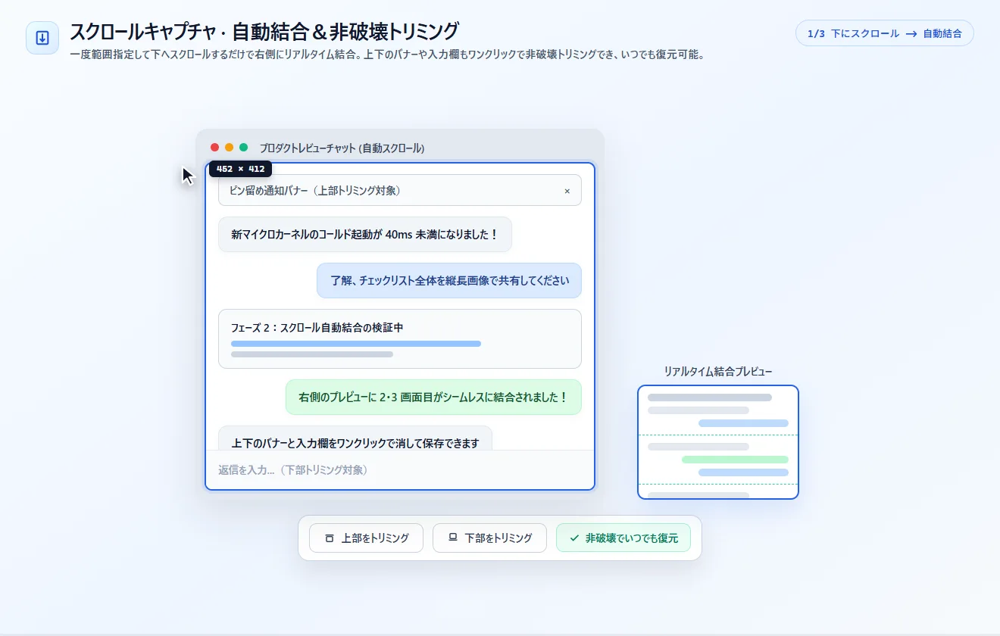<br />
      <sub><b>スクロールキャプチャ</b> · 自動スクロールでシームレス結合、リアルタイムプレビューと上下の非破壊トリミング</sub>
    </td>
    <td width="50%" align="center" valign="top">
      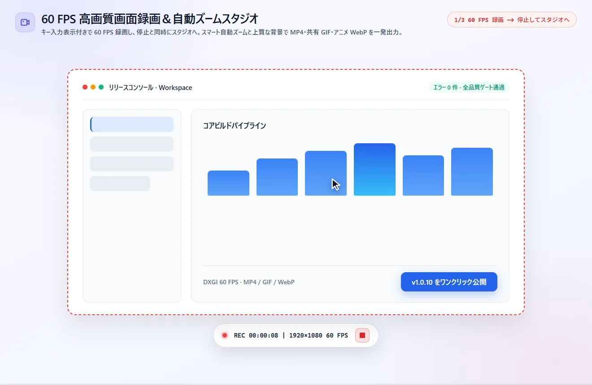<br />
      <sub><b>画面録画 ＆ 自動ズームスタジオ</b> · 画面録画・スマート自動ズーム・MP4 / GIF / アニメーション WebP 出力</sub>
    </td>
  </tr>
  <tr>
    <td width="50%" align="center" valign="top">
      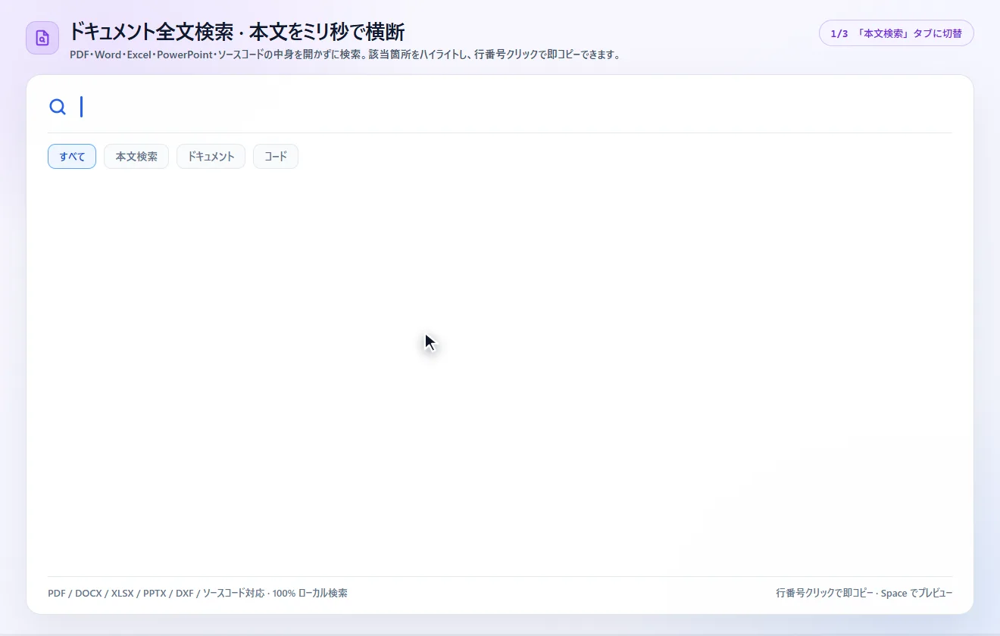<br />
      <sub><b>ドキュメント全文検索</b> · PDF / Word / Excel / ソースコード本文を横断検索し、行番号クリックで即コピー</sub>
    </td>
    <td width="50%" align="center" valign="top">
      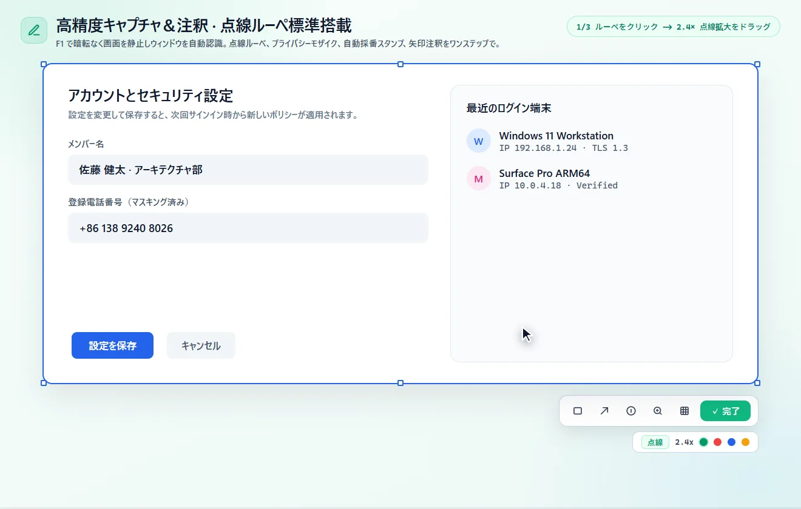<br />
      <sub><b>精密スクリーンショット注釈</b> · 要素自動吸着、破線光学ルーペ、モザイク、自動連番スタンプ</sub>
    </td>
  </tr>
  <tr>
    <td width="50%" align="center" valign="top">
      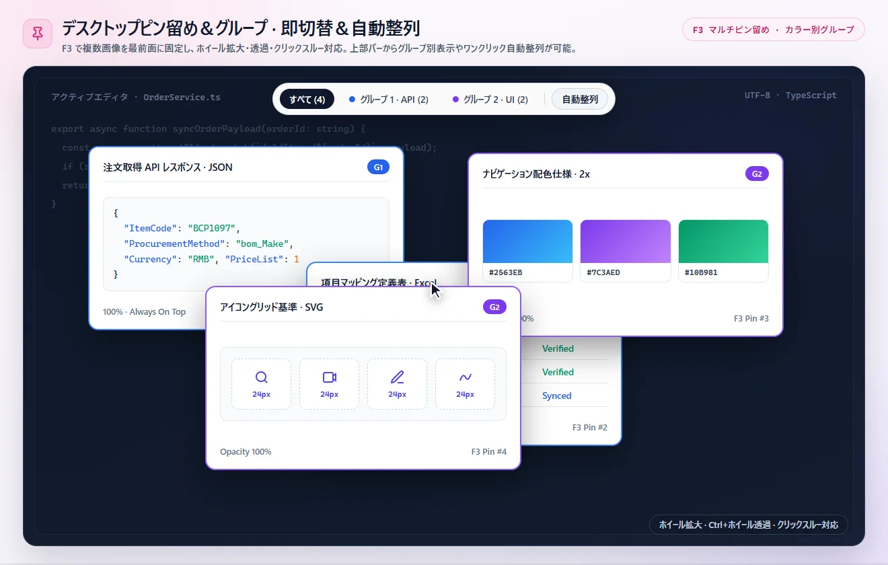<br />
      <sub><b>ピン留め ＆ グループ管理</b> · F3 で最前面固定、カラーグループ絞り込みとワンクリック自動整列</sub>
    </td>
    <td width="50%" align="center" valign="top">
      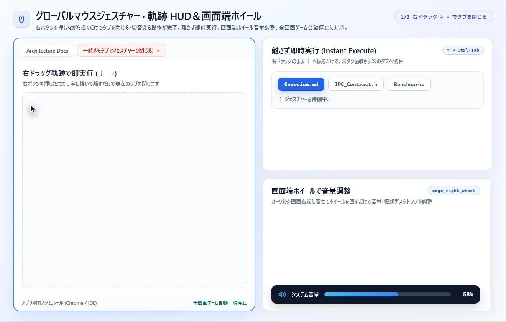<br />
      <sub><b>グローバルマウスジェスチャー</b> · 一時停止キャンセル既定 ON、既存ウィンドウ切替、即時実行＆画面端ホイール音量</sub>
    </td>
  </tr>
  <tr>
    <td width="50%" align="center" valign="top">
      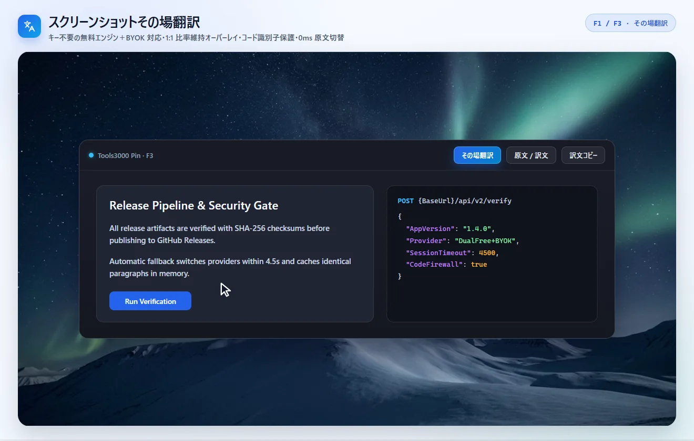<br />
      <sub><b>スクリーンショットその場翻訳</b> · キー不要エンジン＋BYOK 対応、自然な 1:1 上書き・コード保護・0ms 原文切替</sub>
    </td>
    <td width="50%" align="center" valign="top">
      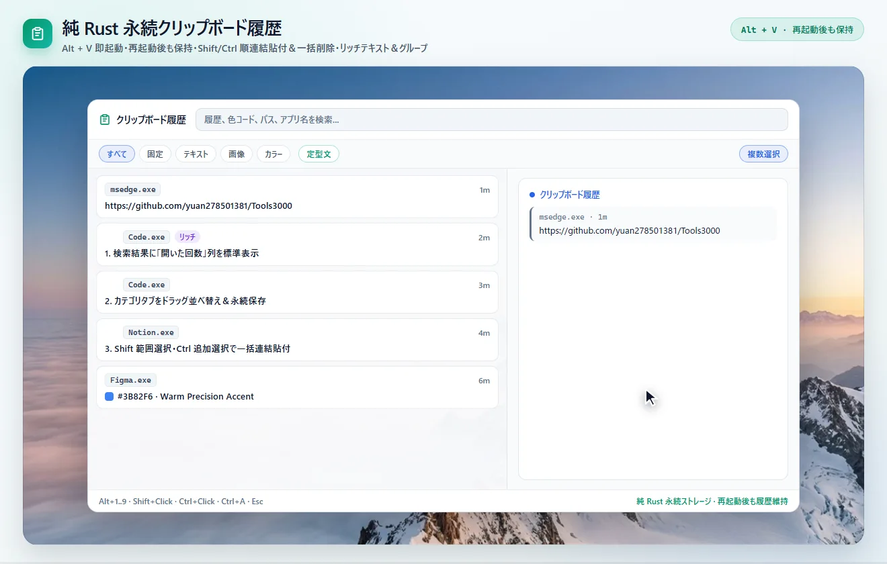<br />
      <sub><b>永続クリップボード履歴 (Alt + V)</b> · 再起動後も保持、Shift/Ctrl 順序結合貼付・リッチテキスト・トレイ切替</sub>
    </td>
  </tr>
  <tr>
    <td width="50%" align="center" valign="top">
      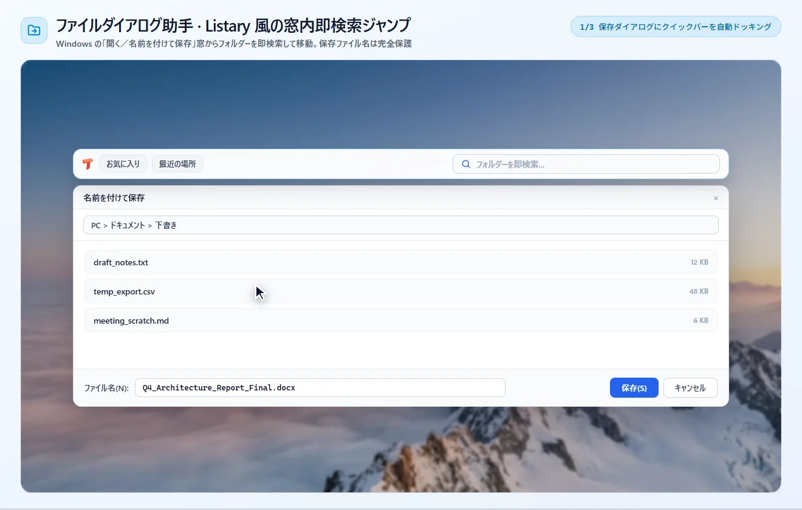<br />
      <sub><b>ファイルダイアログ助手</b> · Windows 開く/保存窓内で即座にフォルダー検索＆移動、保存ファイル名は完全保護</sub>
    </td>
    <td width="50%" align="center" valign="top">
      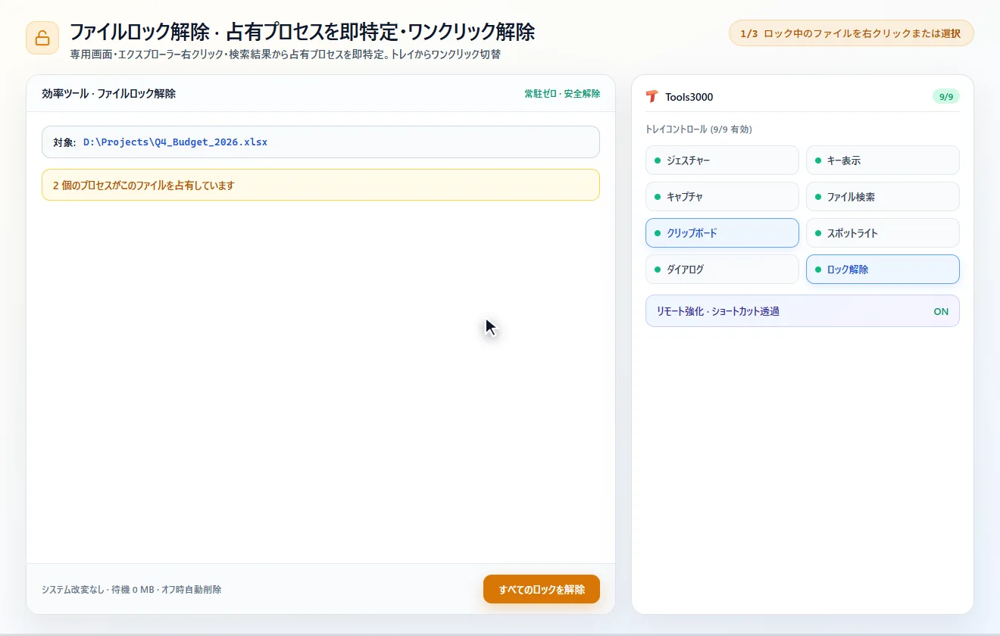<br />
      <sub><b>ファイルロック解除</b> · 右クリック・検索結果・設定画面から占有アプリを特定しワンクリックで安全解除</sub>
    </td>
  </tr>
  <tr>
    <td colspan="2" align="center" valign="top">
      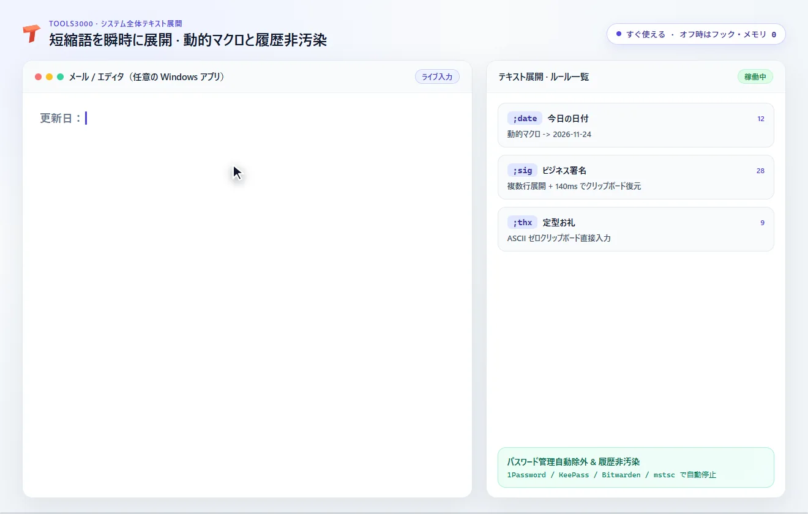<br />
      <sub><b>テキスト展開</b> · 任意のアプリで <code>;date</code> / <code>;sig</code> を即時展開。動的マクロ・パスワード管理アプリ除外・履歴非汚染に対応</sub>
    </td>
  </tr>
  <tr>
    <td width="50%" align="center" valign="top">
      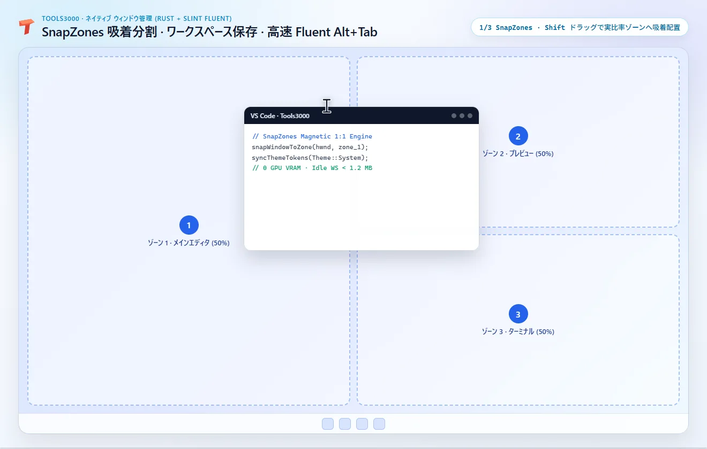<br />
      <sub><b>ウィンドウ管理（任意有効）</b> · SnapZones 実比率マグネット分割、4px 赤枠ワークスペース保存＆Fluent Alt+Tab / Alt+`（VRAM 0・オフ時 0 MB）</sub>
    </td>
    <td width="50%" align="center" valign="top">
      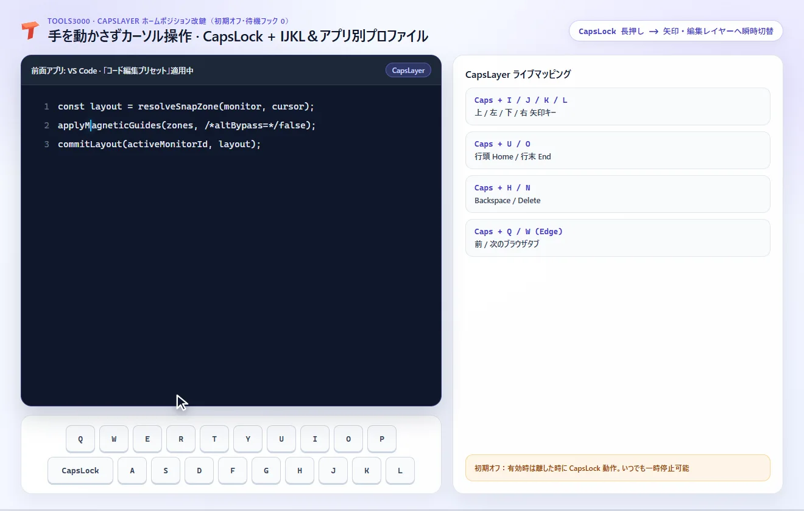<br />
      <sub><b>CapsLayer 改鍵（任意有効）</b> · CapsLock + IJKL で手を動かさず矢印・編集、アプリ別プロファイル自動切替（オフ時フック 0）</sub>
    </td>
  </tr>
</table>

| モジュール | 主な体験 |
| :--- | :--- |
| **高速ファイル検索** | `Alt + Space` で全ドライブの数百万ファイルをミリ秒検索。インストール済みアプリ（`app:`）、37 の Windows システムツール（`cmd:env` 等）、Edge/Chrome/Brave/Vivaldi ブックマーク（`bm:`/`b:`、ローカルから実 Favicon を完全オフライン表示）を統合。**Live リアルタイム更新**、**3段階メモリ設定**（待機時 0 MB 休止可）、開いた回数列、ドラッグ並び替えカテゴリタブ、`Space` クイックプレビュー（文書・PDF・コード・CAD・PSD・3D・ZIP/7Z/RAR 圧縮・TTF/OTF フォント・動画）、350 KB 軽量 CLI/MCP ツール `tools3000-cli.exe` を内蔵。 |
| **ドキュメント全文検索** | `content:` プレフィックスで Word・Excel・PDF・PowerPoint・CAD・ソースコードの本文を直接検索。該当箇所をハイライト表示し、行番号クリックで即コピーできます。 |
| **永続クリップボード履歴** | `Alt + V`（またはトレイ右クリックメニュー／トレイコントロールからワンクリック開閉）で即呼び出し。再起動後も履歴を保持し、コピー元アプリのカラーアイコンとアプリ名表示、モダンブラウザ検索欄・ターミナル・AI IDE へのスマートドラッグ貼付、`Shift / Ctrl` による順番通りの一括連結貼付・一括削除、HTML/RTF リッチテキスト、グループ管理、インライン編集、`Alt + 1..9` 即貼付、他カテゴリでのピン留め非表示、機密アプリ除外に対応します。 |
| **テキスト展開** | 任意の Windows アプリで `;date`・`;now`・`;sig` などの短縮語を定型文や 15 種類の動的マクロ（`{{date+Nd}}` 日数オフセット・曜日 `{{weekday}}`・`{{uuid}}`・`{{timestamp}}`・`{{user}}`・クリップボード・`{{cursor}}` 位置指定）へ即展開。全角記号トリガー自動互換、区切りキー保持、リアルタイム展開プレビュー、パスワード管理アプリ自動除外、プライバシー除外フラグに対応（オフ時はフック・メモリ消費ゼロ）。 |
| **ウィンドウ管理スイート（任意・既定オフ）** | 独立 Rust + Slint Fluent エンジン（WebView2・GPU VRAM 不使用、オフ時はプロセス 0）：半透明 2 層 **SnapZones 分割**＆実比率吸着キャンバス、**ワークスペース** 4px 赤枠一括記録＋デスクトップショートカット、1–9 即切替 **Fluent Alt+Tab ＆ 同一アプリ Alt+`**、遅延ゼロの強調枠を搭載。 |
| **CapsLayer リーダー改鍵（任意・既定オフ）** | `CapsLock` をホームポジション矢印（`I/J/K/L`）・編集・ショートカット層へ拡張し、前面アプリ別プロファイル切替に対応。既定オフ・待機フック 0、有効化時は IME 影響の注意を表示。 |
| **ファイルダイアログ助手** | Windows の「開く / 名前を付けて保存 / フォルダー選択」や Tools3000 自身のダイアログ上部にクイック移動バーを自動表示。Listary 風にフォルダーを即検索してジャンプでき、「名前を付けて保存」のファイル名は決して上書きしません。 |
| **ファイルロック解除** | 削除できないファイルを占有しているアプリを瞬時に特定して安全解除。エクスプローラー右クリック（任意で `Shift + 右クリック` のみ表示）、検索結果右クリック、または設定内の専用画面から直接ファイルを選んで実行可能。常駐メモリゼロでシステムも改変せず、オフにすると右クリック項目も自動削除されます。 |
| **スクロールキャプチャ** | 長い Web ページやチャット履歴を自動スクロールでシームレスに結合。右側でリアルタイム確認でき、上下の非破壊トリミング（ドラッグでいつでも復元可能）や直接注釈に対応します。 |
| **精密スクリーンショット注釈** | `F1` でウィンドウや UI 要素へ自動吸着。ピクセル単位カラーピッカー、破線光学ルーペ、6 種類の矢印、自動再採番スタンプ、モザイク、共有フレーム、自動コピー／自動保存の独立設定、`Shift + F1` / `R` による固定・履歴キャプチャ範囲の再利用を備えています。 |
| **ピン留め ＆ グループ管理** | `F3` でキャプチャやクリップボード画像を常に最前面へ固定（120Hz GPU 滑らかズーム・透過・クリックスルー・カラーグループ・ワンクリック整列）。多数の 4K 画像や長尺キャプチャでも可逆コールド圧縮と GPU テクスチャ自動解放で省メモリを維持し、ピン留め時の自動文字認識オン／オフも設定可能です。 |
| **8言語オフライン OCR ＆ その場翻訳** | 言語切替なしで 8 言語（日・韓・中・英・露・西・葡）のスクリーンショットを完全ローカル自動認識（追加 4 言語パックはオンデマンド取得、ピン右クリックで個別言語再認識可）。ドラッグコピー、波線・マーカー注釈、その場文字修正、表・QR 抽出に加え、**自然な 1:1 その場翻訳**（無料 2 系統＋BYOK OpenAI 互換モデル）、コード保護、0ms 原文瞬切に対応します。 |
| **画面録画 ＆ 自動ズームスタジオ** | キー表示付きの画面録画後、そのままスタジオ画面へ移行。クリック箇所へのスマート自動ズーム、厳選背景、波形タイムライン編集に対応し、**MP4**・**チャット向け GIF**・**アニメーション WebP** をワンクリックで書き出せます。 |
| **グローバルマウスジェスチャー** | 右ドラッグでタブ切替・戻る・ウィンドウ閉じを完結。誤操作を防ぐ「一時停止で自動キャンセル」が既定オン、「アプリ実行」の既存ウィンドウ優先切替（Chrome のプロファイル別ウィンドウも識別）、ホールド即時実行、画面端ホイール音量/輝度、8 秒イースターエッグ、ゲーム自動回避、Lua 拡張に対応します。 |
| **プレゼン演出 ＆ リモート支援** | 画面共有向けキー表示と `Ctrl` 2 回押しスポットライト、mstsc・RustDesk・ToDesk・AnyDesk 向けショートカット透過と修飾キー固着解除、さらに左下の「フィードバック」からユーザー名・IP・メール等を自動マスクした診断レポート出力を備えます。 |
| **Picasa フォトビューアー（Rust 再現・オプション）** | Rust + Direct2D で再現した軽量 Picasa 風画像ビューアー（**閲覧専用・オリジナル Google Picasa 全機能版ではありません**）。**2 MB 未満の単一バイナリかつ外部ランタイム依存ゼロで、Tools3000 連携はもちろん単体でもそのまま独立動作**します。インストーラー既定ではオフ、有効化すると対応 41 形式を一括自動関連付け（定番ポラロイドアイコン＆ダーク／ライト対応 Direct2D 設定画面付き）。カーソル基準の滑らかズームやフィルムストリップ波紋・クロスディゾルブ・スライドショーを忠実に再現しつつ、**オリジナルに無かった最新機能を補完**：4K High-DPI（100%–250%+）鮮明描画、60–240Hz VSync、WebP / AVIF / HEIC / SVG / QOI / DDS / カメラ RAW、アニメーション再生コントロール、可逆反転、8 言語 UI に対応。 |

---

## ダウンロードとインストール

### 方法 1：パッケージマネージャー（おすすめ）

- **Scoop（すぐ利用可能・`data/` 永続化による完全ポータブル構成でアップデート時も設定維持）**：

```powershell
scoop bucket add tools3000 https://github.com/yuan278501381/Tools3000
scoop install tools3000/tools3000
```

- **Winget（公式スキーマ準拠マニフェスト同梱）**：[`packaging/winget/`](../../packaging/winget/) に `winget validate` 検証済みの `Yy1.Tools3000` マニフェストを自動生成しています。`microsoft/winget-pkgs` 登録後は `winget install Yy1.Tools3000` で直接導入できます（ローカル検証は `winget install -m packaging/winget`）。

### 方法 2：GitHub Releases から直接ダウンロード

最新バージョンは **[GitHub Releases](https://github.com/yuan278501381/Tools3000/releases/latest)** からダウンロードできます：

- **標準インストーラー（`Tools3000-vX.Y.Z-Setup.exe`）** — 日常利用におすすめ。コンポーネント選択、自動起動、シームレスな上書きアップデートに対応します。
- **ポータブル版（`Tools3000-vX.Y.Z-win-x64-portable.zip`）** — 解凍するだけで即利用可能。設定やデータはすべて展開先フォルダー内に保存されます。
- **チェックサム（`SHA256SUMS.txt`）** — 各リリースの SHA-256 整合性検証ハッシュを同梱しています。

> **動作環境**：Windows 10（1809 以降）/ Windows 11 / Windows Server 2019–2025。ソース・ビルド基盤は `x64`・`ARM64` ネイティブ対応（GitHub Releases では現在 `x64` ビルド済みインストーラー／ポータブル版を配布中。ARM64 環境は[開発者ガイド](../DEVELOPER.md)に沿ってネイティブビルド、または `x64` 版を直接実行可能）、標準の Microsoft Edge WebView2 Runtime が必要です。アプリ UI は日本語を含む 8 言語にネイティブ対応し、既定で OS 言語に自動追従します。

### セキュリティ検証と信頼性

透明性と安心感を最優先し、4 つの検証手段を用意しています（詳細は **[SECURITY.md](../../.github/SECURITY.md)**）：

1. **SHA-256 整合性チェック**：PowerShell でローカルのハッシュを算出し `SHA256SUMS.txt` と照合できます：
   ```powershell
   Get-FileHash .\Tools3000-vX.Y.Z-Setup.exe -Algorithm SHA256
   ```
2. **VirusTotal 公開スキャン確認**：**[VirusTotal](https://www.virustotal.com/)** に SHA-256 を入力する（または今後の Release ノート記載の直リンクを開く）ことで、70 以上のセキュリティエンジンの結果を公開確認できます。
3. **Windows Defender SmartScreen 警告について**：個人 OSS で商用 EV 署名／公的信頼署名（SignPath 等を準備中）が未適用、または新バージョン直後のレピュテーション蓄積前は「Windows によって PC が保護されました」と表示される場合があります。SHA-256 と VirusTotal を確認のうえ **「詳細情報 -> 実行」** で続行するか、**[開発者ガイド](../DEVELOPER.md)** からソースビルドしてください。
4. **SPDX SBOM 同梱**：インストーラーおよびポータブル版には依存関係一覧 `SBOM.spdx.json` と `THIRD_PARTY_NOTICES.txt` を同梱しています。

---

## 開発のきっかけ

私は **Everything** を 10 年以上愛用してきました。スクリーンショットやピン留めは **WinShot**、**FastStone Capture**、**Rapture**、**Snipaste** などを渡り歩き、クリップボード履歴には **Clibor** や **Ditto**、マウスジェスチャーには **WGestures** や **StrokesPlus** を使い、画面録画ツールもいくつも乗り換え、途中で Microsoft **PowerToys** も試してみましたが、どうしても日常の必須機能がいくつか足りず、結局また複数の常駐アプリに戻ってしまいました。

画像ビューアーも同じ悩みでした。フリービューアーの多くは広告やバンドルが多く、Google が **Picasa** を終了してからは **FastStone Image Viewer** や Everything 作者公式の画像ビューアー（**Void Image Viewer**）などいくつも試したものの、Picasa 特有の軽快な手触りと心地よい演出には届かず、最終的には諦めて Windows 標準のフォトアプリで妥協していました。そこで Rust + Direct3D 11 で軽量な Picasa フォトビューアーを自分の手で再現し（2 MB 未満・外部依存ゼロで単体利用も可能）、当時なかった 4K 高 DPI 鮮明化や WebP/AVIF/HEIC/SVG/RAW などの最新形式まで一気に補完しました。

ある日 Windows のタスクトレイに並ぶいくつもの常駐アイコンを眺めながら、**「これらが Electron 不使用・レジストリを汚さない 1 つの軽量ネイティブアプリにまとまればいいのに」**と思いました。さらに、標準の画面 OCR は日英混在の技術画面で精度が落ちやすく、常駐ツール同士のグローバルフック競合にも悩まされていました。そこで C++20 + Rust でゼロから設計し、主プロセス常駐約 **2〜6 MB** に凝縮したオールインワンツールが **Tools3000** です。

利用を検討される方へ率直にお伝えすると、公開前に私自身が **4 か月間じっくり実用** しながら段階的に機能を追加し、気づいた不具合を少しずつ潰してきました。最初のうちは旧ツールも起動したまま併用し、うまく動かない時だけ戻して修正を重ねていましたが、**いまではタスクトレイがすっかり静かになり、常駐しているのは Tools3000 だけです。**

もちろん実際の利用環境は千差万別なので、今後も新たな課題は出てくるはずです。AI 時代だからこそ、**[GitHub Issues](https://github.com/yuan278501381/Tools3000/issues) での不具合報告** や **Pull Request による共創** を通じて、一緒に磨き上げていければ嬉しいです。

---

## 置き換え対象一覧

単機能ツールにはそれぞれの深い強みがあります。Tools3000 は日常の 90% 以上を占める高頻度ワークフローを **広告なし・GPL-3.0 ライセンスの 1 つのネイティブアプリ** に集約しつつ、専門ツールが優位な領域も率直に明記しています：

| 定番の単機能ツール | Tools3000 がカバーする日常ワークフロー | 専用ツールの併用をおすすめする場面 |
| :--- | :--- | :--- |
| **Everything** | `Alt + Space` によるミリ秒ファイル名・`bm:` ブックマーク・`content:` 全文検索、350 KB 純 Rust CLI / MCP サーバー内蔵（オンデマンド起動で常駐負荷ゼロ） | HTTP/ETP ネットワーク共有検索、EXIF 等全プロパティ列ソート、既存 `es.exe` 構文に依存するスクリプトが必要な場合 |
| **Clibor / Ditto / Windows `Win + V`** | `Alt + V` 純 Rust 永続クリップボード履歴（再起動後も保持）、元アプリのカラーアイコン表示、ブラウザ・端末へのドラッグ貼付、`Shift / Ctrl` 一括連結貼付、グループ、`Alt + 1..9` 即貼付 | 複数 PC 間の LAN リアルタイム同期やクラウドアカウントによる履歴ローミングが必要な場合 |
| **Rapture / Snipaste / WinShot** | `F1` キャプチャ注釈、破線ルーペ、スクロール撮影、`F3` 120Hz ピン留めグループ（4K可逆省メモリ）、1:1 その場翻訳、高速オフライン OCR（選択コピー・その場文字修正） | 特殊レガシー GUI の極限スナップ検出や独自 CLI キャプチャ連携に依存する場合 |
| **WGestures / StrokesPlus** | 右ドラッグ操作、ホールド中即時実行、画面端ホイール音量、ホットコーナー、ゲーム自動回避、Lua 拡張 | 複雑なマルチボタン同時押しや高度なウィンドウ領域条件・既存マクロ資産を使う場合 |
| **画面録画ツール（ShareX 等）** | 画面録画、キー表示、自動ズームスタジオ（波形編集＆カーソル自動ズーム）、MP4 / GIF / WebP ワンクリック出力 | 80 以上のクラウド / S3 / FTP 自動アップロードや複雑な FFmpeg 後処理パイプラインを使う場合 |
| **Picasa ビューアー / FastStone / Windows フォト** | 2 MB 未満・依存ゼロの Rust 再現軽量 Picasa ビューアー（単体起動可）。定番アニメを再現しつつ 4K High-DPI・WebP/AVIF/HEIC/SVG/RAW・可逆反転を補完 | オリジナル Google Picasa のアルバム管理・顔認識や、本格的なバッチ変換／RAW 現像が必要な場合 |
| **Listary ダイアログ移動 / PowerToys File Locksmith** | Windows「開く / 保存」窓内で Listary 風フォルダー即検索ジャンプ（保存名保護）；常駐ゼロの「ファイルロック解除」で右クリック／設定画面から占有アプリを即解除 | Listary の高度なカスタムランチャー連携や、カーネルハンドル単位の深い調査が必要な場合 |
| **Espanso / Beeftext / AutoHotkey 定型文** | 標準搭載のネイティブテキスト展開（すぐ使えて、オフ時はフックゼロ）。即時／区切りキー両対応、日付・クリップボード・カーソル動的マクロ、パスワード管理自動除外、ライブ試用欄、JSON 入出力を搭載 | 複雑な YAML フォーム入力、シェル実行出力、または Linux/macOS 間のクロスプラットフォーム同期が必要な場合 |
| **PowerToys FancyZones・Workspaces / AltTab** | 任意有効の Rust + Slint Fluent ウィンドウ管理（VRAM 0・オフ時 0 MB）：2 層 SnapZones＆吸着キャンバス、赤枠ワークスペース一括起動、検索・1–9 直行 Alt+Tab ＆ 同一アプリ Alt+` | GlazeWM / Komorebi などの自動タイリング WM ワークフローが必要な場合 |
| **AutoHotkey / Change Key / CapsLock+** | スクリプト不要の視覚的 CapsLayer（`Caps+IJKL` 矢印・編集）とアプリ別プロファイル（オフ時フック 0） | 高度な AHK スクリプト制御や QMK/VIA ファームウェア書き換えが必要な場合 |

---

## 基本ショートカットと設定・データ保存先

すべてのショートカットは設定画面から自由に変更でき、競合も自動検知されます：

| ショートカット | 動作 |
| :--- | :--- |
| `Alt + Space` | 高速検索の表示 / 非表示（`app:`・`cmd:`・`bm:`・`content:` 対応、選択中に `Space` でクイックプレビュー） |
| `Alt + V` | 永続クリップボード履歴の表示 / 非表示（`Shift / Ctrl` 一括連結貼付・`Alt + 1..9` 即貼付、トレイメニューからも起動可） |
| `F1` | 範囲スクリーンショット・注釈・ワンクリックその場翻訳 |
| `F3` | クリップボードの画像・テキストを最前面にピン留め |
| `Ctrl` を素早く 2 回押し | カーソルスポットライトのオン / オフ |
| `Ctrl + Alt + Backspace` | リモート操作時の修飾キー固着を即時解除（または右 `Ctrl` 2 回押し） |

### 機能の場所とローカルデータ保存先

日本語・中国語・韓国語など非 ASCII 文字を含むインストール先や Windows ユーザー名に完全対応しています：

| 項目 | 設定画面の入口 / 標準インストール先 | ポータブル版保存先 |
| :--- | :--- | :--- |
| **クラウド・同期フォルダー設定バックアップ** | `システム -> 一般 -> クラウド・同期フォルダーバックアップ`（OneDrive/Google Drive/Dropbox/iCloud 自動検出、WebDAV・S3、任意の E2E 暗号化対応） | 同じ（ポータブル版も `設定 -> バージョン情報` からその場ホットアップデート可能） |
| **メモリポリシーと回収スケジュール** | `インサイトと情報 -> メモリポリシー`（10 項目のオンデマンド一時停止・アイドル解放・自動回収スケジュール） | 同じ |
| **ピン自動文字認識 ＆ 範囲管理** | `効率ツール -> キャプチャと録画 -> ピン留めと固定範囲`（「ピン留め時に自動で文字を認識」スイッチと固定範囲管理） | 同じ |
| **ファイルロック解除** | 設定：`システム -> モジュール`、`効率ツール -> ファイルロック解除`；トレイパネル・右クリック・検索結果右クリック | 同じ（ユーザー単位メニューのみ、常駐ゼロ、オフ時自動削除） |
| **検索アイコン / Live / メモリ設定** | `効率ツール -> ファイル検索`（アイコン表示 / リアルタイム監視 / メモリ管理）；検索窓下部のステータスバーからも Live 切替可 | 同じ（ブックマーク Favicon はローカル読取のみ・通信ゼロ） |
| **8言語オフライン OCR パック** | `効率ツール -> OCR と翻訳` / ピン右クリック `認識言語`；`%LOCALAPPDATA%\Tools3000\models\ocr\` | `<アプリフォルダー>\data\models\ocr\` |
| **クリップボード履歴データ** | トレイパネルから即切替；`%LOCALAPPDATA%\Tools3000\clipboard\` | `<アプリフォルダー>\data\clipboard\` |
| **設定ファイルと診断ログ** | `%LOCALAPPDATA%\Tools3000\config\config.json`・`%LOCALAPPDATA%\Tools3000\logs\tools3000.log`（左下「フィードバック」は個人情報を自動マスクして出力） | `<アプリフォルダー>\data\config\`・`<アプリフォルダー>\data\logs\` |
| **単体 CLI ＆ ビューアー** | `C:\Program Files\Tools3000\tools3000-cli.exe`（CLI/MCP）・`Tools3000_Picasa_Viewer.exe` | `<アプリフォルダー>\tools3000-cli.exe`・`Tools3000_Picasa_Viewer.exe` |

---

## プライバシーと設計思想

- **ローカル完結・オフライン対応**：ファイル索引、全文検索、永続クリップボード、OCR、注釈、キー・マウス統計はすべてローカル完結。スクリーンショット翻訳を実行した時のみ、選択された翻訳プロバイダーへ対象テキストを送信します。
- **ゼロテレメトリ・アカウント不要**：広告ポップアップやログインは一切なく、ファイルや入力データの外部送信も行いません。
- **オンデマンド設計の軽量動作**：各モジュールは個別にオン / オフ可能。検索サービスは呼び出し時のみ起動し、待機負荷を極限まで抑えます。

---

## 共創とフィードバック

- **不具合報告**：アプリ内の **設定画面左下「フィードバック」**（または **`設定 -> バージョン情報 -> フィードバック`**）からの送信が最も簡単です。`Ctrl + V` でスクリーンショットを直接貼り付けられ、ユーザー名パス・メール・IP・トークン等をローカルで自動マスキングした上で診断バンドル（直近 1000 行のログ含む）の書き出しや GitHub Issue の自動入力ができます。**[Bug Report テンプレート](https://github.com/yuan278501381/Tools3000/issues/new?template=bug_report.yml)** から直接ご報告いただくことも可能です。
- **機能提案**：**[Feature Request](https://github.com/yuan278501381/Tools3000/issues/new?template=feature_request.yml)** や **[GitHub Discussions](https://github.com/yuan278501381/Tools3000/discussions)** で気軽にアイデアを共有いただけます。
- **Pull Request 共創**：コントリビューションを大歓迎しています。詳細は **[開発者ガイド](../DEVELOPER.md)**・**[パッケージ管理ガイド](../../packaging/README.md)** を参照してください。

---

## Star History

<a href="https://www.star-history.com/#yuan278501381/tools3000&Date">
 <picture>
   <source media="(prefers-color-scheme: dark)" srcset="https://api.star-history.com/svg?repos=yuan278501381/tools3000&type=Date&theme=dark" />
   <source media="(prefers-color-scheme: light)" srcset="https://api.star-history.com/svg?repos=yuan278501381/tools3000&type=Date" />
   
 </picture>
</a>

---

## ドキュメントとライセンス

- **開発・セキュリティ**：ビルド手順と SDK は **[開発者ガイド](../DEVELOPER.md)**、セキュリティポリシーは **[SECURITY.md](../../.github/SECURITY.md)**、変更履歴は **[GitHub Releases](https://github.com/yuan278501381/Tools3000/releases)** をご覧ください。
- **ライセンス**：**[GNU GPL v3.0](../../LICENSE)** の下で公開されています（[Windows / WebView2 リンク例外](../../LICENSE-EXCEPTION.md) 付き）。
- **著作権**：`Copyright (c) 2026 Yy1 (yuan278501381) & Tools3000 contributors` · [@yuan278501381](https://github.com/yuan278501381)
