<div align="center">


# Tools3000

**가볍고 빠른 네이티브 Windows 올인원 생산성 도구 모음**

[English](../../README.md) · [简体中文](README.zh-CN.md) · [繁體中文](README.zh-TW.md) · [日本語](README.ja.md) · **한국어** · [Русский](README.ru.md) · [Português (Brasil)](README.pt-BR.md) · [Español](README.es.md)

[](https://github.com/yuan278501381/Tools3000/releases/latest)
[](https://github.com/yuan278501381/Tools3000/stargazers)
[](https://github.com/yuan278501381/Tools3000/releases)
[](#다운로드-및-설치)
[](#다운로드-및-설치)
[](../../LICENSE)

**[최신 버전 다운로드](#다운로드-및-설치)** · [핵심 기능](#핵심-기능-한눈에-보기) · [기능 데모](#기능-데모) · [보안 및 검증](#보안-검증-및-신뢰-안내) · [개발 계기](#개발-계기) · [대체 가능 목록](#대체-가능-도구-목록) · [참여 및 피드백](#피드백-및-공동-제작) · [개발자 가이드](../DEVELOPER.md)

</div>

<br />

Tools3000은 매일 자주 쓰는 **초고속 파일·앱·시스템 도구 및 원본 아이콘 북마크 검색(실시간 반영·3단계 메모리·CLI / MCP 포함), 문서 본문 검색, 재부팅 후에도 유지되는 클립보드 기록, 파일 대화상자 내장 검색, 파일 잠금 해제, 자동 스크롤 긴 캡처, 정밀 스크린샷 주석, 화면 고정(핀) 및 그룹 관리, 8개국어 자동 오프라인 OCR·깔끔한 원위치 번역, 화면 녹화(자동 줌 스튜디오 · MP4 / 메신저용 GIF / 애니메이션 WebP 내보내기), 전역 마우스 제스처, Rust 경량 뷰어**를 하나의 네이티브 Windows 앱으로 통합했습니다. 핵심 기능은 100% 로컬 오프라인으로 동작하며 한국어 등 비영어 설치 폴더와 사용자 이름을 완벽히 지원합니다. 대기 메모리는 약 십수 MB 수준(검색 서비스 대기 시 0 MB 절전 가능)이며 개인 PC(`x64` / `ARM64`)와 Windows Server 다중 사용자 동시 작업 환경 모두에 최적화되어 있습니다.

---

## 핵심 기능 한눈에 보기

<p align="center">
  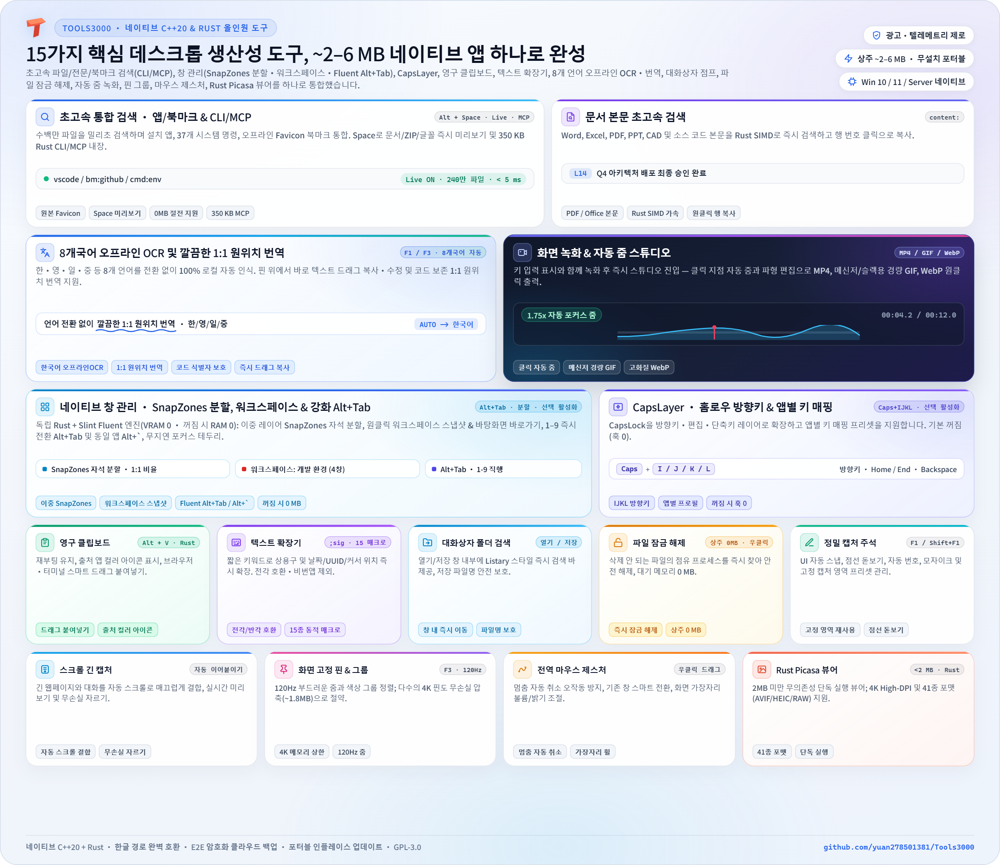
</p>

---

## 기능 데모

<table>
  <tr>
    <td width="50%" align="center" valign="top">
      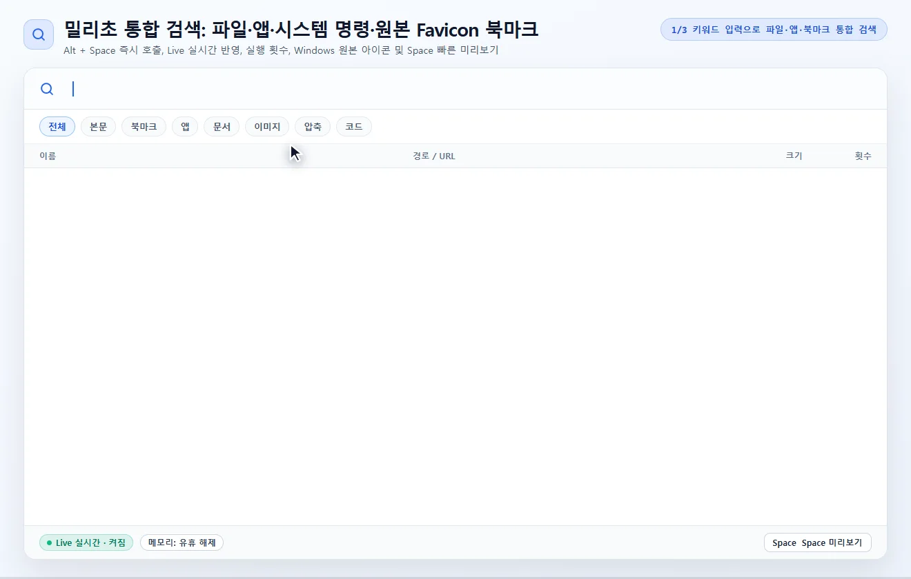<br />
      <sub><b>초고속 통합 검색 및 빠른 미리보기</b> · 앱·원본 Favicon 북마크·시스템 도구 통합, 실시간 반영 및 압축/글꼴 Space 미리보기</sub>
    </td>
    <td width="50%" align="center" valign="top">
      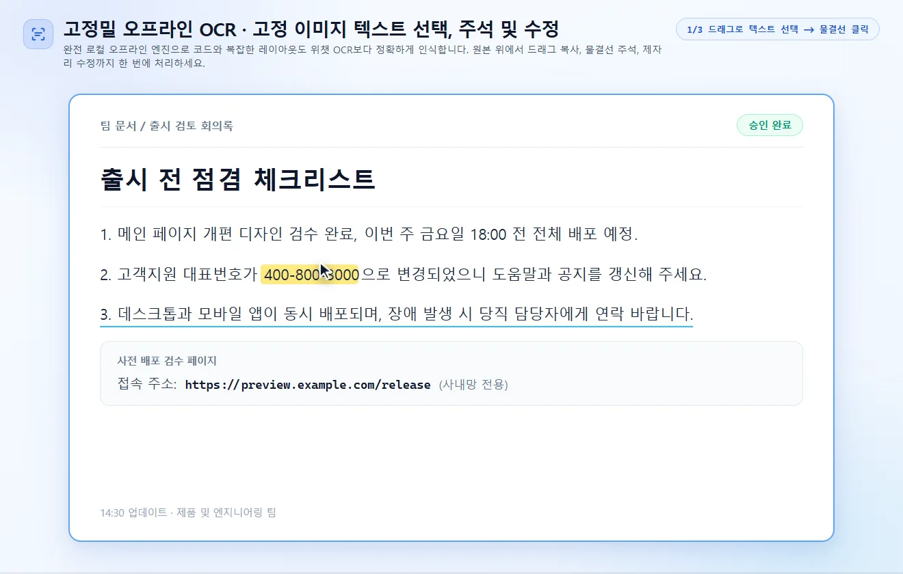<br />
      <sub><b>8개국어 오프라인 OCR 및 주석</b> · 언어 전환 없이 자동 인식, 드래그 복사 · 물결 밑줄 · 원위치 텍스트 수정 지원</sub>
    </td>
  </tr>
  <tr>
    <td width="50%" align="center" valign="top">
      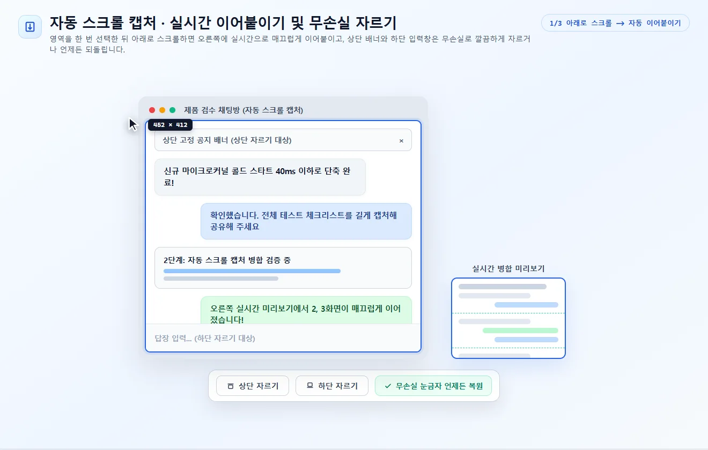<br />
      <sub><b>자동 스크롤 긴 캡처</b> · 실시간 자동 이어붙이기와 상하단 무손실 자르기</sub>
    </td>
    <td width="50%" align="center" valign="top">
      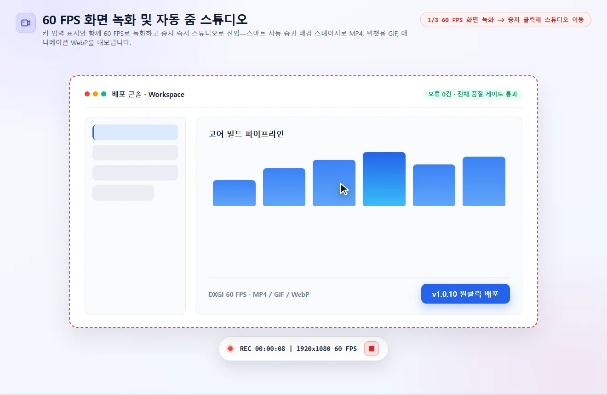<br />
      <sub><b>화면 녹화 및 자동 줌 스튜디오</b> · 화면 녹화, 스마트 자동 줌, MP4 / GIF / 애니메이션 WebP 원클릭 내보내기</sub>
    </td>
  </tr>
  <tr>
    <td width="50%" align="center" valign="top">
      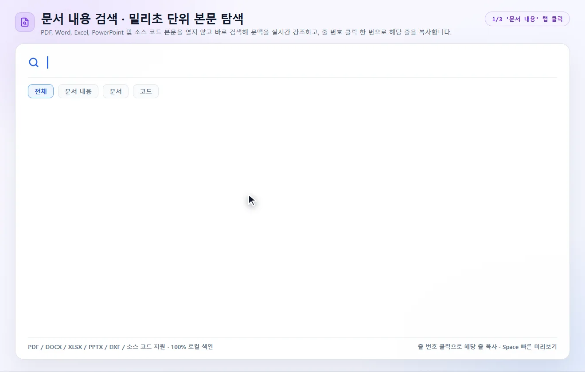<br />
      <sub><b>문서 본문 검색</b> · PDF / Word / Excel / 소스 코드 내부 본문 검색 및 행 번호 클릭 복사</sub>
    </td>
    <td width="50%" align="center" valign="top">
      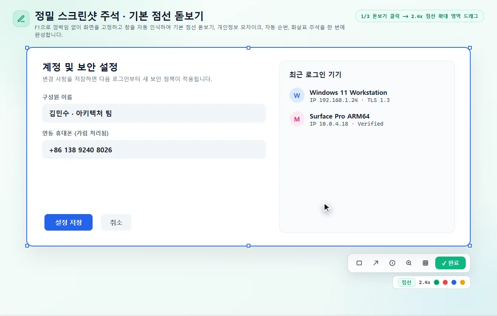<br />
      <sub><b>정밀 스크린샷 주석</b> · 창·요소 자동 스냅, 점선 광학 돋보기, 모자이크, 자동 번호 배지</sub>
    </td>
  </tr>
  <tr>
    <td width="50%" align="center" valign="top">
      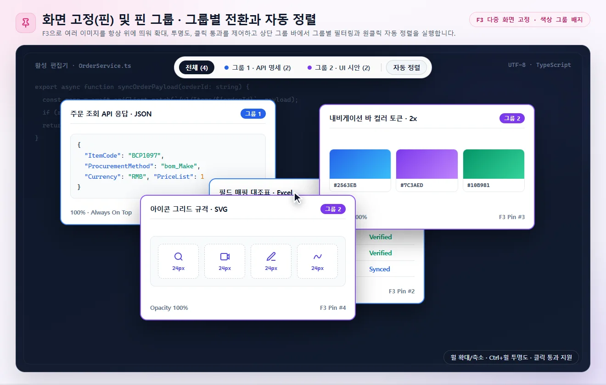<br />
      <sub><b>화면 고정 핀 및 그룹 관리</b> · F3 최상위 고정, 색상 그룹별 표시 전환 및 원클릭 자동 타일 정렬</sub>
    </td>
    <td width="50%" align="center" valign="top">
      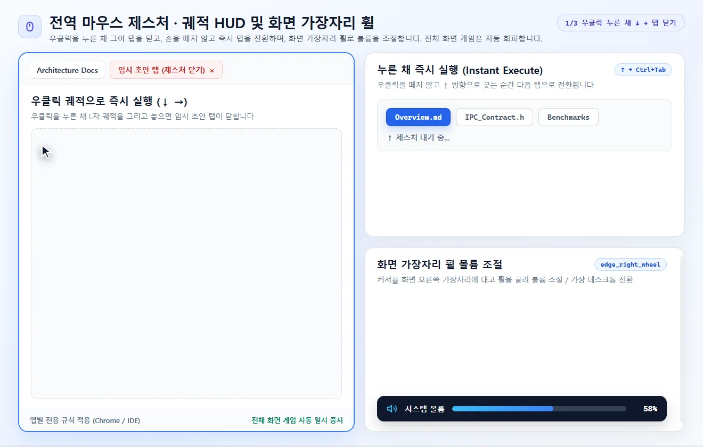<br />
      <sub><b>전역 마우스 제스처</b> · 멈춤 자동 취소 기본 활성, 기존 창 스마트 전환, 즉시 실행 및 화면 가장자리 휠 볼륨</sub>
    </td>
  </tr>
  <tr>
    <td width="50%" align="center" valign="top">
      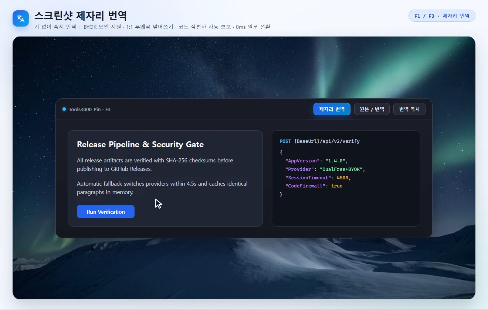<br />
      <sub><b>스크린샷 원위치 번역</b> · 키 없이 무료 번역 + BYOK 지원, 깔끔한 1:1 덮어쓰기 · 코드 보호 · 0ms 원문 전환</sub>
    </td>
    <td width="50%" align="center" valign="top">
      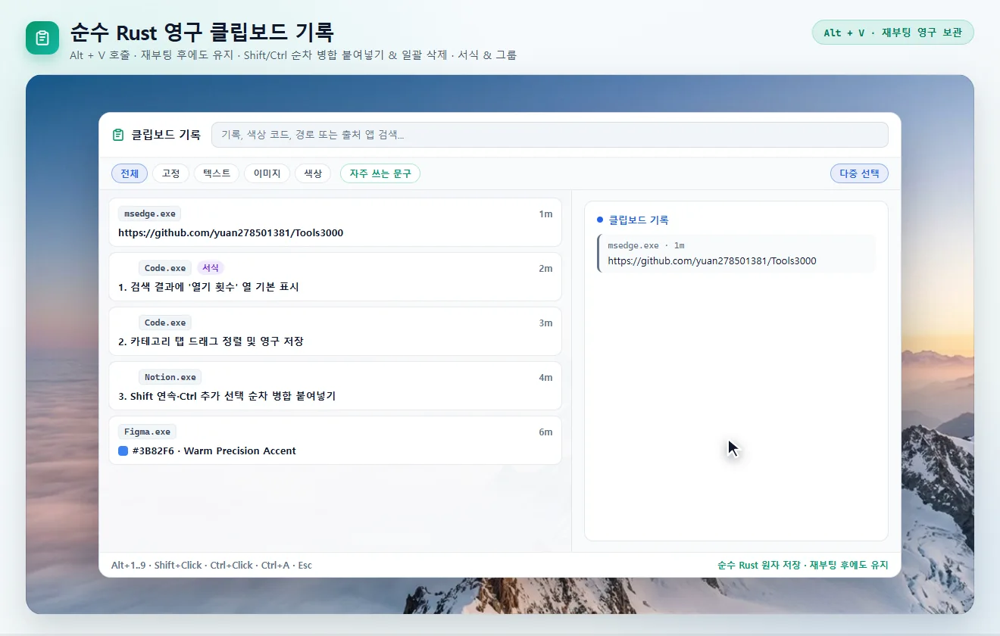<br />
      <sub><b>영구 클립보드 기록 (Alt + V)</b> · 재부팅 후에도 유지, Shift/Ctrl 순차 병합 붙여넣기 · 서식 · 트레이 스위치</sub>
    </td>
  </tr>
  <tr>
    <td width="50%" align="center" valign="top">
      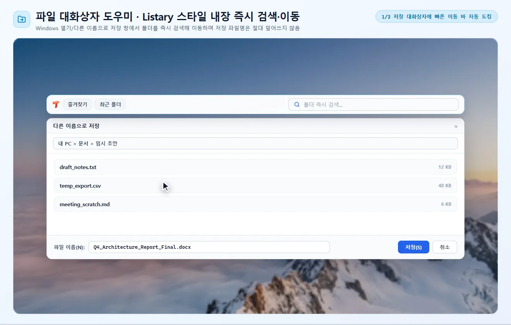<br />
      <sub><b>파일 대화상자 도우미</b> · Windows 열기/저장 창에서 폴더 즉시 검색·이동, 저장 파일명은 절대 덮어쓰지 않음</sub>
    </td>
    <td width="50%" align="center" valign="top">
      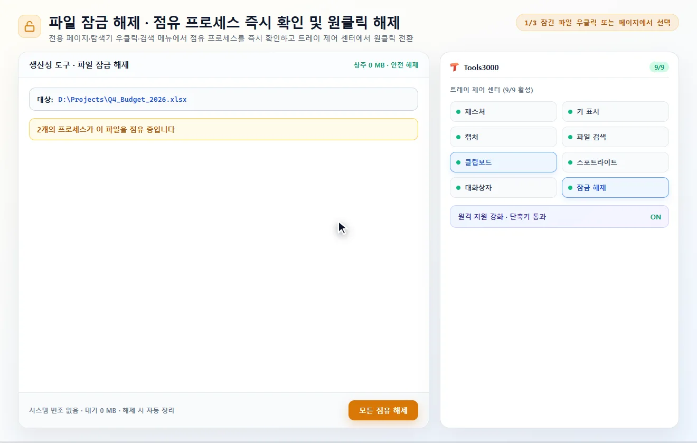<br />
      <sub><b>파일 잠금 해제</b> · 우클릭·검색 결과·전용 페이지에서 점유 앱을 즉시 찾고 원클릭 안전 해제</sub>
    </td>
  </tr>
  <tr>
    <td colspan="2" align="center" valign="top">
      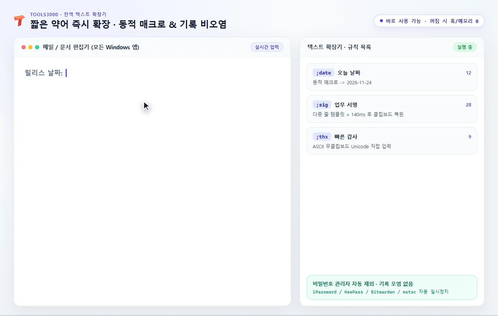<br />
      <sub><b>텍스트 확장기</b> · 어디서나 <code>;date</code> / <code>;sig</code> 즉시 확장, 동적 매크로·비밀번호 관리자 자동 제외·클립보드 비오염 지원</sub>
    </td>
  </tr>
  <tr>
    <td width="50%" align="center" valign="top">
      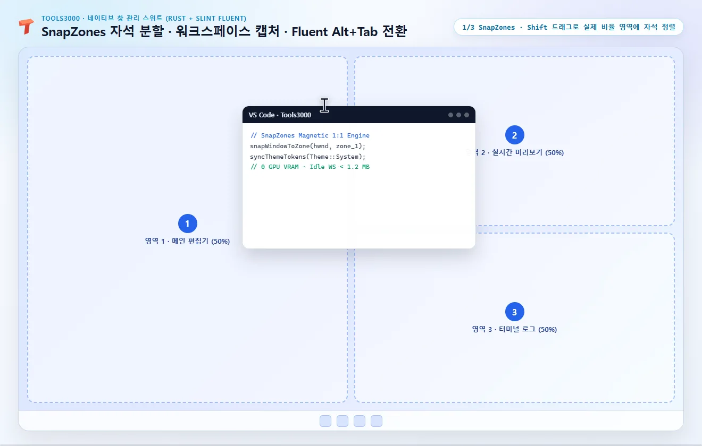<br />
      <sub><b>창 관리 스위트 (선택 활성화)</b> · SnapZones 1:1 자석 분할, 4px 붉은 테두리 워크스페이스 캡처 &amp; Fluent Alt+Tab / Alt+` (VRAM 0 · 꺼짐 시 0 MB)</sub>
    </td>
    <td width="50%" align="center" valign="top">
      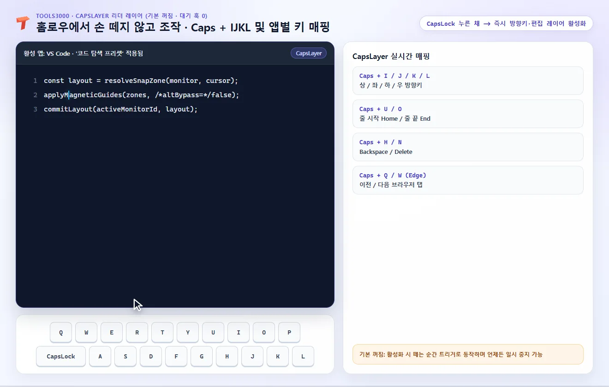<br />
      <sub><b>CapsLayer 키 매핑 (선택 활성화)</b> · CapsLock + IJKL로 손 이동 없이 방향·편집, 앱별 프리셋 자동 전환 (꺼짐 시 훅 0)</sub>
    </td>
  </tr>
</table>

| 모듈 | 주요 기능 |
| :--- | :--- |
| **초고속 파일 검색** | `Alt + Space`로 수백만 개 파일을 밀리초 만에 검색하며 설치된 앱(`app:`), 37개 Windows 시스템 도구(`cmd:env` 등), Edge/Chrome/Brave/Vivaldi 북마크(`bm:`/`b:`, 로컬에서 원본 웹사이트 아이콘 오프라인 표시)를 통합합니다. **실시간 변경 반영(Live)**, **3단계 메모리 정책**(대기 0 MB 절전 포함), 열기 횟수 표시, 드래그 정렬 카테고리 바, `Space` 빠른 미리보기(문서·PDF·코드·CAD·PSD·3D·ZIP/7Z/RAR 압축·TTF/OTF 글꼴·미디어)와 350 KB 경량 CLI/MCP 도구 `tools3000-cli.exe`를 내장합니다. |
| **문서 본문 검색** | `content:` 접두사로 Word, Excel, PDF, PowerPoint, CAD 및 소스 코드 내부 텍스트를 검색하고, 강조된 문맥과 행 번호 클릭 원클릭 복사를 지원합니다. |
| **영구 클립보드 기록** | `Alt + V`(또는 트레이 우클릭 메뉴·트레이 제어 센터 원클릭 전환)로 즉시 호출하며 재부팅 후에도 유지됩니다. 출처 앱의 실제 컬러 아이콘 및 앱 이름 표시, 최신 브라우저 검색창·터미널·AI IDE로의 스마트 드래그 붙여넣기, `Shift / Ctrl` 순차 병합 붙여넣기·일괄 삭제, HTML/RTF 서식, 그룹, 인라인 편집, `Alt + 1..9` 즉시 붙여넣기, 고정 항목 숨김 및 민감 앱 제외를 지원합니다. |
| **텍스트 확장기** | 모든 Windows 앱에서 `;date`, `;now`, `;sig` 같은 짧은 키워드를 상용구 및 15종 동적 매크로(`{{date+Nd}}` 날짜 오프셋, 요일 `{{weekday}}`, `{{uuid}}`, `{{timestamp}}`, `{{user}}`, 클립보드, `{{cursor}}` 위치 지정)로 즉시 확장합니다. 전각/반각 기호 자동 호환, 구분 키 유지 옵션, 실시간 미리보기, 비밀번호 관리자 자동 제외 및 개인정보 제외 플래그를 지원하며 비활성 시 훅과 메모리 점유가 0입니다. |
| **창 관리 스위트 (선택형 · 기본 꺼짐)** | 독립 Rust + Slint Fluent 엔진(WebView2·GPU VRAM 0, 비활성 시 프로세스·메모리 0): 이중 레이어 **SnapZones 분할** 및 1:1 자석 캔버스, **워크스페이스** 4px 붉은 테두리 캡처 + 바탕화면 바로가기, 자유 크기 조절 **Fluent Alt+Tab (1–9 즉시 이동 & 검색) / 동일 앱 Alt+`**, 무지연 포커스·고정 테두리. |
| **CapsLayer 리더 키 매핑 (선택형 · 기본 꺼짐)** | `CapsLock`을 홈로우 방향키(`I/J/K/L`)·편집·단축키 레이어로 확장하고 활성 앱별 프로필을 자동 전환합니다. 기본 꺼짐(훅 0)이며 한영/입력기 습관 안내를 함께 제공합니다. |
| **파일 대화상자 도우미** | Windows 열기/다른 이름으로 저장/폴더 선택 창과 Tools3000 자체 대화상자 상단에 빠른 이동 바를 자동 표시합니다. Listary 스타일로 폴더를 즉시 검색해 이동하며 저장 파일명은 안전하게 보호합니다. |
| **파일 잠금 해제** | 삭제되지 않는 파일을 잡고 있는 앱을 즉시 찾아 안전하게 해제합니다. 탐색기 우클릭(선택적으로 `Shift + 우클릭` 시에만 표시), 검색 결과 우클릭 또는 설정 내 전용 페이지에서 바로 파일을 선택해 검사할 수 있으며 평소 상주 메모리는 0 MB이고 끄면 우클릭 메뉴도 자동 정리됩니다. |
| **자동 스크롤 긴 캡처** | 긴 웹페이지, 문서, 메신저 대화를 자동 스크롤로 매끄럽게 이어 붙입니다. 우측 실시간 미리보기, 상하단 무손실 자르기(언제든 드래그로 복원), 긴 이미지 직접 주석을 지원합니다. |
| **정밀 스크린샷 주석** | `F1`으로 창과 UI 컨트롤에 자동 스냅해 캡처합니다. 픽셀 컬러 피커, 기본 점선 광학 돋보기, 6종 화살표, 자동 재정렬 번호, 프라이버시 모자이크, 공유 프레임, 자동 복사/자동 저장 개별 설정 및 `Shift + F1` / `R` 고정·최근 캡처 영역 재사용을 제공합니다. |
| **화면 고정 핀 및 그룹** | `F3`으로 스크린샷이나 클립보드 이미지를 항상 위에 고정하고 120Hz GPU 부드러운 줌, 투명도, 클릭 투과, 색상 그룹 및 원클릭 정렬을 지원합니다. 다수의 4K 이미지나 긴 캡처도 무손실 콜드 압축과 GPU 텍스처 해제로 메모리를 아끼며 핀 고정 시 자동 문자 인식 켜기/끄기도 설정할 수 있습니다. |
| **8개국어 오프라인 OCR 및 원위치 번역** | 언어 전환 없이 한·일·중·영·러·스·포 스크린샷을 100% 로컬 자동 인식합니다(추가 4개 경량 언어팩 필요 시 다운로드, 핀 우클릭으로 개별 언어 지정 가능). 드래그 복사, 물결선·형광펜 주석, 원위치 텍스트 수정, 표·QR 추출에 더해 **깔끔한 1:1 원위치 번역**(무료 2채널 + BYOK OpenAI 호환 모델), 코드 보호, 0ms 원본/번역 전환을 지원합니다. |
| **화면 녹화 및 스튜디오** | 키/클릭 오버레이가 포함된 화면 녹화 후 자동으로 스튜디오로 이동합니다. 클릭 지점 스마트 자동 줌, 프리미엄 배경, 파형 타임라인 편집을 지원하며 **MP4**, **메신저용 GIF**, **고화질 애니메이션 WebP**로 원클릭 내보내기가 가능합니다. |
| **전역 마우스 제스처** | 우클릭 드래그만으로 탭 전환, 뒤로 가기, 창 닫기를 수행합니다. 실수 방지를 위한 '멈춤 자동 취소' 기본 활성, 기존 창 스마트 전환(Chrome 다중 프로필 구분 포함), 즉시 실행, 화면 가장자리 휠 볼륨/밝기, 8초 이스터에그, 게임 자동 우회, Lua 확장을 지원합니다. |
| **프레젠테이션 및 원격 도우미** | 깔끔한 키 입력 표시 및 `Ctrl` 두 번 누르기 스포트라이트, mstsc·RustDesk·ToDesk·AnyDesk 원격 단축키 패스스루 및 키 걸림 해제, 좌측 하단 '피드백'에서 사용자 이름·IP·이메일 등을 자동 마스킹하는 진단 리포트 내보내기를 제공합니다. |
| **Picasa 이미지 뷰어 (Rust 재구현 · 선택)** | Rust + Direct2D로 재구현한 클래식 경량 Picasa 이미지 뷰어입니다(**뷰어 전용 · 원본 Google Picasa 전체 기능 제품군 아님**). **2 MB 미만의 단일 실행 파일이자 외부 런타임 의존성 제로로 Tools3000과 함께 쓰거나 단독 복사해 독립 실행할 수 있습니다.** 설치 시 기본 비활성화되며 활성화하면 41종 지원 이미지 형식을 자동 연결합니다(클래식 폴라로이드 아이콘 및 다크/라이트 대응 Direct2D 설정 UI 포함). 커서 기준 부드러운 줌, 필름스트립 파동, 크로스 디졸브 슬라이드쇼를 충실히 재현하면서도 **원본에 없던 최신 기능을 보완**했습니다: 4K High-DPI(100%–250%+) 선명도, 60–240Hz VSync, WebP / AVIF / HEIC / SVG / QOI / DDS / 카메라 RAW 디코딩, 애니메이션 프레임 제어, 무손실 좌우/상하 반전 및 8개 언어 UI 지원. |

---

## 다운로드 및 설치

### 방법 1: 패키지 관리자 원클릭 설치 (권장)

- **Scoop (지금 바로 사용 가능 · `data/` 영속화로 완전 포터블 모드 및 업그레이드 시 설정 유지)**:

```powershell
scoop bucket add tools3000 https://github.com/yuan278501381/Tools3000
scoop install tools3000/tools3000
```

- **Winget (공식 규격 매니페스트 내장)**: [`packaging/winget/`](../../packaging/winget/)에 `winget validate` 검증을 통과한 `Yy1.Tools3000` 매니페스트가 자동 유지됩니다. `microsoft/winget-pkgs` 반영 후 `winget install Yy1.Tools3000`으로 바로 설치할 수 있습니다 (로컬 검증: `winget install -m packaging/winget`).

### 방법 2: GitHub Releases 직접 다운로드

**[GitHub Releases](https://github.com/yuan278501381/Tools3000/releases/latest)**에서 최신 버전을 다운로드하세요:

- **표준 설치 프로그램 (`Tools3000-vX.Y.Z-Setup.exe`)** — 일상 사용에 권장되며 선택적 구성 요소, 시작 프로그램 등록, 매끄러운 덮어쓰기 업그레이드를 지원합니다.
- **포터블 압축 파일 (`Tools3000-vX.Y.Z-win-x64-portable.zip`)** — 압축 해제 후 바로 실행할 수 있으며 모든 설정과 데이터가 현재 폴더에 저장됩니다.
- **체크섬 (`SHA256SUMS.txt`)** — 모든 릴리스 아티팩트의 SHA-256 무결성 해시를 제공합니다.

> **시스템 요구 사항**: Windows 10 (1809 이상) / Windows 11 / Windows Server 2019–2025, 소스 및 빌드 파이프라인에서 `x64` 및 `ARM64` 네이티브 지원 (GitHub Releases는 현재 사전 빌드된 `x64` 설치 파일 및 포터블 패키지 제공, ARM64 기기는 [개발자 가이드](../DEVELOPER.md)에 따라 네이티브 빌드하거나 `x64` 버전을 바로 실행 가능), 시스템 내장 Microsoft Edge WebView2 Runtime 필요. 앱 UI는 한국어를 포함한 8개 언어를 기본 지원하며 시스템 언어를 자동으로 따릅니다.

### 보안 검증 및 신뢰 안내

완전한 투명성을 위해 4중 검증 절차를 제공합니다 (자세한 내용은 **[SECURITY.md](../../.github/SECURITY.md)** 참조):

1. **SHA-256 무결성 확인**: 다운로드 후 PowerShell에서 해시를 계산해 `SHA256SUMS.txt`와 대조하세요:
   ```powershell
   Get-FileHash .\Tools3000-vX.Y.Z-Setup.exe -Algorithm SHA256
   ```
2. **VirusTotal 공개 검사**: **[VirusTotal](https://www.virustotal.com/)**에서 파일 SHA-256을 조회하거나(이후 Release 노트에는 바로가기 링크 포함) 70개 이상 보안 엔진 결과를 투명하게 확인할 수 있습니다.
3. **Windows Defender SmartScreen 안내**: 독립 오픈소스 프로젝트가 상용 EV/공인 코드 서명(SignPath / Trusted Signing 준비 중) 적용 전이거나 신규 릴리스 직후에는 "알 수 없는 게시자" 안내가 표시될 수 있습니다. SHA-256 및 VirusTotal 확인 후 **추가 정보 -> 실행**을 선택하거나 **[개발자 가이드](../DEVELOPER.md)**에 따라 소스에서 직접 빌드할 수 있습니다.
4. **SPDX SBOM 내장**: 설치 파일과 포터블 패키지 모두 `SBOM.spdx.json` 및 `THIRD_PARTY_NOTICES.txt`를 포함합니다.

---

## 개발 계기

저는 **Everything**을 10년 넘게 사용해 온 오랜 사용자입니다. 스크린샷과 화면 고정 도구는 **칼무리(Kalmuri)**, **픽픽(PicPick)**, **알캡처(ALCapture)**, **FastStone Capture**, **Snipaste** 등을 거쳐 왔고, 클립보드는 **Ditto**, 마우스 제스처는 **WGestures**와 **StrokesPlus**, 화면 녹화 도구도 수많은 앱을 써 왔습니다. 중간에 Microsoft **PowerToys**도 시도해 봤지만 일상에서 꼭 필요한 핵심 기능이 몇 가지 빠져 결국 다시 여러 앱을 함께 띄워 둘 수밖에 없었습니다.

이미지 뷰어도 마찬가지였습니다. 무료 뷰어는 상용 라이선스 팝업이나 광고·번들 설치가 잦았고, Google이 **Picasa**를 종료한 뒤 **FastStone Image Viewer**나 Everything 제작사의 이미지 뷰어(**Void Image Viewer**)까지 써 봤지만 Picasa 특유의 경쾌한 조작감과 애니메이션에는 못 미쳐 결국 Windows 기본 사진 앱으로 버티고 있었습니다. 그래서 Rust + Direct3D 11로 그리웠던 클래식 경량 Picasa 이미지 뷰어를 직접 재구현하고(2 MB 미만·외부 의존성 제로로 단독 실행 가능), 원본에 없던 4K 고해상도 DPI와 WebP/AVIF/HEIC/SVG/RAW 등 최신 포맷까지 모두 채워 넣었습니다.

어느 날 Windows 시스템 트레이에 줄지어 떠 있는 여러 아이콘을 보며 **“광고·번들과 Electron 메모리 낭비 없이 이걸 전부 하나의 가벼운 네이티브 앱으로 합칠 수 없을까?”**라는 생각이 들었습니다. C++20 + Rust로 직접 설계해 메인 프로세스 대기 메모리를 약 **2~6 MB** 수준으로 줄인 올인원 도구가 바로 **Tools3000**입니다.

새로운 사용자분들께 솔직히 말씀드리면, 공개 전 **4개월 동안 직접 실사용하며** 점진적으로 기능을 추가하고 부딪힌 버그들을 하나씩 고쳐 왔습니다. 초반에는 기존 도구들을 같이 켜 두고 문제가 생기면 잠시 돌아갔다가 수정하곤 했지만, **이제 제 시스템 트레이는 말끔히 비워지고 Tools3000 단 하나만 남아 있습니다.**

물론 실제 데스크톱 환경은 워낙 다양해 앞으로도 새로운 문제가 생길 수 있습니다. AI 시대에는 함께 다듬어 가기가 훨씬 쉬워졌습니다. **[GitHub Issues](https://github.com/yuan278501381/Tools3000/issues)로 문제를 제보**해 주시거나 **Pull Request로 함께 기여**해 주시면 감사하겠습니다.

---

## 하나로 대체하는 도구 목록

단일 전문 도구들은 각자의 깊은 강점이 있습니다. Tools3000은 일상의 90% 이상을 차지하는 고빈도 작업을 **광고 없는 GPL-3.0 오픈소스 네이티브 앱 하나로 통합**하되, 전문 도구가 유리한 영역도 솔직히 안내합니다:

| 기존 단독 도구 | Tools3000이 대체하는 일상 워크플로 | 기존 전문 도구 병행을 권장하는 경우 |
| :--- | :--- | :--- |
| **Everything** | `Alt + Space` 밀리초 파일명, `bm:` 브라우저 북마크 및 `content:` 문서 본문 검색, 350 KB 순수 Rust CLI / MCP 서버 내장 (온디맨드 구동) | HTTP/ETP 네트워크 공유 검색, EXIF 전 속성 정렬 또는 기존 `es.exe` 문법에 종속된 스크립트가 필요한 경우 |
| **Ditto / Windows `Win + V` 클립보드** | `Alt + V` 순수 Rust 영구 클립보드 기록(재부팅 후 유지), `Shift / Ctrl` 순차 병합 붙여넣기·일괄 삭제, HTML/RTF 서식, 그룹, 인라인 편집 및 `Alt + 1..9` 즉시 붙여넣기 | 여러 PC 간 LAN 실시간 클립보드 동기화 또는 클라우드 계정 기반 기록 로밍이 필요한 경우 |
| **픽픽(PicPick) / 알캡처 / 칼무리 / Snipaste** | `F1` 캡처 주석, 점선 돋보기, 스크롤 캡처, `F3` 120Hz 그룹 핀 고정(4K 무손실 메모리 절약), 1:1 원위치 번역, 고속 오프라인 OCR 및 원위치 텍스트 수정 | 특수 구형 GUI 요소 탐지나 전용 CLI 캡처 자동화에 의존하는 경우 |
| **WGestures / StrokesPlus** | 우클릭 드래그 탭/뒤로/닫기, 즉시 트리거, 화면 가장자리 휠 볼륨, 핫 코너, 전체 화면 게임 우회, Lua 확장 | 복잡한 다중 버튼 조합 제스처나 장기간 축적된 매크로 스크립트를 사용하는 경우 |
| **화면 녹화 도구 (ShareX 등)** | 화면 녹화, 키 입력 오버레이, 자동 줌 스튜디오(파형 편집 및 마우스 자동 줌) 및 MP4 / GIF / WebP 원클릭 내보내기 | 80+ 클라우드/S3/FTP 자동 업로드 워크플로나 커스텀 FFmpeg 배치 파이프라인이 필요한 경우 |
| **Picasa 뷰어 / FastStone / Windows 사진** | 2 MB 미만·외부 의존성 제로의 Rust 재구현 경량 Picasa 뷰어(단독 실행 가능) — 클래식 애니메이션에 4K High-DPI, WebP/AVIF/HEIC/SVG/RAW, 무손실 반전 보강 | 원본 Google Picasa의 앨범 라이브러리 관리·얼굴 인식이나 전문 일괄 RAW 현상·편집이 필요한 경우 |
| **Listary 대화상자 이동 / PowerToys File Locksmith** | Windows 열기/저장 창에서 Listary 스타일 폴더 즉시 검색·이동(저장 파일명 보호); 상주 0 MB '파일 잠금 해제'로 우클릭 또는 전용 페이지에서 즉시 잠금 해제 | Listary 전체 커스텀 런처 액션 워크플로나 커널 핸들 단위의 심층 분석이 필요한 경우 |
| **Espanso / Beeftext / AutoHotkey 상용구** | 기본 내장 네이티브 텍스트 확장기(바로 사용 가능 · 비활성 시 훅 0), 즉시/구분 키 트리거, 날짜·클립보드·커서 동적 매크로, 비밀번호 관리자 자동 예외, 실시간 샌드박스 및 JSON 가져오기/내보내기 지원 | 복잡한 YAML 폼 팝업, 셸 명령 동적 출력 또는 Linux/macOS 크로스 플랫폼 설정 동기화가 필요한 경우 |
| **PowerToys FancyZones & Workspaces / AltTab** | 선택형 Rust + Slint Fluent 창 관리(VRAM 0 · 꺼짐 시 0 MB): 이중 SnapZones + 자석 캔버스, 워크스페이스 원클릭 스냅샷·바로가기, 강화 Alt+Tab(1–9 이동) 및 동일 앱 Alt+` | GlazeWM / Komorebi 같은 완전 자동 타일링 WM 스크립트가 필요한 경우 |
| **AutoHotkey / KeyTweak / CapsLock+** | 코딩 없는 시각적 CapsLayer(`Caps+IJKL` 방향·편집)와 앱별 키 매핑 프리셋(꺼짐 시 훅 0) | 복잡한 AHK 스크립트 매크로나 하드웨어 QMK/VIA 펌웨어 매핑이 필요한 경우 |

---

## 기본 단축키 및 설정·데이터 경로

모든 단축키는 설정 화면에서 자유롭게 변경할 수 있으며 충돌을 실시간으로 감지합니다:

| 단축키 | 동작 |
| :--- | :--- |
| `Alt + Space` | 초고속 검색 열기 / 닫기 (`app:`, `cmd:`, `bm:`, `content:` 지원, 선택 항목에서 `Space`로 빠른 미리보기) |
| `Alt + V` | 영구 클립보드 기록 열기 / 닫기 (`Shift / Ctrl` 병합 붙여넣기 및 `Alt + 1..9` 즉시 붙여넣기, 트레이 메뉴에서도 실행 가능) |
| `F1` | 영역 스크린샷, 주석 및 원클릭 원위치 번역 |
| `F3` | 클립보드 이미지 또는 텍스트 화면 고정(핀) |
| `Ctrl` 빠르게 두 번 누르기 | 마우스 스포트라이트 켜기 / 끄기 |
| `Ctrl + Alt + Backspace` | 원격 데스크톱 조합 키 걸림 즉시 해제 (또는 오른쪽 `Ctrl` 두 번 누르기) |

### 기능 위치 및 로컬 데이터 경로

한국어·중국어·일본어 등 비영어 문자가 포함된 설치 경로와 Windows 사용자 이름을 완벽히 지원합니다:

| 항목 | 설정 메뉴 / 표준 설치 경로 | 포터블 버전 경로 |
| :--- | :--- | :--- |
| **클라우드 및 동기화 폴더 백업** | `시스템 -> 일반 -> 클라우드 및 동기화 폴더 백업` (OneDrive/Google Drive/Dropbox/iCloud 자동 감지, WebDAV · S3 및 선택적 종단간 암호화) | 동일 (포터블 버전도 `설정 -> 정보`에서 원클릭 인플레이스 업데이트 지원) |
| **메모리 정책 및 회수 일정표** | `인사이트 및 정보 -> 메모리 정책` (10개 온디맨드 일시 중단, 유휴 해제 및 자동 회수 읽기 전용 일정표) | 동일 |
| **핀 자동 문자 인식 및 영역 관리** | `생산성 도구 -> 캡처 및 녹화 -> 화면 고정 및 고정 영역` ('고정 시 자동으로 텍스트 인식' 스위치 및 고정 영역 관리) | 동일 |
| **파일 잠금 해제** | 설정: `시스템 -> 기능 모듈`, `생산성 도구 -> 파일 잠금 해제`; 트레이 패널 · 탐색기 우클릭 · 검색 결과 우클릭 | 동일 (사용자 전용 메뉴, 상주 0 MB, 비활성화 시 자동 정리) |
| **검색 아이콘 / Live / 메모리 모드** | `생산성 도구 -> 파일 검색` (아이콘 스타일 / 실시간 감시 / 메모리 관리); 검색창 하단 상태바에서도 실시간 감시 전환 | 동일 (북마크 아이콘은 로컬 캐시에서 오프라인으로만 읽음) |
| **8개국어 오프라인 OCR 팩** | `생산성 도구 -> OCR 및 번역` / 핀 우클릭 `인식 언어`; `%LOCALAPPDATA%\Tools3000\models\ocr\` | `<앱 폴더>\data\models\ocr\` |
| **클립보드 기록 데이터** | 트레이 제어 센터에서 원클릭 전환; `%LOCALAPPDATA%\Tools3000\clipboard\` | `<앱 폴더>\data\clipboard\` |
| **설정 및 진단 로그** | `%LOCALAPPDATA%\Tools3000\config\config.json` 및 `%LOCALAPPDATA%\Tools3000\logs\tools3000.log` (좌측 하단 '피드백'은 개인정보를 로컬에서 자동 마스킹) | `<앱 폴더>\data\config\` 및 `<앱 폴더>\data\logs\` |
| **독립 CLI 및 뷰어** | `C:\Program Files\Tools3000\tools3000-cli.exe`(CLI/MCP) 및 `Tools3000_Picasa_Viewer.exe` | `<앱 폴더>\tools3000-cli.exe` 및 `Tools3000_Picasa_Viewer.exe` |

---

## 개인정보 보호 원칙

- **로컬 우선 · 오프라인 완벽 지원**: 파일 인덱싱, 본문 검색, 영구 클립보드, OCR, 주석, 입력 통계 모두 로컬 기기에서만 실행됩니다. 사용자가 스크린샷 번역을 직접 실행할 때만 선택한 번역 채널로 해당 텍스트가 전송됩니다.
- **텔레메트리 및 계정 없음**: 광고 팝업이나 로그인이 없으며 파일 및 입력 데이터를 외부로 전송하지 않습니다.
- **온디맨드 경량 설계**: 모든 모듈을 개별적으로 켜고 끌 수 있으며 검색 서비스는 호출 시에만 실행되어 대기 리소스 점유를 최소화합니다.

---

## 피드백 및 기여

- **버그 제보**: 앱 안에서 **설정 창 왼쪽 하단 `피드백 보내기`**(또는 **`설정 -> 정보 -> 피드백 보내기`**)를 이용하면 가장 빠릅니다. `Ctrl + V`로 스크린샷을 바로 붙여넣을 수 있으며, 사용자 경로·이메일·IP·토큰 등을 로컬에서 자동 비식별화한 뒤 진단 번들(최근 1000줄 로그 포함) 내보내기 또는 GitHub Issue 자동 입력을 지원합니다. **[Bug Report 템플릿](https://github.com/yuan278501381/Tools3000/issues/new?template=bug_report.yml)**으로 직접 제보할 수도 있습니다.
- **기능 제안**: **[Feature Request](https://github.com/yuan278501381/Tools3000/issues/new?template=feature_request.yml)** 또는 **[GitHub Discussions](https://github.com/yuan278501381/Tools3000/discussions)**에서 의견을 나눠 주세요.
- **오픈소스 공창**: Pull Request를 환영합니다. 자세한 내용은 **[개발자 가이드](../DEVELOPER.md)** 및 **[패키징 가이드](../../packaging/README.md)**를 참고하세요.

---

## Star History

<a href="https://www.star-history.com/#yuan278501381/tools3000&Date">
 <picture>
   <source media="(prefers-color-scheme: dark)" srcset="https://api.star-history.com/svg?repos=yuan278501381/tools3000&type=Date&theme=dark" />
   <source media="(prefers-color-scheme: light)" srcset="https://api.star-history.com/svg?repos=yuan278501381/tools3000&type=Date" />
   
 </picture>
</a>

---

## 문서 및 라이선스

- **개발 및 보안**: 빌드 안내와 SDK는 **[개발자 가이드](../DEVELOPER.md)**, 보안 정책은 **[SECURITY.md](../../.github/SECURITY.md)**, 릴리스 기록은 **[GitHub Releases](https://github.com/yuan278501381/Tools3000/releases)**에서 확인하세요.
- **라이선스**: **[GNU GPL v3.0](../../LICENSE)** 하에 배포됩니다 ([Windows / WebView2 링크 예외](../../LICENSE-EXCEPTION.md) 포함).
- **저작권**: `Copyright (c) 2026 Yy1 (yuan278501381) & Tools3000 contributors` · [@yuan278501381](https://github.com/yuan278501381)
