<div align="center">


# Tools3000

**Suíte nativa, completa e ultraleve de produtividade para Windows**

[English](../../README.md) · [简体中文](README.zh-CN.md) · [繁體中文](README.zh-TW.md) · [日本語](README.ja.md) · [한국어](README.ko.md) · [Русский](README.ru.md) · **Português (Brasil)** · [Español](README.es.md)

[](https://github.com/yuan278501381/Tools3000/releases/latest)
[](https://github.com/yuan278501381/Tools3000/stargazers)
[](https://github.com/yuan278501381/Tools3000/releases)
[](#download-e-instalação)
[](#download-e-instalação)
[](../../LICENSE)

**[Baixar versão mais recente](#download-e-instalação)** · [Visão geral](#visão-geral) · [Demonstrações](#demonstrações) · [Segurança e verificação](#verificação-de-segurança-e-confiança) · [Por que criei](#por-que-criei-o-tools3000) · [O que substitui](#o-que-o-tools3000-substitui) · [Contribuir](#feedback-e-cocriação) · [Guia do desenvolvedor](../DEVELOPER.md)

</div>

<br />

O Tools3000 reúne em um único aplicativo nativo para Windows as ferramentas essenciais do dia a dia: **busca instantânea de arquivos, apps, comandos do sistema e favoritos com ícones reais dos sites (com Live Watch, 3 modos de RAM e CLI / MCP), busca no conteúdo de documentos, histórico da área de transferência que sobrevive a reinícios, busca inline nas janelas Abrir/Salvar, desbloqueio de arquivos travados, captura com rolagem, anotação precisa de capturas, fixação na tela com grupos de pins, OCR offline em 8 idiomas e tradução limpa no local, gravação de tela com Estúdio de zoom automático (MP4, GIF para mensageiros e WebP animado), gestos globais do mouse e visualizador leve Picasa em Rust**. Funciona localmente sem telemetria, suporta integralmente pastas e nomes de usuário com acentos ou outros alfabetos, consome apenas cerca de uma dúzia de MB de RAM em repouso (com modo sono de 0 MB para o serviço de busca) e atende PCs pessoais (`x64` e `ARM64`) e ambientes Windows Server multiusuário.

---

## Visão geral

<p align="center">
  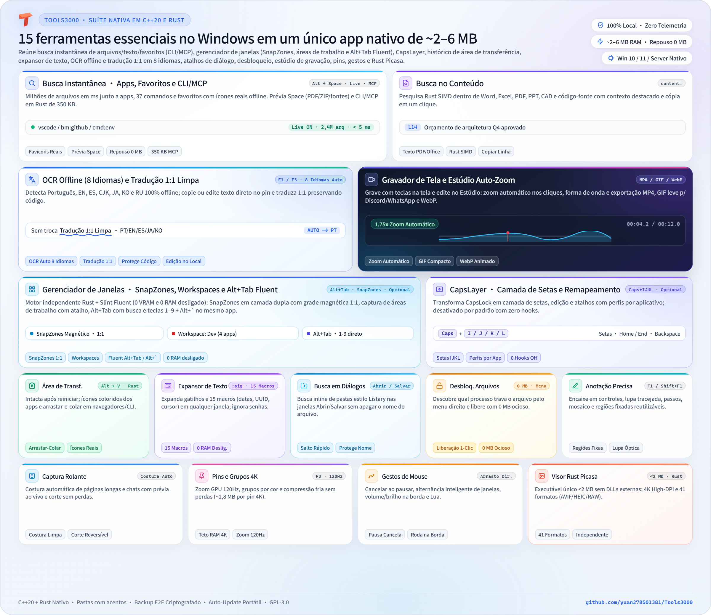
</p>

---

## Demonstrações

<table>
  <tr>
    <td width="50%" align="center" valign="top">
      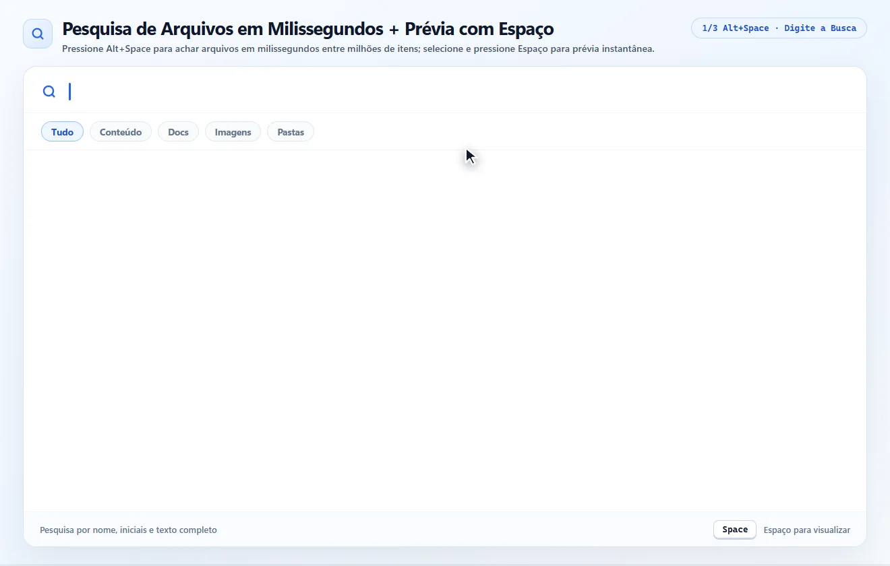<br />
      <sub><b>Busca Instantânea e Pré-visualização</b> · Apps, favoritos com Favicons reais, Live Watch e preview de ZIP e fontes com Espaço</sub>
    </td>
    <td width="50%" align="center" valign="top">
      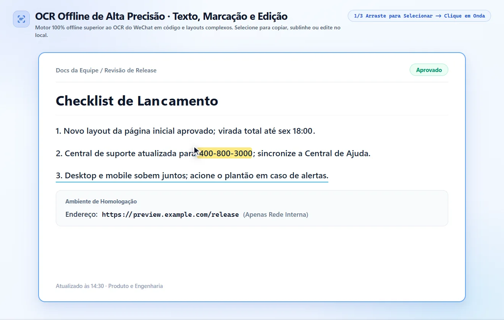<br />
      <sub><b>OCR Offline em 8 Idiomas</b> · Detecta idiomas automaticamente offline; copie, sublinhe com linha ondulada ou edite no local</sub>
    </td>
  </tr>
  <tr>
    <td width="50%" align="center" valign="top">
      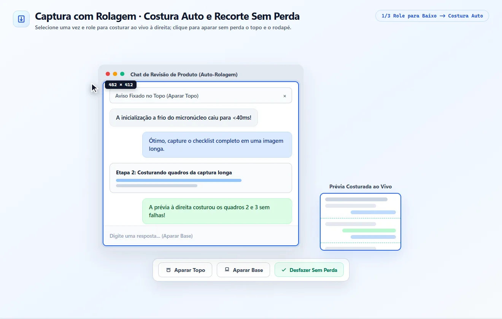<br />
      <sub><b>Captura com Rolagem</b> · Junção automática com prévia ao vivo e recorte não destrutivo de topo e rodapé</sub>
    </td>
    <td width="50%" align="center" valign="top">
      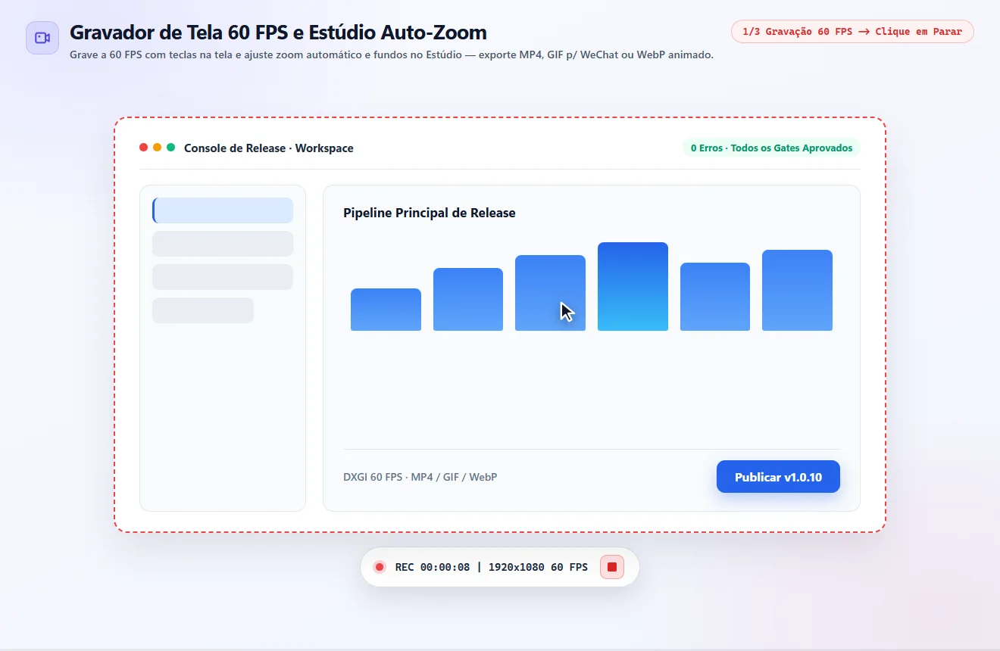<br />
      <sub><b>Gravador de Tela e Estúdio Auto-Zoom</b> · Zoom inteligente nos cliques e exportação em MP4, GIF e WebP animado</sub>
    </td>
  </tr>
  <tr>
    <td width="50%" align="center" valign="top">
      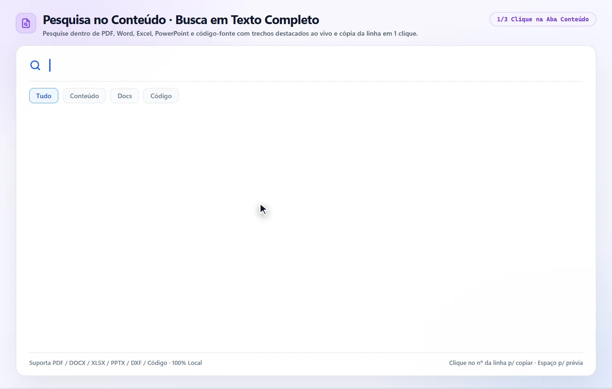<br />
      <sub><b>Busca no Conteúdo</b> · Pesquise dentro de PDF, Word, Excel e código-fonte com cópia da linha em um clique</sub>
    </td>
    <td width="50%" align="center" valign="top">
      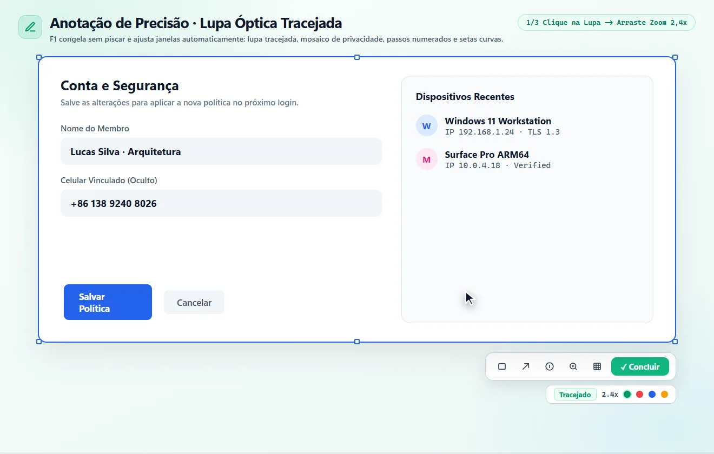<br />
      <sub><b>Anotação Precisa</b> · Encaixe automático em controles, lupa óptica tracejada, mosaico de privacidade e marcadores numerados</sub>
    </td>
  </tr>
  <tr>
    <td width="50%" align="center" valign="top">
      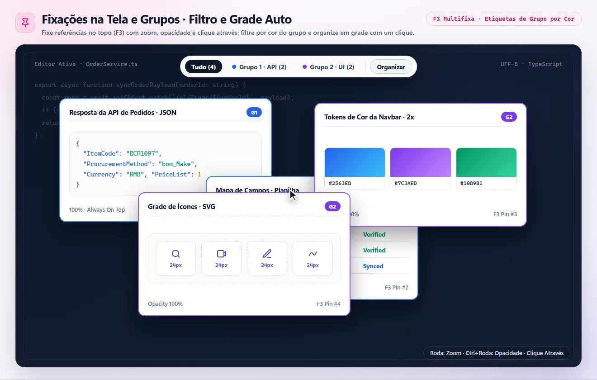<br />
      <sub><b>Pins na Tela e Grupos</b> · Fixe referências no topo (F3), filtre por cor de grupo e organize em grade com um clique</sub>
    </td>
    <td width="50%" align="center" valign="top">
      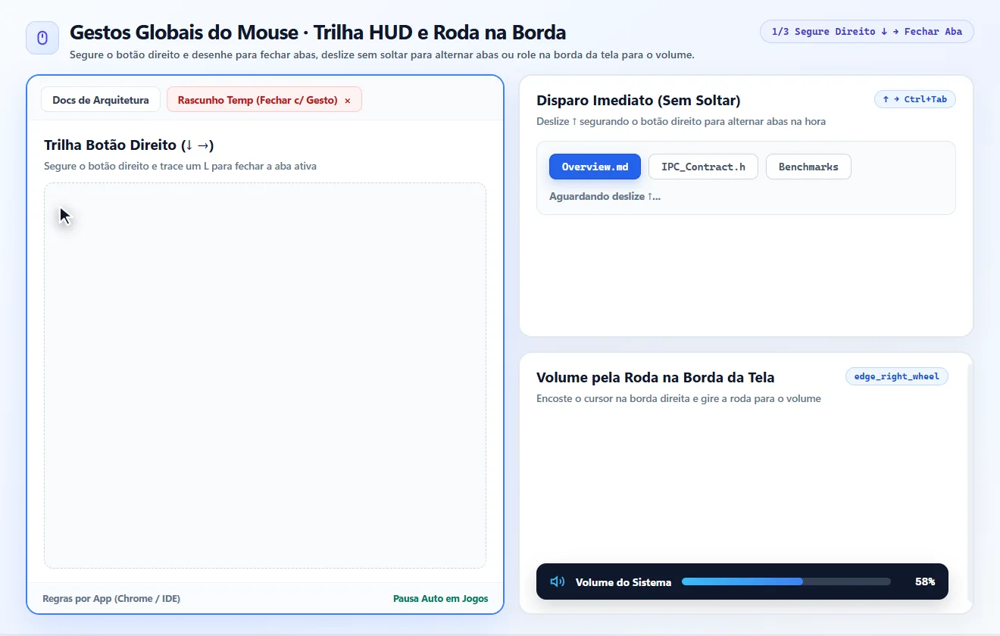<br />
      <sub><b>Gestos Globais do Mouse</b> · Cancelar ao pausar ativo por padrão, alternância inteligente de janelas abertas e volume na borda</sub>
    </td>
  </tr>
  <tr>
    <td width="50%" align="center" valign="top">
      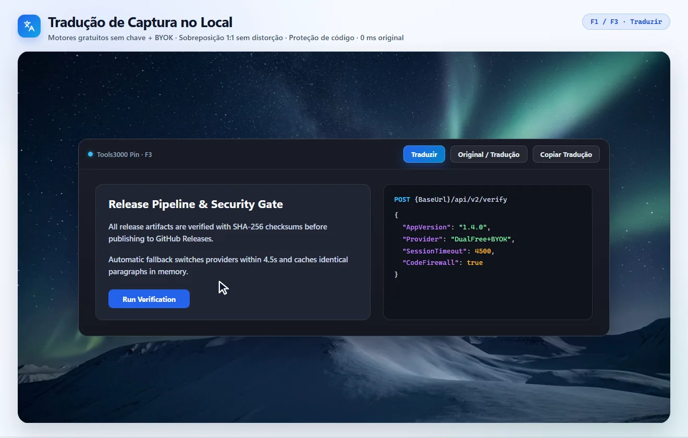<br />
      <sub><b>Tradução de Captura no Local</b> · Motores gratuitos sem chave + BYOK, sobreposição limpa 1:1, proteção de código e alternância em 0 ms</sub>
    </td>
    <td width="50%" align="center" valign="top">
      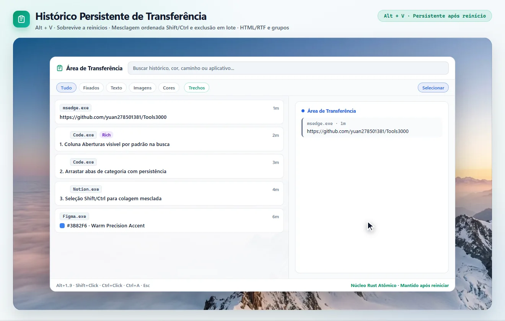<br />
      <sub><b>Histórico de Transferência (Alt + V)</b> · Sobrevive a reinícios, colagem mesclada Shift/Ctrl, Rich Text e controle na bandeja</sub>
    </td>
  </tr>
  <tr>
    <td width="50%" align="center" valign="top">
      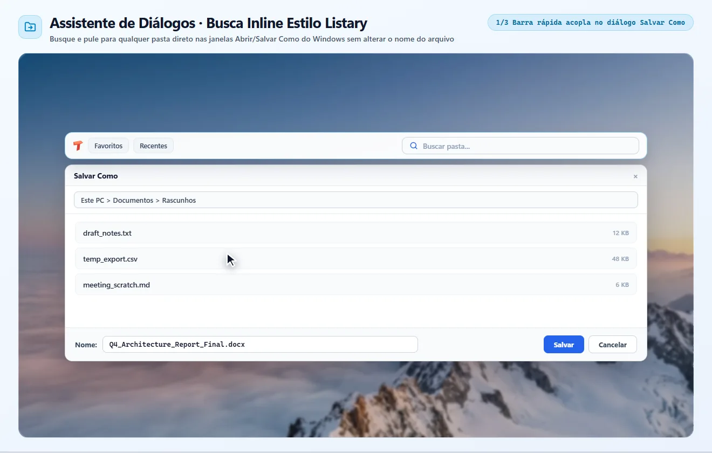<br />
      <sub><b>Assistente de Diálogos</b> · Busca e salto de pastas estilo Listary nas janelas Abrir/Salvar sem sobrescrever o nome do arquivo</sub>
    </td>
    <td width="50%" align="center" valign="top">
      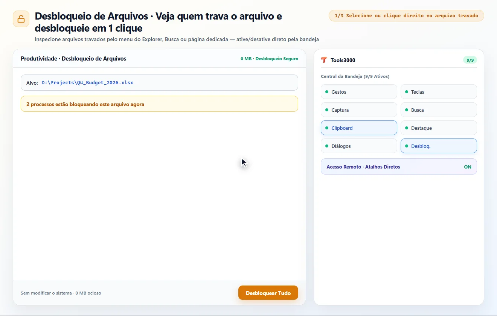<br />
      <sub><b>Desbloqueio de Arquivos</b> · Veja quem trava um arquivo pelo menu direito, busca ou página própria e libere em 1 clique</sub>
    </td>
  </tr>
  <tr>
    <td colspan="2" align="center" valign="top">
      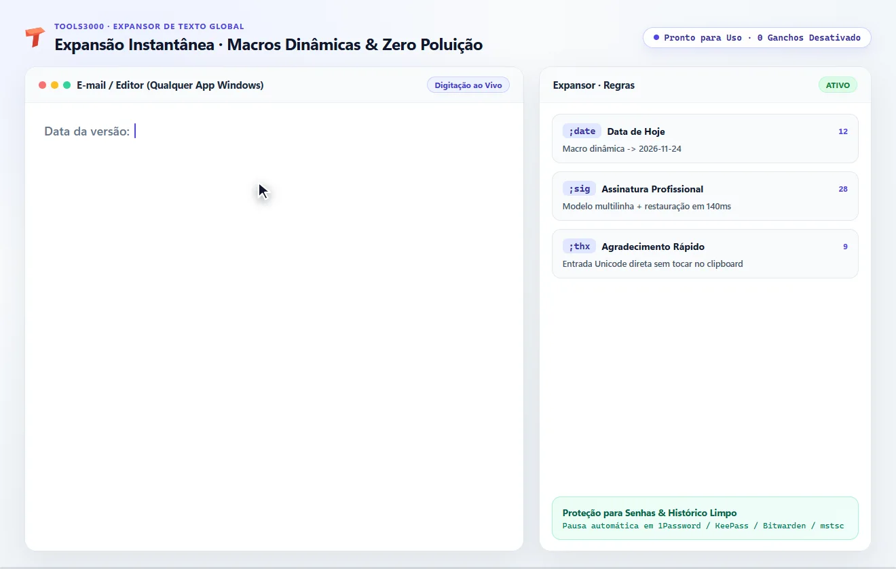<br />
      <sub><b>Expansor de Texto</b> · Digite <code>;date</code> ou <code>;sig</code> em qualquer app com macros dinâmicas, proteção para senhas e zero poluição da área de transferência</sub>
    </td>
  </tr>
</table>

| Módulo | O que faz |
| :--- | :--- |
| **Busca Instantânea de Arquivos** | Pressione `Alt + Space` para localizar arquivos entre milhões de itens em ms junto com apps instalados (`app:`), 37 ferramentas do Windows (`cmd:env` etc.) e favoritos do Edge/Chrome/Brave/Vivaldi (`bm:`/`b:`, exibindo ícones reais dos sites totalmente offline). Traz **Live Watch**, **3 modos de RAM** (até 0 MB em repouso), contador de aberturas, abas arrastáveis, prévia com `Space` (Office, PDF, código, CAD, PSD, 3D, arquivos ZIP/7Z/RAR, fontes TTF/OTF e mídia) e a ferramenta CLI/MCP `tools3000-cli.exe` (350 KB). |
| **Busca no Conteúdo** | Use `content:` para pesquisar dentro de Word, Excel, PDF, PowerPoint, CAD e código-fonte com trechos destacados e cópia da linha em um clique. |
| **Histórico Persistente de Transferência** | Acione com `Alt + V` (ou pelo menu e central rápida da bandeja) mantendo todo o histórico após reiniciar; exibe ícones coloridos reais e nomes amigáveis dos apps de origem, suporta arrastar-e-soltar universal em navegadores, terminais e IDEs de IA, colagem mesclada `Shift / Ctrl`, HTML/RTF, grupos, edição no local, `Alt + 1..9`, ocultação de fixados em outras abas e exclusão de apps sensíveis. |
| **Expansor de Texto** | Digite gatilhos curtos (`;date`, `;now`, `;sig`) em qualquer app Windows para expandir frases e 15 macros dinâmicos (`{{date+Nd}}`, `{{weekday}}`, `{{uuid}}`, `{{timestamp}}`, `{{user}}`, área de transferência e `{{cursor}}`) com pré-visualização ao vivo, retenção opcional do delimitador, pausa automática em gerenciadores de senha e zero ganchos/RAM quando desligado. |
| **Assistente de Diálogos** | Acopla automaticamente uma barra de acesso rápido com busca inline de pastas estilo Listary nas janelas Abrir / Salvar Como / Escolher Pasta do Windows e nos diálogos do próprio Tools3000, protegendo o nome preenchido ao salvar. |
| **Desbloqueio de Arquivos** | Quando um arquivo não pode ser excluído, descubra qual programa o está travando e libere com segurança — pelo menu direito do Explorer (opcionalmente apenas com `Shift + Clique Direito`), nos resultados da busca ou na página própria em Configurações. Consome 0 MB ocioso, não altera o sistema e remove o menu automaticamente ao desativar. |
| **Captura com Rolagem** | Costure automaticamente páginas longas, chats e documentos com prévia lateral ao vivo, recorte não destrutivo de topo/rodapé e anotação direta na imagem longa. |
| **Anotação Precisa** | `F1` encaixa automaticamente em janelas e controles de interface; inclui seletor de cor por pixel, lupa óptica tracejada, 6 estilos de seta, numeração autoajustável, mosaico, molduras, ações independentes de copiar/salvar ao concluir, além de `Shift + F1` / `R` para regiões fixadas e recentes. |
| **Pins na Tela e Grupos** | Fixe capturas ou trechos da área de transferência sempre no topo (`F3`) com zoom GPU fluido 120Hz, opacidade, clique transparente, grupos de cor e alinhamento em grade; traz compressão fria sem perdas para dezenas de pins 4K/longos e opção de reconhecimento automático de texto ao fixar. |
| **OCR Offline (8 Idiomas) e Tradução no Local** | OCR 100% local com detecção automática de 8 idiomas sem troca manual (pacotes leves extras sob demanda e troca de idioma com clique direito no pin); copie, sublinhe, edite no local e extraia tabelas/QR Codes, mais **tradução limpa 1:1 diretamente sobre a captura** (canais gratuitos + BYOK LLM), proteção de código e alternância em 0 ms. |
| **Gravador de Tela e Estúdio** | Grave a tela com sobreposição de teclas/cliques e entre direto no Estúdio: zoom automático nos cliques, papéis de parede selecionados, edição por forma de onda e exportação em **MP4**, **GIF pronto para mensageiros/WeChat** e **WebP animado**. |
| **Gestos Globais do Mouse** | Segure o botão direito e deslize para alternar abas, voltar ou fechar janelas; cancelar ao pausar ativo por padrão, alternância inteligente para janelas já abertas (inclusive perfis distintos do Chrome), disparo instantâneo, volume/brilho na borda, easter egg de 8s, pausa em jogos e scripts Lua. |
| **Apresentação, Acesso Remoto e Feedback** | Exibição limpa de teclas e holofote com duplo toque em `Ctrl`; passagem de atalhos para mstsc, RustDesk, ToDesk e AnyDesk com desbloqueio de teclas presas; botão **Feedback** no canto inferior esquerdo com mascaramento automático local de usuário, IP, e-mail e tokens antes de exportar diagnósticos. |
| **Visualizador de Fotos Picasa (Rust · Opcional)** | Visualizador leve no estilo Picasa recriado em Rust + Direct2D (**apenas visualizador, não o pacote completo Google Picasa**). **Executável único com menos de 2 MB e zero dependências externas — funciona junto ao Tools3000 ou totalmente independente em qualquer Windows.** Desmarcado por padrão no instalador; ao ativar, associa automaticamente todos os 41 formatos suportados (com ícones Polaroid e painel Direct2D nativo com tema claro/escuro). Além do zoom amortecido no cursor, tira de miniaturas e apresentação com fundido cruzado, **adiciona recursos ausentes no original**: nitidez 4K High-DPI (100%–250%+), VSync 60–240 Hz, WebP / AVIF / HEIC / SVG / QOI / DDS / RAW de câmeras, controle de quadros animados, espelhamento sem perdas e 8 idiomas. |

---

## Download e instalação

### Opção 1: Gerenciadores de Pacotes (Recomendado)

- **Scoop (Disponível agora — modo portátil verdadeiro com configurações persistidas em `data/`)**:

```powershell
scoop bucket add tools3000 https://github.com/yuan278501381/Tools3000
scoop install tools3000/tools3000
```

- **Winget (Manifestos oficiais incluídos)**: os manifestos de `Yy1.Tools3000` em [`packaging/winget/`](../../packaging/winget/) são atualizados e validados com `winget validate` a cada release. Após publicação em `microsoft/winget-pkgs`, instale com `winget install Yy1.Tools3000` (validação local: `winget install -m packaging/winget`).

### Opção 2: Download Direto no GitHub Releases

Baixe a versão mais recente em **[GitHub Releases](https://github.com/yuan278501381/Tools3000/releases/latest)**:

- **Instalador Padrão (`Tools3000-vX.Y.Z-Setup.exe`)** — Recomendado para uso diário, com seleção de componentes, inicialização automática e atualização fluida sem reiniciar.
- **Versão Portátil (`Tools3000-vX.Y.Z-win-x64-portable.zip`)** — Extraia e execute imediatamente, mantendo todas as configurações na própria pasta.
- **Checksums (`SHA256SUMS.txt`)** — Hashes SHA-256 para validação de integridade de cada arquivo publicado.

> **Requisitos do sistema**: Windows 10 (1809+) / Windows 11 / Windows Server 2019–2025, com suporte nativo no código e pipeline de build para `x64` e `ARM64` (o GitHub Releases fornece atualmente pacotes pré-compilados `x64`; dispositivos ARM64 podem compilar nativamente pelo [Guia do desenvolvedor](../DEVELOPER.md) ou executar a versão `x64`), requer Microsoft Edge WebView2 Runtime integrado. A interface do aplicativo oferece suporte nativo a 8 idiomas (incluindo Português do Brasil), seguindo o idioma do sistema por padrão.

### Verificação de segurança e confiança

Transparência total em quatro camadas (detalhes em **[SECURITY.md](../../.github/SECURITY.md)**):

1. **Verificação SHA-256**: valide o arquivo baixado contra `SHA256SUMS.txt` no PowerShell:
   ```powershell
   Get-FileHash .\Tools3000-vX.Y.Z-Setup.exe -Algorithm SHA256
   ```
2. **Consulta pública no VirusTotal**: pesquise o SHA-256 no **[VirusTotal](https://www.virustotal.com/)** (ou clique nos links diretos incluídos nas notas dos próximos releases) para inspecionar os resultados de 70+ mecanismos de segurança.
3. **Aviso do Windows Defender SmartScreen**: enquanto um projeto open-source independente não possui certificado comercial EV/confiável público (SignPath / Trusted Signing em andamento) ou em versões recém-lançadas, o Windows pode exibir "Editor desconhecido". Após conferir SHA-256 e VirusTotal, clique em **Mais informações -> Executar assim mesmo** ou compile você mesmo pelo **[Guia do desenvolvedor](../DEVELOPER.md)**.
4. **SPDX SBOM embutido**: o instalador e o arquivo portátil incluem `SBOM.spdx.json` e `THIRD_PARTY_NOTICES.txt`.

---

## Por que criei o Tools3000

Sou usuário assíduo do **Everything** há mais de dez anos. Para capturas de tela, comecei com as capturas integradas do **QQ e WeChat**, passei para o **FastStone Capture** pela praticidade das anotações, depois mudei para o **Snipaste** para poder fixar capturas na tela e, mais tarde, migrei para o **PixPin** por causa da captura com rolagem, lupa e OCR; nos gestos de mouse, usei **WGestures** e **WGestures 2**, além de testar inúmeros gravadores de tela — no meio do caminho cheguei até a experimentar o Microsoft **PowerToys**, mas ainda faltavam peças essenciais do dia a dia e acabei voltando a manter vários aplicativos abertos ao mesmo tempo.

Com visualizadores de imagem foi a mesma frustração: os gratuitos populares vinham cheios de anúncios e instaladores embutidos, e depois que o Google descontinuou o **Picasa**, testei várias alternativas — como **FastStone Image Viewer** e até o visualizador oficial do autor do Everything (**Void Image Viewer**) —, mas nenhum tinha a fluidez e a naturalidade do Picasa. Acabei desistindo e me contentando com o app Fotos nativo do Windows. Aproveitando o projeto, recriei em Rust + Direct2D o clássico visualizador leve do Picasa (menos de 2 MB, zero dependências, utilizável de forma independente) completando tudo o que faltava no original, como High-DPI e formatos modernos (WebP/AVIF/HEIC/SVG/RAW).

Um dia, olhando para a fileira de ícones acumulados na bandeja do sistema do Windows, pensei: **seria ótimo juntar tudo isso em um único aplicativo.** Além disso, alguns incômodos diários persistiam — o OCR do PixPin continuava atrás do WeChat em precisão e velocidade, e o WGestures passou a deixar uma pequena caixa de texto presa na tela que só sumia ao reiniciar o programa. Aproveitando a era da IA, decidi construir do zero essa suíte tudo-em-um: o **Tools3000**.

Para ser totalmente transparente com quem está conhecendo o projeto: venho **usando o Tools3000 no meu dia a dia há 4 meses**, adicionando recursos de forma gradual e corrigindo problemas conforme aparecem. No começo eu ainda mantinha os programas antigos abertos como plano B quando algo falhava; **hoje minha bandeja do sistema está finalmente limpa — só o Tools3000 continua rodando.**

Claro que os ambientes Windows reais são muito diversos e novos detalhes ainda podem surgir. Na era da IA, evoluir um software juntos ficou muito mais acessível — seja **[abrindo uma issue no GitHub](https://github.com/yuan278501381/Tools3000/issues)** para relatar problemas, seja **cocriando via Pull Requests**, você é muito bem-vindo.

---

## O que o Tools3000 substitui

Cada utilitário clássico tem seus pontos fortes avançados. O Tools3000 reúne 90%+ da rotina diária em **um único aplicativo nativo gratuito sob licença GPL-3.0**, deixando claro quando ainda vale manter a ferramenta dedicada:

| Utilitário Clássico | Fluxos cobertos pelo Tools3000 | Quando manter a ferramenta dedicada |
| :--- | :--- | :--- |
| **Everything** | `Alt + Space` para busca NTFS instantânea por nome, favoritos `bm:` e `content:` no conteúdo de documentos, mais CLI / MCP em Rust (350 KB), iniciando sob demanda | Quando precisa de servidor HTTP/ETP, indexação completa de metadados EXIF/mídia ou scripts antigos presos à sintaxe do `es.exe` |
| **Ditto / Windows `Win + V`** | `Alt + V` histórico persistente em Rust (sobrevive a reinícios) com mesclagem ordenada `Shift / Ctrl` e exclusão em lote, HTML/RTF, grupos, edição no local e `Alt + 1..9` | Quando precisa de sincronização de área de transferência em rede local entre vários PCs ou roaming em nuvem |
| **Snipaste / PixPin** | `F1` captura e anotação, lupa tracejada, captura com rolagem, `F3` grupos de pins 120Hz, tradução 1:1 no local e OCR offline rápido com edição no local | Quando depende da detecção extrema de controles GUI legados ou automações CLI específicas |
| **WGestures / StrokesPlus** | Gestos com botão direito, disparo imediato, volume na borda, cantos ativos, pausa automática em jogos e scripts Lua | Quando utiliza gestos com múltiplos botões simultâneos, condições complexas de janela ou macros legados |
| **Gravadores (ex.: ShareX)** | Gravação de tela, exibição de teclas, Estúdio (edição por forma de onda e zoom do cursor), exportação em MP4, GIF e WebP | Quando depende de upload automático para 80+ serviços de nuvem/S3/FTP/Webhook ou pipelines FFmpeg personalizados |
| **Picasa Photo Viewer / FastStone / Fotos do Windows** | Visualizador leve Picasa opcional em Rust (< 2 MB, zero dependências, executável independente): animações clássicas com 4K High-DPI, WebP/AVIF/HEIC/SVG/RAW e espelhamento sem perdas | Quando precisa da biblioteca de álbuns e reconhecimento facial do Google Picasa completo ou edição RAW avançada em lote |
| **Listary Dialog Jump / PowerToys File Locksmith** | Busca inline estilo Listary nas janelas Abrir/Salvar do Windows protegendo o nome do arquivo; Desbloqueio de Arquivos com 0 MB ocioso via menu direito ou página dedicada | Fluxos personalizados completos do Listary ou inspeção profunda de handles do kernel |
| **Espanso / Beeftext / Snippets AutoHotkey** | Expansor nativo integrado (pronto para uso, zero ganchos quando desligado) com disparo imediato ou por delimitador, macros de data/clipboard/cursor, exclusão automática de gerenciadores de senha, área de teste ao vivo e JSON | Formulários YAML complexos, saída dinâmica de scripts shell ou sincronização entre Linux/macOS |

---

## Atalhos padrão e onde encontrar dados

Todos os atalhos podem ser personalizados nas Configurações com detecção de conflitos em tempo real:

| Atalho | Ação |
| :--- | :--- |
| `Alt + Space` | Abrir / ocultar busca instantânea (suporta `app:`, `cmd:`, `bm:`, `content:`; `Space` abre pré-visualização) |
| `Alt + V` | Abrir / ocultar histórico persistente de transferência (`Shift / Ctrl` colagem mesclada e `Alt + 1..9`; também no menu da bandeja) |
| `F1` | Captura de área, anotação e tradução no local em 1 clique |
| `F3` | Fixar imagem ou texto da área de transferência no topo |
| Duplo toque em `Ctrl` | Ativar / desativar holofote do cursor |
| `Ctrl + Alt + Backspace` | Liberar teclas modificadoras presas em acesso remoto (ou duplo toque no `Ctrl` direito) |

### Onde encontrar cada recurso e arquivos locais

Compatibilidade total com pastas de instalação e nomes de usuário do Windows com acentos, ç ou caracteres não latinos:

| Recurso / Arquivo | Onde acessar / Instalação padrão | Versão portátil |
| :--- | :--- | :--- |
| **Backup em Nuvem e Pastas** | `Sistema -> Geral -> Backup em Nuvem e Pasta Sincronizada` (detecção automática de OneDrive/Google Drive/Dropbox/iCloud, WebDAV, S3 e criptografia ponta a ponta opcional) | Igual (versão portátil também atualiza no local em `Configurações -> Sobre`) |
| **Desempenho e Memória** | `Análises e Sobre -> Desempenho e Memória` (telemetria ao vivo, liberação em 1 clique e cronograma de 10 regras de recuperação) | Igual |
| **Auto-OCR em Pins e Regiões** | `Produtividade -> Captura e Gravação -> Fixação e Regiões` (opção «Reconhecer texto automaticamente ao fixar» e gerenciador de regiões) | Igual |
| **Desbloqueio de Arquivos** | Configurações: `Sistema -> Módulos`, `Produtividade -> Desbloqueio de Arquivos`; central da bandeja, clique direito no Explorer e na Busca | Igual (menu apenas do usuário, 0 MB ocioso, limpeza automática ao desligar) |
| **Ícones da Busca / Live / RAM** | `Produtividade -> Busca de Arquivos` (estilo de ícones / Live Watch / memória); alternador Live também na barra inferior da Busca | Igual (ícones de favoritos lidos localmente offline, zero rede) |
| **Pacotes de OCR Offline (8 idiomas)** | `Produtividade -> OCR e Tradução` / clique direito no pin `Idioma OCR`; `%LOCALAPPDATA%\Tools3000\models\ocr\` | `<pasta do app>\data\models\ocr\` |
| **Dados da Área de Transferência** | Alternador na central da bandeja; `%LOCALAPPDATA%\Tools3000\clipboard\` | `<pasta do app>\data\clipboard\` |
| **Configurações e Logs de Diagnóstico** | `%LOCALAPPDATA%\Tools3000\config\config.json` e `%LOCALAPPDATA%\Tools3000\logs\tools3000.log` (o botão **Feedback** mascara dados pessoais localmente) | `<pasta do app>\data\config\` e `<pasta do app>\data\logs\` |
| **CLI e Visualizador Independentes** | `C:\Program Files\Tools3000\tools3000-cli.exe` (CLI/MCP) e `Tools3000_Picasa_Viewer.exe` | `<pasta do app>\tools3000-cli.exe` e `Tools3000_Picasa_Viewer.exe` |

---

## Privacidade e princípios

- **Local Primeiro e Pronto para Offline**: Indexação de arquivos, busca textual, área de transferência persistente, OCR, anotações e estatísticas operam estritamente no seu dispositivo. Apenas quando você aciona explicitamente a tradução de captura o trecho selecionado é enviado ao provedor escolhido.
- **Zero Telemetria, Sem Contas**: Sem anúncios, sem login e sem envio de arquivos ou digitação para servidores externos.
- **Leve por Padrão**: Cada módulo pode ser ativado ou desativado individualmente, e o serviço de busca só inicia sob demanda para manter o consumo em repouso mínimo.

---

## Feedback e cocriação

- **Relatar um bug**: o caminho mais rápido é dentro do próprio app — clique em **`Enviar feedback`** no canto inferior esquerdo da barra lateral de Configurações (ou **`Configurações -> Sobre -> Enviar feedback`**). Você pode colar capturas de tela com `Ctrl + V`, e o Tools3000 oculta localmente caminhos de usuário, e-mails, IPs e tokens antes de exportar o pacote de diagnóstico (com as últimas 1000 linhas de log) ou pré-preencher uma GitHub Issue. Também é possível enviar manualmente pelo **[modelo de Bug Report](https://github.com/yuan278501381/Tools3000/issues/new?template=bug_report.yml)**.
- **Sugerir recursos**: envie um **[Feature Request](https://github.com/yuan278501381/Tools3000/issues/new?template=feature_request.yml)** ou participe das **[GitHub Discussions](https://github.com/yuan278501381/Tools3000/discussions)**.
- **Contribuir com código**: Pull Requests são muito bem-vindos — consulte o **[Guia do desenvolvedor](../DEVELOPER.md)** e o **[Guia de empacotamento](../../packaging/README.md)**.

---

## Star History

<a href="https://www.star-history.com/#yuan278501381/tools3000&Date">
 <picture>
   <source media="(prefers-color-scheme: dark)" srcset="https://api.star-history.com/svg?repos=yuan278501381/tools3000&type=Date&theme=dark" />
   <source media="(prefers-color-scheme: light)" srcset="https://api.star-history.com/svg?repos=yuan278501381/tools3000&type=Date" />
   
 </picture>
</a>

---

## Documentação e licença

- **Desenvolvimento e Segurança**: instruções de compilação no **[Guia do desenvolvedor](../DEVELOPER.md)**, política de segurança em **[SECURITY.md](../../.github/SECURITY.md)** e histórico em **[GitHub Releases](https://github.com/yuan278501381/Tools3000/releases)**.
- **Licença**: Distribuído sob a **[GNU GPL v3.0](../../LICENSE)** (com [exceção de vinculação Windows / WebView2](../../LICENSE-EXCEPTION.md)).
- **Direitos autorais**: `Copyright (c) 2026 Yy1 (yuan278501381) & Tools3000 contributors` · [@yuan278501381](https://github.com/yuan278501381)
