<div align="center">


# Tools3000

**Лёгкий нативный универсальный набор продуктивности для Windows**

[English](../../README.md) · [简体中文](README.zh-CN.md) · [繁體中文](README.zh-TW.md) · [日本語](README.ja.md) · [한국어](README.ko.md) · **Русский** · [Português (Brasil)](README.pt-BR.md) · [Español](README.es.md)

[](https://github.com/yuan278501381/Tools3000/releases/latest)
[](https://github.com/yuan278501381/Tools3000/stargazers)
[](https://github.com/yuan278501381/Tools3000/releases)
[](#загрузка-и-установка)
[](#загрузка-и-установка)
[](../../LICENSE)

**[Скачать последнюю версию](#загрузка-и-установка)** · [Обзор](#обзор-возможностей) · [Демонстрация](#демонстрация-функций) · [Безопасность и проверка](#проверка-безопасности-и-доверие) · [Зачем я создал Tools3000](#почему-я-создал-tools3000) · [Что заменяет](#что-заменяет-tools3000) · [Участие](#обратная-связь-и-совместная-разработка) · [Руководство разработчика](../DEVELOPER.md)

</div>

<br />

Tools3000 объединяет повседневные инструменты — **мгновенный поиск файлов, приложений, системных команд и закладок с реальными иконками сайтов (Live-обновление, 3 режима ОЗУ и CLI / MCP), полнотекстовый поиск по документам, историю буфера обмена, не пропадающую после перезагрузки, встроенный поиск в диалогах «Открыть/Сохранить», разблокировку занятых файлов, длинный скриншот с автопрокруткой, точную разметку, закрепление снимков поверх окон с группами, офлайн-OCR на 8 языках и аккуратный перевод на месте, запись экрана со Студией автозума (MP4, GIF и анимированный WebP), глобальные жесты мышью и лёгкий просмотрщик фото на Rust** — в одном нативном приложении Windows. Ключевые функции работают локально без интернета и телеметрии, полностью поддерживают кириллицу и пути на 8 языках, занимают в фоне около десятка мегабайт ОЗУ (с режимом сна 0 МБ для службы поиска) и подходят как для личных ПК (`x64` и `ARM64`), так и для многопользовательской работы на Windows Server.

---

## Обзор возможностей

<p align="center">
  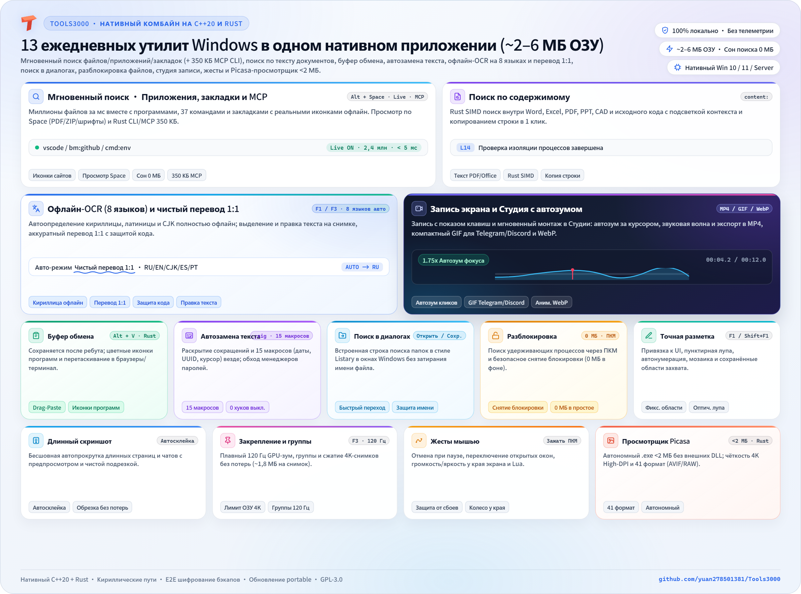
</p>

---

## Демонстрация функций

<table>
  <tr>
    <td width="50%" align="center" valign="top">
      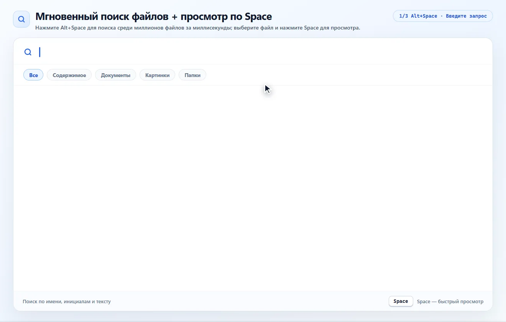<br />
      <sub><b>Мгновенный поиск и предпросмотр</b> · Приложения, закладки с реальными Favicon, Live-обновление и Space-просмотр архивов и шрифтов</sub>
    </td>
    <td width="50%" align="center" valign="top">
      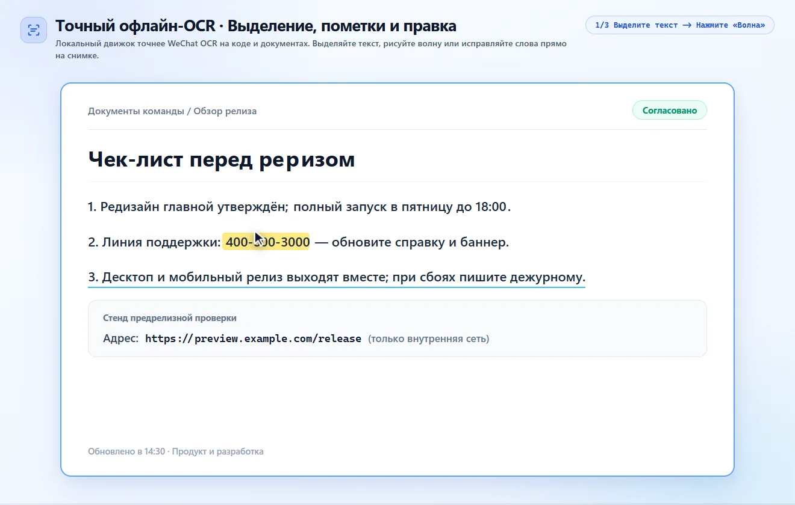<br />
      <sub><b>Офлайн-OCR (8 языков) и разметка</b> · Автоопределение кириллицы, CJK и латиницы локально: копирование, подчёркивание и правка на месте</sub>
    </td>
  </tr>
  <tr>
    <td width="50%" align="center" valign="top">
      <br />
      <sub><b>Скриншот с прокруткой</b> · Автосклейка с предпросмотром в реальном времени и неразрушающая обрезка краёв</sub>
    </td>
    <td width="50%" align="center" valign="top">
      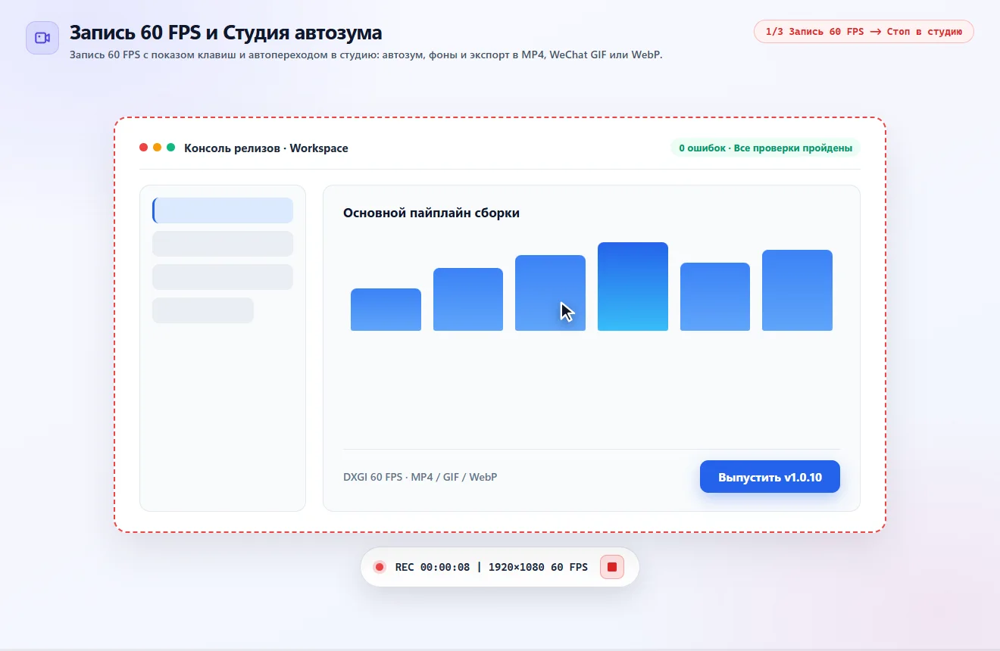<br />
      <sub><b>Запись экрана и Студия с автозумом</b> · умный автозум и экспорт в MP4, GIF и анимированный WebP</sub>
    </td>
  </tr>
  <tr>
    <td width="50%" align="center" valign="top">
      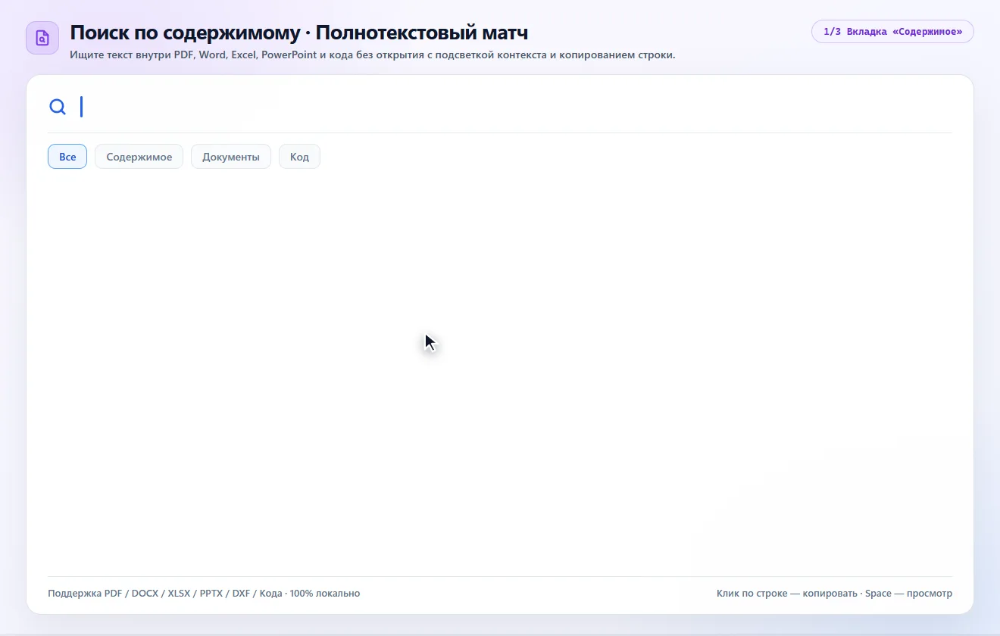<br />
      <sub><b>Поиск по содержимому</b> · Поиск внутри PDF, Word, Excel и исходного кода с копированием строки по клику</sub>
    </td>
    <td width="50%" align="center" valign="top">
      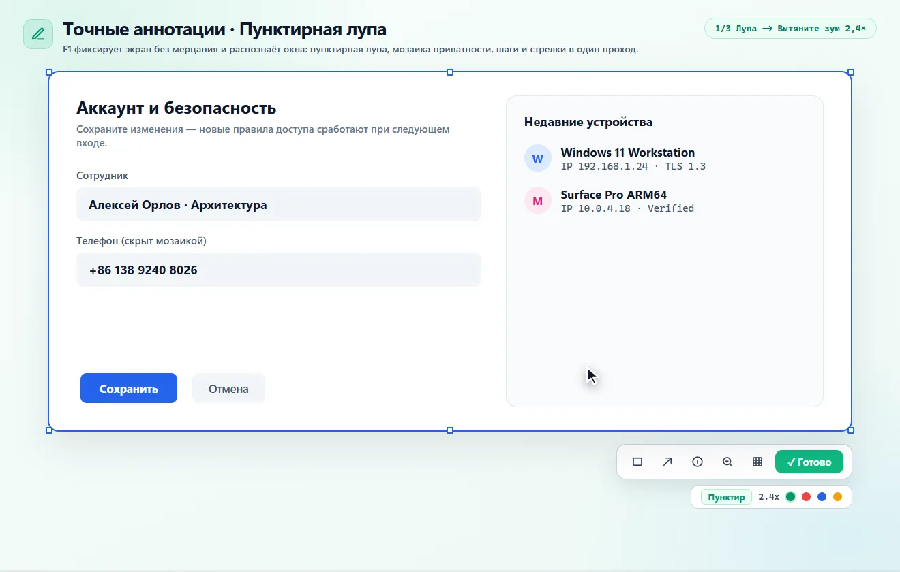<br />
      <sub><b>Точная разметка</b> · Автопривязка к элементам, пунктирная лупа, мозаика и нумерация шагов</sub>
    </td>
  </tr>
  <tr>
    <td width="50%" align="center" valign="top">
      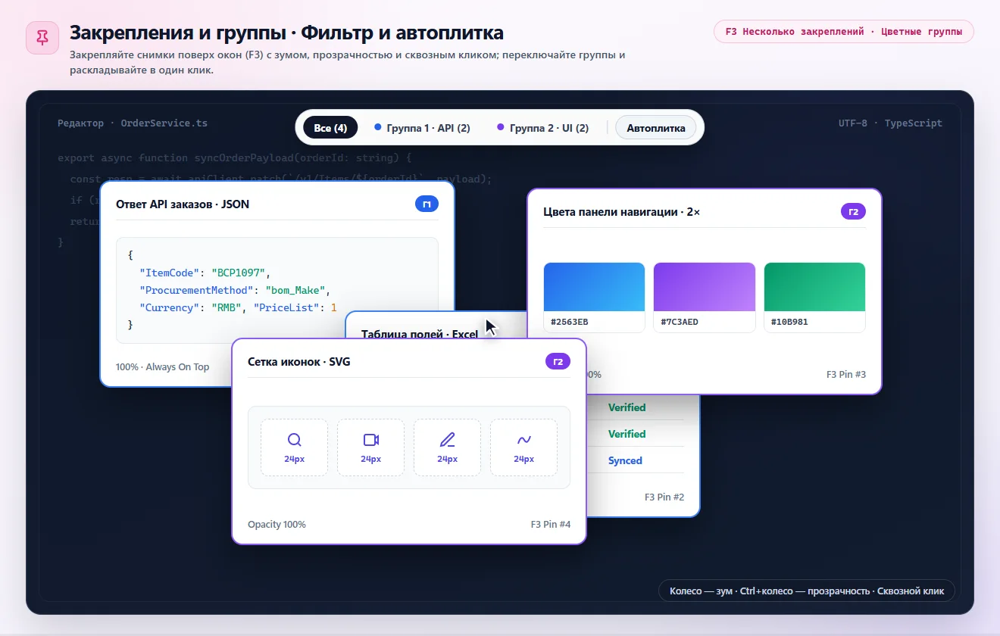<br />
      <sub><b>Закрепление и группы</b> · Фиксация поверх окон (F3), фильтрация по группам и автоукладка сеткой в один клик</sub>
    </td>
    <td width="50%" align="center" valign="top">
      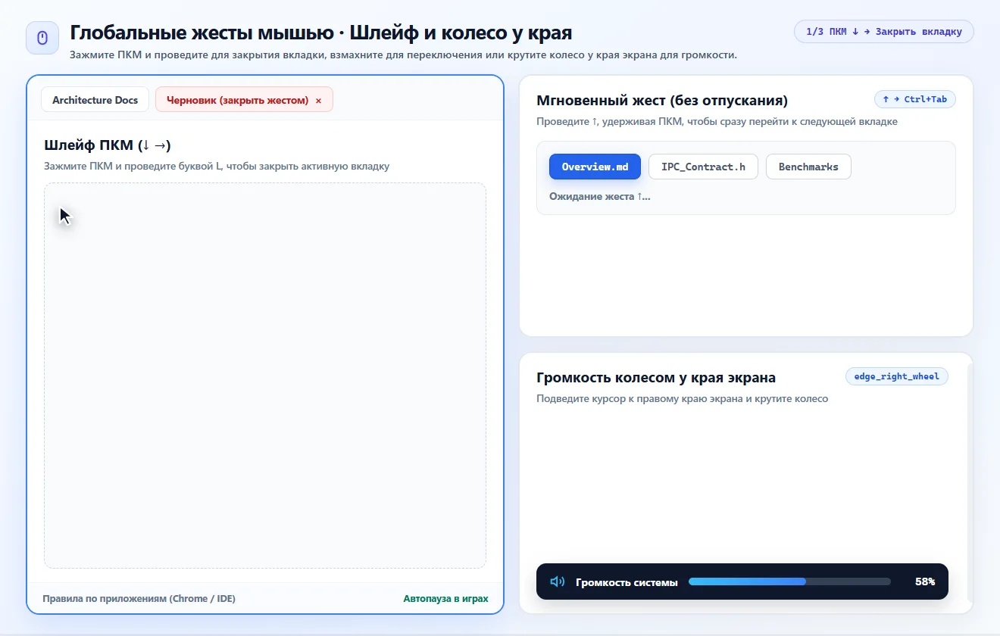<br />
      <sub><b>Жесты мышью</b> · Отмена при паузе по умолчанию, умное переключение уже открытых окон и громкость у края экрана</sub>
    </td>
  </tr>
  <tr>
    <td width="50%" align="center" valign="top">
      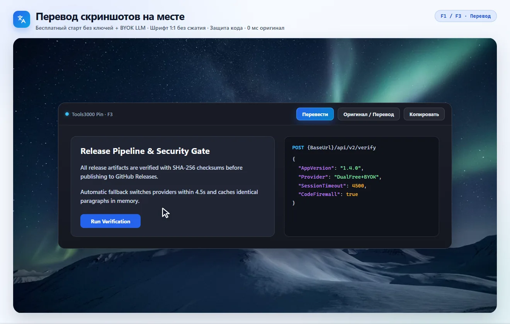<br />
      <sub><b>Перевод скриншотов на месте</b> · Бесплатные движки без ключей + BYOK LLM, аккуратное наложение 1:1, защита кода и 0 мс оригинал</sub>
    </td>
    <td width="50%" align="center" valign="top">
      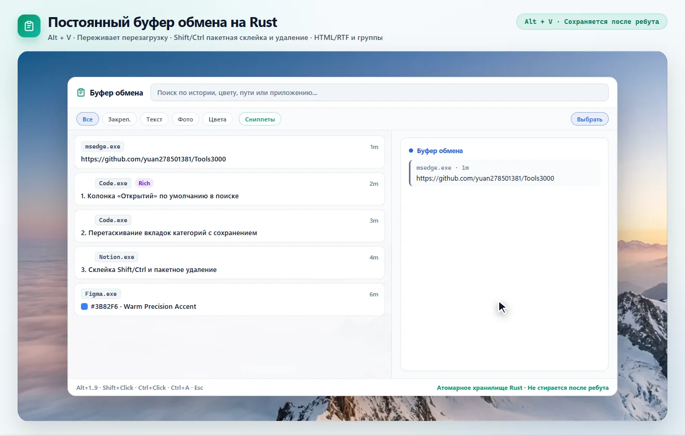<br />
      <sub><b>Постоянный буфер обмена (Alt + V)</b> · Сохраняется после перезагрузки, склейка Shift/Ctrl по порядку, HTML/RTF и тумблер в трее</sub>
    </td>
  </tr>
  <tr>
    <td width="50%" align="center" valign="top">
      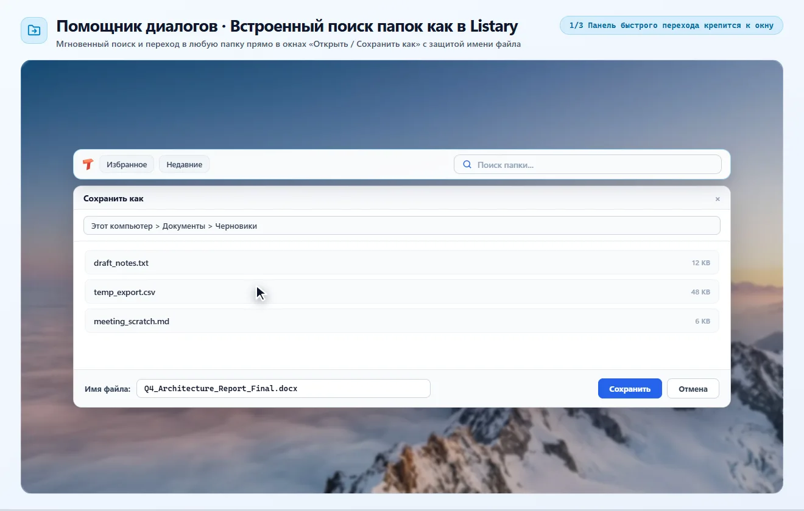<br />
      <sub><b>Помощник диалогов</b> · Встроенный поиск и переход по папкам в окнах «Открыть / Сохранить» без перезаписи имени файла</sub>
    </td>
    <td width="50%" align="center" valign="top">
      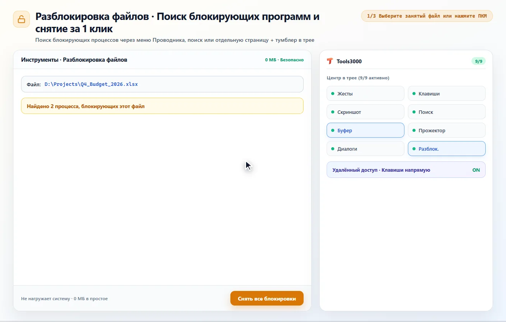<br />
      <sub><b>Разблокировка файлов</b> · Поиск программ, держащих файл, из контекстного меню, поиска или отдельной страницы — снятие в 1 клик</sub>
    </td>
  </tr>
  <tr>
    <td colspan="2" align="center" valign="top">
      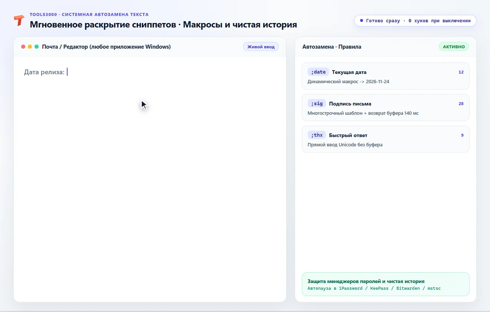<br />
      <sub><b>Автозамена текста</b> · Введите <code>;date</code> или <code>;sig</code> в любом окне — динамические макросы, защита менеджеров паролей и без загрязнения буфера</sub>
    </td>
  </tr>
</table>

| Модуль | Возможности |
| :--- | :--- |
| **Мгновенный поиск файлов** | Нажмите `Alt + Space` для поиска среди миллионов файлов за мс; объединяет установленные приложения (`app:`), 37 системных инструментов Windows (`cmd:env` и др.) и закладки Edge/Chrome/Brave/Vivaldi (`bm:`/`b:`, офлайн-чтение реальных иконок сайтов). Поддерживает **Live-обновление**, **3 режима ОЗУ** (включая сон 0 МБ), колонку «Открытий», перетаскивание вкладок, предпросмотр по `Space` (документы, PDF, код, CAD, PSD, 3D, архивы ZIP/7Z/RAR, шрифты TTF/OTF и медиа) и компактный инструмент CLI/MCP `tools3000-cli.exe` (350 КБ). |
| **Поиск по содержимому** | Префикс `content:` ищет непосредственно внутри Word, Excel, PDF, PowerPoint, CAD и исходного кода с подсветкой фрагментов и копированием строки кликом по её номеру. |
| **Постоянный буфер обмена** | Вызов по `Alt + V` (или из меню и центра управления в трее), история сохраняется после перезагрузки; цветные иконки и понятные названия программ-источников, умное перетаскивание в поисковые строки браузеров, терминалы и AI IDE, склейка по порядку (`Shift / Ctrl`), HTML/RTF, группы, встроенное редактирование, `Alt + 1..9`, скрытие закреплённых в других вкладках и список исключений. |
| **Автозамена текста** | Мгновенно раскрывает короткие сокращения (`;date`, `;now`, `;sig`) во фразы и 15 динамических макросов (`{{date+Nd}}`, день недели `{{weekday}}`, `{{uuid}}`, `{{timestamp}}`, `{{user}}`, буфер и позицию `{{cursor}}`) с живым предпросмотром, сохранением разделителя, автопаузой в менеджерах паролей и защитой от засорения `Win + V`; в выключенном состоянии — 0 хуков и 0 ОЗУ. |
| **Помощник диалогов** | Автоматически добавляет панель быстрого перехода со встроенным поиском папок в стиле Listary в окна «Открыть / Сохранить как / Выбор папки» Windows и собственные диалоги Tools3000, бережно защищая введённое имя файла при сохранении. |
| **Разблокировка файлов** | Когда файл не удаляется — найдите, какая программа его держит, и безопасно снимите блокировку: через контекстное меню Проводника (опционально только с `Shift + ПКМ`), меню результатов поиска или отдельную страницу в настройках. Потребляет 0 МБ в простое, не вмешивается в систему и сам убирает пункт меню при отключении. |
| **Скриншот с прокруткой** | Автоматическая склейка длинных веб-страниц, чатов и документов с боковым предпросмотром, неразрушающей обрезкой верха/низа и прямой разметкой длинного снимка. |
| **Точная разметка** | `F1` автоматически привязывается к окнам и элементам UI; доступны пипетка, пунктирная оптическая лупа, 6 видов стрелок, самовосстанавливающаяся нумерация, мозаика, рамки, независимые переключатели автокопирования/автосохранения и `Shift + F1` / `R` для сохранённых и недавних областей. |
| **Закрепление и группы** | Закрепляйте скриншоты и фрагменты буфера обмена поверх окон (`F3`) с плавным 120 Гц GPU-зумом, прозрачностью, кликом насквозь, цветовыми группами и выравниванием сеткой; холодное сжатие без потерь удерживает минимум памяти даже при десятках 4K-снимков, доступен переключатель авто-OCR при закреплении. |
| **Офлайн-OCR (8 языков) и перевод на месте** | Полностью локальный OCR с автоопределением 8 языков без переключения (кириллица, CJK, японский, корейский и латиница; лёгкие языковые пакеты докачиваются по требованию, плюс принудительный выбор языка по ПКМ на закреплённом снимке); копирование, подчёркивание, правка на месте, таблицы и QR-коды плюс **аккуратный перевод 1:1 поверх скриншота** (бесплатные каналы + BYOK LLM), защита кода и 0 мс показ оригинала. |
| **Запись экрана и Студия** | Запись экрана с отображением клавиш и кликов и мгновенным переходом в Студию: умный автозум на кликах, фоновые обои, монтаж по аудиоволне и экспорт в **MP4**, **компактный GIF для Telegram / Discord** и **анимированный WebP**. |
| **Глобальные жесты мышью** | Зажмите правую кнопку мыши для переключения вкладок, навигации и закрытия окон; отмена при короткой паузе включена по умолчанию, умное переключение уже открытых окон (включая разные профили Chrome), мгновенное срабатывание, громкость/яркость у края экрана, 8-секундная пасхалка, автообход в играх и Lua-скрипты. |
| **Презентация, удалённый доступ и обратная связь** | Оверлей клавиш и прожектор по двойному `Ctrl`; проброс горячих клавиш для mstsc, RustDesk, ToDesk, AnyDesk и сброс залипших клавиш; кнопка **«Обратная связь»** в левом нижнем углу с автоматическим локальным скрытием имени пользователя, IP, почты и ключей перед экспортом логов. |
| **Просмотрщик фото Picasa (на Rust · опция)** | Лёгкий просмотрщик изображений в стиле Picasa на Rust + Direct2D (**только просмотрщик, не полный пакет Google Picasa**). **Один файл менее 2 МБ без внешних библиотек — работает как в составе Tools3000, так и полностью автономно на любом ПК с Windows.** По умолчанию в установщике не выбран; при включении автоматически связывает все 41 поддерживаемых формата изображений (классические значки Polaroid и нативная панель Direct2D со светлой/тёмной темой). Воспроизводя плавный зум от курсора, ленту миниатюр и слайд-шоу с перекрёстным растворением, он **добавляет современные возможности, которых не было в оригинале**: чёткость 4K High-DPI (100%–250%+), VSync 60–240 Гц, WebP / AVIF / HEIC / SVG / QOI / DDS / RAW камер, покадровое управление анимациями, отражение без потерь и 8 языков. |

---

## Загрузка и установка

### Способ 1: Пакетные менеджеры (рекомендуется)

- **Scoop (доступно прямо сейчас — настоящий портативный режим с сохранением данных в `data/` при обновлениях)**:

```powershell
scoop bucket add tools3000 https://github.com/yuan278501381/Tools3000
scoop install tools3000/tools3000
```

- **Winget (готовые официальные манифесты)**: в каталоге [`packaging/winget/`](../../packaging/winget/) автоматически обновляются и проходят `winget validate` манифесты `Yy1.Tools3000`. После публикации в `microsoft/winget-pkgs` установка будет доступна через `winget install Yy1.Tools3000` (локально: `winget install -m packaging/winget`).

### Способ 2: Прямая загрузка с GitHub Releases

Скачайте актуальный релиз на странице **[GitHub Releases](https://github.com/yuan278501381/Tools3000/releases/latest)**:

- **Стандартный установщик (`Tools3000-vX.Y.Z-Setup.exe`)** — рекомендуется для повседневной работы: выбор компонентов, автозапуск и плавное обновление поверх установленной версии.
- **Портативный архив (`Tools3000-vX.Y.Z-win-x64-portable.zip`)** — распакуйте и запускайте сразу, все настройки и данные хранятся в папке программы.
- **Контрольные суммы (`SHA256SUMS.txt`)** — хеши SHA-256 для проверки целостности каждого файла релиза.

> **Системные требования**: Windows 10 (1809+) / Windows 11 / Windows Server 2019–2025; исходный код и система сборки нативно поддерживают `x64` и `ARM64` (в GitHub Releases сейчас публикуются готовые сборки `x64`, на устройствах ARM64 можно собрать нативно по [Руководству разработчика](../DEVELOPER.md) или запускать `x64`-версию), требуется встроенный Microsoft Edge WebView2 Runtime. Интерфейс приложения поддерживает 8 языков, включая русский, и по умолчанию следует за языком системы.

### Проверка безопасности и доверие

Полная прозрачность без чёрных ящиков (подробнее в **[SECURITY.md](../../.github/SECURITY.md)**):

1. **Проверка целостности SHA-256**: сверьте файл с `SHA256SUMS.txt` в PowerShell:
   ```powershell
   Get-FileHash .\Tools3000-vX.Y.Z-Setup.exe -Algorithm SHA256
   ```
2. **Публичная проверка на VirusTotal**: вставьте SHA-256 файла на **[VirusTotal](https://www.virustotal.com/)** (в новых релизах ссылки на VirusTotal добавляются прямо в описание релиза), чтобы проверить вердикты 70+ антивирусных движков.
3. **Предупреждение Windows Defender SmartScreen**: пока у независимого open-source проекта нет коммерческого EV/публично доверенного сертификата (оформление SignPath / Trusted Signing в процессе) или свежий релиз ещё не набрал репутацию, Windows может показать «Неизвестный издатель». После проверки SHA-256 и VirusTotal нажмите **«Подробнее -> Выполнить в любом случае»** или соберите программу самостоятельно из исходников по **[Руководству разработчика](../DEVELOPER.md)**.
4. **Встроенный SPDX SBOM**: в установщик и портативный архив входят `SBOM.spdx.json` и `THIRD_PARTY_NOTICES.txt` со всеми зависимостями.

---

## Почему я создал Tools3000

Я пользуюсь **Everything** уже более десяти лет. Для скриншотов я начинал со встроенных стандартных утилит и **Lightshot**, затем перешёл на **FastStone Capture** ради удобных аннотаций, после — на **Snipaste** ради закрепления скриншотов поверх окон, а позже перешёл на **PixPin** ради длинных скриншотов с прокруткой, лупы и OCR; для жестов мышью пользовался **WGestures** и **WGestures 2**, программ для записи экрана перепробовал десятки, а по пути даже попробовал Microsoft **PowerToys**, но в нём всё равно не хватало нескольких ключевых повседневных инструментов — и снова приходилось держать запущенной целую стопку утилит.

С просмотрщиками изображений история оказалась похожей: популярные локальные программы завалены рекламой и навязчивыми надстройками, а после закрытия **Picasa** от Google я перепробовал немало замен — в том числе **FastStone Image Viewer** и даже официальный просмотрщик от автора Everything (**Void Image Viewer**), — но ни один не давал такой же отзывчивости и плавных анимаций, как Picasa. В итоге я махнул рукой и просто мирился со встроенным приложением «Фотографии» Windows. Работая над Tools3000, я заодно воссоздал любимый лёгкий просмотрщик Picasa на Rust + Direct2D (менее 2 МБ, без внешних зависимостей, полностью автономный) и добавил всё, чего не хватало оригиналу: High-DPI, WebP/AVIF/HEIC/SVG/RAW и управление анимациями.

Однажды, глядя на целую вереницу иконок в системном трее Windows, я подумал: **было бы здорово объединить всё это в одном приложении.** К тому же в ежедневной работе накапливались раздражающие мелочи — встроенный OCR в Windows уступал по точности и скорости и по точности, и по скорости, а в WGestures в какой-то момент на экране стало зависать маленькое текстовое окошко, убрать которое удавалось только перезапуском программы. С наступлением эпохи ИИ я решил собрать единый комбайн сам — так появился **Tools3000**.

Честно расскажу потенциальным пользователям: перед публикацией я **4 месяца ежедневно пользовался Tools3000 сам**, постепенно добавляя функции и исправляя всё, на что натыкался. Поначалу старые утилиты оставались запущенными на подстраховке — если что-то сбоило, я временно возвращался к ним и чинил проблему; **а теперь мой трей наконец-то чист, в нём остался только Tools3000.**

Разумеется, реальные конфигурации Windows очень разнообразны, и новые нюансы наверняка ещё встретятся. В эпоху ИИ дорабатывать проекты вместе стало проще простого — буду рад как **[баг-репортам в GitHub Issues](https://github.com/yuan278501381/Tools3000/issues)**, так и **совместной разработке через Pull Requests**.

---

## Что заменяет Tools3000

У специализированных программ есть свои глубокие ниши. Tools3000 закрывает 90%+ ежедневных задач **одним бесплатным нативным приложением под лицензией GPL-3.0**, честно обозначая границы, где узкие утилиты всё ещё незаменимы:

| Отдельная утилита | Ежедневные задачи в Tools3000 | Когда стоит оставить исходную утилиту |
| :--- | :--- | :--- |
| **Everything** | `Alt + Space` — мгновенный поиск по именам, закладкам `bm:` и `content:` по тексту документов + 350 КБ Rust CLI / MCP-сервер с запуском службы по запросу | Нужны HTTP/ETP-серверы поиска, индексация EXIF/медиа-атрибутов или старые скрипты, завязанные на синтаксис `es.exe` |
| **Ditto / Windows `Win + V`** | `Alt + V` — постоянный буфер обмена на Rust (переживает перезагрузку), склейка `Shift / Ctrl` по порядку и удаление, HTML/RTF, группы, правка и `Alt + 1..9` | Нужна синхронизация буфера по локальной сети между несколькими ПК или облачный роуминг через учётную запись |
| **Snipaste / Lightshot / ShareX** | `F1` захват и разметка, пунктирная лупа, длинный скриншот, `F3` группы с 120 Гц зумом, перевод на месте 1:1 и быстрый офлайн-OCR с правкой текста | Нужна уникальная детекция элементов в старых редких GUI или кастомные CLI-цепочки захвата |
| **WGestures / StrokesPlus** | Жесты правой кнопкой, мгновенный триггер, громкость у края экрана, активные углы, автопауза в играх и Lua-скрипты | Нужны сложные многокнопочные аккорды, хитрые условия областей окна или многолетняя коллекция макросов |
| **Запись экрана (ShareX и др.)** | Запись экрана, показ клавиш, Студия (монтаж по аудиоволне и автозум за курсором), экспорт в MP4, GIF и WebP | Нужна автозагрузка на 80+ облачных хостингов/S3/FTP/Webhook или сложные пакетные конвейеры FFmpeg |
| **Picasa Photo Viewer / FastStone / «Фотографии» Windows** | Опциональный автономный просмотрщик Picasa на Rust (< 2 МБ, ноль зависимостей): классические анимации плюс 4K High-DPI, WebP/AVIF/HEIC/SVG/RAW и отражение без потерь | Нужны каталогизация альбомов и распознавание лиц полного Google Picasa или профессиональная пакетная обработка RAW |
| **Listary Dialog Jump / PowerToys File Locksmith** | Встроенный поиск и переход по папкам прямо в окнах «Открыть / Сохранить» (с защитой имени файла); «Разблокировка файлов» с 0 МБ в простое через ПКМ или отдельную страницу | Нужны сложные цепочки действий Listary или глубокий анализ дескрипторов ядра |
| **Espanso / Beeftext / AutoHotkey сниппеты** | Встроенная нативная автозамена текста (готова сразу, 0 хуков при выключении): мгновенный и разделительный режимы, макросы даты/буфера/курсора, автопропуск менеджеров паролей, песочница и импорт/экспорт JSON | Сложные YAML-формы, вывод shell-скриптов или кроссплатформенная синхронизация с Linux/macOS |

---

## Горячие клавиши и пути хранения данных

Любое сочетание клавиш можно свободно изменить в настройках с автоматической проверкой конфликтов:

| Сочетание | Действие |
| :--- | :--- |
| `Alt + Space` | Открыть / скрыть быстрый поиск (поддерживает `app:`, `cmd:`, `bm:`, `content:`; `Space` — быстрый предпросмотр) |
| `Alt + V` | Открыть / скрыть постоянный буфер обмена (`Shift / Ctrl` склейка и `Alt + 1..9`, также доступно в меню трея) |
| `F1` | Скриншот области, разметка и перевод на месте в 1 клик |
| `F3` | Закрепить изображение или текст из буфера обмена поверх окон |
| Двойное нажатие `Ctrl` | Включить / выключить прожектор курсора |
| `Ctrl + Alt + Backspace` | Сбросить залипшие модификаторы в удалённом рабочем столе (или двойной правый `Ctrl`) |

### Где найти функции и локальные файлы

Полная совместимость с папками установки и именами пользователей Windows на русском и других нелатинских языках:

| Раздел / Файл | Где в интерфейсе / Обычная установка | Портативная версия |
| :--- | :--- | :--- |
| **Облачное резервное копирование** | `Система -> Общие -> Облачное и локальное резервное копирование` (автопоиск OneDrive/Google Drive/Dropbox/iCloud, WebDAV, S3 и опциональное сквозное шифрование) | То же самое (портативная версия также обновляется на месте в `Настройки -> О программе`) |
| **Производительность и память** | `Аналитика и о программе -> Производительность и память` (мониторинг ОЗУ/задержек, очистка в 1 клик и расписание из 10 правил) | То же самое |
| **Авто-OCR закреплений и области** | `Инструменты -> Захват и запись -> Закрепление и области` (переключатель «Распознавать текст при закреплении» и фиксированные области) | То же самое |
| **Разблокировка файлов** | Настройки: `Система -> Модули`, `Инструменты -> Разблокировка файлов`; панель в трее, ПКМ в Проводнике и в поиске | То же самое (пункт меню только для текущего пользователя, 0 МБ в фоне, автоудаление при выключении) |
| **Иконки поиска / Live / ОЗУ** | `Инструменты -> Поиск файлов` (стиль иконок / Live-мониторинг / память службы); тумблер Live также в строке состояния поиска | То же самое (иконки закладок читаются локально без выхода в сеть) |
| **Языковые пакеты офлайн-OCR** | `Инструменты -> OCR и перевод` / ПКМ по закреплённому снимку `Язык OCR`; `%LOCALAPPDATA%\Tools3000\models\ocr\` | `<папка программы>\data\models\ocr\` |
| **История буфера обмена** | Тумблер в центре управления в трее; `%LOCALAPPDATA%\Tools3000\clipboard\` | `<папка программы>\data\clipboard\` |
| **Настройки и журналы диагностики** | `%LOCALAPPDATA%\Tools3000\config\config.json` и `%LOCALAPPDATA%\Tools3000\logs\tools3000.log` (кнопка «Обратная связь» автоматически скрывает личные данные) | `<папка программы>\data\config\` и `<папка программы>\data\logs\` |
| **Автономные CLI и просмотрщик** | `C:\Program Files\Tools3000\tools3000-cli.exe` (CLI/MCP) и `Tools3000_Picasa_Viewer.exe` | `<папка программы>\tools3000-cli.exe` и `Tools3000_Picasa_Viewer.exe` |

---

## Приватность и принципы

- **Локальный приоритет и работа офлайн**: индексация файлов, полнотекстовый поиск, буфер обмена, OCR, аннотации и статистика работают строго локально. Выделенный текст отправляется выбранному провайдеру только при явном нажатии кнопки перевода скриншота.
- **Без телеметрии и аккаунтов**: никакой рекламы, регистрации и отправки ваших файлов или нажатий клавиш на внешние серверы.
- **Лёгкость по умолчанию**: каждый модуль отключается отдельно, а служба поиска запускается только по запросу, сохраняя минимальное потребление ресурсов в фоне.

---

## Обратная связь и совместная разработка

- **Сообщить об ошибке**: удобнее всего прямо в приложении — нажмите **`Обратная связь`** в левом нижнем углу окна настроек (или **`Настройки -> О программе -> Обратная связь`**). Можно вставить скриншот через `Ctrl + V`: Tools3000 локально очистит пути с именем пользователя, почту, IP и токены, после чего выгрузит диагностический архив (с последними 1000 строками журнала) или предзаполнит GitHub Issue. Также можно отправить отчёт вручную через **[шаблон Bug Report](https://github.com/yuan278501381/Tools3000/issues/new?template=bug_report.yml)**.
- **Предложить идею**: создайте **[Feature Request](https://github.com/yuan278501381/Tools3000/issues/new?template=feature_request.yml)** или обсудите в **[GitHub Discussions](https://github.com/yuan278501381/Tools3000/discussions)**.
- **Участвовать в разработке**: Pull Request всегда приветствуются — см. **[Руководство разработчика](../DEVELOPER.md)** и **[руководство по пакетам](../../packaging/README.md)**.

---

## Star History

<a href="https://www.star-history.com/#yuan278501381/tools3000&Date">
 <picture>
   <source media="(prefers-color-scheme: dark)" srcset="https://api.star-history.com/svg?repos=yuan278501381/tools3000&type=Date&theme=dark" />
   <source media="(prefers-color-scheme: light)" srcset="https://api.star-history.com/svg?repos=yuan278501381/tools3000&type=Date" />
   
 </picture>
</a>

---

## Документация и лицензия

- **Разработка и безопасность**: инструкции по сборке в **[Руководстве разработчика](../DEVELOPER.md)**, политика безопасности в **[SECURITY.md](../../.github/SECURITY.md)**, история версий в **[GitHub Releases](https://github.com/yuan278501381/Tools3000/releases)**.
- **Лицензия**: распространяется под **[GNU GPL v3.0](../../LICENSE)** (с [исключением связывания Windows / WebView2](../../LICENSE-EXCEPTION.md)).
- **Авторские права**: `Copyright (c) 2026 Yy1 (yuan278501381) & Tools3000 contributors` · [@yuan278501381](https://github.com/yuan278501381)
