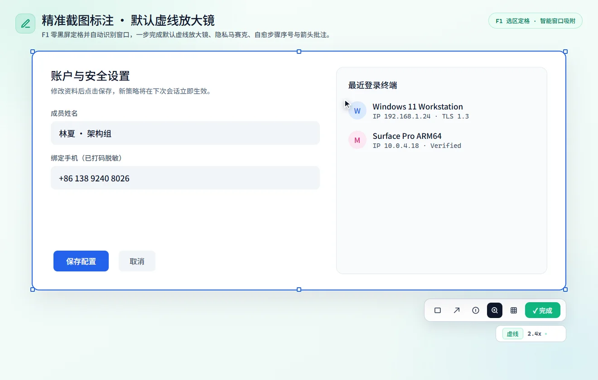
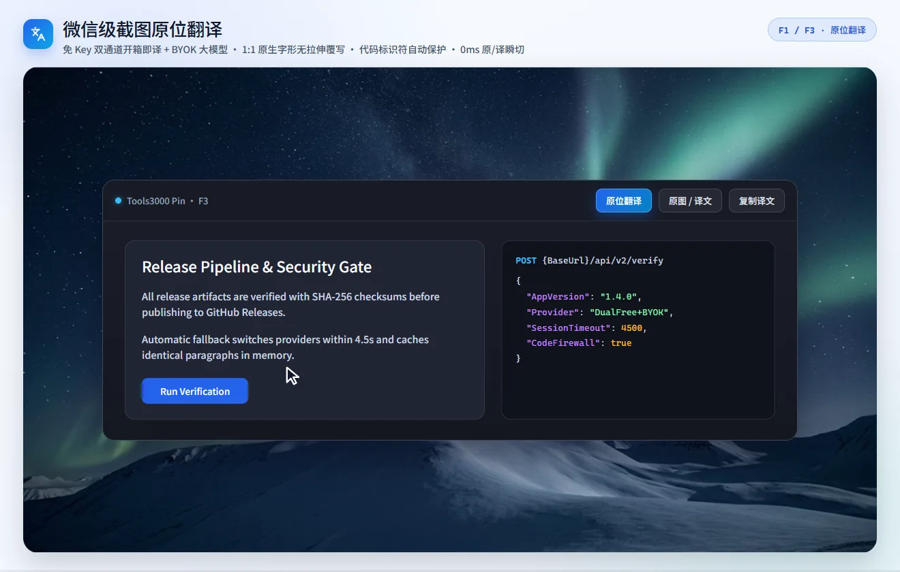
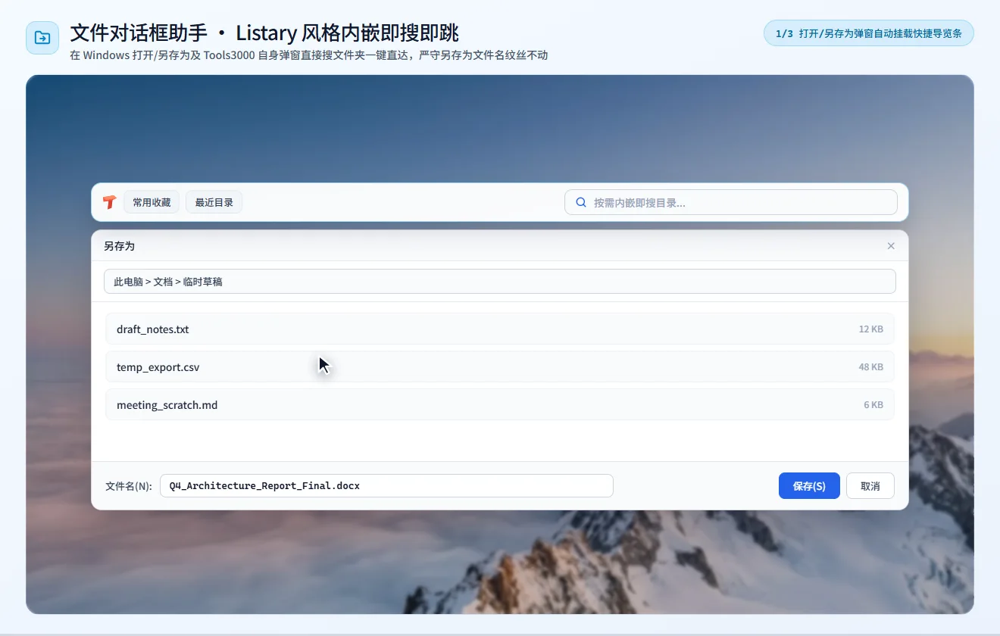

<div align="center">


# Tools3000

**轻量、原生的 Windows 多合一桌面效率工具集**

[English](../../README.md) · **简体中文** · [繁體中文](README.zh-TW.md) · [日本語](README.ja.md) · [한국어](README.ko.md) · [Русский](README.ru.md) · [Português (Brasil)](README.pt-BR.md) · [Español](README.es.md)

[](https://github.com/yuan278501381/Tools3000/releases/latest)
[](https://github.com/yuan278501381/Tools3000/actions/workflows/ci.yml)
[](https://github.com/yuan278501381/Tools3000/stargazers)
[](https://github.com/yuan278501381/Tools3000/releases)
[](https://glama.ai/mcp/servers/yuan278501381/Tools3000)
[](#安装与下载)
[](#安装与下载)
[](../../LICENSE)

**[项目官网](https://yuan278501381.github.io/Tools3000/)** · **[立即下载最新版本](#安装与下载)** · [核心功能一览](#核心功能一览) · [全功能演示](#全功能动态演示) · [安全与校验](#安全校验与信任说明) · [开发初衷](#开发初衷) · [一软替代清单](#一软替代清单) · [参与共创](#参与共创与反馈) · [开发者指南](../DEVELOPER.md)

</div>

<br />

Tools3000 将日常高频的**文件/应用/系统命令与原站图标书签搜索（含实时刷新、3 档内存省电模式及命令行/MCP）、文档内容搜索、重启不丢的剪贴板历史、全局文本扩展器、文件对话框内嵌即搜、文件占用解锁、滚动长截图、精准截图标注、桌面贴图与贴图组、8 国语言自动离线识字与无痕原位翻译、录屏（自动运镜演播室、支持导出微信 GIF 与动态 WebP）、全局鼠标手势、配置端到端加密云备份与 Rust 轻量看图器**整合为单一原生软件。核心功能 100% 本地离线运行、完整支持中文及多语言安装目录与用户名，常驻主程序专用工作集仅约 **2–6 MB**（搜索后台支持闲置 0 MB 休眠），同时适配个人电脑（`x64` / `ARM64`）与 Windows Server 多用户并发办公。

> **快速下载与一键安装** — 直接下载 **[标准安装包 `.exe` / 绿色便携包 `.zip`（最新版）](https://github.com/yuan278501381/Tools3000/releases/latest)**，或使用 **Scoop** 一键安装：
> ```powershell
> scoop bucket add tools3000 https://github.com/yuan278501381/Tools3000 && scoop install tools3000/tools3000
> ```

---

## 核心功能一览

<p align="center">
  
</p>

---

## 全功能动态演示

<table>
  <tr>
    <td width="50%" align="center" valign="top">
      <br />
      <sub><b>极速融合搜索与空格预览</b> · 原图标直达应用/知乎等书签/系统命令，Live 实时刷新与空格直看文档/压缩包/字体</sub>
    </td>
    <td width="50%" align="center" valign="top">
      <br />
      <sub><b>全 8 语种离线文本识别与批注</b> · 跨语种零切换离线识字、准确率高于微信截图 OCR，拖选复制/波浪线/改字</sub>
    </td>
  </tr>
  <tr>
    <td width="50%" align="center" valign="top">
      <br />
      <sub><b>滚动长截图</b> · 自动滚动无缝拼接、右侧实时预览，首尾一键无损裁切</sub>
    </td>
    <td width="50%" align="center" valign="top">
      <br />
      <sub><b>录屏与自动运镜演播室</b> · 屏幕录制、智能自动运镜，一键转微信 GIF、动态 WebP 与 MP4</sub>
    </td>
  </tr>
  <tr>
    <td width="50%" align="center" valign="top">
      <br />
      <sub><b>文档内容搜索</b> · 穿透检索 PDF / Word / Excel / 代码正文，高亮上下文并一键复制行</sub>
    </td>
    <td width="50%" align="center" valign="top">
      <br />
      <sub><b>精准截图标注</b> · 默认虚线光学放大镜、自动吸附控件、隐私马赛克与自愈序号</sub>
    </td>
  </tr>
  <tr>
    <td width="50%" align="center" valign="top">
      <br />
      <sub><b>桌面贴图与贴图组</b> · F3 多图置顶与彩色分组，顶部导览条按组秒切显隐、一键磁吸平铺</sub>
    </td>
    <td width="50%" align="center" valign="top">
      <br />
      <sub><b>全局鼠标手势</b> · 默认停顿自动取消防误触、应用参数精准切窗、不松键瞬发与边缘滚轮调音量</sub>
    </td>
  </tr>
  <tr>
    <td width="50%" align="center" valign="top">
      <br />
      <sub><b>微信级截图原位翻译</b> · 免 Key 双通道 + 自定义大模型，智能擦除无痕覆盖、代码原样保留与 0ms 原译瞬切</sub>
    </td>
    <td width="50%" align="center" valign="top">
      <br />
      <sub><b>剪贴板历史 (Alt + V)</b> · 关机重启不丢，Shift/Ctrl 按序合并粘贴、富文本、分组与托盘快捷开关</sub>
    </td>
  </tr>
  <tr>
    <td width="50%" align="center" valign="top">
      <br />
      <sub><b>文件对话框助手</b> · 打开/另存为及软件自身弹窗直接搜目录一键跳，另存为文件名绝不覆盖</sub>
    </td>
    <td width="50%" align="center" valign="top">
      <br />
      <sub><b>文件占用解锁</b> · 右键文件、搜索结果或页内直选，秒查占用进程并一键安全解锁</sub>
    </td>
  </tr>
  <tr>
    <td colspan="2" align="center" valign="top">
      <br />
      <sub><b>文本扩展器</b> · 输入 <code>;date</code> / <code>;sig</code> 任意窗口秒速展开，动态宏、密码管理器避让与零剪贴板污染</sub>
    </td>
  </tr>
</table>

| 模块 | 核心体验 |
| :--- | :--- |
| **极速文件搜索** | `Alt + Space` 全盘百万文件毫秒秒搜，融合中文全拼/首字母、已安装软件（`app:`）、37 个常用 Windows 系统工具（`cmd:env` 等）与 Edge/Chrome/Brave/Vivaldi 浏览器书签（`bm:`/`b:`，纯离线直接显示网站原本图标）；支持 **实时刷新**（新下载/新建文件直接出现）、**3 档内存模式**（含闲置 0 MB 休眠）、打开次数统计与自定义拖拽分类栏；选中按 `Space` 免打开快速预览（文档、PDF、代码、CAD、PSD、3D、压缩包 ZIP/7Z/RAR、字体 TTF/OTF 与音视频画面）；并附带 350 KB 轻量命令行与 MCP 工具 `tools3000-cli.exe`。 |
| **文档内容搜索** | `content:` 直接穿透检索 Word、Excel、PDF、PPT、CAD 与源代码正文，实时高亮上下文片段并支持点击行号一键复制。 |
| **剪贴板历史** | `Alt + V` 秒呼（支持托盘右键快捷打开与托盘面板一键开关），关机重启不丢历史记录；卡片直观显示复制来源软件的真实彩色图标与名称，支持向现代浏览器网页输入框、命令行终端、无边框应用及 AI 编程工具全场景智能拖拽直贴，以及 `Shift / Ctrl` 按序批量合并粘贴与删除、HTML/RTF 富文本、收藏分组、内联编辑、`Alt + 1..9` 极速瞬贴、非置顶分类一键隐藏置顶项与敏感应用自动跳过。 |
| **文本扩展器** | 在任意 Windows 应用输入短触发词（如 `;date`、`;now`、`;sig`）瞬间展开完整短语与 15 类动态宏（支持 `{{date+Nd}}` 天数偏移、8 语种星期 `{{weekday}}`、`{{uuid}}`、`{{timestamp}}`、`{{user}}`、剪贴板引用与 `{{cursor}}` 光标定位）；默认兼容中日韩全角符号触发（如 `；sig`）、支持保留触发边界键与实时展开预览，内置密码管理器自动避让与隐私排除标记（绝不污染剪贴板历史或 `Win + V`），关闭时零钩子零内存占用。 |
| **文件对话框助手** | 在 Windows 原生「打开 / 另存为 / 选择文件夹」及 Tools3000 自身弹窗上方自动出现快捷导览条，像 Listary 一样直接输入搜目录一键跳转；另存为模式下严格保护底部文件名不被覆盖。 |
| **文件占用解锁** | 删不掉文件时一键找出谁在占用：在资源管理器右键文件或文件夹（可选仅按住 `Shift + 右键` 显示）、搜索结果右键，或在设置页内直接选择文件/文件夹，都能秒查占用进程并一键安全解锁；平时零内存常驻、不改系统底层，关闭即自动清理右键项。 |
| **滚动长截图** | 网页、文档与聊天记录自动滚动无缝拼接，右侧实时预览，支持首尾无损裁切（随时往回拖恢复）与长图原位标注。 |
| **精准截图标注** | `F1` 自动吸附窗口与界面控件，支持像素级取色、默认虚线光学放大镜、6 种箭头、自愈步骤序号、隐私马赛克、美化分享壳、自动复制与自动保存独立开关，以及 `Shift + F1` / `R` 快速复用固定与历史选区。 |
| **桌面贴图与贴图组** | `F3` 一键将截图或剪贴板图像置顶悬浮，支持 120Hz GPU 平滑阻尼缩放、透明调节、鼠标穿透、多贴图彩色分组与一键磁吸平铺；内置多张 4K 大图及超长截图无损冷压缩与显存卸载保护，海量贴图常驻依然极度省内存，并可按需开关贴图时自动识别文字。 |
| **8 国语言离线识字与原位翻译** | 纯本地离线跨语种零切换识字（自动识别中/英/日/韩/俄/西/葡截图，4 套轻量语言包按需下载，贴图右键可单图强制切语种），支持划选复制、波浪线/荧光笔批注、原位无痕改字与表格/二维码提取；内置**微信级无痕原位 1:1 翻译**（免 Key 双通道 + 自定义 OpenAI 兼容大模型），代码原样保留与 0ms 原译瞬切。 |
| **录屏与自动运镜演播室** | 录屏联动键鼠回显，停止即进演播室——光标点击处智能自动运镜聚焦，搭配多款质感壁纸与声波时间轴剪辑；支持一键导出 **MP4**、**微信直发 GIF**（免点直播表情 / 可双击放大高清大图分档）与**高清动态 WebP**。 |
| **全局鼠标手势** | 按住右键一划即可切标签、后退、关窗口；默认开启「划动中途停顿自动取消」防误触，支持「运行程序」精准切回已有窗口（含 Chrome 多开不同配置）、不松键瞬发、屏幕边缘滚轮调音量/硬件亮度、8 秒彩蛋、全屏游戏自动避让与 Lua 扩展。 |
| **演示特效与远控助手** | 投屏清透键帽与双击 `Ctrl` 聚光灯；mstsc、RustDesk、ToDesk、向日葵等远控系统热键直通与卡键一键释放；侧边栏左下角内置支持本机隐私自动打码的「问题反馈」与诊断包导出通道。 |
| **Picasa 图片查看器（Rust 复刻 · 可选）** | 基于 Rust + Direct2D 复刻的经典 Picasa 轻量图片查看器（**非原版 Google Picasa 全功能套件**）。**单文件不足 2 MB、零外部运行库依赖，既可随 Tools3000 使用也可直接拎出来完全独立使用**；安装默认不勾选，勾选或设置页启用即自动关联全部 41 种支持的图片格式（附经典拍立得图标与原生深浅自适应关联面板）。在高度还原原版丝滑阻尼光标缩放、胶片缩略图涟漪、关闭收拢与整屏交叉叠化幻灯片动效的同时，**补足了原版缺失的现代功能**：4K High-DPI 100%~250%+ 物理像素锐度与 60~240Hz VSync 硬件渲染、WebP / AVIF / HEIC / SVG / QOI / DDS / 主流相机 RAW 解码、动图逐帧/倍速播控、水平与垂直无损镜像翻转及全 8 语种界面。 |

---

## 安装与下载

### 方式一：包管理器一键安装（推荐）

- **Scoop（即刻可用 · 自动绿色便携模式，配置持久化于 `data/`，升级零丢失）**：

```powershell
scoop bucket add tools3000 https://github.com/yuan278501381/Tools3000
scoop install tools3000/tools3000
```

- **Winget（官方规范清单已就绪）**：仓库 [`packaging/winget/`](../../packaging/winget/) 已随版本自动生成并通过微软官方 `winget validate` 校验（包 ID：`Yy1.Tools3000`），收录至微软官方 `microsoft/winget-pkgs` 源后可直接运行 `winget install Yy1.Tools3000`（源码环境亦可通过 `winget install -m packaging/winget` 本地安装）。

### 方式二：GitHub Releases 直接下载

前往 **[GitHub Releases](https://github.com/yuan278501381/Tools3000/releases/latest)** 下载最新版本：

- **标准安装程序（`Tools3000-vX.Y.Z-Setup.exe`）** — 推荐日常使用，支持开机自启、按需组件勾选与无感覆盖升级。
- **绿色便携版（`Tools3000-vX.Y.Z-win-x64-portable.zip`）** — 解压即用，配置与数据均保存在当前目录，并支持在 `设置 -> 关于` 中一键原地热更新。
- **校验清单（`SHA256SUMS.txt`）** — 提供每次发布的 SHA-256 完整性校验值。

> **系统要求**：Windows 10（1809 及以上）/ Windows 11 / Windows Server 2019–2025，源码与构建管线原生支持 `x64` 与 `ARM64` 架构（GitHub Releases 当前预编译提供 `x64` 安装包与便携包，ARM64 设备可按[开发者指南](../DEVELOPER.md)原生编译或直接运行 `x64` 版本），依赖系统内置 Microsoft Edge WebView2 Runtime。界面原生支持简体中文、繁體中文、English、日本語、한국어、Русский、Português (Brasil)、Español 共 8 种语言，默认自动跟随系统语言。

### 安全校验与信任说明

为彻底消除对 Windows 桌面工具的安全顾虑，Tools3000 提供四重零黑盒验证机制（完整披露见 **[SECURITY.md](../../.github/SECURITY.md)**）：

1. **SHA-256 完整性校验**：下载后可在 PowerShell 中核对本地文件哈希，并与对应版本的 `SHA256SUMS.txt` 比对：
   ```powershell
   Get-FileHash .\Tools3000-vX.Y.Z-Setup.exe -Algorithm SHA256
   ```
2. **VirusTotal 公开查毒**：在 **[VirusTotal](https://www.virustotal.com/)** 搜索框输入发布包 SHA-256（后续每个 GitHub Release 说明页也将直接附带可点击的 VirusTotal 哈希直链），即可公开核验 70+ 主流杀毒引擎检测结果。
3. **关于 Windows Defender SmartScreen 提示**：独立开源项目在尚未配置商业 EV / 公网可信代码签名（SignPath / Trusted Signing 推进中）或新版本刚发布尚未累积云端信誉前，Windows 可能会弹出「Windows 已保护你的电脑（未知发布者）」提示。核对 SHA-256 与 VirusTotal 无误后点击 **「更多信息 -> 仍要运行」** 即可继续；如您更偏好完全自主可控，也可随时依据 **[开发者指南](../DEVELOPER.md)** 从源码从零编译。
4. **内嵌 SPDX 软件物料清单（SBOM）**：每个安装包与便携包根目录均随附 `SBOM.spdx.json` 与 `THIRD_PARTY_NOTICES.txt`，所有依赖与开源许可透明可查。

---

## 开发初衷

我是 **Everything** 十多年的老用户；截图软件最早用 **QQ、微信截图**，后来换到标注方便的 **FastStone Capture**，再之后换到可以贴图的 **Snipaste**，后来因为需要滚动长截图、截图放大镜效果和文本识别，又换到了 **PixPin**；鼠标手势从 **WGestures** 一路用到 **WGestures 2**；录屏软件也前前后后换过很多款，中途还试过微软的 **PowerToys** 工具套件，但总还是缺那么几块核心拼图，最后依然得同时常驻好几个工具。

至于看图软件，国产看图工具大多充斥着弹窗广告与捆绑推广；Google 停更 **Picasa** 之后，我也在网上找过不少替代品——比如 **FastStone Image Viewer**，甚至 **Everything** 官方出品的看图软件（Void Image Viewer）——但实际用下来总觉得没有 Picasa 那种行云流水般顺手的交互与动效，折腾一圈后干脆放弃，退回将就着用 Windows 自带的照片应用。既然在打造自己的效率工具集，便顺手用 Rust + Direct2D 把心心念念的经典 Picasa 轻量看图器亲手复刻回来（不到 2 MB 单文件零依赖、也能直接独立使用），并把原版早已缺席的高分屏锐度、WebP/AVIF/HEIC/SVG/RAW 等现代格式与动图控制一并补齐。

某一天看着 Windows 系统托盘里排成一串的图标，心想：**要是能把它们合并成一个软件就好了。** 再加上日常使用时一直被几个痛点困扰——PixPin 的文本识别在识别率和速度上始终不如微信；WGestures 从某一天起总会在屏幕上残留一个很小的文本框挡住视线，只有重启软件才能消掉。趁着 AI 时代到来，我干脆自己动手，借助 AI 一步步做出了这款多合一效率工具 **Tools3000**。

给各位潜在用户做一个真诚的交代：在公开发布之前，我已经**重度自用了 4 个月**，一边渐进式开发新功能，一边陆续修掉日常遇到的各种问题。最开始还是老软件开着兜底，Tools3000 哪里用着不顺手就先切回去，修完再切回来；**而现在，我的系统托盘终于清净了，只剩下 Tools3000 这一个软件。**

当然，考虑到真实桌面环境和使用场景的复杂性，大家在实际使用中难免还会遇到新的问题。在 AI 时代，软件演进的门槛已经大大降低——无论是通过 **[GitHub Issues](https://github.com/yuan278501381/Tools3000/issues) 把问题发给我**，还是**直接参与共创（Pull Request）**，都非常欢迎我们一起把它打磨得越来越顺手。

---

## 一软替代清单

老牌专精软件各有深厚积累，Tools3000 的目标不是否定它们，而是用**一个统一界面、统一快捷键、零广告零付费墙的原生进程**，覆盖日常 90%+ 的高频组合场景，让系统托盘回归清净：

| 常见独立工具 | Tools3000 覆盖的日常高频场景 | 仍建议保留或搭配原工具的专精场景 |
| :--- | :--- | :--- |
| **Everything** | `Alt + Space` 毫秒级全盘文件名、拼音/首字母、`bm:` 浏览器书签与 `content:` 文档正文穿透检索，内置 350 KB 纯 Rust CLI / MCP Server，按需启动不拖慢开机 | 需要 HTTP/ETP 局域网共享搜索、EXIF/音视频全属性列索引，或强绑定既有 `es.exe` 第三方脚本语法 |
| **Ditto / Windows `Win + V` 剪贴板** | `Alt + V` 纯 Rust 原子持久化剪贴板历史（关机重启不丢），支持 `Shift / Ctrl` 批量按序合并粘贴与删除、HTML/RTF 富文本、自定义分组、内联编辑与 `Alt + 1..9` 秒贴 | 需要多台电脑之间的跨设备局域网剪贴板实时同步，或海量历史条目的云端账号漫游 |
| **Snipaste / PixPin** | `F1` 截图标注、默认虚线放大镜、滚动长截图、`F3` 120Hz 阻尼贴图分组、微信级原位 1:1 翻译，以及纯离线高精度 OCR（拖选复制、波浪线批注与原位改字） | 需要 Snipaste 对老旧特殊 GUI 控件的极致单点元素探测，或特定命令行截图工作流 |
| **WGestures / StrokesPlus** | 按住右键一划切标签/后退/关窗、不松键瞬发、屏幕边缘滚轮调音量、四角触发、全屏游戏自动避让与内置 Lua 扩展 | 需要极复杂的多键组合触发（如左键按住加右键手势）、复杂窗体区域条件或多年沉淀的宏录制脚本 |
| **各类录屏工具（如 ShareX）** | 录屏、键鼠回显、停止即进自动运镜演播室（声波剪辑与鼠标运镜），一键导出 MP4、微信直发 GIF 与动态 WebP | 需要 80+ 图床/S3/FTP/Webhook 截完自动上传工作流，或高度定制的自定义 FFmpeg 批处理流水线 |
| **Picasa 看图器 / FastStone / Windows 照片** | 可选内置不足 2 MB 的 Rust 复刻 Picasa 轻量看图器（亦可零依赖独立运行），极速开图、经典跟手动效，并补齐 4K High-DPI、WebP/AVIF/HEIC/SVG/RAW 与无损翻转等现代能力 | 需要原版 Google Picasa 的相册库扫描管理、人脸识别，或专业批量转码/RAW 后期调色修图软件 |
| **Listary 对话框跳转 / PowerToys File Locksmith** | 在 Windows「打开 / 另存为」与自身弹窗内直接输入搜目录一键跳转（严守另存文件名不覆盖）；「文件占用解锁」平时零常驻，右键文件或页内直选即可秒查占用进程并一键解锁 | 需要 Listary 全套自定义动作流/外部启动器插件，或极深度的内核句柄级强制拆锁分析 |
| **Espanso / Beeftext / AutoHotkey 短语** | 内置原生文本扩展器（开箱即用，关闭零驻留），支持即时/边界双模式触发、日期/剪贴板/光标动态宏、密码管理器自动避让、实时体验沙盒与 JSON 导入导出 | 需要复杂 YAML 表单弹窗、Shell 脚本命令动态输出或跨平台 Linux/macOS 同步配置 |

---

## 常用快捷键与入口/文件位置速查

所有快捷键均可在设置中心自由修改并自动检测冲突：

| 快捷键 | 功能 |
| :--- | :--- |
| `Alt + Space` | 呼出 / 隐藏极速搜索（支持 `app:` / `cmd:` / `bm:` / `content:`，选中结果按 `Space` 快速预览） |
| `Alt + V` | 呼出 / 隐藏剪贴板历史（支持 `Shift / Ctrl` 按序合并粘贴与 `Alt + 1..9` 瞬贴，也可在托盘右键菜单打开） |
| `F1` / `Shift + F1` | 区域截图、标注与一键原位翻译（`Shift + F1` 直接重复上次选区截图，截图内按 `R` 切换历史/固定选区） |
| `F3` | 将剪贴板图像或文本置顶贴图 |
| 快速双击 `Ctrl` | 唤起 / 关闭鼠标聚光灯 |
| `Ctrl + Alt + Backspace` | 远控修饰键卡死一键释放（或快速双击右侧 `Ctrl`） |

### 界面入口与本地数据路径

完整兼容包含中文、日文、韩文、俄文、西葡等非英文字符的安装目录与 Windows 用户名：

| 项目 | 界面入口 / 标准安装路径 | 绿色便携版路径 |
| :--- | :--- | :--- |
| **配置云端与同步盘备份** | `系统总控 -> 通用设置 -> 配置云端与同步盘备份`（自动识别 OneDrive/Google Drive/Dropbox/iCloud/坚果云，内置 WebDAV 与 S3 通道及可选端到端加密） | 同左（本机凭据经系统加密保护，恢复前自动生成本地保险副本） |
| **性能与内存实时看板** | `洞察与关于 -> 性能与内存`（6 项实时内存/延迟监控、一键静默回收与 10 项自动回收时间表） | 同左 |
| **贴图自动识字 & 选区管理** | `效率工具 -> 截图与录屏 -> 贴图与固定选区`（「贴图时自动识别文字」开关与置顶固定选区工作台） | 同左 |
| **文件占用解锁** | 设置：`系统总控 -> 功能模块`、`效率工具 -> 文件占用解锁`；快捷：`托盘右键面板`、`文件右键`、`搜索结果右键` | 同左（仅写入当前用户右键项，平时零常驻、关闭即自动清理） |
| **搜索原图标 / 实时刷新 / 内存模式** | `效率工具 -> 文件搜索`（图标风格 / 实时监控 / 服务内存管理）；搜索窗底部状态栏支持一键开关实时监控 | 同左（浏览器书签原站图标纯离线读取本地缓存，零联网） |
| **多语种离线识字包** | `效率工具 -> 文本识别与翻译` / 贴图右键 `识字语种`；模型存于 `%LOCALAPPDATA%\Tools3000\models\ocr\` | `<程序目录>\data\models\ocr\` |
| **剪贴板历史数据** | 托盘右键面板一键开关；数据存于 `%LOCALAPPDATA%\Tools3000\clipboard\` | `<程序目录>\data\clipboard\` |
| **全局配置与诊断日志** | 配置 `%LOCALAPPDATA%\Tools3000\config\config.json`；日志 `%LOCALAPPDATA%\Tools3000\logs\tools3000.log`（左下角「问题反馈」导出前会自动抹除路径用户名、IP、邮箱等隐私） | `<程序目录>\data\config\` 与 `<程序目录>\data\logs\` |
| **独立命令行与看图工具** | `C:\Program Files\Tools3000\tools3000-cli.exe`（命令行 / MCP）与 `Tools3000_Picasa_Viewer.exe`（独立看图器） | `<程序目录>\tools3000-cli.exe` 与 `Tools3000_Picasa_Viewer.exe` |

---

## 隐私与原则

- **本地优先、离线可用**：文件索引、文档搜索、持久化剪贴板、离线 OCR 与键鼠统计均 100% 在本地完成，断网可用；仅在您主动点击截图原位翻译时，按所选通道发送当前截选文本。
- **零遥测、无账号**：无广告弹窗、无需登录，不收集或上传任何文件与输入数据。
- **按需轻量**：所有模块均可自由开关，搜索服务仅在主动呼出时按需启动，日常待机几乎零感知。

---

## 参与共创与反馈

- **报告问题**：推荐直接在软件内点击 **设置窗口左下角「问题反馈」**（或 **`设置 -> 关于 -> 问题反馈`**），支持 `Ctrl + V` 直接粘贴截图，并在本地自动抹除用户名路径、邮箱、IP 与密钥等隐私后一键导出诊断包（含最近 1000 行日志）或预填 GitHub Issue；也可以直接通过 **[Bug Report 模板](https://github.com/yuan278501381/Tools3000/issues/new?template=bug_report.yml)** 手动提交。
- **需求建议**：有好用的顺手小功能想法，欢迎提交 **[Feature Request](https://github.com/yuan278501381/Tools3000/issues/new?template=feature_request.yml)** 或前往 **[GitHub Discussions](https://github.com/yuan278501381/Tools3000/discussions)** 交流。
- **社区交流与友链**：欢迎前往 **[LINUX DO](https://linux.do/)** 社区分享使用体验与改进建议。
- **代码共创**：非常欢迎提交 Pull Request（也欢迎借助 AI 共同打磨），构建与开发细节请参阅 **[开发者指南](../DEVELOPER.md)** 与 **[包管理器维护说明](../../packaging/README.md)**。

---

## Star History

<a href="https://www.star-history.com/#yuan278501381/tools3000&Date">
 <picture>
   <source media="(prefers-color-scheme: dark)" srcset="https://api.star-history.com/svg?repos=yuan278501381/tools3000&type=Date&theme=dark" />
   <source media="(prefers-color-scheme: light)" srcset="https://api.star-history.com/svg?repos=yuan278501381/tools3000&type=Date" />
   
 </picture>
</a>

---

## 文档与许可

- **开发、隐私与安全**：贡献指南见 **[CONTRIBUTING.md](../../.github/CONTRIBUTING.md)**，源码编译与插件扩展见 **[开发者指南](../DEVELOPER.md)**，零遥测隐私承诺见 **[PRIVACY.md](../PRIVACY.md)**，安全披露见 **[SECURITY.md](../../.github/SECURITY.md)**，版本变更见 **[GitHub Releases](https://github.com/yuan278501381/Tools3000/releases)**。
- **开源协议**：本项目基于 **[GNU GPL v3.0](../../LICENSE)** 开源（附 [Windows / WebView2 链接豁免](../../LICENSE-EXCEPTION.md)）。
- **版权声明**：`Copyright (c) 2026 Yy1 (yuan278501381) & Tools3000 contributors` · [@yuan278501381](https://github.com/yuan278501381)
